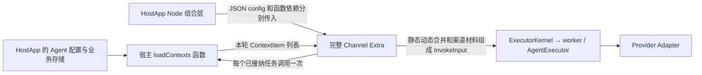

# Channel 逐轮加载宿主 Context 与插件封装

## 1. 目标与当前状态

HostApp 中的 Agent 提示词、项目说明或业务规则可能随时变化。仅把这些值写入启动时的 `config.bots[i].context`，运行中的 Channel 就只能使用该配置快照；修改宿主数据库不会修改这份快照。为更新提示词而重建整个 Extra，会中断其管理的连接。

采用 `extra(context, jsonConfig)(dependencies)`：宿主在初始化时注入一个 `loadContexts` 函数，Channel 在每个已接纳的普通任务真正开始准备时调用它。**函数只装配一次，业务数据每轮读取。** 宿主更新该函数读取的数据后，无需重启 Channel Gateway、Kernel 或 worker，也无需调用内部 Bot 更新接口。

Gateway/WeCom 使用两阶段函数入口和逐轮覆盖。HostApp 通过 `createExtraService({endpoint, module, config, dependencies})` 后 initialize，在当前进程直接注入函数；不经依赖代理或 dependencyModule。CLI 的 channel-gateway 使用 JSON 静态配置。具体初始化见 [SDK 指南](../../SDK_CHANNEL_GATEWAY_GUIDE.md)。真实 IM 验收单列记录。

## 2. 所有权与封装



图表示逻辑调用关系。Extra 与函数在调用进程直接装配，执行请求经 Kernel 进入内部 worker 的 AgentExecutor，不传输业务函数源码或对象。

| 责任方 | 负责什么 | 不取得的控制权 |
| --- | --- | --- |
| HostApp | 决定提示词、业务项及顺序，读取和授权业务存储，实现函数；通知整体 load/unload/stop | 不取得 manager、Bot、连接、队列或 session store |
| SDK/loader | 创建运行环境和停止信号，注入已有模型执行端口，调用两阶段入口并管理清理 | 不解释提示词，不扫描宿主存储，不实现 Agent 数据源 |
| Channel Extra | 消息准入、调度、逐轮调用函数、合并快照、追加渠道材料、调用模型与投递 | 不接管宿主数据库，不提供逐 Bot 原地更新控制 |
| Host/Adapter | 校验和执行本轮显式请求，按合同渲染普通 Context、传递可信控制指令 | 不调用业务加载函数，不缓存或补齐历史 Context |

业务函数是一个窄的取值入口。向 Extra 注入函数不等于替换其核心执行依赖，也不要求业务方实现 invoke、cancel 或 Provider。`ExtraContext` 的生命周期环境与模型 Context v3 是不同对象。

## 3. 函数合同与调用时机

```ts
type LoadContexts = (
  botConfig: JsonObject,
  options: { readonly signal: AbortSignal }
) => readonly ContextItem[] | Promise<readonly ContextItem[]>;

interface ChannelDependencies {
  readonly loadContexts?: LoadContexts;
}
```

`config` 始终为普通 JSON 对象。函数通过 initializer 的独立参数注入，不写入配置文件、SDK descriptor 或 Context；不保存 lambda 源码，不做 eval，不经过跨进程代理。类型见 [context-loader.ts](../../packages/octo-runtime-host-sdk/src/context-loader.ts)。

第一参数是当前 Bot 的独立完整配置快照，不是整个 `bots` 数组，也不含本轮消息、session 或 manager。宿主可按 `bot_id` 及自身已授权映射查 Agent；多环境、多租户不能只凭裸 Bot ID 决定授权。Bot 配置可能含凭据，不记录整个入参。需要更多数据的业务必须在宿主函数内部按其已有业务作用域读取，当前接口不承诺按发送者或消息内容选择材料。

第二参数的 signal 关联本轮停止、Extra 卸载和加载超时。同步内存读取可直接返回数组；数据库或 HTTP 读取可返回 Promise，有 IO 的实现须向底层传递取消信号。await 不会创建工作线程，也不能中断同步死循环。返回值必须是普通有限 JSON item 数组，不是 `{ schema, items }` envelope。

每轮流程：

1. Channel 完成现有消息准入、去重及队列接纳；控制命令不触发此回调。
2. 任务真正轮到准备时，申请该 Extra 的动态加载额度；调用一次宿主函数。等待队列中的消息不会预先保存一份旧动态结果。
3. 校验回调结果，与该 Bot 的静态项合并，形成独立数据快照。
4. 追加本轮渠道材料，继续检查协议预算、权限和必要执行配置，提交公开 `InvokeInput`。
5. 本逻辑轮的既有 Provider 重试复用该快照；下一条新任务重新读取。同一项在不同任务显式提交时不去重。

回调读取期间更新数据时，本轮拿到哪个业务版本由宿主存储的一致性保证决定。交付后的数组不得并发修改；Channel 创建自有快照后，宿主后续修改不改变本轮输入。不向已运行的任务追写新提示词。

## 4. 静态默认值与动态值如何覆盖

静态基线来自 `config.bots[i].context.items`，在 Extra 加载时成为配置快照，随后每轮参与组装。未提供函数时仅使用该基线。提供函数时，按 **`(namespace, name)` 二元组**匹配：

| 输入情况 | 结果 |
| --- | --- |
| 静态 `[A, B]`，动态 `[B2, C]`，B/B2 同 key | `[A, B2, C]` |
| 同 key 的 payload、guidance 或 entries 不同 | 用动态整项替换，保留静态项原位置；旧字段不补回 |
| 动态 key 在静态中不存在 | 按动态返回顺序追加到静态列表末尾 |
| 动态返回 `[]` | 保留全部静态项；不表示清空、不删除静态项 |
| 某一动态项在下一轮未返回 | 下一轮重新从静态基线计算，不沿用上一轮动态结果 |
| 同一个输入列表内部重复 key | 拒绝该轮，不以最后一项掩盖错误 |
| 返回 undefined/null、抛错、超时或校验失败 | 本轮准备失败，不 invoke，不用旧动态结果或静态项掩盖加载失败 |

合并只发生在 Channel 业务边界。它不是通用执行层的自动补背景，也不是协议 `mergeContext` 的特殊字段合并。没有 payload 深合并、entries 拼接、删除标记或跨轮累计。渠道自行生成的身份、来源和消息项继续受现有冲突及权限校验约束，函数不能借此伪造真实消息身份。

系统指令例子，静态项为：

```json
{
  "namespace": "octo.control",
  "name": "instructions",
  "payload": {
    "entries": [{ "text": "我是明略科技的Octo助理" }]
  }
}
```

动态返回同 key 时，应显式构造最终完整列表，例如：

```json
{
  "namespace": "octo.control",
  "name": "instructions",
  "payload": {
    "entries": [
      { "text": "我是明略科技的Octo助理" },
      { "text": "回答前先核对宿主提供的项目规则。" }
    ]
  }
}
```

最终只存在这一份动态 instructions，条目按序用单换行连接；每个条目只有 `text`，不使用 `source`。如果动态项只含第二条，静态人设也会被替换。当前“固定人设”指默认正文固定，不表示该项不可覆盖。仅需逐轮补充普通业务材料时，使用宿主自己的 `extra.<domain>/<name>` 项，可保留静态系统指令。

**取得最新系统指令不等于已有 Provider 会话已应用它。** 当前可信指令按新 Provider 会话初始化合同处理，正常续聊不重复注入；动态加载不暗中 reset 或新建会话。需要新 system 指令实际生效时，由业务方显式新建/reset，随后下一轮重新读取；插件和 Kernel 均无需重启。普通业务 Context 则按本轮材料传入。全 Provider 的新建/续聊/reset 矩阵仍待验收，不能承诺所有 Provider 都支持会话中替换 system。见 [Context 会话时机](../rules/context-input.md#系统指令的会话时机与协议变更)。

## 5. 哪些变化需要生命周期操作

| 变化 | 宿主动作 |
| --- | --- |
| 已注入函数读取的 Agent 提示词或业务存储发生变化 | 更新宿主存储；下一轮读取，无需 unload/load |
| 宿主内存保存的当前版本发生变化 | 替换当前值；函数每次读取该当前值，不把旧版本塞入历史数组 |
| JSON 中的静态 context、Bot 集合、凭据、连接或执行配置变化 | 按既有整体卸载、保存完整配置、重新加载合同处理 |
| 要替换 loadContexts 函数实现或其他函数依赖引用 | await unload 后以新函数 load；不修改运行实例内部依赖 |
| 退出、登出或更换账号 | 宿主通知对应整体生命周期，SDK/loader 协调 Extra 清理；不依赖业务函数自行察觉退出 |

函数依赖对象被浅复制并冻结，只固定本实例的函数引用，不冻结宿主数据库或函数读取的数据。模块入口仅返回 initializer，initializer 的返回值仍为 void/Promise<void>；不借本需求返回一个可操控内部对象的新插件实例。

## 6. 有界资源与失败

顶层 `config.context_loading` 可设置 `timeout_ms` 和 `max_in_flight`，默认分别为 5000 和 8，范围分别为 1..30000 和 1..32。额度由整个 Extra 的所有 Bot 共用；不另建回调等待队列，满额直接使本轮准备失败。

超时只结束等待并发出取消，不能强制结束业务 Promise。实际操作 settle 前继续占额，避免不断超时又不断启动新 IO；迟到结果不进入模型，迟到拒绝也被消费。卸载先 abort，按既有 5 秒清理宽限等待；清理失败保留失败实例并阻止同名重载，不能靠反复重载叠加未完成操作。

输出经有限 JSON 预检及 Context v3 校验。静态、动态、合并结果及追加渠道材料后的最终 envelope 均受协议预算约束：最多 32 项、65,536 字节；不能返回满额后假定渠道材料不占预算。结果只属于本轮及已有有界重试快照，不增加 lastContexts、session 缓存、后台轮询或历史版本集合。

这能约束框架保留的动态加载资源，不能隔离任意宿主 JS 的内存分配。业务函数仍须避免无限缓存、未取消的外部 IO、大对象闭包和同步阻塞；详细成本和验证见 [内存合同](../tasks/extra-initializer-context-dependencies/memory.md)。

## 7. 实施与验收入口

2026-10-17 [宿主完整 SDK 接入专项](../tasks/sdk-host-extra-contexts/brief.md)已完成本地 SDK 实施，按 H01–H06 描述准备、启动、函数注入、数据更新、状态、重载和退出。数据流和生命周期接线放在 SDK 内部附录，宿主不创建 loader 或内部执行桥。第三方 App、demo 迁移及真实 IM 验证按用户要求留在后续范围。

核心位置为 [共享加载与合并](../../packages/octo-runtime-host-sdk/src/context-loader.ts)、[Gateway 装配](../../packages/octo-runtime-extra-channel-gateway/src/extra.ts)、[Gateway 每轮准备](../../packages/octo-runtime-extra-channel-gateway/src/application/im-channel.ts)、[WeCom 每轮准备](../../packages/octo-runtime-extra-channel-wecom/src/application/im-channel.ts)。对应核心注释说明函数/数据边界、覆盖和资源所有权。

历史 loader、SDK、GC 和 im-test 证据保存在[此前交付记录](../journal/shared/2026-10-17-extra-initializer-delivery.md)与[旧 SDK 记录](../journal/shared/2026-10-17-sdk-host-extra-contexts.md)，仅说明当时拓扑。当前统一原生服务的测试与待验项见[实施记录](../tasks/unified-native-sdk-services/implementation.md)，旧结果不能代替本次验收。
