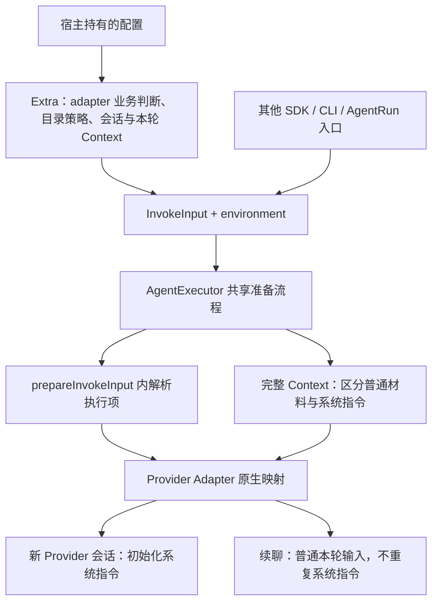

# IM Agent 与通用 invoke 的责任边界

## 架构决策

IM 入口管理长期 Agent；`AgentExecutor.invoke(input, environment)` 执行调用方已经确定的一次请求。二者使用同一执行链，但承担不同责任。本文中的“IM Agent”指 Channel Gateway 管理的 Bot/Agent 业务，不是新增名为 ImAgent 的通用接口或组件。

本期 IM Agent 使用固定 workdir，对标当前 OpenClaw 接入保留 Provider Agent 工作区的方向。不同聊天、sessionId 或 reset 不产生新目录。每会话目录不是需求，固定目录也不是待开发功能；它是 IM 业务的架构约束。通用 Host 仍按已有执行合同处理调用方提交的目录配置，不因此被改造成固定 IM Agent 管理器。

这里的固定目录属于 IM 后台配置对应的 Agent：该 Agent 的所有任务使用同一个配置目录，不随任务 workdir 或 workspace Context 改变。IM 入口不是允许每个任务另选工作目录的通用执行入口；任务参数不能充当 Agent 配置更新。

2026-10-16 F16 评审中，用户指出旧实现混合了 ChannelGateway 与 AgentRun 的责任，进而引入逐会话目录等不符合当前需求的功能。新架构必须将渠道会话生命周期与执行工作区生命周期分开。本文中的 AgentRun 指单次 Agent 执行职责，不表示新增组件或协议类型。ChannelGateway 使用业务方已确定的 Agent 配置；执行层按执行合同校验、准备和使用目录。渠道会话变化不能自行产生目录切换、迁移或清理要求。具体意见见[F16 评审](../tasks/gateway-august-feature-assessment/assessment.md#逐项-reviewf16-逐会话工作目录)。

## 责任归属

| 事项 | IM 业务入口 / Channel Gateway | 通用 AgentExecutor 与 Provider Adapter |
| --- | --- | --- |
| Agent 身份与配置 | 选择本次使用的长期 Agent、Bot 配置及业务默认值 | 根据已提交的执行配置调用 Provider，不维护 IM Agent 注册或业务配置 |
| adapter 与执行准备 | 读取 adapter 选择用于业务判断，组装公开 InvokeInput | Core 唯一解析执行配置、构造内部请求并调用所选 Adapter；Extra 不重复准备 |
| 工作目录 | 按 IM 后台 Agent 配置使用固定目录，不接受任务级目录切换；OpenClaw 可由 Provider 管理 | 校验和准备本轮已解析的目录；Provider 原生限制继续执行，不自行决定业务目录生命周期 |
| 会话关联 | 管理频道到业务 session、generation、Provider binding 的有界映射 | 接收本轮身份与 opaque Provider session，返回真实会话及恢复结果，不自行维护频道映射 |
| reset | 拦截业务命令、清除 binding 并切换会话代次；不切目录、不删文件、不等同取消 | 不解释 IM 的 /reset 命令，不根据新 sessionId 创建目录或删除旧会话文件 |
| 历史与 mention 指引 | 决定本轮查询、构造、顺序与提交时机 | 校验、转发及固定渲染本轮 Context，不按会话补齐或去重 |
| 消息与投递 | 处理 IM 身份、触发条件、图片下载、最终文本与 mention 投递 | 消费通用输入、输出执行事件；不读取频道成员或理解 IM 通知语义 |
| 故障恢复 | 按业务证据与预算决定是否再次 invoke，避免重复副作用 | 一次 invoke 报告真实结果；Provider 原生恢复按其合同执行，不自动升级为 IM 业务重跑 |

“单次执行”不表示每次必须新建 Provider 会话。同一 Provider 会话可以供后续 invoke 显式续接；业务 sessionId、Provider sessionId、调用 invocationId 与工作目录是不同概念，不互相推导。

## 执行准备与系统指令调用视图

2026-10-16 用户确认以下责任边界。Octo / WeCom dispatcher 的重复 resolver 和内部请求构造已删除，双渠道直接提交公开 InvokeInput。图表示 Core 内部准备关系，隔离入口在到达 Core 前经过 Kernel IPC 和 worker，显式 direct 模式在宿主内调用同一 Core。

Extra 在发起调用时读取当前业务配置并冻结本轮输入，不要求在启动时固化提示词。Extra 可以读取 adapter 选择，但不得调用 `resolveLocalContext()` 或先生成内部 `InvokeRequest` 再转回公开输入；业务默认值和目录约束继续在 Extra 处理。Host 负责将执行项交给执行 resolver，完整 Context 进入共享渲染与指令处理路径。

普通业务 Context 是否逐轮发送由发起方决定，底层不缓存补齐或去重。`octo.control/instructions` 使用独立系统指令通道，续聊不重复初始化；需要更换系统指令时，业务显式新建或 reset Provider 会话。不能以减少重复 system 为由省略普通本轮 Context，也不能把 system 转成每轮用户正文。

当前 instructions 的 entries 只包含 `{ text }` 并以单个换行拼接，source 已删除且不兼容。故障链、易错做法和调试顺序见[排查经验](../journal/shared/2026-10-16-im-invoke-preparation-lessons.md)，实际字段由[协议 Schema](../../packages/octo-runtime-protocol/schema/protocol.schema.json)校验。

## 目录能力与产品策略不能互相替代

通用执行合同已有固定及随机目录准备能力。调用方可以在权限、mandatory 配置和 Provider 约束允许的范围内，为具体任务显式选择目录。这不表示 IM 必须提供“一个 sessionId 一个新目录”的产品功能。Host 不根据 sessionId 自动发明目录映射，也不能把 IM 的固定目录策略扩展为所有 SDK/CLI 调用方必须共享同一目录。

同一 IM Agent 执行不同任务、在 DM/群/话题间切换，以及 `/reset` 后，仍使用其配置的固定目录。任务级 workdir、workspace Context 均不构成目录切换依据。宿主显式修改 Agent 配置是另一种操作，不能用任务参数或 reset 隐式代替。已有文件和 Provider 原生历史不因本决策被清理。

当前实现依据：[IM 请求与目录选择](../../packages/octo-runtime-extra-channel-gateway/src/execution/dispatcher.ts)、[IM 会话与 reset](../../packages/octo-runtime-extra-channel-gateway/src/application/im-channel.ts)、[Host 执行准备](../../packages/octo-runtime-executor-core/src/execution-preparation.ts)、[通用输入合同](../rules/invoke-input.md)。具体固定目录取舍见[原专项决策记录](../tasks/channel-fixed-workdir-decision/brief.md)。

## 后续设计与评审要求

1. 先说明规则属于 IM Agent 业务、通用执行合同还是 Provider 原生限制，再确定修改模块；不得把业务默认策略直接写成所有 invoke 的框架要求。
2. 区分“底层已有能力”和“当前业务明确需求”。不能因为 Host 有随机目录能力，就推导 IM 需要每会话目录；也不能因为 IM 使用固定目录，就删除其他调用方显式配置目录的能力。
3. 涉及 session 时分别说明业务会话、Provider binding 和本次调用的变化。若涉及目录或文件生命周期，必须有独立明确需求，不能从 sessionId 改变自动推导。
4. 架构决策不计入功能开发计划准备度。实现若偏离规则，另列具体缺陷、证据与修复范围，不把“保持固定目录”重新包装为新功能。
5. IM 目录变更必须来自明确的 Agent 配置更新；不能把通用 InvokeInput 的 workdir 字段解释为 IM 任务可覆盖 Agent 目录的授权。实现核对覆盖任务级 workspace 输入，不能只验证 reset 前后路径相同。
6. 不得混合 ChannelGateway 的渠道接入责任与 AgentRun 的执行责任：Channel 负责本轮业务输入、会话关联和结果投递，执行层负责既定请求的执行、权限/审批、原生适配及取消/资源回收。不能因执行层存在目录能力就给 Channel 新增目录生命周期，也不能因 Channel 的固定目录策略删除其他调用方合法的目录选择能力。

本文定义责任约束。2026-10-16 已在 IM 入口补齐任务目录不可覆盖校验，历史与 Mention 由 Channel 构造；具体实现与 im-test 验证范围见[交付记录](../journal/shared/2026-10-16-channel-features-delivery.md)。通用 Host 目录能力未因本决策改变。
