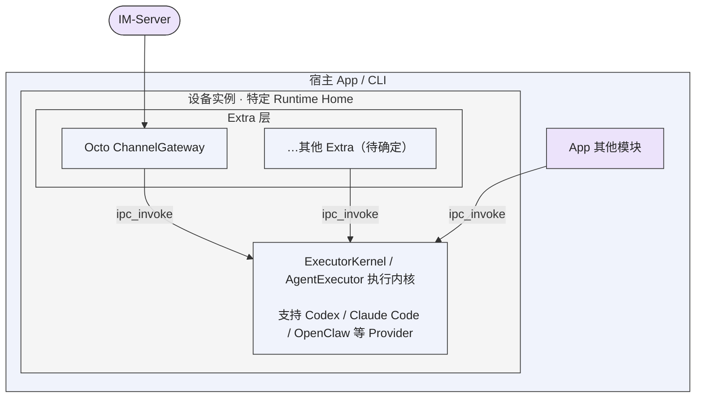

# Octo Runtime 基础架构

## 统一原生服务构造与部署边界

2026-10-20，Issue #71 及用户补充明确以下强制架构原则。统一服务 API 在本 worktree 落实，见[实施记录](../tasks/unified-native-sdk-services/implementation.md)。`main@fae6333` 的 `startOwnedKernel`、`startExtra` 及 runner 绑定装配已移除，不能以历史验收为由恢复。

1. **CLI 服务进程与 Electron 主进程必须严格原生、直接构造对应服务。** 两者导入相同公共服务工厂，使用相同配置/依赖形状和 initialize、status、执行/控制、close 签名，调用同一真实实现。Kernel socket 必须由调用进程监听；Gateway 控制 socket 如启用也必须属于该调用进程。不得通过外部 Node、Runtime CLI 或其他进程代替服务启动。
2. **服务对象所有权不等于另一个 OS 进程所有权。** SDK 管理自己构造的服务对象及其资源；CLI/App 管理宿主进程和部署。严禁 `startOwnedKernel`、`OwnedKernel` 及同等语义的专门 launch/restart 合同；不得换名、加兼容 alias、包装成可选便利函数或移到宿主 supervisor 后保留相同路径。`startExtra`/`OwnedExtra` 的必经进程启动合同同样删除，抽为普通可导入服务。
3. **部署拓扑由宿主决定，构造实现不得分叉。** CLI 的 `executor-kernel start` 与 `channel-gateway start` 分别管理独立服务进程，各自 run 入口直接调用 SDK。Gateway 仅连接指定 Kernel，不能创建、启动或关闭 Kernel。Electron 主进程通过相同 API 原生构造所需服务。不得将该要求误解为所有 CLI 服务合进一个常驻进程。
4. **内部执行隔离与服务部署分别设计。** worker 可以基于明确隔离需求执行唯一 AgentExecutor，Adapter 可以启动合法 Provider CLI；二者都不能成为另一个顶层 Kernel/Gateway。计划必须列出执行位置、服务拥有的资源和进程、Electron 实际运行机制。不得向原生宿主增加外部 Node 安装、版本或 executable 选择要求；不能用修改宿主 fuse 策略或 source patch 掩盖 Runtime 缺陷。
5. **一份调用合同、一份生命周期实现。** 普通业务执行统一使用 KernelClient.invoke，低层 primitives 保留给明确需要的调用方；不得建立 Extra 专用执行层或让业务方复制 submit/subscribe 组合。invoke 自动登记，服务 close 自动完成所属调用的停止接纳、取消和排空，不得要求普通业务调用方额外手动触发 client.invocations。所属 Run 登记/取消/排空是服务内部资源管理，不是第二个 invoke。停止 Gateway 只影响自己的 Run 和资源，不能关闭 Kernel、其他 Extra、无关 Run 或宿主数据库。
6. **功能测试通过不能豁免架构。** 每个涉及装配/生命周期/进程的 brief 必须声明服务与进程拓扑、composition root、资源所有权、公共接口和删除映射。库内评审以 CLI 直接加载共同公共 SDK 为主要验证路径，核对真实调用链、包外普通 SDK 严格类型 fixture 和实际 PID/socket 所有权；名称扫描不足以证明不存在换名替身。其他原生宿主遵循相同接口与实现，不为其另建装配路径。外部 Electron 的打包/版本/真机集成不作为库内改造前置条件，也不因 CLI 通过而宣称已实测。
7. **失败事实与既有数据必须保留。** 分开定义服务、客户端连接与已接纳 Run 的生命周期。初始化回滚、重复 close、尾流排空、未结束依赖和 incomplete 需共同覆盖，不能用进程退出假报完整清理。接入改造不授权重置 Home、machine/profile/runtime identity、凭据、配置或应用 SQLite，也不授权消费方依赖未合并的私有 Runtime 补丁。
8. **SQLite 由宿主 App 维护。** 应用数据库的创建、连接、迁移、事务策略和关闭均归宿主；Runtime SDK 与 Extra 通过宿主提供的业务依赖访问数据，不创建或接管应用 SQLite，不在 initialize、失败回滚或 close 时关闭宿主数据库。停止 Extra 时先停止新调用并报告实际在途操作的清理结果，数据库何时关闭仍由宿主决定。CLI 作为宿主也遵循此边界。
9. **业务准入、取消通知与依赖权限分开。** close 立即停止新 invoke 并通知插件停止新任务，已有任务和 disposer 可在共同截止内调用注入函数完成保存与投递。插件清理结束或到期后，必须在进入宿主函数前拒绝后续调用；最后等待全部已开始的真实操作，不能仅等待取消时的集合快照。插件负责等待自己的业务消费者；SDK 不从函数名推断用途，也不能强停已开始的宿主函数。
10. **公开迁移必须通过实际发行包验证。** 删除旧接入 API 时，为仍支持的内置模块保留公开入口。只安装主包 tgz 的包外工程须能严格编译、原生构造、初始化、查询状态及关闭，静态资源也必须可读；workspace 内导入成功不替代此证据。

本节约束优先于旧任务和实现说明中的 launcher 设计。具体接口合同、迁移与验收见[设计](../tasks/unified-native-sdk-services/design.md)、[迁移](../tasks/unified-native-sdk-services/migration.md)和[验收矩阵](../tasks/unified-native-sdk-services/acceptance.md)。需要变更服务构造或新增进程时，必须先按本节检查；不得以“能启动/能调用”为唯一完成标准。

## ExecutorCore 抽取后的执行边界

接入通过原生 SDK 服务及 Kernel IPC，服务直接构造在宿主选择的服务进程中；尤其是 Electron，Kernel 服务在主进程构造，不能由外部 Node 代启。执行隔离由 Kernel 内部 worker 承担。允许宿主显式选择直接嵌入 Core，但它不是 CLI/Electron 服务合同的替代分支。历史实现证据见 [Kernel/Host 实施记录](../tasks/executor-kernel-host-lifecycle/implementation.md)，其中 owned launcher 已由上节否决。

#46 将唯一执行实现收敛到 `octo-runtime-executor-core` 的 `AgentExecutor`。主发行物公开
`@mininglamp-oss/octo-runtime/executor-core`，宿主可显式注册 Adapter 并直接执行，不需要
Kernel、IPC、Extra、云端账号或进程信号接线。默认链路由 executor-kernel 监督独立
worker，通过 stdio NDJSON 调用同一实现；旧 adapter-host 包和 AdapterHost 类别名已删除。

直接执行与宿主共享进程故障域，不能隔离 process.exit、OOM 或同步阻塞。Core 负责输入准备、
本轮固定渲染、接纳身份、执行、交互路由、取消和正常终态；不加载业务、安装 Provider 或保存
业务历史。实例所有者必须检查 shutdown 的 cleanup 结果，closed 不等于资源已回收或 Home
锁可释放。失败或未确认的 iterator 清理持续报告 incomplete，不得用再次 return 的空操作
宣称清理成功；后续 shutdown 只能继续观察尚未结束的清理。具体 API 和限制见 [Core](../../packages/octo-runtime-executor-core/README.md)。

### KernelClient 与 AgentExecutor 的选型合同

两种入口共用 InputInvoke 类型和 invoke(input, environment?) 签名：相同的 InvokeInput 业务结构、独立的本地环境，以及 native/default 的 HostFrame 或 canonical 的 CanonicalEvent 异步输出。相同输入契约不表示相同的执行拓扑、故障影响、环境选项或控制 API；Adapter、配置和运行环境仍须由相应宿主装配。

产品默认推荐 KernelClient，依据是执行与宿主的进程隔离、worker 监督和原身份/原游标的有界恢复。原生服务的 client、attached client 及 Extra 的 ctx.kernel 使用此路径；Kernel 服务本身在调用进程，执行隔离来自内部 worker。本地 IPC 在 macOS/Linux 使用 Unix socket，在 Windows 使用 Named Pipe。直接 AgentExecutor 无需 IPC，适用于宿主明确接受同进程故障影响并自行管理 Adapter 与实例清理的接入。

提前关闭 Core 执行 iterator 会请求取消；关闭 Kernel 观察 iterator 或 client 仅停止观察，不隐式取消已接纳 Run。Core 所有者调用 shutdown 并检查 cleanup；原生服务所有者调用 close 并检查 complete，Extra 服务内部自动排空所属 invoke。仅高级 attached 调用方自定调用所有权策略时才直接使用 invocations.stopAdmission/drain。两条路径的 signal 都请求取消，不能把取消接纳当作执行终态。直接 Core 支持 environment.streamLimits，当前 Kernel wire 对该本地选项明确拒绝。

不得把产品推荐解释为每次执行必定成功：worker 重启不重跑旧 Run，恢复预算或源窗口不足明确失败，lost/结果未知仍不得报告完成。选型对照和适用场景见[架构讲解](../../ARCHITECTURE.md#接入选型产品默认推荐-kernelclient)，精确恢复合同见[本地执行](local-execution.md)。

App 和 Extra 直接使用同一个 KernelClient.invoke，Extra 通过 ctx.kernel 获得实际 client。提交、身份关联、订阅与有界恢复由 Kernel 包统一维护，Gateway 消费调用结果做 delivery；不建立第二个 Extra 执行 API。服务 close 内部复用 invocations.stopAdmission/drain，未知或 lost 不得视为清理完成。

Executor Kernel 提供本地 IPC、源窗口和 worker 监督；Host SDK 独立管理 Kernel 与各 Extra。
旧 daemon app、包、bin、CLI 命令和 API 已删除，不保留兼容包装。LoopDaemon 是另一项目的
Go 二进制，不在本仓实现；平台和真实业务验收按各自实际证据报告。

## 实现语言与原生依赖边界

2026-10-20 用户明确：**Octo Runtime 的 Kernel 和公共层采用 TypeScript / Node.js；业务 Extra 的原生依赖是独立边界。** 本约束适用于 Executor Core、Executor Kernel、Host/Adapter SDK、公共协议、传输和进程管理等框架代码。

- **公共层不引入原生实现。** 不为框架能力新增 Go、Rust、C/C++ 辅助程序、Node 原生扩展，或随包分发、安装时下载的分架构 `.exe`、动态库等运行时二进制。不得为了 Windows 进程清理引入原生 Job Object broker，也不得把编译工具链、二进制构建、摘要校验和分发变成公共 Runtime 的依赖。
- **平台差异留在 Node.js 合同内。** 使用 Node.js API 和操作系统已有命令实现常规生命周期管理，明确实际保证及限制。Windows 的 `taskkill /PID … /T /F` 依赖仍可识别的进程树；父进程先退出、Runtime 被强杀或事件循环无法运行时，不承诺后代必然清空。现有 Windows 清理在 leader 已退出时可能返回成功；`cleanup.complete` 仅反映既有观测范围，不能证明此时全部后代已清空。已观察到的清理失败须如实报告，不得把不可观测场景写成已解决的强保证。
- **业务 Extra 可以拥有原生依赖。** 原生实现、构建、打包、安装和清理由对应 Extra 自身负责，保持可选且隔离，不成为 Kernel 或公共 SDK 的启动、构建或发布前提。不得把公共进程管理搬入一个 Extra，以绕过本约束。
- **调用外部程序不等于内置原生实现。** Adapter 调用宿主选择的 Provider CLI、业务 Extra 使用 octo-cli，以及 SDK 启动调用方显式提供的外部组件，仍按各自已有合同执行；不因此授权 Runtime 自带通用原生辅助程序。用于验证这些外部组件合同的测试 fixture 也不构成产品运行时依赖。

本次 Windows 清理方案不属于原生例外，必须撤除已有 Go broker、专属构建及二进制分发接线。未来若确有公共层原生实现的必要性，应先明确需求、替代方案、维护成本和例外边界，并取得用户明确授权；实现方不能自行以必要性为由突破本约束。

## CLI 使用与 SDK 原生接入

**SDK 是 Octo Runtime 的主要接入方式。** 不同团队维护各自的 HostApp，经 SDK 装配并使用统一执行能力。用户明确 Buddy 就是由其他团队维护的宿主产品；其产品策略、认证、配置、凭据保护和应用生命周期由该团队负责，Runtime 团队维护通用 SDK、执行合同及其实现。

本文的“官方 Runtime CLI”仅指 **`octo-runtime` 可执行程序**，由 `npm install -g @mininglamp-oss/octo-runtime` 安装；后文涉及宿主、装配和运维时使用 `Runtime CLI（octo-runtime）` 称呼。`octo-cli` 是另一项业务工具，用于消息、文档、文件等操作，不是此处的 Runtime 宿主 CLI。两者的用途、配置及凭据责任不得因都称为 CLI 而混同。

Runtime CLI（octo-runtime）是 Runtime 团队基于 SDK 维护、提供开箱即用能力的一个特殊宿主工具。它与 Buddy 或其他自研宿主同属 SDK 的使用方；其特殊性在于维护方和预置装配，不在于拥有额外的架构决定权。不得从该宿主的目录、JSON、配置来源、安装集合或服务管理约定推导其他 SDK 宿主必须遵循的合同。Runtime CLI 和桌面只是宿主示例，不将 HostApp 限定为两种固定形态。

CLI 面向云端设备的定制接入、部署和运维，默认包含全部 Adapter、Extra，以及系统管理、开启自启等服务能力。发行物包含组件不表示安装后全部 Extra 已启用或系统自启已注册；启用与注册按各自配置和命令执行。

Electron、Tauri 2 桌面程序严禁通过 CLI 接入，必须使用 SDK。宿主通过 SDK 管理装配、配置、执行及生命周期，不把 CLI 可执行程序、终端输出解析或 CLI 系统服务作为业务接入层。SDK 在调用进程原生构造服务，管理内部执行 worker 和合法 Provider 子进程不构成外部服务代启；SDK 不管理另一个顶层 Kernel/Gateway 启动器。SDK 宿主自行选择依赖和配置来源，不继承 CLI 的全量集合或文件约定。

## octo-cli 的业务定位与产品价值

**octo-cli 是由业务团队共同维护、使用 Go（Golang）开发的二进制可执行程序。** 它主要提供 Octo 生态各业务子系统的 API 调用能力，包括消息、文档和文件等业务操作，供 Agent 在工具循环中使用。它与 Runtime CLI（octo-runtime）是不同程序：前者提供业务操作，后者是 Runtime 团队提供的特殊 SDK 宿主；不得将两者的维护责任或用途混写。

octo-cli 是 Octo 场景的重要产品能力。用户明确：对使用 Octo Runtime 的产品，特别是 ChannelGateway 的 IM Channel，宿主预置并正确配置 octo-cli 后，用户体验可以产生质的提升。Agent 可以在对话中按任务读取业务材料、调用业务 API、发送消息及交付文件，减少用户手工跨系统操作，使“对话”能够完成实际业务任务。该价值判断不表示本轮已测量体验提升，也不声称每个宿主或 Provider 已预置并验证全部业务能力。

面向 Octo 业务的宿主在产品装配时，应将是否预置 octo-cli 作为重要产品决策，并明确工具可执行位置、业务身份及使用指引。是否提供、安装哪个版本和如何安装仍由 HostApp 决定；预置价值不授权 SDK、Channel、Host 或 Adapter 在接收消息或执行时隐式安装。业务指引由 Event 发起方通过 Context v3 表达，凭据沿独立执行环境及既有身份合同传递，不进入模型文本。模型在工具循环内的具体业务动作由 Agent 调用 octo-cli 完成，不能因其重要而把模型业务任务搬进执行内核或 Channel；Channel作为Event发起方按已确认合同固定准备规则、历史等输入，直接使用API层，不依赖CLI预置。

业务团队维护 octo-cli 的业务 API 能力与工具合同；宿主团队负责产品装配和配置；Runtime 团队负责通用执行及身份传递合同。这样的组合既能让产品具备完整业务操作能力，也能使内核保持跨业务复用。具体示例与边界见[工具调用决策](../journal/shared/2026-10-16-agent-toolcall-channel-boundary.md#octo-cli-的维护归属与预置价值)。

## 强制定位：执行基础设施不得代替产品决策

2026-10-16 用户再次明确：Octo Runtime 是供 SDK 嵌入、CLI 和不同业务入口使用的执行基础设施。框架提供协议校验、合同内配置解析、传输、原生适配和真实结果返回；不得自行定义或修改产品的用户体验意图。本节是后续需求、方案、实现及评审的强制范围检查，不是仅适用于 Plan 的局部建议。

- **业务方拥有意图。** 行为模式、思考强度、模型选择、界面是否提供某项能力，以及新建/续接/继承/重置会话的产品策略，由各产品或业务入口决定并输入。不同产品可有不同策略；Runtime 不将某产品选择提升为所有接入方的默认行为。
- **Runtime 忠实执行合同。** 对显式输入只做已定义的校验、配置解析、完整传递和 Provider 原生映射；转换载体不改变语义。不猜测意图、不自动增加选择、不强制每轮重设模式、不因省略字段而擅自新建会话或恢复上一轮设置。已有明确 defaults / mandatory、权限及身份合同仍有效，但不得借此新增产品默认策略。
- **省略不是隐式产品决策。** 调用方未提供的可选控制，不自动转成 Runtime 的模式重置、会话继承或历史补齐动作。调用方需要稳定的某种体验时，由调用方按其产品规则明确表达；Provider 对省略参数的行为如实记录，不能包装成 Runtime 对用户体验的保证。
- **Adapter 管技术差异，不管产品方向。** Adapter 负责将统一的显式输入转换为原生参数或操作，并返回真实支持/应用结果；无权默认开启实验功能、模拟产品流程或替宿主决定何时切换 Plan。宿主负责是否展示选项以及不支持能力的产品处理。
- **例外必须有明确合同和授权。** 本轮用户允许 actmode 不支持时降级 default，仅限该可选能力的已定义适配合同，不构成通用兜底授权，不改写其他维度或已有 mandatory/权限约束。不把网络错误、上游错误或未知状态扩展解释为可降级条件。
- **不替其他模块修错。** 谁产生错误协议或错误产品输入，谁负责修复。Runtime 返回真实错误或合同规定的未应用结果，不能在下游猜测、补造或改写意图以隐藏上游问题。协议转换与缺陷补偿必须区分；具体责任规则见下文。
- **接入方独立。** IM Channel Gateway 当前产品决定始终普通/default 执行，不配置或接入 Plan。该策略属于此业务入口，不能转成通用 Runtime 的 Plan 开关、拒绝规则或其他产品的默认策略。桌面及自研 App 经 SDK 使用 actmode，按各自产品设计管理。

每个后续需求进入方案前必须回答并写入对应 brief：

1. 不看旧代码和现有兜底，从真实业务动作出发，此需求为何需要存在？
2. 谁拥有决定权：产品/业务、通用执行合同，还是 Provider 原生适配？需求是否确属 octo-runtime 范畴？
3. 调用方明确输入了什么？方案是否在输入之外补造、改变或继承用户体验意图？
4. 谁最先违反合同？是否正在让下游替上游兜底，应改动哪个责任模块？
5. 多个产品共用此 Runtime 时，是否会改变其他产品的默认行为、会话或配置？
6. 每项默认、降级、重试和自动动作依据哪个明确合同及当前授权？没有依据的动作从 Runtime 方案中移除，归还业务方决定。

任一职责无法说明时，不得以“体验更完整”“框架统一管理”或“不加会出问题”为由扩大 Runtime 职责。范围检查不要求用户重新批准已授权的常规工作，应在现有边界内推进。两次误判及修正见[产品意图归属记录](../journal/shared/2026-10-16-product-intent-ownership.md)。

## 配置来源归宿主，SDK 消费配置值

2026-10-16 明确：宿主负责从 JSON、SQLite、云端 Nacos 或自己的其他来源取得配置，完成读取、解密、组合、持久化及更新，再向 SDK/Extra 传入已准备的配置对象。配置源的选择与生命周期属于宿主产品，不属于通用 SDK 或 Extra 的配置合同。

F30 进一步明确宿主及其凭据保护责任：大多数接入通过 SDK 完成，HostApp 可由其他团队维护，例如 Buddy；Runtime CLI（octo-runtime）是 Runtime 团队提供的特殊 headless 宿主。以下列举主要接入方式与此宿主特例，不构成对宿主形态的封闭分类。它属于本仓发行物，不表示它的文件约定属于通用 Runtime/SDK 合同。

| 宿主 | 配置与凭据责任 | SDK/Extra 接收到的输入 |
| --- | --- | --- |
| 经 SDK 接入的 HostApp，如其他团队维护的 Buddy 或桌面应用 | 对应宿主团队决定 Token 的获取、登录授权流程、认证状态管理、存储、访问保护、更新和撤销；自行选择文件、数据库或系统凭据存储，再构造完整配置值 | HostApp 显式传入的声明及 `config` JSON 对象，不要求存在 CLI 配置文件 |
| Runtime CLI（octo-runtime），Runtime 团队维护的特殊 headless 宿主 | 按自己的目录和 JSON 约定读取、保存 Extra 声明，负责该文件及凭据的访问保护、写入完整性和配置更新；当前入口保存到 `<Runtime Home>/extras/<name>/config.json` | 该宿主读取并构造的完整声明及 `config` JSON 对象 |

例如，CLI 将合法配置保存到上述 JSON 并在加载时读取即可，不需要 Extra 再扫描另一份凭据文件；桌面宿主从自己的受保护存储取得 Token 后传入相同对象，SDK/Extra 无需知道 Token 来自何处。宿主更换存储方式时，插件输入合同无需变化。

**宿主业务凭据的来源、持久化与静态存储保护归 HostApp，通用 Runtime/SDK/Extra 不接管。** 不得把桌面宿主的文件权限、加密方式、凭据库或登录授权 UI 写成 Runtime 缺失功能，也不为其在 Extra config 中新增存储机制。SDK/Extra 仍须校验传入值，按实际接入合同携带凭据完成认证并处理真实拒绝，不因宿主已构造 JSON 就跳过权限校验。框架自身拥有的身份、IPC、租约及内部状态仍由框架按既有合同保护；这不是把框架内部安全责任全部移交宿主。

- **SDK/Extra 只消费合同中的实际值。** 例如 Channel 接收 `bf_token` 或 `app_secret`，校验其格式并用于认证；不接受凭据文件路径来代替值，不自行读取文件、查询数据库或配置中心来补齐缺失值。宿主显式注入的凭据回调可以提供已解析的值，存储来源仍归宿主。
- **新增字段先判断业务含义。** 每个字段必须对应消费者实际需要的业务值或执行参数，schema 的 description 说明用途、必填条件及省略行为。不得为“支持多种配置来源”增加 `_file`、`_env`、配置中心地址、存储类型或来源优先级等 SDK 配置机制。JSON Schema 只描述输入约束，接入方自行选择校验器或类型生成工具。
- **CLI 是一种宿主。** CLI 可以拥有自己的 JSON 文件与目录读取约定；Desktop 或其他宿主可以使用 SQLite、Nacos 等来源。CLI 的读取、权限检查和保存实现不得因此成为 SDK 接入条件，也不得下沉到 Extra 的业务字段中。
- **配置来源和业务资源路径分开。** `workdir`、业务资源地址、插件会话状态存储路径及 Runtime 内部状态文件按其各自合同处理；本规则不禁止正常的资源访问和内部状态读写。判断依据是路径是否代表业务需要的资源，还是仅为了取得另一个配置值。

设计和评审必须检查：“宿主若把配置从 JSON 换到 SQLite/Nacos，SDK 的输入合同和消费逻辑是否仍无需变化？”若必须改动，先纠正配置来源越界。后续同类需求统一遵循本节，不因旧代码已有某种来源适配而沿用。Channel 的 `bf_token_file`、`app_secret_file` 及插件内凭据文件读取已删除，调用方需自行解析后传入值；不自动改写既有宿主配置。当前实现与验证见[配置来源责任记录](../journal/shared/2026-10-16-host-config-source-boundary.md)。

本次清理不保留旧凭据文件配置的兼容入口、读取解析、旧模块路径转发、自动迁移或来源回退。该决定只针对这次删除的配置机制，不作为其他历史数据或 Runtime 身份重建的授权。

## 本地信任边界：同一操作系统账号内互信

2026-10-17 用户确认：**Octo Runtime 的本地 app-server 以操作系统账号作为信任边界。同一操作系统账号内、能够访问该实例本地 IPC 的客户端互信，不额外区分宿主 APP 身份。** 这是当前产品明确选择的接入合同，不是暂缓处理的鉴权缺陷。

该合同适用于 Runtime CLI、SDK 宿主及其他同账号本地客户端。Runtime 不为区分这些客户端增加 APP 注册、共享 Token、逐应用授权或相应错误码、错误卡片。这样可让多个本机应用直接复用执行能力，避免引入当前产品不需要的应用身份与凭据维护流程。不同 Runtime Home 区分设备实例和状态，不提供同账号 APP 之间的安全隔离。

本地 IPC 的访问保护由操作系统权限承载，Runtime 按平台合同维护端点权限；POSIX socket 的现有 0600 权限限制其他普通账号访问，不将其描述为 Windows Pipe 的权限实现。同账号互信不取消协议校验、执行权限、审批、取消及资源生命周期约束；真实连接失败仍按既有错误合同返回，由宿主选择展示方式。

此规则仅定义本地 IPC 信任，不将经网络进入的业务请求视为可信。Extra 和外部系统继续承担各自的身份、租户及资源授权检查。后续架构评审不得仅因本地 IPC 未区分同账号 APP，就要求补建应用级鉴权体系。

传输合同见[本地执行](local-execution.md#ipc-v1)，决策来源及文档验证见[同账号互信记录](../journal/shared/2026-10-17-local-ipc-account-trust.md)。

## 宿主函数注入与逐轮业务数据读取

宿主可能将 Agent 提示词和业务 Context 存在内存、SQLite 或远端服务。仅在启动配置里复制这些值，会使后续任务读到旧快照；每次业务数据变化都重载 Extra，又会中断其内部连接。框架也不应为了读取新值而接管宿主的数据库、配置来源或业务查询。

Extra 使用两阶段入口 `extra(ctx, jsonConfig)(dependencies)`：第一阶段同步返回 initializer，由 SDK 在第二阶段传入宿主依赖并等待初始化完成。统一原生服务直接注入函数依赖，配置与函数分开，真实 Promise 完成前持续占额度；执行通过共同 KernelClient，不在 Kernel 内加载 Extra。禁止以独立 runner 或父子依赖代理代替同进程原生装配。

**两阶段初始化与逐轮回调是两个不同时间点。** initializer 在每次加载时执行一次，其完成表示插件初始化完成；Channel 在每个已接纳任务开始准备时，再调用同一个 loadContexts 函数获取本轮材料。宿主修改函数读取的数据后，下一轮读取新值，不重载连接；替换函数引用或 JSON 配置时才整体卸载后重载。SDK 不读取宿主业务存储，不自动决定 Context 内容、顺序或历史补齐。

loadContexts 的返回合同为 `readonly ContextItem[] | Promise<readonly ContextItem[]>`，同步函数和 async 函数都有效。内存或同步 SQLite 查询可以直接返回数组；异步 SQLite/HTTP 查询返回 Promise。SDK 不强制具体数据库或驱动。同步数据库查询仍占用宿主 Node 线程，外面加 async 不会使查询自动转为非阻塞。

回调第二参数提供 `{ signal }`。宿主应在调用前后检查取消，并在底层 IO 支持时传递 signal；不能声称任意 SQLite 驱动都支持中断。超时会终止本轮等待，未结束的实际操作仍占在途额度，迟到结果不进入模型。它不是任意业务代码的线程沙箱。

现行[SDK 指南](../../SDK_CHANNEL_GATEWAY_GUIDE.md#逐轮-context)已使用原生服务与直接依赖注入；库内验证见[Issue 71 实施记录](../tasks/unified-native-sdk-services/implementation.md)。第三方 App 与真实 IM 验证仍单列；独立 Extra 与依赖代理的[历史记录](../tasks/executor-kernel-host-lifecycle/implementation.md)只证明旧实现。

## 设备执行内核、Extra 与外部工具的职责权限边界

F29 已确认采用设备执行内核 + Extra 插件 + 外部工具的分工：Extra 判断业务接入是否准入，并提供明确的业务输入和工具身份；执行内核按统一执行合同处理权限、审批与生命周期，Adapter 负责原生映射；Agent 调用实际工具，工具与服务端检查凭据和资源 ACL。HostApp 负责装配、配置来源和安装决策。获准触发不等于获得发送者个人权限，full_access 不扩大 Bot 资源权限，Context 指引不替代安全校验。

后续方案必须分别说明“谁能触发”“以谁的身份调用”“本地允许执行什么”的责任和依据，不得以统一管理为由重新合成 Channel 权限中心、同义分档、跨 Provider 工具权限矩阵或专用业务代执行层。复用现有合同，真实缺口在最先违反合同的责任组件修复。标准 MCP、Channel 正常通信与 CanonicalEvent 投影、既有执行安全合同继续有效。

当前分工的收益是内核跨业务复用、业务工具与 Provider 分别演进、减少重复策略和状态、明确故障归属。旧 Gateway 将准入、原生权限映射及业务 broker 集中装配的教训，连同后续评审要求，见[架构决策](../journal/shared/2026-10-16-kernel-extra-tool-boundary.md)。F29 的三类职责覆盖 100% 不表示旧隔离机制全量等价，也不抹去 F24 等独立缺陷。

## 业务动作归 Agent tool call，Context 约束行为

2026-10-19 用户澄清两类调用不得混淆：**模型在工具循环中执行的业务动作使用 octo-cli；模型调用前、由 ChannelGateway 作为 Event 发起方负责的固定输入准备，直接调用现有 TypeScript API 层。** 群/话题规则和有界聊天历史属于后者，不需要模型先决定是否执行，也不启动 CLI 子进程。Issue #32 的历史缺口在准备 Context 时固定调用消息同步 API，最多最近15条；Host、Adapter 和 renderer 仍不得预取业务材料。该边界不授权 Channel 代替 Agent 执行文件交付、跨会话发送或通用业务任务。

2026-10-16 用户确认：消息发送、文件上传、附件交付和多文件处理属于 Agent 的工具调用能力。已有 octo-cli 或其他工具能够完成的业务动作，应计入业务能力覆盖，不要求 Channel 再硬编码 API 或业务流程。旧 Gateway 的自动 artifact 收集与投递是历史遗留，不是目标架构。

本约束适用于Agent执行过程中的定制业务流程，不限于文件或消息；不禁止业务Event发起方按已确认合同固定准备输入。非执行基础设施合同所必需的业务步骤、顺序、条件、工具选择和收尾要求，必须由业务发起方通过 octo.context-envelope/v3 表达约束，交由 Agent 在正常工具循环中执行；严禁在 Channel、Host、Adapter 或其他中间层编写专用执行流程、分支或补偿代码代替 Agent。统一 Context 已能表达的约束，不新增同义流程协议、业务执行器或完成钩子。“必要”仅指已有协议校验、权限/审批、原生适配及执行生命周期等责任明确的基础设施合同，不能以模型不稳定、旧方案已有或开发方便作为例外依据。新增例外必须在对应计划中说明不可由 Context/工具表达的实际合同需求及归属；未明确之前不得落成业务执行代码。

需要“生成后自动上传并交付”时，由业务方在其选择的本轮 Context instructions 中表达目标和约束，Agent 在正常工具循环中调用工具并核对真实结果。**严禁 Channel、Host 或 Adapter 在执行结束后硬编码收集 artifact、扫描文件、上传、发送或代替 Agent 补做业务操作的流程**；不得将模型正文、工具输出或 artifact 事件当成执行这些副作用的指令。

工具调用不稳定、漏调或选错时，先在业务方拥有的 Context、提示词、技能和工具说明处对齐，验证真实工具行为；不得修改 Channel 增加特殊业务代执行来掩盖问题。若实际工具、身份传递或原生适配违反合同，则在责任模块修复，不以提示词掩盖代码缺陷，也不让 Channel 代偿。

Context 内容、顺序和发送时机仍由 Event 发起方决定；本规则不授权 Host/Adapter 自动注入、补齐历史指令或要求每轮非空 Context。Channel 的准入、连接、最终回复、CanonicalEvent 卡片投影及标准交互响应按既有合同执行，不扩展为业务工具编排。执行权限、审批、取消和预算合同保持有效。具体决定、指令示例及 F11/F12 状态见[决策记录](../journal/shared/2026-10-16-agent-toolcall-channel-boundary.md)。

## 人格与 SOUL 的注入归业务方

2026-10-16 用户在 F17 评审中明确：人格、persona、SOUL 属于提示词指令内容，其选择、构造及注入策略必须完全归业务方；IM 场景由 ChannelGateway 作为业务 Event 发起方，构造 octo.context-envelope/v3 并提交本轮快照。是否发送、文本内容、顺序、更新及重复发送时机均由业务方决定，不能下沉为通用 Runtime 或 AgentRun 的人格管理功能。

Kernel、worker、HostApp、renderer 和 Adapter 只按已有合同校验、转发、固定渲染或适配本轮显式输入，不得自行扫描、读取或合并 SOUL.md、persona 配置及其他人格文件，不得选择默认人格、强制注入、从历史补齐、按 session 缓存或去重人格内容。业务方需要使用文件或配置中的人格时，由业务方取得并构造 Context；不得以 Provider 隐式读取人格文件代替这条业务注入链路。

普通人格指引可使用业务 extra item，IM 使用 extra.im，无需新增人格专用协议或处理器。指令文本不因名为 SOUL、persona 或由 Channel 提交就自动成为可信控制指令；确需控制通道时必须满足既有来源校验与 octo.control/instructions 合同。人格指引不授予权限、不替代审批，也不授权 Channel 硬编码业务执行流程。

这是已确认的架构约束；现有统一 Context 已能承载这些文本，不表示当前已配置某个人格，也不表示本轮已改变或核验全部 Provider 的原生文件读取行为。本轮仅更新文档，不删除、改写或重建既有人格文件、Provider 数据和用户配置。具体评估见[F17](../tasks/gateway-august-feature-assessment/assessment.md#逐项-reviewf17-人格技能说明与自动指引)。

## 资源地址 Context 与按需取材

2026-10-16 架构决策：文档、网盘文件和内部附件按资源上下文处理。业务发起方选择本轮资源，将真实类型、来源、标识/地址及匹配的获取指引放入统一 Context；IM 使用 extra.im。Provider/Harness 内的 Agent 在正常工具循环中根据任务决定是否及如何调用 octo-cli、下载或读取工具。这里的 Harness 不表示 AgentExecutor 新增资源抓取调度器。

Kernel、AgentExecutor 和 Adapter 不管理文档/网盘业务，不按资源类型自动下载、提取、转写、预取或注入正文。Adapter 继续负责显式输入和工具交互的原生适配；资源地址不必先转换为原生附件才能使用。获取、授权及工具结果归实际工具与服务端，工具安装仍由 HostApp 决定；执行层保留现有权限、审批、取消及预算校验。

资源 Context 与首轮原生媒体输入分别表达意图：前者提供可按需读取的材料，后者由发起方明确要求本轮直接使用图像等原始内容，并走统一 inputs。当前 Codex 独立图片合同保持不变；两条路径均不要求新增业务能力标签、Context Schema 或 Provider 自动改选。统一 Context 的覆盖度按业务材料及行为比较，不因替代旧特殊提示词拼接而扣减。

本决定为已接受的架构方向；Channel 资源报文映射、指引装配及工具取材闭环尚未实施验证，不能写成当前自动支持所有附件。决策依据、工具入口核对及后续验证见[资源 Context 决策记录](../journal/shared/2026-10-16-resource-context-access-decision.md)。

## 设备定义与寻址目标

2026-10-16 用户明确：本架构中的**设备是某台机器上，由特定 Runtime Home 承载的本地执行实例**，不是整台电脑或手机。普通目录或单个 Provider 工作目录不构成设备；HostApp 初始化的 Home 承载设备身份、配置与本地状态，ExecutorKernel 管理 IPC 与共享 worker。不同 Home 不因位于同一台机器而自动合并。

统一设备的目标是先确定执行位置，再选择传输：

- 统一设备必须具有跨业务的普适性，提供多个场景可共用的执行底座。应用专用的业务对象、状态和流程由对应 Extra / 业务服务管理；新增业务通过 Extra 或 SDK 接入，不得要求设备内核理解该应用业务。旧 Loop daemon 将大量 Loop 应用逻辑耦合在服务内，其他业务几乎无法直接复用，这是其不满足统一设备定义的首要原因。
- IM、Buddy 等业务发起通用执行时，不得以先转换成 Loop 应用调用模型为接入条件。各入口负责将自己的调用适配到公共执行合同，Loop 作为使用方之一接入相同底座。Workspace 等应用范围不决定本地设备数量，一次定向调用解析到一个目标执行实例。业务显式编排的多次调用按各次调用分别处理。
- 对外虚拟身份、身份映射、个人/组织/项目归属及相应认证授权模型属于可选 Extra 的业务逻辑，不作为统一设备的必要概念或必备数据结构。不得把 Loop 的 workspace_id 或用户 Workspace 成员关系设为设备本体存在的条件，也不得因成员关系变化自动复制本地设备身份；实际启用的业务接入仍按自身合同校验权限。
- 本地调用目标：本机应用通过本地 IPC 调用设备执行任务，不经过网络；多个本机业务共用同一个执行内核。
- IM 通道目标：移动端等客户端经 wukong-im Server 收发消息，IM Channel 接收下发消息，触发设备执行并通过通道回复；通道业务由对应 Extra 管理。
- 可选线上接入目标：将设备注册为线上可用，让移动端 WorkBuddy 通过 conversation 入口指定设备、发起 AgentRun 并接收结果，获得类似桌面本地的对话体验。移动端 IM 对话与 conversation 跨端对话是两种入口，各自维护入口与会话逻辑，共用执行内核；不能用“移动端指定执行位置”笼统替代这一区分。此可选目标不作为本地调用或 IM 通道的前置条件，具体生产级跨端架构待确定。
- 线上设备接入当前考虑由 Extra 层的独立模块承担设备登记与在线状态保持，使用独立设备 Token；具体模块方案、Token 合同及远程调用接线待架构确认，不在此展开其他职责，不把移动端业务或云端注册逻辑写入执行内核。
- 本地设备在初始化后客观存在，云端注册只管理相应业务内的可见性、归属和跨端寻址映射。未注册、注册失败或登记失效不得阻断已就绪的本地内核与 IPC，不得因此重建身份或停止设备；缺少有效映射会使相应跨端寻址失败。注册成功不等于在线、已获执行权限或执行必定成功。
- 调用方及业务接入解析目标身份，确认指向本地可访问的设备实例后，必须直接使用 Unix Socket / Windows Named Pipe 等本地 IPC；该调用链不经过网络，也不经 localhost HTTP、WS/SSE 或云端绕行。Provider 模型和工具是否访问网络按其自身合同处理。
- 目标位于其他设备时，业务接入通过云端服务完成相应授权与目标寻址，经设备侧 Extra 层接入模块，再由本地接入层调用执行内核。远程服务不得直接连接 Kernel 本地执行端点。WS/SSE 等可作为远程通道选择，具体模块方案与协议待架构确认；SSE 仅承载服务端事件，需要配套请求通道。独立设备 Token 属于远程接入方案，不得因此把云端注册或该 Token 变成普通本地 IPC 调用的前置条件。
- 选定设备后不得在目标离线或不可访问时静默改投其他设备。等待、重新选择或重新发起由业务方决定；标识和本地发现均不代替权限校验。
- 本地与远程入口最终复用同一个 Kernel 和唯一 AgentExecutor 执行实现。业务登记、连接、任务策略和投递留在对应 Extra 或业务服务，不进入设备执行底座。

设备独立存在、跨业务复用及本地直连是已确定的架构目标。本地 SDK、IPC 与执行内核已有实现；设备登记与在线状态保持模块、远程接入和云端统一寻址的具体架构待确认，通用本地发现/远端选择也尚未完成，不能写成已有 SDK API 或已验收能力。讲解及新旧对比见 [为什么统一设备](../../ARCHITECTURE.md)。本次不修改协议或代码，不重置任何现有身份、Home、profile 或配置。

## 设备与虚拟身份的历史澄清

下述对外虚拟身份及归属模型仅用于理解历史业务方案，属于可选 Extra 的业务范围，不构成统一设备的必备模型；现有身份与配置保护要求继续有效。

2026-10-15 用户进一步确认：实体设备提供执行资源，Runtime 是设备上的虚拟标识；多个 runtimeId 可以引用同一 machineId，并由业务插件分别登记给个人或组织。Extra 属于设备 Host，不属于某个虚拟 Runtime/profile。下文将“运行时设备”与“稳定 Runtime 身份”合并叙述的部分不再作为身份归属依据。目标结构、原定义问题、profile 收敛和迁移验收见 [设备与虚拟 Runtime 决策](../tasks/device-virtual-runtime-boundary/brief.md)。这项澄清尚未完成代码改造，现有身份与配置不得自动重置。

Octo Runtime 提供上述**设备实例的执行底座**：本地身份与状态、IPC 及统一执行实现 `AgentExecutor`。虚拟 Runtime 身份与设备本体分别定义。设备是否接入外部系统、是否加载 Extra、是否在线，分别描述接入状态，不决定本地设备是否存在。

宿主应用通过内部 IPC 使用执行内核。外部系统通过 Extra 插件建立连接、下发执行请求并接收结果。两种入口使用同一个执行内核。

## 架构图

宿主 App / CLI 装配设备实例；该实例内包含上方的 Extra 层与下方的 ExecutorKernel 与 worker 内的 AgentExecutor。IM-Server 位于宿主外，通过 ChannelGateway 接入；Extra 与本地模块复用同一内核，本地模块经 Kernel IPC 调用。图中箭头表示请求进入方向，交互事件与结果沿对应调用链返回。

图中进入 Kernel 的调用统一标为 `ipc_invoke`，用于架构讲解；图示不代替实际 SDK / RPC 方法，实际接口见[协议与调用设计](protocol-design.md)。

图表示责任边界，不表示所有组件必须是独立进程。CLI 部署分别运行 Kernel/Gateway 服务；Electron 在主进程原生构造同一服务。内部 worker 仅隔离执行，SDK 不另起顶层服务。Extra 不挂靠单个 Runtime/profile；插件内部的账号、连接数量与路由由插件管理。“其他 Extra”是扩展占位，不表示已有实现。

## 按责任归属修复问题

2026-10-16 架构决策：从业务意图、协议合同和模块职责出发确定修复位置。谁负责产生某项数据或行为，谁就负责使其符合合同；发现发送端生成协议有误，应修复发送端，不得让接收端通过猜测正文、补造业务意图或放宽准入来掩盖问题。执行此约束的目的是保持一份明确的协议和清晰的模块责任，不以“尽量能用”为由在不同层叠加补偿逻辑。

- 生产方负责正确生成协议字段，传输方按合同完整传递，消费方校验并执行已明确表达的语义。沿链路定位最先违反合同的位置，在责任模块修复，并验证生产到消费的链路；不得仅因下游更容易修改就把责任转移到下游。
- 消费方必须处理缺失、无效及无权限输入，但只能按合同拒绝、忽略或返回真实状态。不得把普通业务内容提升为身份、权限、触发条件或控制指令，也不得伪造成功。可选辅助信息缺失时按既定合同继续业务，不等于补造该信息。
- 协议已明确约定的格式转换、可选字段默认值、重试和兼容属于各自责任；不能把这些机制扩展为对其他模块缺陷的通用兜底。新增兼容需求必须有具体使用方、适用协议与责任归属，按实际影响决策，不因旧项目存在类似代码就复制，不自行增加猜测式回退、配置开关或预留能力。
- 设计和评审先回答：真实业务需求是什么、合同由谁产生和消费、哪一段违反合同、在责任模块修复后还需要哪些下游改动。若下游改动只是为了掩盖上游错误，应删除该设计并回到问题来源；不得把“旧实现曾如此处理”当作需求或合理性的证明。

IM mention 是具体应用：发送端负责将有效点名操作或发送前标记转换为真实 `payload.mention`，接收端只按元数据判断。发送端漏填字段，应修复发送端；接收端不从 `@名字`、`@[uid:name]`、Markdown 报告或代码示例中猜测调用意图。支持协议中的 `mention.ais` 是正常消费显式 AI 广播，不是为缺失字段兜底。决策依据及取舍见[记录](../journal/shared/2026-10-16-contract-responsibility-decision.md)。

## 三个基础边界

### 运行时设备

HostApp 安装并初始化 Runtime 后，本地执行对象及其身份即存在。外部断线、停用 Extra 或普通重启不删除本地身份。本地身份存在、本地执行就绪、Provider 可用及外部连接健康是不同状态，分别按真实证据报告。

本架构调整此前将 Runtime 定义为依赖线上服务才成立的对象的思路。设备上的执行内核启动后，运行时设备本体就已客观存在；本地启动和执行不以登录线上服务、云端登记、IM 建联或对外共享为前置条件。线上服务可以记录该设备的接入关系和可见状态，但不负责赋予设备本体“是否存在”的事实。

与外部 IM 交互、设备登记及在线状态保持等接入需求，可以在设备本体之上按需扩展。设备接入当前考虑 Extra 层的独立模块与独立设备 Token，具体方案待架构确认；远程服务只通过设备侧接入层进入，不直接连接执行内核。停用相关接入或撤销线上登记只改变对应的对外可访问性，不销毁本地设备，也不阻止宿主通过内部 IPC 使用执行内核。

SDK 管理原生服务对象，Kernel 提供 IPC 并监督执行 worker；#71 已删除旧 owned 进程合同。Home、配置与身份辅助函数继续保留既有格式。一个 Home 可承载多个 Runtime/profile，Extra 属于设备宿主。Home 级 `machine_id` 是安装分组标识，不是硬件指纹、认证凭据或跨产品全局设备身份。详见 [本地存在与接入边界](runtime-lifecycle.md)。

### 统一执行内核 AgentExecutor

AgentExecutor 接收公开 `InvokeInput`，在共享流程中完成执行准备，再通过 Provider Adapter 调用对应 Provider，并输出执行事件、交互请求和真实终态。内核统一处理执行、交互响应及取消；具体 Provider 的协议差异由 Adapter 处理。

Agent 定义、业务任务、会话历史及 Provider session binding 由业务调用方管理。AgentExecutor 执行调用方提供的请求，不维护业务 Agent 注册中心，也不决定业务背景。

#### IM Agent 与通用 invoke 不得混淆

2026-10-16 执行准备边界补充：Extra 可以读取所选 adapter 以执行自身业务判断，组装公开 `InvokeInput` 后调用注入的 `ctx.kernel.invoke(input, environment)`。`prepareInvokeInput()` 和其中的 `resolveLocalContext()` 属于 AgentExecutor 的共享执行准备路径；Extra 不得自行解析内部执行计划，或先构造 `InvokeRequest` 再转回公开输入。业务默认值、固定目录约束、渠道会话与本轮材料仍归业务入口。所有入口复用该准备流程，不得通过放宽执行 resolver 接纳完整 Context 来掩盖分层错误。

2026-10-17 已删除 Octo / WeCom dispatcher 的重复执行解析，双渠道直接提交公开 InvokeInput；验证和未完成范围见[交付记录](../journal/shared/2026-10-17-extra-initializer-delivery.md)。调用视图见[执行准备与系统指令](../guides/im-agent-invocation-boundary.md#执行准备与系统指令调用视图)，故障证据和经验见[排查记录](../journal/shared/2026-10-16-im-invoke-preparation-lessons.md)，全面准备失败展示等后续工作见[任务计划](../tasks/unify-execution-and-simplify-instructions/brief.md)。

2026-10-16 明确：Channel Gateway 管理长期 IM Agent 的固定工作目录、频道会话映射、reset、历史输入及消息投递；`AgentExecutor.invoke` 只承接调用方确定的本次执行配置、输入和 Provider 会话。两层共用执行内核，不表示共享业务职责。Host 的单次执行可以显式续接 Provider 会话，不等于每次新建 Agent 或目录。

IM Agent 固定 workdir、reset 只切会话是架构决策，不是待开发功能。Host 的目录配置能力不能推出 IM 需要每 session 一个新目录；IM 的固定目录策略也不得限制所有通用调用方必须使用同一个目录。不得从业务 sessionId 或 Provider sessionId 自动推导目录生命周期、历史采集、身份凭据或投递策略。通用协议与 Provider 的必要校验继续执行。

固定目录的归属是 IM 后台配置对应的 Agent，不是每次任务。该 Agent 的所有任务均在其固定目录执行，任务级 workdir、workspace Context、频道切换、新 session 和 reset 均不得改变这个目录。只有显式修改 Agent 配置才属于目录配置变更，不得把任务参数当作 Agent 配置更新。其他通用 invoke 调用方按自身合同选择目录，不受这项 IM 策略限制。

后续设计、实现与评审必须先声明需求属于业务入口、通用执行合同还是 Provider 限制，再确定修改边界；不能将一层的需求无条件扩大到另一层。责任矩阵、源码入口与典型误判见 [IM Agent 与 invoke 边界](../guides/im-agent-invocation-boundary.md)。

2026-10-17 群准入属于 Channel：groups_enabled 表达群/话题启停，省略为 true；group_ids 仅表达可选父群范围，省略、null、[] 均不限制，非空名单才约束范围。二者不影响私聊，禁用群必须显式 false。不保留旧空名单禁用的兼容语义。群范围开放不改变 owner 默认、显式发送者授权、Space 或真实 @ 门槛；CLI/SDK 共用插件实现，宿主和执行内核不得新增兜底授权。字段约束及例子统一见[渠道准入合同](channel-integration.md#本轮输入)和[事故计划](../tasks/channel-group-admission/plan.md)。

业务标签及其匹配也由业务方管理。自有 `metadata.capabilities`、执行计划 `required_capabilities` 和整个 `ExecutionTarget` / AbilityProvider 预留合同已删除；不另建能力注册或分发体系。Host 保留协议转发和执行生命周期职责，执行模式、审批、输入及来源按真实执行支持校验，详见 [Adapter 元数据](adapter-metadata.md)。

2026-10-16 进一步明确：CLI、desktop 和其他 SDK 宿主管理所选 Adapter 及版本的功能支持范围；Adapter 负责显式输入的原生适配、转发和真实结果返回。Runtime 不再额外建立功能发现、标签匹配或能力准入体系；`executionFeatures` 自建声明的字段、常量、发现投影和消费者已删除，不得恢复标签或换成能力字段表。必要的参数、权限、身份和原生协议校验仍在各自边界执行，实际安装/认证/连接状态与功能目录分别处理。具体边界见 [Adapter 规则](adapter-metadata.md#宿主掌握支持范围adapter-适配转发)及[决策记录](../journal/shared/2026-10-16-adapter-forwarding-ownership.md)。

当前 ExecutorKernel 监督独立 worker，worker 内的 AgentExecutor 是唯一执行实现。SDK 与 Extra 使用 Kernel IPC，不为每种外部系统另建执行实现。

可执行 app 只保留 `apps/cli`。CLI 直接构造服务并使用自己的 Adapter JSON；SDK 显式提供内部执行 worker 入口，以 `serveWorker` 注册 Adapter、提供 RPC 和退出清理。基线 Kernel 通过 stdio RPC 调用 worker，本次复用既有执行隔离，不以外部宿主假设新增运行机制，也不以外部 Node 代替原生服务。HostApp 独立管理 Kernel 和各 Extra。

保留原 Home、身份、profile、配置和执行语义，不为入口迁移重新初始化 Runtime。旧 remove-adapter-host-app 任务保留命令的约定已被本轮明确删除 daemon 的决定替代；当前 CLI 是 executor-kernel/channel-gateway 两组六动作。单一 npm 发行物必须携带实际 runner 与生产依赖。当前验收范围见 [独立组件任务](../tasks/executor-kernel-host-lifecycle/acceptance.md)。

#### Adapter 加载集合的归属

CLI 的第三方追加目标为：专属默认 JSON 集合，加 `<home>/extra_adapters.json` 第三方清单；按 type 去重，已有则忽略外部项，不加载其模块。客户无需源码即可开发独立 Adapter，公开类型与工具通过单一 npm 包提供。SDK 产品不自动读取此 CLI 文件。追加加载及 `/adapter` 入口尚未实施，见[装配任务](../tasks/adapter-composition-ownership/brief.md)；已实施的 `/extra` 与 `/protocol` 入口及其验证边界见[第三方插件合同](../tasks/public-plugin-contracts/brief.md)。

CLI 与客户产品的 SDK 嵌入代码各自决定加载哪些 Adapter。CLI 维护自己的默认 JSON，SDK 在代码中直接导入；SDK 是产品内部嵌入实现，不独立发包，也不要求终端用户另行装配。框架支持的全部 Adapter 不等于产品本次加载集合，Host 只加载显式选择，不自行扩充。Provider 的安装仍由 HostApp 决定。

CLI 的默认清单必须位于 `apps/cli/src/default_adapters.json`，作为 CLI 专属资源构建和交付，不能放在仓库根目录伪装成全产品共享配置。SDK 的选择写在其自身装配代码中，直接 `import` 所需 Adapter 并注册，不维护或复制 CLI 的 JSON。隔离模式的实例在 worker 子进程内创建；显式 direct 模式在宿主进程创建，不把函数或实例跨进程序列化。宿主决定集合，CLI 与 SDK 共享执行机制，不共享选择来源。

通用执行层共享加载与校验机制，不共享产品默认全量清单。SDK 不得通过构建复制 CLI 清单而继承 CLI 的选择。生产依赖、依赖裁剪及最终包体由宿主 App 自行管理，Runtime 只要求选中模块可解析，不承诺产物只包含选中项，也不替客户调整依赖树。独立 Host 子进程保留。

此改造必须同步对接文档，并提供使用真实接口的完整加载示例。示例与加载关键实现必须用中文代码注释说明选择的用途、责任来源、字段、路径解析、子进程传递、失败与重启行为；只给一段无注释调用代码不满足交付要求。

CLI 保留自己的默认清单；原生 Kernel 服务接收显式 workerEntrypoint，自定义内部 worker 通过 serveWorker 注册宿主选择的 Adapter。此入口只用于执行代码，不能启动服务替身，也不接受外部 Node 可执行路径。SDK 不默认继承 CLI 全量集合。显式 manifest 仍是内置 worker runner 的配置输入。第三方追加清单等后续范围见 [Adapter 装配归属方案](../tasks/adapter-composition-ownership/brief.md)。

### Extra 外部接入插件

每个 Extra 负责自己与外部系统的连接启动、认证、请求接收、业务路由、执行交互和结果投递。外部系统下发的请求由 Extra 转为统一执行请求，交给共享 AgentExecutor；执行事件和结果由 Extra 按外部系统协议回传。

框架提供插件加载、停止信号、资源清理和注入的执行能力。插件内部的长连接、重连策略、账号状态、授权及可靠投递属于插件业务实现。HostApp 决定安装和启用哪些插件；没有 Extra 也可以通过内部 IPC 执行 Agent。详见 [Extra 插件合同](extras.md)。

Extra 必须保持这一责任边界：宿主编排“卸载 → 修改并保存完整配置 → 使用最新配置加载”，不要求通用 loader 或插件承担逐 Bot 原地更新。各实例必须可查询内部状态，默认 `{}`，插件以同步回调提供自己定义的 JSON，宿主解释业务含义；框架只负责调用转发。独立卸载和重载不能连带影响其他 Extra 或重启共享执行内核。沿用当前函数式入口与 `onDispose`，不重建卸载接口。当前工作树已收敛动态配置和业务 RPC，实施状态与原因见 [责任边界决策](../tasks/extra-responsibility-boundary/brief.md)。

2026-10-16 F20 进一步明确：宿主以整个 Extra 为运行控制单位，不跨模块操纵内部 Bot、连接或管理器；读取公开配置和展示状态不意味着拥有内部运行控制权。主要部署为单机单 Bot，整体重载通常没有其他 Bot 受连带影响；少数多 Bot 配置更新时的重连已被接受。不得为这个受益面有限的场景扩大通用接口、恢复逐 Bot reconcile 或通用业务 RPC。扩展性来自稳定且不依赖插件内部业务的核心合同，不来自预先暴露每种内部操作。需求价值、耦合成本和边界示例见 [Extra 整体生命周期决策](../journal/shared/2026-10-16-extra-whole-plugin-boundary.md)，强制合同见 [Extra 规则](extras.md#配置和重载)。

Extra 的函数式入口负责封装内部流程：宿主传入完整配置和已有生命周期 context，插件内部持有连接与状态并注册清理/状态回调。Host App / Host CLI 不得接管内部 Bot、连接或队列的控制流程，不为此引入逐对象控制接口或公开插件对象。用户估计同机多 Bot 仅涉及约 1% 的用户或设备，该业务估计进一步说明局部热更受益有限，不能据此让所有宿主依赖插件内部结构；不将估计比例写成实测统计或运行逻辑。

2026-10-17 逐轮业务取值补充：Agent 提示词等宿主数据会在连接存续期间变化，不应要求每次编辑都重载 Channel。通过两阶段 `extra(context, jsonConfig)(dependencies)` 注入宿主实现的 `loadContexts`，由 Channel 在已准入任务真正开始准备时调用一次。config 仍是普通 JSON；函数不进入配置或跨进程传输，不向宿主暴露内部对象。函数引用在加载时固定，函数读取的数据可以逐轮变化；仅更新该数据无需 unload/load。更换 JSON 配置或函数引用仍遵循整体生命周期。

静态 `config.bots[i].context.items` 与本轮函数结果在 Channel 业务边界合并：同 namespace/name 动态整项替换、保留静态位置，新 key 按动态顺序追加；不拼接 payload 或 instructions.entries，不保存上一轮动态结果。动态空数组保留静态项，加载失败不以旧结果兜底。Host/Adapter 只处理本轮显式快照，不读取宿主存储。动态系统指令取得成功与 Provider 续聊实际应用不同，沿既有可信指令会话合同，不自动 reset。

两渠道沿用两阶段函数式入口。统一原生 Extra 服务在调用进程中直接注入依赖，函数不进入 JSON 或 Kernel。逐轮读取、结果容量、实际在途和失败事实必须保留，不恢复子进程代理或 dependencyModule。[逐轮 Context 专题](../guides/channel-dynamic-contexts.md)及[SDK 指南](../../SDK_CHANNEL_GATEWAY_GUIDE.md)与实际 API 一致。本地自动化与真实 IM 验收分别记录。

| 插件方向 | 状态 | 边界 |
| --- | --- | --- |
| `channel-gateway` | 已确定；当前有独立包及 Extra 入口 | 处理 Octo IM 建联、消息触发、会话交互及结果投递，复用 Kernel/AgentExecutor |
| 设备接入 Extra | 待架构确认 | 独立模块，主要表达设备登记与在线状态保持，考虑使用独立设备 Token；具体模块方案与协议待确认，远程服务不直接连接执行内核，不作为设备本体存在的前置条件 |
| 其他 Extra | 待确定 | 按具体外部系统或业务接入需求扩展 |

图中的插件仅作架构示例。当前还有独立的 `extra-channel-wecom` 和 `octo-runtime-extra-webui` 包，以各包实际合同为准。`webui-extra` 提供类似 OpenClaw 的 WebUI 能力，仅用于本地服务调试，不用于实际生产环境。旧 `worker-access` 已退出当前 workspace，不作为已完成的设备 Agent 访问方案。

## 保持的执行约束

- 更新不默认采用破坏性切换，也不统一排除兼容或迁移方案；按具体需求评估宿主、SDK、Adapter、Extra 与已安装 Runtime 的影响。历史方案中的删库或状态重置授权不延续至后续任务；既有 Runtime 身份、Home、profile、配置与运行状态的删除或重新初始化须有当前任务的明确目标与授权。
- Runtime、Provider 及运行依赖的安装方案由 HostApp 决定。执行层探测到缺失或版本不符时返回明确状态，不自行下载或安装。
- Run 使用 `schema_version=7`，Context 使用 `octo.context-envelope/v3`，版本独立。业务发起方决定每轮模型上下文的内容、顺序和发送时机；空上下文及显式重复均有效。
- 必要执行配置独立解析校验，不注入模型文本。Host 只按 namespace/name 白名单保序渲染本轮业务项，不从历史、sessionId 或上下文 hash 补齐、合并、去重或省略。
- Provider session 存在不保证恢复成功。reset、新会话或恢复失败后，由业务方决定并重新提供必要背景，执行层报告真实结果。
- 源事件流为有界流，不等于持久会话历史或可靠投递队列。调用方或 Extra 按自身业务要求保存历史及处理投递；接收请求和取消请求的回执不等于执行终态。
- 外部接入必须在实际合同边界校验身份、权限及适用的租约、fencing；这些要求不把外部登记变成本地 Runtime 存在或本地调用的前置条件。
- 凭据留在受保护的宿主或插件配置中，不进入 renderer、模型文本、公开日志或命令行参数。Provider workdir 是工作目录，不是操作系统隔离边界。

实现与接入细节见 [CLI 使用指南](../../CLI_USAGE_GUIDE.md)、[SDK 完整原生接入指南](../../SDK_NATIVE_INTEGRATION_FULL_GUIDE.md)、[SDK Channel Gateway 指南](../../SDK_CHANNEL_GATEWAY_GUIDE.md)、[部署说明](../../DEPLOYMENTS.md) 和 [Context 输入合同](context-input.md)。历史决策与撤回理由见 [架构演进](../journal/shared/architecture-evolution.md)。
