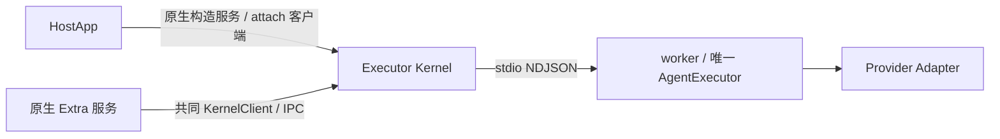

# 本地执行与传输

服务构造强制遵循[统一原生服务原则](architecture.md#统一原生服务构造与部署边界)：CLI 服务进程与 Electron 主进程直接构造服务、持有 socket，不得由外部 Node 代启。下述 worker/IPC 是现有执行隔离合同，不授权 SDK 再启动顶层 Kernel。公共 API 见[服务设计](../tasks/unified-native-sdk-services/design.md)。直接 /executor-core AgentExecutor 仍是显式可选模式，实例所有者管理 shutdown，共享宿主故障域，不具备进程隔离或源重放。

业务输入为 InvokeInput，环境 signal 不序列化，executionEnvOverrides 独立传递。唯一 Core 负责执行配置解析和输入准备；Extra 不提前解析内部计划，不补模型历史。

App 的 attached client、原生服务的 client 和 Extra 的 ctx.kernel 都直接使用 KernelClient.invoke(input, environment?)，普通消费者不组合 submit/subscribe。业务仅调用 RPC 能力，不负责服务托管、调用登记或手动 drain。首次 next 才自动登记和提交；native/default 返回 HostFrame，canonical 返回 CanonicalEvent，变量模式返回联合。没有 Extra 加载要求，也没有第二个 Extra invoke。高级调用方保留原语并自行管理其所有权。

caller signal 在写出前取消时不发 invoke；写出后按原身份恢复接纳并发一次 cancel，原观察保留尾事件。正常耗尽后抛实际 signal.reason，具体传输/控制错误优先保留。iterator.return/client.close/订阅 signal 只关闭观察。native lost 先保留源帧再报 RUN_OUTCOME_UNKNOWN；canonical 在错误处查询确认 lost 后报同码，不造 Provider 事件。若确认查询失败，保留原控制错误。

invocations 只登记本 client 的高层 invoke 元数据，最多 128（包括在途/未知）。cancelInvocation/respondInteraction/respondNativeInteraction 按 invocationId 关联原 ref；非本 client 登记拒绝。owner 先 stopAdmission，再 drain({deadline,reason})，使用绝对共享期限；重复排空共享首次操作，最多 4 查询和 4 取消并发，不增加重放订阅。确认 completed/failed/cancelled 才释放登记，lost/未知/未确认仍返回 unresolved，不能把 ACK 当完成。低层 submit 不进入登记。

environment.streamLimits 在现有 Kernel wire 不支持，显式传入拒绝 KERNEL_STREAM_LIMITS_UNSUPPORTED；直接 Core 仍支持。执行终态与 delivery/业务写入完成分别验证，SDK 继续等待 onDispose 的剩余期限。当前实现和证据见 [#69 实施](../tasks/69-kernel-client-invoke/implementation.md)。

## IPC v1

一条连接发送一条 UTF-8 LF 结尾 JSON-RPC 请求，不接受 batch。status/list、invoke/get/subscribe/cancel/respond/native.respond 形状由 [wire Schema](../../packages/octo-runtime-protocol/schema/kernel-ipc.schema.json) 定义。共享 [protocol Schema](../../packages/octo-runtime-protocol/schema/protocol.schema.json) 定义 LookupKey、RunRef、Snapshot 和 Status；主包公开原始 JSON。

- submit 返回完整 RunRef：kernel_instance_id 加原 receipt 的所有身份。
- get 使用 run/invocation/session/generation/mode 五元组，允许指定预期 Kernel instance。
- 订阅和控制校验完整 ref。游标是最后连续收到的 seq。
- wire invoke 与 subscribe 分离；普通业务 API 使用 main 已实现的同一个 KernelClient.invoke。接纳后 Kernel 独立消费源，不由请求 socket 拥有 generator。
- ACK 丢失仅查询原身份，最多 3 次、总修复预算 10 秒；不能重新 invoke。
- 断流沿原 ref/cursor 有界修复，实例变化、身份不符、窗口缺口和过期明确失败。
- cancel/respond 的 ACK 仅表示操作被接纳；执行结果以真实终态为准。
- 连接、客户端 close、iterator.return 或订阅取消不等于业务 cancel。
- 控制 ACK 丢失返回 OPERATION_OUTCOME_UNKNOWN，不自动重试副作用。

本地 IPC 同一 OS 账号互信；不增加 APP 注册、共享 Token 或逐应用授权。POSIX socket 权限为 0600；Windows Pipe 的访问机制独立，不能由 POSIX 结果推断。远程入口的授权归 Extra 和业务系统。

### Playboard 临时端点与常驻 Home

常驻 POSIX socket 保留在宿主配置的 Runtime Home 内；SDK 自配 Home，Unix CLI 默认 `~/.octo-runtime`，既有覆盖方式不变。一次性 Playboard 的 POSIX socket 则在固定短根 `/tmp` 下以 `mkdtemp` 创建本次独占的私有目录，使用短文件名；不能把受 TMPDIR/TMP/TEMP 影响的长或多字节路径继续拼进 Unix socket。Windows Playboard 保留系统临时目录与既有哈希命名管道。

Playboard 直接构造临时 Kernel，只有真实 close 完成才删除所属目录；incomplete 时保留资源事实，不删除其他实例或用户 Home。创建临时目录失败时尚未注册进程级监听，不能留下 signal/stdout handler。此修复不迁移常驻端点、不改变公共 SDK、不新增 Home 限制。验证与范围见 [Issue 184](../tasks/184-ci-ipc-reliability/brief.md)。

## worker 监督

worker 加载 Adapter，并使用同一 AgentExecutor。独立 Node IPC 心跳由主循环响应，1 秒检查，单个带序号 probe 5 秒未响应判失联；不能用执行输出静默程度判断存活。检测到 wall/monotonic 长间隔或回拨时废弃旧 probe，发新 probe 并给予完整 5 秒，不因休眠直接丢失 Run；旧 pong 不能刷新新期限。就绪预算 15 秒。失败先回收本次进程，再按 250/1000/4000 ms 退避，60 秒活跃观测时间最多三次快速替换；快速额度耗尽后保持 recovering，每次等待 15 秒再单次尝试，普通启动失败回收完成后继续冷却，不永久停止。启动成功不立即退出低频模式；连续健康观测 60 秒才重置策略，休眠时间不洗掉预算。仅清理或所有权确认失败进入 exhausted，阻止冲突替换并保留 close 失败。冷却/启动串行，close 取消等待，status/invoke 不触发额外重试。整个恢复保留 Kernel instance、进程和监听端点；本地监听不依赖网络或 Provider 在线。

worker 丢失令活动源产生一次 lost；已保留终态不改写。重启不恢复旧 Run、不重新 invoke。进程身份清单只用于孤儿清理，不是业务持久化。清理失败禁止替代实例。

Windows 进程身份登记调用系统 PowerShell 查询真实启动 UTC ticks，冷启动与查询共用 40 秒期限；该期限独立于后续 RPC 就绪和关闭预算，不缓存 PID 身份。登记失败保留系统错误 cause，不能退回 PID 或猜测启动时间；公开探测仍以未知身份返回，孤儿回收遇到未知身份时不终止目标。

## 有界资源

源窗口沿中央 StreamLimitPolicy：默认每 Run 4096 帧 / 32 MiB，全局 128 MiB / 128 Run、终态 TTL 120 秒。Kernel 最多 64 连接 / 16 订阅，客户端最多 32 个在途连接。写入等待 drain 最多 5 秒；接收行使用中央 HostFrame 上限，invoke 使用中央 32 MiB 上限。客户端按异步消费施加背压，不增加无界事件队列。

POSIX 只回收自己创建的独立进程组，leader 退出不表示后代消失；TERM 400 ms、KILL 确认 200 ms 共用起点，EPERM 不是消失证明。spawn/stdin/stdout/stderr 错误只归属本次调用，不能中断兄弟调用；异步启动失败须保留原 errno，不能因尚无 PID 而提前清理未启动的句柄。

Windows 使用 Node.js 创建进程，并通过系统已有的 `taskkill /PID … /T /F` 处理仍可识别的进程树。ChildProcess、status 和 manifest 保留真实目标身份。父进程先退出后可能失去后代归属；Runtime 被强杀或事件循环无法运行时，退出回调也可能不执行。这些场景不具备 Job Object 级回收保证。现有清理在 leader 已退出时仍可能返回成功，因此 cleanup.complete 不是异常退出后整棵树已清空的证明；对应缺口保留，不以文档修改宣称已经修复。

Windows 崩溃后的 invocation manifest 回收在原 Kernel 已退出、worker 启动身份仍匹配时，先用 taskkill /T /F 回收整棵可识别树，再确认 leader 消失。命令失败或退出未确认返回 cleanup_incomplete，原子保存 cleanupIncomplete 事实并拒绝替代 open；后续 leader 消失或 PID 复用不能自动丢弃记录。同身份仍存活时继续重试。操作者已停止遗留工具后，可以显式 acknowledgeOrphanCleanup / CLI recover 确认：原清单归档、确认绑定原文摘要，仍存活或无法验证的原 owner 拒绝放行，旧确认不能放行新记录。下一次启动消费确认，reaped 仍为 false；doctor 显示路径与状态。持久阻塞仅作用于 Windows，POSIX 维持既有 best-effort orphan 回收合同。不扫描无关应用，也不为原本已经消失且从未登记清理失败的 leader 新增后代归属保证。

JSON-lines Provider 的 stdout、stderr 及 readline 错误归属单次调用，走相同有界清理路径；迟到的管道 error 仍有监听。进程清理后释放所属 stdin/stdout/stderr，失败继续传播；释放句柄不是进程已退出的证明。Windows 原生启动失败保留 ENOENT 等原始 errno，不用全局异常抑制或重启共享 worker 消化本次管道错误。

确认被消费并创建新清单、成功回收删除旧清单或正常 close 后，尽力删除已经失效的 acknowledgement 辅助文件，原始 acknowledged 归档继续保留。辅助文件清理失败不得将已恢复的启动重新阻塞；它已不能匹配新清单。CLI 的 --manifest 选择 Provider/Extra 模块清单，不改变 Home 下的 Kernel 状态位置，doctor、recover 与前台 Kernel 共用该位置。

公共 Runtime 不引入 Go broker、原生扩展或随包辅助二进制，遵守[实现语言与原生依赖边界](architecture.md#实现语言与原生依赖边界)。已观察到的清理失败及协议未确认仍按既有合同报告 incomplete。各 Windows 平台及真实 Provider 的验证证据分别记录，历史原生方案的测试结果不能作为当前 Node.js 方案的回收保证，见[专项实施记录](../tasks/gateway-drain-windows-cleanup/implementation.md)。

## 临时执行与证据

Windows worker 正常 close 在 launcher 内部先结束 stdin，复用既有 shutdown/logging.close；监听先于 EOF，等待期间继续消费输出，整个关闭过程共用一个 Promise。排空与树回收必须共用调用方剩余预算，为回收预留时间；未响应 EOF 时提前进入回收，已确认开始关闭的 worker 可使用较长的有界排空机会。故障恢复不等待正常排空宽限。worker 通过现有私有 IPC 通知排空结果并保留 leader，随后 launcher 使用 taskkill 清理仍可识别的进程树。本次 EOF 关闭开始后、树回收确认前发生的提前退出、taskkill 失败或已报告的排空 incomplete 不能报成功；cleanup 后仍释放本层管道并保留错误。关闭开始前已经退出的 worker 沿用前述基线限制。启动失败直接回滚；宿主不传平台选项或调用新 flush API。Host SDK→Kernel→worker 慢关闭和延迟回收的组合须实际验证，不能仅比较超时常量。证据见 [#38 验证记录](../journal/shared/2026-10-20-windows-host-log-close.md)。

CLI playboard 通过同一原生工厂在本进程创建临时 Kernel 服务，读取选定 profile 的 Provider 配置，跳过 Extra 和渠道工具环境同步。退出只回收本次资源，保留 Home/profile，不复用常驻服务。#71 已删除旧 owned launcher 路径。

Windows 共享控制台事件可同时到达 Kernel 与 worker。父 IPC 仍连接时，worker 不因 SIGINT/SIGTERM 抢先关闭，由 Kernel 经 RPC 取消并消费源终态，再以 EOF 进入既有排空与树回收；独立运行或父 IPC 断开时仍自行 shutdown。测试必须使用所属独立控制台验证真实 Ctrl+C，child.kill 的强制终止另行记录，不能作为优雅关闭成功。见 [#58 最新基线任务](../tasks/58-windows-cli-signals/brief.md)。

实现：[server](../../packages/octo-runtime-executor-kernel/src/server.ts)、[client](../../packages/octo-runtime-executor-kernel/src/client.ts)、[源窗口](../../packages/octo-runtime-executor-kernel/src/host-run-service.ts)、[Core](../../packages/octo-runtime-executor-core/README.md)。测试：[clients](../../test/kernel-clients.test.js)、[worker](../../test/kernel-worker-supervision.test.js)、[所有权](../../test/host-sdk-lifecycle.test.js)。实际平台与线上证据见 [实施记录](../tasks/executor-kernel-host-lifecycle/implementation.md)。
