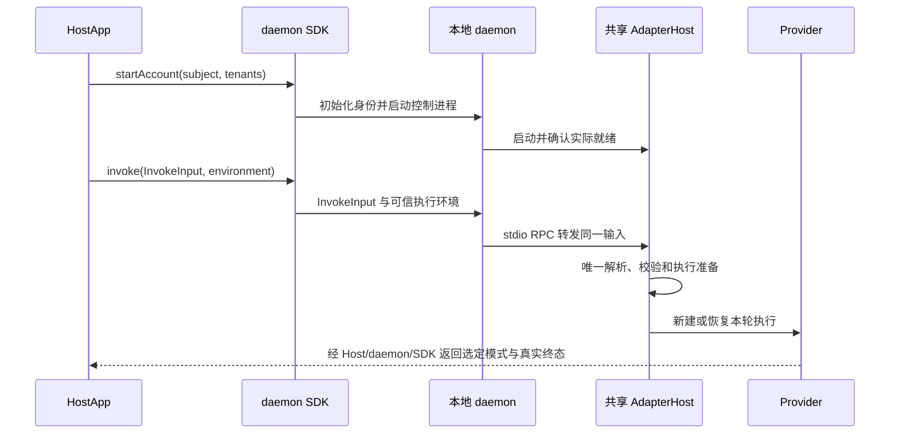

# 本地执行与传输

推荐接入方式为 SDK 经 IPC 调用独立 Executor Kernel，以进程隔离和监督提高稳定性；
Electron 等长期运行的宿主优先采用此方式。新 Kernel 属于 #47，当前使用保留的独立
worker 路径。直接嵌入 Core 是允许显式选择的 SDK 简易方案，由宿主管理生命周期并承担
同进程故障影响；不得因开放 direct 入口而将默认隔离链路改为进程内执行。

显式 direct 入口为 `@mininglamp-oss/octo-runtime/executor-core` 的 AgentExecutor，同一执行类
也由默认独立 worker 实例化。direct 不创建 IPC，不具备订阅回放和进程隔离；HostApp 管理
实例生命周期。首个 running 帧可见前已建立取消所有权；未消费 iterator 不接纳、不占容量。
失败的 generator finalizer 不能靠再次 return 重试；next 拒绝、return 未确认 done 或提前
关闭却无 return 时保留未确认清理所有权，shutdown 持续报告 incomplete。尚在等待的清理
可以稍后完成，由下一次 shutdown 观察。取消已确认清理的调用可按 TTL 淘汰；旧 iterator
迟到结束不得修改复用同一 invocationId 的新调用。具体限制见 [Core](../../packages/octo-runtime-executor-core/README.md)。
shutdown 同步关闭新接纳，返回不可变的清理快照；incomplete 保留所有权，后续仅继续观察未决清理。
候选终态、取消或首次清理三者最早时刻建立单调时钟截止时间；终态 drain、return、catch/finally
共用一次 cancelGraceMs，暂停后恢复消费不能重开预算。后台清理 Promise 必须观察拒绝；
单项关闭失败不能跳过其他独立资源释放，也不能为等待永不结束的兄弟项无限推迟已知失败。
具体合同见 [Core API](../../packages/octo-runtime-executor-core/README.md)。

下方 daemon/stdio 形状描述当前仍保留的隔离链路，不限制 direct 使用。新 ExecutorKernel
的命令、端点和监督改造属于 #47，不能用现有 worker 回归代替其最终联合验收。

公共入口为 `invoke(input, environment)`，其中 input 是 [InvokeInput](invoke-input.md)。本地 environment 支持取消 signal，以及渠道工具所需的独立 executionEnvOverrides；详见 [环境合同](environment.md)。SDK、RPC 和 CLI playboard 转发原输入，只有 Host 解析执行配置。内部 `invokeFrames(input, environment)` 返回同一执行的完整源帧，不再接受 adapterType/request/options 三参数，不另行准备执行。

本地调用不要求 Worker 注册、Human Token 或 IM 连接。HostApp 预先决定并准备 Provider 的安装与认证。

## 本地客户端信任

遵循[基础架构的同账号互信约束](architecture.md#本地信任边界同一操作系统账号内互信)：同一操作系统账号内、能够访问实例本地 IPC 的客户端互信，daemon 不额外识别宿主 APP 身份，不要求 APP 注册、共享 Token 或逐应用授权。多个 Home 不构成同账号客户端之间的安全隔离。

Runtime 保持本地端点的操作系统访问权限；现有 POSIX socket 使用 0600，该事实不代表 Windows Pipe 使用同一权限机制。正常的同账号调用不产生专用鉴权错误或错误卡片。连接失败、权限不足及超时沿既有错误路径返回，由宿主负责展示。

本地信任不省略请求协议、执行权限及审批校验，也不代替 Extra 对远程业务请求的认证授权。上述约束是当前本地 app-server 合同，不新增产品代码或 IPC 协议字段。

## 传输边界

CLI `playboard` 也经过 daemon：启动本次临时 daemon，经 UDS/Pipe 执行，daemon 通过 stdio `AdapterHostRpcClient` 调用自己的 Host。它不直接启动 Host，不复用常驻 daemon，不单独装配 OpenClaw。统一 CLI 启动编排选择 profile 并准备 Provider；临时执行跳过 Extra 加载及渠道工具环境同步。socket、PID 和执行账本使用独立临时目录，Home/profile 的配置与身份保留。决策与验收见 [Playboard 改造](../tasks/playboard-daemon-execution/brief.md)。

| 边界 | 当前实现 |
| --- | --- |
| CLI 普通控制请求 | UDS / Windows Pipe 的单行 JSON 请求，响应使用 JSON-RPC 形状 |
| SDK 到 daemon 的执行与订阅 | JSON-RPC 2.0 请求、响应和 notification |
| daemon 到 AdapterHost | stdio NDJSON JSON-RPC 2.0 |
| Host 到 Provider | Adapter 管理的子进程、SDK 或认证原生连接 |
| Extra 到外部系统 | 插件自身的传输、认证和投递合同 |

正式 Runtime CLI 与正式 daemon 对同一个规范化 Home 必须调用同一个端点派生函数。POSIX 使用
Home 下的 `sockets/octo-runtime-daemon.sock`；Windows 使用 `octo-runtime-` 前缀和 Home 的
16 位 SHA-256 前缀。CLI 不得复制另一套 Home hash 算法。SDK embedded daemon 与 Playboard
临时 daemon 分别使用自己的 prefix 和生命周期，不得与正式 Runtime 合并命名空间。显式
`--socket` 或 `OCTO_RUNTIME_SOCKET` 仍由调用方负责两端一致配置，不改变默认派生合同。

`agent_run.invoke` 和 `agent_run.subscribe` 强制 JSON-RPC 2.0；不能把 CLI 普通控制路径的简化编码推广为所有 IPC 的合同。流式 notification 包含源身份、连续序号与完整 HostFrame。

执行 RPC 的 params 使用 `input`，不再传 `adapter_type / adapterType + request + options`。signal 不进入 params，客户端将 abort 映射为 cancel；服务端为本次 invocation 维护 AbortController，覆盖 ACK 在途取消和传输关闭。仅有必要的可信 executionEnvOverrides 以独立环境字段传输，不注入模型。CLI / Playboard / Work App 验证入口见[统一调用任务](../tasks/unify-invoke-transport/brief.md)。

## 接纳、续流与终态

- invoke、cancel、respond 的命令回执只证明相应操作被接纳，不证明 Provider 完成或已退出。
- 断流后用原 `run_id + stream_id + after_seq` 订阅；游标表示最后连续收到的位置。重新订阅不选择新模式，不重新 invoke，不重试业务副作用。
- Host 缓冲有界源帧，不提供 durable outbox、逐事件 ACK 或重启后完整历史。过期、源变化和窗口缺口明确失败。
- Provider 终态、应用保存完成和 IM 投递成功是不同事实。断开订阅本身不等于取消执行。

## 本次执行资源的错误隔离与回收

创建者负责其启动的进程及 stdio：spawn、stdin/stdout/stderr 的不可恢复错误必须归属本次调用，保存首个错误，拒绝 pending 和后续请求，不能因未处理的 error 事件终止共享 Host。一个 Provider 失败不得中断兄弟调用或阻止后续调用。

POSIX 下，由创建者明确创建的独立进程组按整个组回收；leader 退出不能作为工具后代已退出的证据。并发、重复关闭等待同一次清理 Promise，覆盖 TERM、必要的 KILL 和消失确认；只操作本次所有权范围，不扫描全机或保存历史 PGID 以后重试。EPERM 不表示目标不存在；短暂拒绝后须确认消失才能报告成功，持续失败或超时返回真实错误，并保留原始启动/执行失败原因。

ACP、NDJSON、Host launcher、Codex 和 ZCode 复用 [process-cleanup](../../packages/octo-runtime-adapter-sdk/src/process-cleanup.ts)：TERM 400 ms、KILL 后确认 200 ms 共用起点；ACP/ZCode 的协议取消宽限为 250 ms，Codex 的 EOF 宽限为 250 ms；Codex 即使已收到 leader 退出，也必须等待受管组清理，暂停消费的取消仍启动有界回收。更短的 Host 取消预算仍按既有合同返回 cleanup_timeout，不静默延长。Windows 必须满足同等故障隔离、取消及受管后代回收要求。Windows 已有 child 关闭实现，本轮尚未真机验证；后代回收疑点与自动化缺口按[Windows 验收](../tasks/pr1-yujiawei-review/windows-validation.md)跟踪，确认缺陷后必须修复，不得用“不保证支持”代替处理。此处不将其他 Provider 的原生关闭策略强行统一为这些数值。

接收缓冲超限属于当前传输失败；正常 Provider 退出则须保留已接纳且尚待读取的终态，不因资源释放而伪造执行失败。具体容量见[有界状态](stateless-execution.md#provider-接收缓冲)，实现与平台验证见 [PR 1 整改记录](../tasks/pr1-yujiawei-review/implementation.md)。

## 外部系统

当前仓库不提供 Worker WS 接入工厂或远端 native 入口。Extra 可接收外部请求并调用共享 Host；请求者身份、租户/owner 作用域、远程授权、业务幂等及可靠投递由拥有该业务的系统实现。

本地 Runtime ID 不是远程授权凭据，HTTP/SSE 演示也不证明已实现跨节点调度、租约或 fencing。已识别身份、权限及适用的执行合同仍必须校验。

## 核对入口

[SDK 类型](../../packages/octo-runtime-daemon/src/runtime/types.ts)、[daemon server](../../packages/octo-runtime-daemon/src/server.ts)、[Host RPC](../../packages/octo-runtime-adapter-host/src/rpc.ts)、[HostRunService](../../packages/octo-runtime-adapter-host/src/host-run-service.ts)、[续流](../../packages/octo-runtime-daemon/src/runtime/run-stream.ts)。

测试入口：[host-run-service.test.js](../../test/host-run-service.test.js)、[embedded-invoke.test.js](../../test/embedded-invoke.test.js)。容量与历史边界见 [纯执行约束](stateless-execution.md)，输出选择见 [输出协议](output-protocol.md)。
