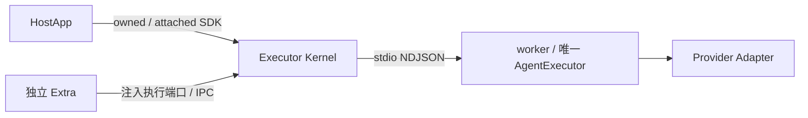

# 本地执行与传输

推荐宿主通过 SDK 经 IPC 调用独立 Executor Kernel。直接 /executor-core AgentExecutor 仍是显式可选模式，实例所有者管理 shutdown，共享宿主故障域，不具备进程隔离或源重放。

业务输入为 InvokeInput，环境 signal 不序列化，executionEnvOverrides 独立传递。唯一 Core 负责执行配置解析和输入准备；Extra 不提前解析内部计划，不补模型历史。

## IPC v1

一条连接发送一条 UTF-8 LF 结尾 JSON-RPC 请求，不接受 batch。status/list、invoke/get/subscribe/cancel/respond/native.respond 形状由 [wire Schema](../../packages/octo-runtime-protocol/schema/kernel-ipc.schema.json) 定义。共享 [protocol Schema](../../packages/octo-runtime-protocol/schema/protocol.schema.json) 定义 LookupKey、RunRef、Snapshot 和 Status；主包公开原始 JSON。

- submit 返回完整 RunRef：kernel_instance_id 加原 receipt 的所有身份。
- get 使用 run/invocation/session/generation/mode 五元组，允许指定预期 Kernel instance。
- 订阅和控制校验完整 ref。游标是最后连续收到的 seq。
- invoke 与 subscribe 分离；接纳后 Kernel 独立消费源，不由请求 socket 拥有 generator。
- ACK 丢失仅查询原身份，最多 3 次、总修复预算 10 秒；不能重新 invoke。
- 断流沿原 ref/cursor 有界修复，实例变化、身份不符、窗口缺口和过期明确失败。
- cancel/respond 的 ACK 仅表示操作被接纳；执行结果以真实终态为准。
- 连接、客户端 close、iterator.return 或订阅取消不等于业务 cancel。
- 控制 ACK 丢失返回 OPERATION_OUTCOME_UNKNOWN，不自动重试副作用。

本地 IPC 同一 OS 账号互信；不增加 APP 注册、共享 Token 或逐应用授权。POSIX socket 权限为 0600；Windows Pipe 的访问机制独立，不能由 POSIX 结果推断。远程入口的授权归 Extra 和业务系统。

## worker 监督

worker 加载 Adapter，并使用同一 AgentExecutor。独立 Node IPC 心跳由主循环响应，1 秒检查，5 秒失联；不能用执行输出静默程度判断存活。就绪预算 15 秒。失败先回收本次进程，再按 250/1000/4000 ms 退避，60 秒最多三次替换；稳定 60 秒后重置。耗尽后 status 可用，拒绝新执行。

worker 丢失令活动源产生一次 lost；已保留终态不改写。重启不恢复旧 Run、不重新 invoke。进程身份清单只用于孤儿清理，不是业务持久化。清理失败禁止替代实例。

## 有界资源

源窗口沿中央 StreamLimitPolicy：默认每 Run 4096 帧 / 32 MiB，全局 128 MiB / 128 Run、终态 TTL 120 秒。Kernel 最多 64 连接 / 16 订阅，客户端最多 32 个在途连接。写入等待 drain 最多 5 秒；接收行使用中央 HostFrame 上限，invoke 使用中央 32 MiB 上限。客户端按异步消费施加背压，不增加无界事件队列。

POSIX 只回收自己创建的独立进程组，leader 退出不表示后代消失；TERM 400 ms、KILL 确认 200 ms 共用起点，EPERM 不是消失证明。Windows 有界 taskkill /T 的后代回收和父进程已退出场景仍需平台实际证据。spawn/stdin/stdout/stderr 错误只归属本次调用，不能中断兄弟调用。

## 临时执行与证据

CLI playboard 创建临时 owned Kernel，读取选定 profile 的 Provider 配置，跳过 Extra 和渠道工具环境同步。退出只回收本次资源，保留 Home/profile，不复用常驻服务。

实现：[server](../../packages/octo-runtime-executor-kernel/src/server.ts)、[client](../../packages/octo-runtime-executor-kernel/src/client.ts)、[源窗口](../../packages/octo-runtime-executor-kernel/src/host-run-service.ts)、[Core](../../packages/octo-runtime-executor-core/README.md)。测试：[clients](../../test/kernel-clients.test.js)、[worker](../../test/kernel-worker-supervision.test.js)、[所有权](../../test/host-sdk-lifecycle.test.js)。实际平台与线上证据见 [实施记录](../tasks/executor-kernel-host-lifecycle/implementation.md)。
