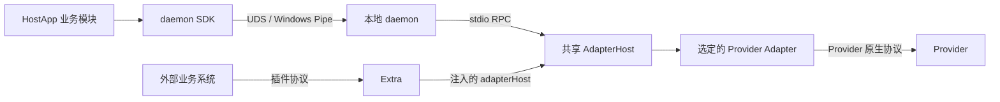
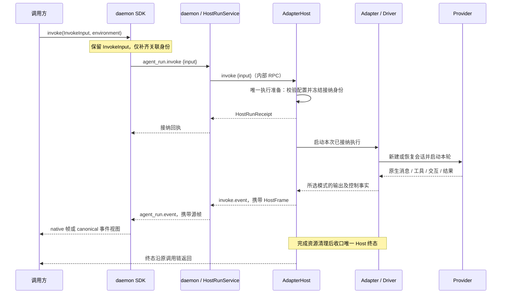
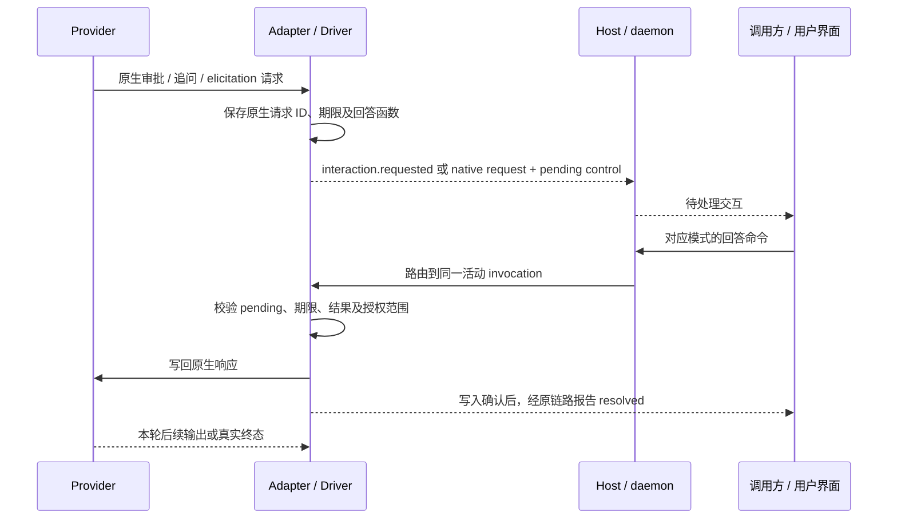

# Runtime 总体协议与调用设计

本文是 Runtime 协议与调用关系的总入口，按 `836135d` 与当前工作树核对。字段全集由 Schema 和类型定义维护，各专项规则维护具体约束。本文不新增 wire 字段或执行行为，也不表示本次重新完成真实 Provider 或线上验收。

## 1. 调用关系与责任

图中箭头表示调用进入方向，帧、交互请求和终态沿对应调用链返回。Extra 由设备 Host 加载；其执行端口复用共享内核。图不要求 Extra 单独运行一个进程。CLI playboard 同样经过本次临时 daemon，具体接线见 [本地执行](local-execution.md)。

| 主体 | 拥有的决策或状态 |
| --- | --- |
| HostApp / 业务调用方 | Runtime 安装方案、调用身份、业务会话、当轮输入、当轮 Context、用户交互界面和业务历史 |
| Extra | 外部系统认证、授权、请求转换、业务路由、交互与结果投递 |
| ExecutorCore | 公共输入校验、本轮配置解析、固定渲染、执行、身份、交互、取消与清理 |
| daemon / HostRunService | 内核生命周期、本地 RPC、接纳身份映射、源帧的有界窗口与订阅 |
| AdapterHost | 执行接纳、输出模式、活动 invocation 路由、模型 Context 固定渲染、取消及终态收口 |
| Provider Adapter / Driver | 原生传输、Provider 会话操作、事件转换、pending 原生请求与回答写回 |
| Provider | 模型及工具的实际执行、原生会话和原生执行结果 |

当前没有通用的 Adapter A → Adapter B 互调协议。一次调用由 AdapterHost 选择对应 Adapter。业务方需要多 Agent 或多次调用时，在业务层编排各次 invoke；不得把 Provider 内部行为或业务编排写成已有的 Adapter 互调能力。身份与设备归属见 [基础架构](architecture.md)。

## 2. 协议分层与版本

| 层 | 合同 / 载体 | 用途 |
| --- | --- | --- |
| 公共调用 | `InvokeInput` | 所有公共入口共用的 JSON 输入，必填 `inputs` 与 `contexts` |
| 业务执行 | Run `schema_version=7` | 上游业务 Run 合同；不等于本地 RPC 版本 |
| 本轮上下文 | `octo.context-envelope/v3` | 保存本轮有序 Context；空模型上下文有效 |
| 内部执行 | `InvokeRequest`、Adapter `protocolVersion=2` | 准备后的执行请求及 canonical 事件 |
| Host 输出 | `HostRunReceipt`、`HostFrame`、`HostControl` | 接纳身份、选定输出视图、流顺序和执行控制事实 |
| 本地进程通信 | JSON-RPC 2.0；daemon → Host 为 stdio NDJSON | invoke、回答、取消及流通知；CLI 普通控制请求另有简化编码 |
| 审批请求 | `octo.approval-request/v1` | canonical 审批操作、允许回答与授权范围 |
| Provider 原生通信 | 各 Adapter 的 stdio、ACP、WebSocket 等 | Provider 自有请求、响应及通知 |

这些版本独立，不能因 Context=v3 将 Run、Adapter transport 或 approval 的版本机械改为 3。协议代码载体为 `@mininglamp-oss/octo-runtime-protocol`；Schema 定义数据形状，运行时校验器执行语义约束，见 [协议 Schema](protocol-schema.md)。

`protocol_mode` 选择 native 或 canonical 输出，不选择 Provider、不改变 Context，也不扩大权限。默认 native；canonical-only Adapter 的调用方必须显式选 canonical，不支持的模式在接纳前拒绝。完整字段见 [InvokeInput](invoke-input.md)，模式及帧见 [输出协议](output-protocol.md)。

## 3. 一次调用的主时序

接纳回执不证明 Provider 已完成。`invoke.done` 等传输结束通知也不能代替 Host 终态。调用方使用源帧身份核对本次执行；native payload 中的 `result` 或 `completed` 字样不构成公共层的完成依据。

Host 只渲染当轮显式提交的模型 Context。执行配置和审批策略不拼入模型文本；可信控制指令走独立通道。普通续聊也不得按 sessionId 补齐、合并或去重历史 Context，见 [Context 输入](context-input.md)。

## 4. 调用身份与接口对应

| 身份 | 含义及使用位置 |
| --- | --- |
| `sessionId` / 内部 `agentSessionId` | 逻辑执行会话；不等于 Provider 原生 session |
| `runId` | 本轮业务执行；daemon 的回答、取消和查询以此定位 Run |
| `invocationId` | 当前活动调用；Host 将回答和取消路由给拥有该调用的 Adapter 实例 |
| `stream_id`、`seq` | 已接纳执行的源流与连续位置，用于订阅和缺口检查 |
| `interactionId` | canonical 交互标识，在当前 invocation 内关联请求与回答 |
| `requestId` | native 模式的 Provider 请求 ID；不与 canonical ID 混用 |
| 会话 generation / Provider epoch | 防止旧执行更新污染新会话或 Provider binding |

| 操作 | daemon SDK | daemon RPC | AdapterHost RPC / 接口 |
| --- | --- | --- | --- |
| 执行 | `invoke(input, environment)` | `agent_run.invoke {input}` | `invoke {input}` → `invokeFrames(input, environment)`；Host 内部唯一准备 |
| canonical 回答 | `respondRun(runId, response)` | `agent_run.respond` | `interaction.respond` → `respondInteraction(invocationId, response)` |
| native 回答 | `respondNativeRun(runId, response)` | `agent_run.native.respond` | `native.respond` → `respondNative(invocationId, response)` |
| 取消 | `cancelRun(runId)` | `agent_run.cancel` | `cancel(invocationId, reason)` |
| 续流 | `subscribeRun({runId, streamId, afterSeq})` | `agent_run.subscribe` | 读取 daemon 已有源窗口，不启动新执行 |

Extra 使用注入的 `adapterHost.invoke / cancel / respondInteraction`，执行端口的取消和回答直接使用 invocationId。daemon 的 Run 入口先经 HostRunService 查出 invocationId，再转发同一回答。字段不能按名字近似互换。

## 5. 审批、追问与信息补充

这些交互都是 Provider 在活动 invocation 中发出的反向请求。Adapter 保存原生请求及 responder，向调用方发送待处理事件；回答通过独立命令返回，写回原请求后继续本轮执行。回答不创建新 Run，也不通过追加用户 prompt 模拟原生响应。

### canonical 模式

`interaction.requested.payload` 包含 `interactionId`、`executionInstanceId`、`expiresAt`、`kind` 和 `request`。当前 Adapter 使用 invocationId 作为 executionInstanceId。回答 `InteractionResponse` 包含 `interactionId`、`outcome` 和可选 `value`；Host 在方法参数中接收 invocationId，不从回答内容推断执行归属。

| kind | 问题与回答语义 | 当前统一范围 |
| --- | --- | --- |
| `approval` | 是否允许本次操作；结果按 `allowedOutcomes` 选择 `accepted / declined / cancelled` | request 使用 `octo.approval-request/v1`；`answered` 不能作为审批答案 |
| `question` | Provider 需要用户回答后继续；答案通过 `answered + value` 返回，拒绝或取消按 Adapter 映射 | 统一交互信封；问题和答案的具体结构仍由 Provider 映射决定 |
| `elicitation` | MCP 等请求结构化信息；按原请求支持范围接受、回答、拒绝或取消 | 统一交互信封；requestedSchema、内容和原生 action 仍有 Provider 差异 |

审批的 `policy`、`operation`、`requestedPermissions`、`allowedOutcomes`、`grantScope` 和展示字段由 ApprovalRequest schema 与校验器约束。当前通用 profile 要求 `requestedPermissions=[]`；不能因枚举存在 `permission_grant` 就宣称已支持任意权限授予。Provider 授权范围的例外也只按当前 allowlist 接受。

`ask / assisted / full_access` 是执行策略，不是交互种类。Adapter 必须按真实支持范围处理；枚举存在不证明所有 Provider 都能执行该模式。full_access 不自动回答用户追问或 elicitation，也不绕过组织权限和资源 ACL。

Codex 当前将命令／文件审批映射为 approval，`item/tool/requestUserInput` 映射为 question，`mcpServer/elicitation/request` 映射为 elicitation。追问的 value 按原问题 ID 对应答案；elicitation 按原生 action/content 回答。这是 Codex 映射，不能当作所有 Adapter 的通用答案 Schema。`item/permissions/requestApproval` 当前明确拒绝。其他 Provider 的支持范围见 [Provider 指南](../guides/providers.md)。

### native 模式

原生 request 帧保留 Provider 载荷；独立 Host control 报告 `requestId`、`pending` 及期限。调用方以 `NativeInteractionResponse {requestId, payload}` 返回完整原生响应，Driver 核对原请求的方法、ID 和允许结果后写回。native 模式不接受 canonical 回答，canonical 模式也不接受 native 回答。

native 保留原生结构不代表开放任意 Provider RPC。初始化、启动唯一 turn、会话恢复和资源关闭仍归 Driver；调用方不能借交互回答再次启动 turn 或操作其他会话。

### 交互状态与失败

交互从 pending 进入 `resolved / expired / invalidated`。回答在途标记用于阻止并发重复写入；确认写回原生传输后才报告 resolved。resolved 证明交互响应已写回，不证明对应工具已执行成功。

超过期限后拒绝回答；取消、执行丢失或结束时使未完成交互失效。当前接口不承诺重复回答返回同一成功结果。交互 ID、原生请求 ID、输出模式或 invocation 不匹配时不得改投其他执行。源帧回放只重发观察结果，不重复写回答。

## 6. 取消、续流和下一轮

取消命令定位当前 invocation，通过 AbortSignal 或原生取消方法请求停止。取消回执不证明子进程已经退出；Host 等待清理并报告真实终态，清理失败不能报告成功。

断流后按原 `run_id + stream_id + after_seq` 续订有界源窗口，不重新 invoke。窗口缺口、过期和重启后不可恢复均明确失败；业务方决定是否发起新执行。Runtime 不提供 durable outbox 或重启后完整业务历史，见 [有界状态](stateless-execution.md)。

下一轮由业务方重新提供 InvokeInput。调用方保存并提交 opaque Provider session；resume 的结果以 Provider 实际回执为准。reset、新会话或恢复失败时，业务方决定重新提供哪些背景。会话重置不等于取消当前执行，见 [会话合同](session-reset.md)。

## 7. 源码与验证入口

| 核对对象 | 源码 / 测试 |
| --- | --- |
| 数据结构与语义校验 | [Schema](../../packages/octo-runtime-protocol/schema/protocol.schema.json)、[Protocol](../../packages/octo-runtime-protocol/src/index.ts)、[Host 帧校验](../../packages/octo-runtime-protocol/src/run-protocol.ts) |
| 公共请求准备 | [Core InvokeInput](../../packages/octo-runtime-executor-core/src/invoke-input.ts) |
| SDK、daemon 和两层 RPC | [SDK](../../packages/octo-runtime-daemon/src/runtime/daemon-runtime.ts)、[流客户端](../../packages/octo-runtime-daemon/src/runtime/run-stream.ts)、[daemon](../../packages/octo-runtime-daemon/src/server.ts)、[Host RPC](../../packages/octo-runtime-adapter-host/src/rpc.ts) |
| 接纳与执行 / 传输窗口 | [AgentExecutor](../../packages/octo-runtime-executor-core/src/index.ts)、[HostRunService](../../packages/octo-runtime-adapter-host/src/host-run-service.ts) |
| 原生请求保存与写回 | [NativeInteractionBridge](../../packages/octo-runtime-adapter-sdk/src/native.ts)、[ACP 审批桥](../../packages/octo-runtime-adapter-sdk/src/approval.ts)、[Codex 交互映射](../../packages/octo-runtime-adapter-codex/src/app-server.ts) |
| 合同回归参考 | [native-host](../../test/native-host.test.js)、[host-run-service](../../test/host-run-service.test.js)、[ACP approval](../../test/acp-approval.test.js)、[MCP protocol](../../test/mcp-protocol.test.js) |

新增 Adapter 时，从本总览进入 [Adapter 开发指南](../guides/adapter-authoring.md)，逐项核对执行、交互、取消、恢复及输出模式。测试入口是验证依据的位置，不表示本次文档改动重新运行了这些测试。
