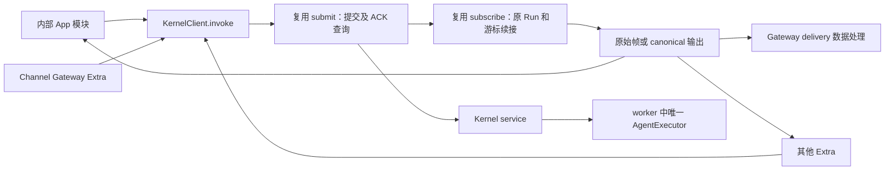

# 设计状态与源码依据

本文件基于 main@fae6333。用户确认破坏性更新和 Gateway 只消费结果做 delivery 后，明确要求“开始实施”；本设计作为实施依据，实际差异和验证见 [实施记录](implementation.md)。下表记录改造前源码事实，已删除路径仅用于说明基线。

| 当前事实 | 已读取的源码 |
| --- | --- |
| KernelClient 仅有 submit/get/subscribe/cancel/respond/respondNative 等方法 | `packages/octo-runtime-executor-kernel/src/types.ts` |
| attachKernel 已实现 ACK 查询及原 ref/seq 续接；client.close 不取消 Run | `packages/octo-runtime-executor-kernel/src/client.ts` |
| Extra port 同时组合提交/订阅、转换视图、登记 refs、处理取消和关闭 | `packages/octo-runtime-host-sdk/src/extra-port.ts` |
| InputInvoke 有三组重载；createInputInvoke 的 finally 会抛已中止的 signal.reason | `packages/octo-runtime-protocol/src/invoke-input.ts` |
| canonicalEvents 校验并转换帧、抛 Host error/gap；不把 Host state 帧转成业务事件 | `packages/octo-runtime-protocol/src/run-protocol.ts` |
| runner 共用 4 秒清理预算，4.5 秒最终退出；当前先等 starting 会超出剩余预算 | `packages/octo-runtime-host-sdk/src/extra-entry.ts`、`extra-port.ts` |
| owned.client 已由 attachKernel 产生；不需要第二套 owned invoke | `packages/octo-runtime-host-sdk/src/kernel.ts` |
| 三个 Extra 使用 adapterHost，渠道还有独立 ImExecutionPort 方法声明 | 各 Extra 的 `extra.ts`、`contracts.ts`、`ports.ts` 及 WebUI `src/index.ts` |

## 1. 同一个 Kernel client



执行代码在 executor-kernel 包。Host SDK 向每个独立 Extra 注入一个真实 attached KernelClient；内部 App 可直接 attach。`OwnedKernel.client` 仍是 attached client，owned handle 才能 stop/restart Kernel。

Gateway 只调用 invoke 并处理返回结果以完成 delivery；没有 submit/subscribe、transport retry、源游标、ACK 查询或从连接关闭猜执行结果的代码。现有业务重试只能依据业务合同显式启动另一次调用，不能将 `ACCEPTANCE_UNKNOWN`、断流或窗口缺口当作可重跑的 Provider 失败。WeCom/WebUI 同样不得实现这些执行步骤。

## 2. 公共调用类型

在现有 KernelClient 增加 `invoke: InputInvoke`，直接复用 protocol 中的重载：

```ts
interface InputInvoke {
  (input: InvokeInput & { protocol_mode: "canonical" },
    environment?: InvokeEnvironment): AsyncGenerator<CanonicalEvent>;
  (input: InvokeInput & { protocol_mode?: "native" },
    environment?: InvokeEnvironment): AsyncGenerator<HostFrame>;
  (input: InvokeInput,
    environment?: InvokeEnvironment): AsyncGenerator<CanonicalEvent | HostFrame>;
}
```

保留现有 `submit/get/subscribe/cancel/respond/respondNative/status/list/close`；它们仍是有意使用底层能力时的入口。invoke 不返回“只有最终文本”的 Promise，不提供 Extra 专用返回类型，也不公开另一层 prepare/execute。

调用采用惰性 generator：创建 iterator 不发 RPC、不占 Run 登记槽；第一次 next 时完成预检、登记和提交。未消费的 iterator 不会执行。首次 next 后以一次生成的 invocation/run/session 身份贯穿接纳、查询和续流，不修改调用方对象。接纳回执核对全部身份及模式。

native 保留 HostFrame 全部源身份、seq、Provider payload 和控制事实；canonical 使用既有 canonicalEvents 视图，不能重建 native 或重新归一化 Provider 输出。canonical 消费者在同一流消费至真实终态后才正常结束；流关闭、Run lost、缺口和未确认终态不能正常成功结束。

`signal` 仅在本地使用；executionEnvOverrides 仍沿原私有字段转发。Kernel 的容量由受信执行配置决定，当前 wire 不支持每调用 streamLimits。新合同对 Kernel invoke/submit 中非 undefined 的 `environment.streamLimits` 明确返回本地 `KERNEL_STREAM_LIMITS_UNSUPPORTED`，不再默默忽略，也不为此修改 wire。直接 Core 可继续按原合同使用该值。

主包 `/executor-kernel` 导出 KernelClient 及下述本地辅助类型；`/protocol` 保持 InvokeInput/InputInvoke/InvokeEnvironment 的来源。不要只在 workspace 内部包导出后就声称公开可用。

直接宿主调用只需要以下形态；消费函数由宿主提供，不要求存在 Extra：

```ts
import { attachKernel } from "@mininglamp-oss/octo-runtime/executor-kernel";
import type { InvokeInput, CanonicalEvent } from "@mininglamp-oss/octo-runtime/protocol";

export async function execute(
  endpoint: string,
  input: InvokeInput,
  consume: (event: CanonicalEvent) => Promise<void>
) {
  const client = attachKernel({ endpoint });
  try {
    for await (const event of client.invoke({ ...input, protocol_mode: "canonical" })) {
      await consume(event);
    }
  } finally {
    client.close();
  }
}
```

消费函数抛错会提前关闭观察，已接纳 Run 仍继续。宿主若希望此时取消，必须明确调用 cancelInvocation 或在关闭前执行本 owner 的 drain；不能由示例的 finally 隐式取消。Gateway 的结果消费同样直接使用 `ctx.kernel.invoke(...)`，随后进行自身 delivery 数据处理。

### 与直接 Core 的有意差异

| 行为 | 直接 AgentExecutor | KernelClient |
| --- | --- | --- |
| 输入/输出视图 | 同一 InvokeInput、native/canonical 类型 | 相同业务概念及重载 |
| 执行位置 | 宿主进程，共享故障域 | 独立 Kernel/worker |
| iterator 提前 return | 当前 Core finally 会请求 consumer_closed 取消并清理源 | 只结束观察；已接纳执行归 Kernel |
| 源重放/断流 | 没有 IPC 重放窗口 | 原 ref/连续游标有界恢复 |
| 取消回执 | Core cancel 返回 boolean，表达本地请求接纳 | cancel/cancelInvocation 返回 accepted，表达远端控制接纳 |
| 生命周期 | 实例 owner 检查 shutdown 的 cleanup 结果 | attached.close 只关连接；owned handle 才管理服务 |

本任务不强行统一这些所有权差异。修正共享视图的错误覆盖时，Core 提前关闭会取消执行的合同必须继续通过测试。

## 3. 身份关联、交互与 owner 登记

消费者常以 invocationId 表达取消/回答意图。该 ID 到完整 RunRef 的映射属于 Kernel client，不能由 Gateway 或 Extra SDK port 各自维护。拟在同一个 KernelClient 增加：

```ts
interface KernelClient {
  // 其余现有方法保留。
  invoke: InputInvoke;
  cancelInvocation(invocationId: string, reason?: string): Promise<{ accepted: boolean }>;
  respondInteraction(invocationId: string, response: InteractionResponse): Promise<void>;
  respondNativeInteraction(invocationId: string, response: NativeInteractionResponse): Promise<void>;
  readonly invocations: KernelInvocationLifecycle;
}

interface KernelInvocationRecord {
  readonly key: LookupKey;
  readonly ref?: RunRef;
  readonly phase: "admitting" | "accepted" | "acceptance_unknown" | "unobserved";
  readonly cancellation: "none" | "requested" | "acknowledged" | "unknown";
  readonly lastSeq: number;
  readonly observationError?: string;
}
interface KernelInvocationDrainResult {
  readonly complete: boolean;
  readonly unresolved: readonly KernelInvocationRecord[];
}
interface KernelInvocationLifecycle {
  snapshot(): readonly KernelInvocationRecord[];
  stopAdmission(): void;
  drain(options: { deadline: number; reason: string }): Promise<KernelInvocationDrainResult>;
}
```

`deadline` 是 `Date.now()` 同一时间基准的绝对毫秒时间，调用前必须为有限安全整数。不存在隐式无限等待。以上是 JS 本地类型，不进入 IPC Schema，不改变 Run 7 / Context v3 / IPC v1。

- 每个 client 登记自己通过 invoke 启动的调用，包含接纳在途；上限 128，满额在发请求前返回 `CLIENT_INVOCATION_CAPACITY_EXHAUSTED`。同 invocationId 在途重复返回 `EXECUTION_IDENTITY_CONFLICT`。未知接纳和观察中断仍占槽。
- 每个 Extra 使用独立 client，owner 范围自然按 client 分开；多个业务 owner 不能共用一个需要独立 drain 的 client。没有 Extra 的 App 也可使用同一登记能力。
- 普通业务取消调用 cancelInvocation；已知 ref 使用现有 cancel。前者只查本 client 登记，并转发同一个完整 ref。未登记返回 `INVOCATION_NOT_TRACKED`；登记但未取得 ref 的取消先锁存意图，接纳/恢复得到 ref 后发送一次。
- 响应方法复用 respond/respondNative。未登记、尚未接纳或已终态明确拒绝；不能猜 ref、扩大授权或自动重试响应。Provider 交互校验继续由原链路负责。
- 低层 submit 不自动成为高层 owner 调用。选择 submit 的高级消费者自行持有 ref 和生命周期责任；官方 Extra 执行路径统一使用 invoke。这样不会把 attached client 的全部底层操作暗中变成“关闭即取消”。
- lifecycle 仅暴露登记、停止新 invoke 和显式取消/观察结果，不提供 invoke，不包装/替换 KernelClient。SDK 不再持有第二份 refs 表或 submit/subscribe 实现。
- 观察真实 completed/failed/cancelled 后释放登记；正常消费结束不得依赖 GC。iterator 提前关闭、观察错误、lost、未知接纳不得直接当作已完成。已知终态的 get 可以解除相应登记；drain 可以核对此前已关闭 iterator 的原 Run。
- 只存身份、seq、取消与错误事实，不存 inputs、contexts、输出历史或 delivery 数据。snapshot 返回独立只读快照。未知记录不得通过 TTL 静默变成 cleanup complete。

## 4. 唯一执行路径与错误优先级

invoke 的私有 source：预检和保留身份 → 调用现有 submit 的共享接纳实现 → 登记完整 ref → 调用现有 subscribe → 记录终态并释放登记。ACK 恢复和订阅恢复继续只有 client.ts 一份实现，不增加 invoke RPC 或自动重发。

接纳前 signal 检查必须同时覆盖第一次 next、status 查询返回后以及最终写 invoke RPC 前；目前只有函数入口检查不足以满足这个合同。已写出请求后 abort 只锁存取消，不能靠断开 ACK 连接把可能已接纳的 Run 当成未执行。

ACK 查询保持现有最多 3 次、100/250/500 ms 退避和 10 秒总修复预算；订阅修复也保持现有次数及预算。原接纳交换 30 秒、普通 RPC 5 秒的上限不因增加 invoke 扩大。实例变化、身份错配、STREAM_GAP/STREAM_EXPIRED 明确退出，不走 Provider 重跑。

caller abort 与现有 submit 的接纳后取消共用一个内部取消意图/发送记录，避免 submit 和 invoke 各发一次。取消控制 ACK 丢失记录 `OPERATION_OUTCOME_UNKNOWN`，不重发副作用。caller signal 不作为 subscribe 的 abort signal；它请求取消而不截断尾帧。

复用 createInputInvoke 及 canonicalEvents。必须修正共享 createInputInvoke 的 finally 错误覆盖：只有 source 正常耗尽且没有更具体错误时，才抛已取消 signal 的 reason；source 抛出的接纳未知、控制未知、缺口、实例变化及其他错误优先保留。iterator 主动 return 不因 finally 补造取消错误。这个修改影响 Core，必须通过 Core/Kernel parity 回归。

native 的 lost 控制帧先原样交给消费者，再以本地 `RUN_OUTCOME_UNKNOWN` 结束；canonical 不补造 Provider run.failed/run.cancelled，直接以该错误结束。登记保留 lost 的未知事实。观察到 completed/failed/cancelled 也不把失败改成 completed；canonical 原有业务终态照常转发。

## 5. 取消与关闭行为表

| 动作/时点 | 执行与输出 | 调用方观察 | owner 登记 |
| --- | --- | --- | --- |
| 未 next 就 return | 无提交 | 正常关闭 iterator | 不占槽 |
| 首次 next 时已 abort | 不发 invoke RPC | 抛 signal.reason；普通 abort 通常是 AbortError | 不登记 |
| status 后、invoke 写出前 abort | 不发 invoke RPC | 同上 | 释放预留槽 |
| 请求已写出，ACK/查询期间 abort | 原身份继续确认；得到 ref 后请求一次取消 | 得到真实尾事件；未知则抛原未知错误 | 不丢接纳在途或未知记录 |
| accepted 后 caller signal abort | 请求取消，保留原订阅与有界修复 | 消费尾事件；正常耗尽后抛 signal.reason；更具体错误优先 | 终态前不释放 |
| cancelInvocation / cancel 明确请求 | 同一 ref 上控制；不自动重试 | 返回 accepted 仅表示取消操作接纳；流仍可到 completed | 以真实终态清理 |
| subscribe 的 signal abort | 只关闭该订阅 | 原订阅中止原因 | Run 继续 |
| invoke iterator return/break | 关闭该 iterator 的订阅，不发送 cancel | 正常关闭；不能声明 Run 成功或停止 | 保留未终态记录 |
| client.close | 关闭本 client 全部连接、停止新操作；不发 cancel | 活跃读取返回 CLIENT_CLOSED | 保留最多 128 条身份事实供检查 |
| owner shutdown | stopAdmission，再 drain 显式取消本范围；尾输出仍可消费 | 有限期限内 complete 或 unresolved | 失败不能清空伪成功 |
| Kernel stop/restart | 只有 owned handle 有权操作 | 旧 ref 不用于新实例；不重跑 | 跨实例不可恢复则报告未确认 |

signal.reason 可以是调用方自定义值，不能承诺总是 AbortError。取消竞态中已真实完成的 Run 仍是 completed；signal 已 abort 的本地等待最终可抛 reason，这不改写远端终态。

## 6. 有界 owner 排空

Host SDK 的 Extra runner 在 stop 开始时计算一次 `deadline = Date.now() + 4000`，停止本 client 的 invoke 接纳，再请求所有本 client 已登记调用取消。owner 停止不是 client.close，也不把 owner signal 传给 subscribe。

drain 立即停止接纳，锁存尚在接纳中的取消意图，所有等待共用传入期限。禁止先无期限 await Promise.all(starting)。超过期限仍不知是否接纳的记录出现在 unresolved，返回 complete=false；runner 不报告资源完整释放。

drain 不为每个 Run 新建订阅。对仍存活的 invoke 由原 source 观察终态；对无消费者/读暂停的调用通过已有 get(ref, expectedInstance) 核对 terminal。控制与查询的本地新增并发各最多 4，总连接仍受 client 的 32 和 server 的 64 限制；不得突破 16 个流订阅限额。轮询间隔 100 ms，单 RPC 截止时间不超过剩余总预算。期限到达必须取消本轮 IO/定时器，不能只有 Promise.race 返回而留下无限等待。

终态查询仅证明执行源终态，不证明业务消费者处理了全部尾事件、写完存储或完成 delivery。SDK 仍须在同一剩余期限内等待插件 onDispose 登记的任务完成后再释放插件资源。Gateway 的最终投递顺序、卡片与文本政策属于 #30，不能由 drain 自动生成。

drain 重入共享同一停止操作；后续调用不得延长首次期限。complete=true 仅在所有所属调用均已确认未提交，或已观察到同一实例的 completed/failed/cancelled 终态时成立。取消 ACK 丢失仍向控制调用方报告 OPERATION_OUTCOME_UNKNOWN；若后来观察到真实终态，可以据此确认执行已结束，不能永久阻塞清理。接纳未知、lost 或未终态仍列 unresolved，即使 process 已退出也不改写未知。complete=false 保留摘要，SDK 沿用 cleanup incomplete 和失败后禁止同名替换合同。client.close 始终由 owner 在排空/清理尝试结束后显式调用。

## 7. 消费者迁移与兼容性

一次性移除旧 port 文件/导出/类型/字段，不保留 alias、兼容适配器或双路径开关。公开 ExtraContext 使用 `readonly kernel: KernelClient`；ExtraPlugins、extra-entry 和测试装配传入该实际 client。

Gateway/WeCom 的 dependencies.host 改为 dependencies.kernel，invoke 直接指向 client.invoke；旧 ImExecutionPort 删除，必要的测试窄类型使用 Pick<KernelClient, ...>，不能重声明 invoke 或包装提交/订阅。取消返回字段统一 accepted，响应仍通过同一个 client；WebUI 的 HTTP 兼容属于业务协议，内部据真实 accepted 映射，不伪造终态。

第三方作者的迁移说明明确列出 `ctx.adapterHost -> ctx.kernel`、取消方法名/accepted 字段，以及 client.close 不拥有 Kernel。旧 Extra 源码必须更新；不自动改写用户 Home 或配置数据。主发行物版本按正常发行流程决定，本轮不发布。

## 8. 相关工作与备选方案

#66 中通用执行和 owner/caller 生命周期部分以本任务为合同来源，业务导出整理仍归 #66。#30 负责 Gateway delivery 的关闭结果。PR #65 在本次读取时 OPEN、未合并；其存储工厂和 SDK-local 代码不能成为 #69 的隐含依赖，合并前仅核对重叠文件和测试，不能把旧 port 合回。

仅在 SDK 增加 invoke 不能覆盖零 Extra 宿主；在 Gateway 包装 submit/subscribe 违反共同入口；将 submit 改成依附 socket 的执行会破坏已接纳 Run 的所有权。选用 Kernel client 的同一 source、原 wire 和 client 本地生命周期登记，修改范围能够对应当前缺口。
