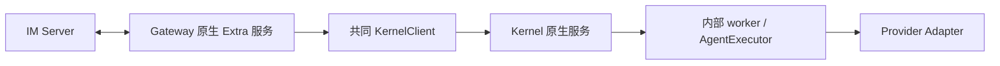

# 拓扑与资源所有权

CLI composition root 为 `apps/cli/src/main.ts`：Kernel 与 Gateway 在各自的用户服务进程中直接构造。SDK 最小宿主在自己的 Node 进程中 import 公共 `/executor-kernel`、`/host`、`/extras/channel-gateway`，直接构造两个服务；worker 由 Kernel 内部管理。两条路径都经过共同实现及本地 IPC，不能用直接 Core 测试替代 SDK KernelClient 路径。

| 主体 | 拥有资源 | 可以恢复什么 | 不拥有的资源 |
| --- | --- | --- | --- |
| Gateway | Bot 连接、心跳、重连 timer、渠道消费者和投递 | 当前 Bot 的暂态 IM 连接 | Kernel 服务、其他 Bot/Extra、宿主数据库 |
| KernelClient | socket、原 RunRef/游标、自己的 invoke 登记 | 原身份观察与后续独立请求 | Kernel 进程、Provider 执行重放 |
| Kernel | endpoint 租约、源窗口、worker supervisor | 内部 worker 可用性 | Extra、自启、业务历史 |
| Adapter | 本次 Provider 连接/子进程及原生会话通信 | 传输释放和后续合法调用 | 业务会话 reset、未知工具副作用重跑 |
| 宿主/管理器 | 配置来源、服务对象/宿主进程、自启、业务存储 | 显式启动/停止/重启及重新登录 | 用周期重启掩盖共享 SDK 缺陷 |

公共生命周期继续 `create → initialize → status/invoke → close`。不新增 SDK `resume/reconnect/restart` 必调接口，不增加顶层启动器。已有 close 总预算和 incomplete 语义不放宽。删除映射：首次暂态失败必须终止的条件、测试和说明予以替换；既有公共 API 不计划删除。

# G1：Gateway 状态机

| 条件 | 目标状态及动作 |
| --- | --- |
| 有效启用配置初始化，首次网络/DNS/timeout/429/5xx 暂态失败 | `retrying`；initialize 完成表示本地插件已装配，非在线承诺；后台恢复与已上线断线共用一个调度器 |
| 暂态断线 | 回收旧传输，再按用户要求的 5/10/15/15…秒等待；成功后清零退避 |
| 未配置/无效凭据、401/403、身份不匹配、已确认终态拒绝 | `failed`，稳定错误码；不后台接管、不 tight loop |
| 未确认 409 或未知协议错误 | 保留终态分类，先核实服务合同；不凭 HTTP 码猜“暂态占用” |
| reason 12 | 执行下述 G2；原始 code 保留，失败层可定位 |
| disabled / owner close / cancel initialize | 不建联或进入 stopped；取消所有后续重连意图 |

实施重点是去掉“必须 everOnline 才允许暂态恢复”的前置条件，保持每 Bot 单一 in-flight attempt、单 timer、独立 connection epoch 和 AbortController。第 n 次等待为 `min(15000, 5000*n)` ms，n 从 1 开始；实际等待为该值与服务端 Retry-After 的较大值，不能因 15 秒封顶绕过限流。成功后 n 重新从 1 开始。首次尝试的迟到成功不能覆盖已断线/已关闭状态。暂停期间错过的 timer 不补跑多次；长 Retry-After 继续分段等待，不能溢出为 1ms。

清理超时不等于资源回收。Wukong/GatewayTransport 的 close 必须实际终止 socket、pending send、typing/polling，并可重复等待同一清理；只有确认回收才允许下次连接。对不可中断的宿主依赖或未确认资源报告 failed/incomplete，不启动第二 owner。断网本身不应制造不可 settle 的内部清理；用受控测试证明这一点。

# G2：reason 12 决策门槛

1. M0 获取部署协议及单 owner、第二进程、第二设备、Token 更新对照证据。记录哪一端、哪个 session、何时踢掉哪个连接。
2. 若部署明确将某个机器可读原因定义为可恢复失联，按 G1 重试；仍保留代次 fencing 和上限退避。
3. 若部署明确为有效 owner 替换或认证撤销，保持终态，不主动夺回连接。
4. 若同一个 12 无法区分以上情形，保持显式错误并将“恢复合同缺少仲裁信息”列为 M0 阻塞项。实现方准备最小服务端合同变更建议和验证样例，不创造不存在的 owner 查询 API，不将重注册成功当作无竞争证明。

此分支可启动调查和无歧义修复，但在单 owner 的一小时事故仍因 12 永久失败时不得关闭 Issue。若需要另仓服务端变更，先提交可评审的合同设计；本轮授权不包含修改/发布服务端或发送外部消息。

# K1：挂起后的 worker 存活判断

这是针对 H2 的候选修复，须先用 M1 证明。内部保存上次监督 tick 的墙钟、单调时钟和当前 probe epoch。相邻监督 tick 在任一时钟的间隔达到 5 秒，或墙钟倒退时，认定需要重新核对存活；先发送新的存活探针，给当前 worker 一个完整 5 秒响应窗口，迟到 timer 不得在这个窗口开始前杀死 worker。一次探针在途时不因普通 tick 再延长截止。正常运行的 1 秒检查、5 秒失联和原替换预算保持，worker 无响应则按已有回收→替换流程处理。两种时钟各自记录，不能把壁钟跳变直接当作 worker 已失联；测试覆盖各平台单调时钟是否包含挂起时间的差异。

独立 heartbeat IPC 的旧 pong 不能证明新探针已响应：需要在私有 kernel.ping/worker.pong 中携带并核对 probe 标识，修改监督器及 worker responder。该私有协议改动不要求增加公共 SDK 接线。退出/error 仍立即失败；真实阻塞不得因重复“宽限”永久免疫。以“本次 probe 的实际响应”判断稳定，不用睡眠经过的墙钟时间重置崩溃预算。时钟大跳、仅父进程停顿、父子共同停顿、先 pong 后 tick、先 tick 后 pong 均须测试。

若 H2 不成立，不凭猜测落该改动；依 [analysis.md](analysis.md) 的 H1/H3/H4/H5 路径形成最小复现与修复。worker 确实崩溃时允许 generation/PID 变化，Kernel instance 和 endpoint 不因普通唤醒强制改变；旧活动 Run 可以 lost，新 Run 必须恢复。

# K2：执行接纳与观察

保留现有最多 3 次/10 秒的原身份修复预算，不将它延长到一小时。长中断后的旧源可能过期，必须明确 unknown/lost/gap/instance changed。新 invocation 使用新的身份，在同一未关闭 client 上独立发起，不继承旧 repairUntil、abort、socket 或失败状态。实际已关闭 client 返回 CLIENT_CLOSED，不能悄悄复活。

ACK 丢失只 get 原身份，cancel/respond 的未知 ACK 不重发副作用。Provider 恢复需要按 adapter 的真实协议实现，在旧资源释放后服务下一次合法请求；不得用自动新 session、reset、换 Provider 或重跑旧工具掩盖失败。测试覆盖 native 与 canonical。

旧 unknown 仍占未确认资源时，保留真实记录；M3 必须区分“泄漏占额”“可核对终态”与“合同内确实 unresolved”。若后者使普通重复恢复永久无法接纳新请求，必须单列资源生命周期设计并解决后才能通过 A12/A17，不能以提高上限或清空 Map 通过。此项不承诺无限未知 Run 历史持久化。

# D1：可观测性

复用 service phase、kernel_available、Kernel execution_ready、worker.state、Bot connected/state/error。`online` 仅指 WS，不改成执行成功。增加受控诊断元数据用于关联：UTC 时间、integration mode、连接/探针 epoch、Kernel instance、worker generation、Run/stream 身份、最后连续 seq、failure phase/code、retry attempt/next delay、cleanup complete。状态查询不得启动真实模型调用。

Gateway 折叠结果未知前记录安全的 Kernel 错误类别，区分接纳、订阅、worker、Provider 与投递；不写原始异常正文、消息正文、凭据或完整配置。现有日志白名单需同步扩展，不能绕过脱敏。若需要公开新状态字段，由 M4 执行 schema/类型同步；不先铺设未使用的大型健康探测 API。

# D2：Extra 状态 stdout 与 logs 命令

用户明确本功能用于 **Extra 工作状态排障**，不是聊天记录或具体 Chat 调试。`octo-runtime channel-gateway logs` 必须可用；同一基础设施用于其他已配置 Extra。API/路径及以下默认值为待实施设计。

| 命令 | 目标行为 |
| --- | --- |
| `octo-runtime channel-gateway logs` | 展示当前 Home 下最近 200 条状态记录，按时间正序，读完退出 |
| `octo-runtime channel-gateway logs --follow` | 先展示尾部，再持续跟随，支持轮转；SIGINT 解除 watcher/timer 并退出 0 |
| `octo-runtime channel-gateway logs --lines 50` | 指定尾部条数，整数 1..10000；每次历史读取另限 4 MiB |
| `octo-runtime channel-gateway logs --json` | 每行一个脱敏状态 JSON；与 --follow 可组合，不输出其他 stdout 提示 |
| `octo-runtime <extra-name> logs --home <path>` | 使用组件状态的同一 Home/name 解析，互不串读；停止后的已有日志也可查看 |

默认文本包含 UTC 时间、级别、Extra 名、事件、状态/稳定错误码和重试等待；示例为 `channel.reconnect_scheduled state=retrying attempt=2 delay_ms=10000`。必须覆盖 initialize/ready/stopping/stopped/failed、连接与断线、每次重试开始/失败/下次等待、终态拒绝、Kernel available/unavailable 转换、cleanup complete/incomplete。Bot 级可记录受控 Bot 标识；不得写 messageId、conversation/session/run 标识、用户内容、模型输出、工具参数、原始错误正文或凭据。总计数可以记录，不能把具体任务详情透出。

实现采用**独立状态事件白名单和字段白名单**，在普通 Runtime 日志入口分流前筛选。状态事件形成一次 JSON 编码，同一行由 CLI 宿主输出到 stdout，并通过既有有界日志 Worker 写入 `<home>/logs/extras/<name>-status-<UTC-hour>.log`。不能只 tail 现有含 Run/session 元数据的执行日志后称为状态 stdout；不能全局替换 `process.stdout.write` 抓取任意模块输出。仅 CLI Extra 显式启用状态 stdout；普通 SDK 默认静默，可由宿主显式订阅同一状态 sink，宿主选择是否打印。

复用 hourly-log 的 UTC 小时、每序列最多 3 个实际文件、每文件 100 MiB 限额及关闭预算；状态序列单独计数。stdout 分支须尊重背压，最多 128 条且最多 1 MiB 待写，慢消费者不得积压无限内存或阻塞恢复；满额丢弃诊断并在恢复后输出一次累计 dropped 计数。文件失败与 stdout 失败互不阻断，更不得变成执行失败；未观测到日志不证明未发生故障。一条状态记录编码后最多 16 KiB，超限按丢弃计数处理，不截断成无效 JSON。

后台可查看性依赖宿主自己写入的状态镜像，不依赖服务管理器的原生 stdout 重定向，因此 macOS/Windows/Linux 一致，Windows Task 不需要新增 shell wrapper。前台真实 stdout 与 logs --json 的状态行内容须可逐行对照。Kernel/worker 的 NDJSON 协议 stdout **不得混入状态行**；本次 `<extra-name> logs` 不接管 Provider stdio。

`logs` 是只读动作：不安装、不启动、不连 Bot、不触发模型、不修改配置。无历史日志输出受控提示到 stderr 并返回 0；不存在的 Extra、权限失败、非法参数返回既有非零错误合同。tail 只扫描目标命名序列，不跟随外部 symlink；按字节有界读取，保留 UTF-8/完整行，轮转和截断不重复整文件。`--follow` 断开时释放所有本命令资源，退出不改变服务状态。CLI flags/parser/help、组件 action 路由、状态 emitter、小时日志 writer 和读日志模块均要有回归；只加文档或文件路径不算完成。

# T1：恢复计时与通过口径

拟采用 180 秒为本修复验收目标。`t_ready` 是主机已唤醒，且本场景必需的 DNS、认证/注册、IM WS、Provider 路由由独立无副作用探针确认可达的最晚时间。`t_link`、`t_bot_online`、`t_kernel_ready`、`t_admitted`、`t_terminal`、`t_reply` 分别记录。依赖未恢复的时间不能算 Runtime 恢复超时，也不能用 Runtime 自己的 online 时间倒推 t_ready。

每 5 秒尝试一个独立、唯一身份的恢复探针；未接纳的明确拒绝可以结束该次探针，接纳未知不得重发该身份。为控制测试流量最多一个真实执行探针在途。自 `t_ready` 起 180 秒内必须有成功接纳的新请求、真实执行终态及 IM 回复确认。选择 baseline 已能在 30 秒内完成的固定小请求；记录供应商延迟，超时不能直接改判通过。此门槛是测试建议，M0 固定后写入操作文档。

遇服务端 Retry-After，单独记录强制等待区间；默认 180 秒检查先标 `deferred_by_server`，从强制等待结束继续最多 180 秒验证，不能直接记 pass 或无限延长。auth/ownership 终态不要求自动恢复，需满足错误可见、无接管循环及其他 Bot 不受影响。SDK 的恢复过程中宿主 PID、服务对象和 initialize 次数保持不变；CLI 的正常睡眠/网络试验中两个服务 PID 保持不变。显式生命周期故障行允许被注入故障的组件改变身份。

# O1：离线消息与投递

M0 用断网前/期间/后唯一 messageId 与 Provider admission 计数核对现有服务端 ACK、离线 replay、消息保留及本地去重窗口。重连不自动宣称离线消息全补齐。对同一重放消息必须验证现有支持窗口内不重复执行；超出合同的丢失/未知如实记录并关联 #78。若本修复导致额外重复执行，阻塞发布。投递结果未知与执行结果未知分别记录，不能用重复 invoke 修复投递。
