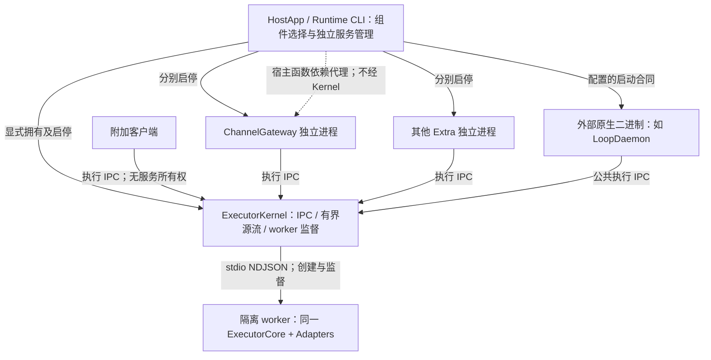

# 实施顺序与状态

基线和范围见 [brief](brief.md)。本轮已完成 worktree 和计划准备；下列 M0–M6 均为待实施，
没有把阅读已有代码或旧测试结果记作本次 milestone 通过。milestone 按功能交付划分，不预设提交授权或截止日期。

细化设计已固定在 [接口与生命周期合同](design.md)、[逐文件改动](changes.md)和
[可执行测试方案](test-execution.md)。原90分评估的10分缺口及复评依据见 [评分](assessment.md)。
用户最新明确：旧 daemon 直接改名拆分或删除重写；最终删除旧包/入口/API，不保留转发、兼容壳、双轨运行或旧服务迁移工具。

| 阶段 | 进入条件 | 可交付结果 | 功能验收 | 主要 issue |
| --- | --- | --- | --- | --- |
| M0 合同与改动清单 | 最新 main 和需求可用 | design 落成 Schema/声明/fixture，逐文件去向与旧代码删除点固定 | A01–A02 | #47/#48，与 #51 对齐 |
| M1 Kernel 与 TS client | M0 合同可实现 | 独立服务、多客户端、双模式执行和有界续订 | A03–A08 | #47 |
| M2 worker 故障监督 | M1 真实 worker 链路可运行 | 父进程探活、有界重启、lost 与清理 | A09–A13 | #47 |
| M3a 独立 Extra runner | M1 端口固定，M2 故障语义可用 | 三个内置 Extra/第三方入口，独立配置、状态与停止 | A14–A16、A19 | #43 |
| M3b 宿主依赖代理 | M3a runner 可用 | 动态函数协议、跨代次真实占额与失败清理 | A17–A18 | #48 |
| M4 原生 HostApp SDK | M2/M3 生命周期可消费 | direct、attach、owned Kernel 与独立 Extra 的明确接口 | A20–A23 | #48 |
| M5 CLI 独立服务 | M4 提供共享编排能力 | executor-kernel/channel-gateway两组各六个生命周期动作，共用独立组件管理原语 | A24–A28 | #49对应范围 |
| M6 集成与迁移交付 | M1–M5 功能通过 | 三平台、临时发行物、真实 CLI/SDK 联验和迁移文档 | A29–A32 | 四项联合，与 #50/#14 交接 |

依赖主线：`M0 -> M1 -> M2 -> M3a -> M3b -> M4 -> M5 -> M6`。
M3 分为两个可单独验证的检查点，其余里程碑编号保持不变。
每个阶段交付可构建检查点，未切换的旧源码只允许作为开发中尚未处理的部分；最终一并删除，不交付兼容路径。

## 目标进程与生命周期

显式 direct 为另一种拓扑：HostApp 直接创建 Core，Adapter 与宿主共享进程及 event loop。
default 不得因 SDK 方法形状像函数就静默改为 direct。进程拓扑须可从类型、状态及真实 PID 验证。

| 操作 | 必须影响 | 必须保留 |
| --- | --- | --- |
| attached client.close | 该客户端连接、订阅、pending 操作 | Kernel、已接纳 Run、其他客户端和 Extra |
| owned Kernel.stop/restart | 该所有者的 Kernel 与 worker；受影响 Run 真实终止或丢失 | 独立 Extra 进程；其执行状态变为 unavailable，不能假报成功 |
| Extra.stop/reload | 该 Extra 的准入、所属调用、连接与进程 | Kernel 和其他 Extra PID/连接 |
| logout/account-change | 宿主显式绑定该账号/租户的 Extra、依赖桥与执行资源 | 无关账号组件、外部共享 Kernel 和其他宿主客户端 |
| 显式组合 shutdown | 仅组合中明确拥有的组件，先停业务准入并尝试最终投递 | 非本宿主拥有的组件；错误不得隐藏 |

取消和交互仍按既有同账号信任及执行身份合同校验。生命周期所有权不是新的逐应用安全边界。
Extra runner 只暴露自身执行的 cancel/respond；生命周期 RPC 不得混入公共执行端点让 attach 客户端隐式取得服务管理能力。

## M0：冻结合同与迁移路径

产物：按 design/changes 实施 Schema、公共声明和正反 fixture；将设计预算纳入可控时钟测试。

- 基于 #46 的唯一 Core 复用执行合同；不得在 Kernel 再做配置解析、业务 Context 渲染或业务重试。
- 与 #51 固定 JSON-RPC 2.0 UTF-8 NDJSON、方法、关联 ID、InvokeInput/环境值、receipt、HostFrame、状态/错误及 native/canonical 语义。AbortSignal、函数和模块对象不进入 wire。
- 固定 run/invocation/session/generation/stream/seq 校验、接纳时点、ACK 丢失后查回、gap/expiry、取消与回答、终态前后 source-lost 行为。旧接口缺口在 Schema 源头补齐，不能只搬 TS 类型。
- 实例字段固定为外层 kernel_instance_id，worker 状态含 generation；receipt/HostFrame 形状保留，不修改 Run 7/Context v3。
- 盘点 runner URL、manifest、imports、public declarations、配置合成、Home 锁、端点、日志、服务定义和 tgz 生产图；每项写明新所有者与切换时点。
- 按用户决定删除 daemon 命令组、octo-runtime-daemon bin、DaemonRuntime API 及旧包；不做旧命令识别/转发或旧服务自动迁移。现存用户文件和进程不属于源码删除操作。

模块去向已固定：executor-kernel 接收执行传输和监督；新 host-sdk 接收宿主及 Extra runner。
主包公开 /executor-kernel 与 /host；旧包删除时点、imports 和构建检查点按 changes 执行。

通过：A01–A02 的每个合同有生产方、消费方和 fixture；未完成 Go client 不阻塞。失败：关键语义冲突先解决，不创建第二套执行/配置引擎兼容两种行为。

## M1：独立 Kernel 与可复用 TS client

主要来源：旧 `server.ts` 的执行分发、`runtime/run-stream.ts`、`runtime-contract.ts`、
adapter-host 的 `host-run-service.ts`、`rpc.ts`、`process.ts`、`serve.ts`、`runner.ts`。

- 交付仅执行用途的服务入口；Host 传 endpoint、已安装入口和准备好的配置值，保留 worker 的 Core/Adapter 隔离与 NDJSON readiness。
- client 支持 list、invoke/receipt、native/canonical 事件流、get/subscribe、cancel、interaction/native response。attach/close 与服务管理分开。
- invoke 接纳与订阅生命周期分开；请求在途断开不能把普通断订阅变成 cancel。ACK 不确定时按身份 get 原接纳，无法确认则报真实 unknown/unavailable，不再次 invoke。
- 沿用中央 StreamLimitPolicy 和有界源流，控制 socket 写队列、客户端队列、pending RPC、连接/订阅数及未换行输入。每项有独立容量和精确错误，慢读不能无限占内存。
- endpoint 由 Host 选择；CLI 默认使用新的 executor-kernel 端点名，SDK 显式传 endpoint。POSIX 保留 socket 访问保护；Windows 验证命名管道。活动端点冲突拒绝，不能直接 unlink 别人的 socket。

通过：A03–A08，真实独立服务与至少两个独立进程客户端完成执行、交互、取消及断流续订。
失败：修复当前检查点，不增加旧 daemon 或进程内执行回退路径。

## M2：worker 监督和真实故障状态

探活必须由 Kernel 父进程计时，worker event loop 响应控制 ping；无模型输出不代表 worker 死亡。
仅在 worker 内设置 timeout 无法处理同步阻塞。控制探活应有独立有界通道/优先级，不能被业务输出积压无限饿死。

以下为本设计选定的实施预算，完整容量和平台关闭合同见 design D4；尚未实施或实测：

| 机制 | 实施预算与判定 |
| --- | --- |
| worker 启动 | 从 spawn 到 readiness 最多 15 秒，复用现有默认；失败进入同一回收流程。 |
| event-loop 探活 | 每 1 秒探测，最后有效 pong 后 5 秒无响应判故障；父进程正常获调度时检测目标不超过 6 秒。模型静默不参与判定。 |
| 强制回收 | POSIX受管组TERM400ms、KILL后确认200ms，共用起点；Windows最多5秒taskkill及后代确认。失败返回incomplete，两个平台均须真实进程验证。 |
| worker 恢复 | 初次启动之外，故障周期最多 3 次替换尝试，等待 250/1000/4000 ms；60 秒内最多 3 次，存活稳定满 60 秒才重置故障预算。耗尽后保持 unavailable，等待 owner 显式恢复。 |
| Extra 受控关闭 | 延续现有最多 5 秒清理预算；停止接纳、打断所属任务并尝试最终投递后再拆业务连接。进程强制回收结果独立报告。 |

- 启动失败、exit/crash、SIGKILL/模拟 OOM、无限同步循环分别用真实 worker fixture 测；不能用 Provider 报错代替 worker 死亡。
- 同 worker 的所有在途 Run 都纳入故障影响；已被 Kernel 接受的最终终态不得改写。Kernel 未接收的 Provider 候选结果不能冒充已完成。
- Kernel 保留有界可查失败/源丢失信息，恢复后的新调用使用新 worker；不重新提交旧输入。Kernel 自身死亡由 Host/服务管理器恢复，client pending 必须结算真实连接错误。
- 在 stop 与 backoff/readiness 并发时取消替换，回收迟到 worker；只回收本次受管进程树。清理未确认时保留所有权，禁止无限重启制造孤儿。

通过：A09–A13；记录检测、信号、退出确认和恢复时间，以及 Provider 启动次数、兄弟 Run 结果。
失败：停止后续迁移，保留错误和资源证据；预算耗尽不无限循环，不扫描或杀死用户其他进程。

## M3：Extra runner 与宿主函数依赖桥

主要来源：旧 `extras.ts`、`extra-config.ts`、`runtime/local-extras.ts`、三个内置 Extra 的入口。

- 每个 Extra 有独立进程/runner、完整 config、明确 endpoint 和生命周期控制连接；只依赖公开执行 client，不依赖 DaemonRuntime、daemon supervisor 或 in-process AdapterHost。
- 保留 `{ module, enabled?, config }`、两阶段 initializer、onDispose/onStatus 和名称/容量/清理失败语义。第三方已安装可解析模块无需修改 Kernel。
- 原生 binary 用独立 launch descriptor 表达 executable/argv/config/endpoint，不把 module 字符串偷偷解释为可执行命令。
- 先启 Extra 而 Kernel 不可达时报告 execution unavailable；可按显式策略重连原 endpoint，但不新建 Kernel，不重新 invoke。业务外联健康由 Extra 自己报告。
- 动态依赖主方案为宿主到 Extra 的专用代理：宿主保存函数，Extra 保存类型化代理；每次已准入任务准备时调用一次并传取消。可选模块入口必须显式声明，在 Extra 进程加载，不能冒充跨进程闭包。
- 固定 call ID、Extra/账号代次、timeout、最大在途数、响应字节数和关闭协议。外层超时不释放仍在运行的宿主操作占额；迟到结果丢弃，断连/饱和真实失败，不缓存旧 Context 兜底。
- 代理预算固定为默认5秒/8个真实在途，上限30秒/32；Context结果64KiB，控制排队64条/2MiB；细节见 design D5。任意同步宿主函数仍可阻塞宿主，不承诺线程沙箱。

M3a 先以无函数依赖/模块依赖运行 Extra，验收 A14–A16/A19；M3b 单独交付宿主代理并验收 A17–A18。
M3a 通过不能冒充动态函数已交付，M3b 失败时不得恢复在 daemon/宿主进程内加载业务的旁路。

通过：A14–A19；三个内置 Extra 和第三方 fixture 分别在独立 PID 下运行；同一函数读取数据改变后，下一轮取新值且 Extra 不重启。
失败：保留失败实例所有权、继续尝试其他独立清理，不允许创建新容器绕开 failed disposal。

## M4：HostApp SDK 的 direct、attach、own

接口名称固定为 AgentExecutor、attachKernel、startOwnedKernel、startExtra；具体能力和返回值见 design D2。
管理操作只能由 owner 显式调用，不靠一个含义不明的 dispose 同时停止共享服务。

- 提供四种可编译、可运行示例；默认 SDK 消费链保留隔离方式，并公开 topology、owner、endpoint、Kernel PID、worker PID 和状态。
- 新本地执行入口不以 startAccount/云登录作为前提；已有身份/权限/账号授权仍在对应业务边界执行。
- Host 接收准备好的值和已安装组件，不强制 CLI 文件布局。createDaemonRuntime旧API直接移除，消费者改用明确能力对象；不能声称任意旧闭包不改即可跨进程。
- 启动每一步登记实际取得的资源；失败只回滚本次新建组件，不能停止原已附加 Kernel。关闭所有独立资源后聚合失败；未确认进程退出/清理不得提前释放所有权与锁。
- 账号/租户切换先停旧代次接纳与依赖调用，旧回调/卸载不能影响新代次；共享 Kernel 仅在显式绑定该账号且由本宿主拥有时纳入对应停止操作。

通过：A20–A23；真实 Node 宿主调用 SDK，不调用或解析 CLI。失败：只修复拥有者合同，不通过账号重建或 Home 清空恢复。

## M5：CLI 作为 HostApp 独立管理服务

主要来源：`apps/cli/src/main.ts`、`help.ts`、`service-control.ts`、`extras.ts`、
`temporary-daemon.ts`、`apps/daemon` 入口及 `octo-runtime-cross-service` 平台后端。

- 用户明确的主命令固定为 `octo-runtime executor-kernel uninstall|install|start|restart|stop|run` 和 `octo-runtime channel-gateway uninstall|install|start|restart|stop|run`，两组动作完全对称。
- start/restart只管理已安装的目标服务；run为该组件前台入口。ChannelGateway不拥有Kernel，Kernel不加载ChannelGateway；任一组操作不得隐式启动、停止、重启或安装另一组。
- 状态继续由全局 `octo-runtime status --json` 分项返回；自启通过目标install的显式选项设置，不在这两组追加enable/disable/status动作。通用Extra/外部binary的公开命令另属#49，不以本次两组交付宣称#49全部关闭。
- 每个服务有独立 service ID、PID/锁、定义、日志与自启设置，复用 SDK/服务后端；组合命令逐项列出范围和结果。
- `extraset/extraget` 保留唯一 CLI 配置目录、整份替换、原子写和文件保护。保存与 reload 分别报告；重载只替换目标 Extra，不重启 Kernel。禁用也是明确目标服务操作。
- 分别报告 process、IPC、worker ready、Extra 外联健康和执行结果。`--json`、exit code、help 与人类输出一致；配置保存不能假报生效，进程 running 不能假报 Run 成功。
- 外部binary启动合同在共享SDK原语中用原生fixture验证argv/cwd/env/config/endpoint、所有权和有界关闭；缺失不下载。本次不借此增加第三组公开CLI命令或实现Loop业务。
- playboard 等临时入口只拥有本次临时 Kernel；关闭不能误停常驻共享服务。最终产物与源码移除旧 daemon 的 bin、service ID、入口和 imports，不增加旧安装检测或迁移框架。

通过：A24–A28；macOS/Linux/Windows 后端按实际支持报告，自动启动与恢复是显式宿主选择。
失败：受影响平台不得记为通过，不借重装旧全量 daemon 隐藏独立服务缺陷。

## M6：工程、平台与实际消费验收

- 复用一次构建执行 typecheck、lint、lint:names、format:check、全量 Node/UI；新增跨包合同与故障测试纳入 CI。
- 单一 npm 发行物暴露新公共入口，仓库外 Node/TS 工程以 `skipLibCheck=false` 消费临时 tgz，验证默认隔离、attach、owned、独立 Extra；内部包继续 private。
- macOS/Linux 真实 UDS，Windows 真实 named pipe、worker/后代回收、服务启停、独立 Extra 与原生 executable 都留证据；平台不可用标待验，不能用 Unix mock 替代。
- CLI 和真实 SDK Host 分别在 im-test 用真实 Provider 验执行、流、交互、取消、失败、单 Extra 重载和 Kernel 恢复。记录宿主、版本、入口和实际 PID；涉及真实 App 改造时构建并重启，renderer 变动另做 CDP 验证。
- 更新 CLI/SDK/Extra 编写指南、公共 OSS 英文说明、架构图与现行规则；本计划不提前把目标替换为已交付合同。
- #46 留下的新 Kernel source-lost/终态 fixture 纳入本任务；交给 #51 共同验证，交给 #50 消费迁移。缺少维护中宿主或平台证据时列出具体缺口，不提前关闭 #43。

通过：A29–A32 和每个 issue 的原始验收都有本次证据。失败：停在明确检查点，保留已可交付的阶段，不以历史 CI/测试数替代缺失证据。
