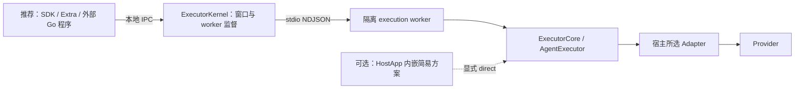

# 草案边界

以下为 #46 的实施设计，接口已在本地工作树实现但尚未发布。总体架构来自用户与 issue；方法、发行入口和生命周期细节为本次实施方案。开发阶段及验收见 [M0–M5](plan.md)，实际结果见 [实施记录](implementation.md)。R3 已落实，R1/R2 仍为跨任务交接条件。

接入优先级已由用户明确：推荐 SDK 经 IPC 调用独立 ExecutorKernel，以稳定性为优先；
Electron 等长期运行的宿主优先采用隔离路径。direct 是允许显式选择的 SDK 内嵌简易方案，
由宿主管理生命周期并承担同进程故障影响。当前保留旧 worker，不能将 #47 的新 Kernel
IPC 和监督能力写成已经实现。



这是目标责任图，同一 Core 可分别被实例化在宿主或 worker 中，不表示两种方式共享内存实例。返回流和交互响应沿原链路传递。Core 不依赖 Kernel，worker 仍是隔离边界；同一 worker 可承载多个 Run，不承诺每 Run 独立进程。

## 公共接入草案

迁移并命名执行类为 `AgentExecutor`，不创建第二套执行门面和实现。HostApp 显式注册 Adapter，不由 Core 读取 CLI manifest、Home 配置或扫描安装集合。

| 方法 | 输入/输出与约束 |
| --- | --- |
| constructor({ log? }) | 仅注入已有 RuntimeLog；默认不创建文件、端点、进程信号监听或后台服务。 |
| register(adapter) | 复用现有 HostedAdapter 结构及注册校验；重复 type 拒绝。 |
| list() / describe(configurations?) / probe(type, options?) | 复用现有注册元数据与实际可用性探测；不恢复业务能力目录，不安装 Provider。 |
| invoke(input, environment?) | 使用现有 createInputInvoke 泛型视图：默认 native 源帧，显式 canonical 返回类型化事件；一次调用只启动一次执行。 |
| invokeFrames(input, environment?) | 同一输入准备与完整 HostFrame 源，返回 AsyncGenerator；不另建执行路径。 |
| cancel(invocationId, reason?) | boolean 只表示向活动调用提出取消，不表示已确认 Provider 退出。 |
| respondInteraction(invocationId, response) | canonical 回答写回原活动调用，Promise 确认写入而非工具成功。 |
| respondNative(invocationId, response) | 保留 requestId 与 Provider payload；拒绝跨模式、过期或非活动回答。 |
| shutdown(reason?, timeoutMs?) | 返回 ExecutorShutdownResult；同步关闭接纳，并发调用共享当前清理，超时如实返回 incomplete，后续允许重试清理且不重新开放执行。见下文状态合同。 |

InvokeInput 继续接受普通结构对象；InvokeEnvironment.signal 与宿主函数留在当前 JS 进程。已有 executionEnvOverrides 和 streamLimits 经可信执行环境处理，不能注入模型文本或混入 input JSON。streamLimits 由宿主受信配置提供，不从 Context、聊天正文或 Provider 参数取得；Core 保留每轮策略冻结及 AdapterInvocationContext 下发。直接调用不自动获得 IPC 接入、断流续订或 worker 故障恢复能力。

接纳前的同步输入/身份错误可由 invokeFrames 抛出；invoke 的惰性异步视图在消费时暴露。首个有效 running HostFrame 承载接纳身份，之后错误按已接纳执行事实收口；不以 RPC ACK 作为执行成功，不新增 public prepare/commit 两阶段执行 API。各模式的类型与取消抛错行为保持现有合同，并在 parity 测试中固定。

### 类型与传输映射

下列是 AgentExecutor 类声明草案，引用现有协议及 Adapter 类型，不要求新增另一层接口实现。InputInvoke 保留现有重载，不能简化成丢失模式类型的任意联合流。

```ts
declare class AgentExecutor {
  constructor(options?: { log?: RuntimeLog });
  register(adapter: HostedAdapter): void;
  list(): HostedAdapterMetadata[];
  describe(configurations?: Record<string, AdapterProbeOptions>): Promise<HostedAdapterMetadata[]>;
  probe(adapterType: string, options?: AdapterProbeOptions): unknown;
  readonly invoke: InputInvoke;
  invokeFrames(input: InvokeInput, environment?: InvokeEnvironment): AsyncGenerator<HostFrame>;
  cancel(invocationId: string, reason?: string): boolean;
  respondInteraction(invocationId: string, response: InteractionResponse): Promise<void>;
  respondNative(invocationId: string, response: NativeInteractionResponse): Promise<void>;
  shutdown(reason?: string, timeoutMs?: number): Promise<ExecutorShutdownResult>;
}

interface ExecutorShutdownResult {
  state: "closed";
  cleanup: "complete" | "incomplete";
  unresolvedInvocationIds: readonly string[];
  failedCleanupInvocationIds: readonly string[];
}
```

`state=closed` 只表示 Core 不再接纳执行，不代表 Provider 进程已全部退出；只有 cleanup=complete 且两个列表都空才表示 Core 观察到其负责的清理完成。complete 不证明同进程任意 JS 或不归本次所有的进程均已停止。结果是当前关闭尝试的快照，不用于业务历史查询。

现有 RPC list 调用 Core.describe(configurations)，不能改为仅返回注册列表；RPC cancel 将 Core boolean 包装为既有 `{cancelled}`，响应保持独立 Promise。Core 不为了适配 JSON-RPC 把所有同步方法改成网络形状。shutdown 属于实例所有者，不添加到 attach 客户端可随意停止共享 Kernel 的公共执行端口。

### 接纳与单次调用状态

| 阶段 | Core 行为 | 可观察结果 / 禁止事项 |
| --- | --- | --- |
| 输入准备 | 校验完整 input/environment、预算、权限、模式并冻结本轮数据；渲染固定 Context | 接纳前失败没有 receipt、活动记录或 Provider 副作用；streamLimits 校验不能晚于状态提交。 |
| 尚未消费 | 返回的 iterator 由调用方持有；不写入 Core 长期 invocation Map | 仅创建 iterator 不占 1024 容量；调用方释放 iterator 后 Core 无残留记录。不增加未消费即运行的后台执行。 |
| 首次 next / 接纳 | 检查实例仍可接纳、重复身份、容量；原子创建 invocation 记录、controller、固定 receipt 与模式，然后返回 running 首帧 | 第一帧一旦可见，cancel/shutdown 已能定位该调用，不能依赖 Provider 已开始；并发相同 ID 只能一个接纳。 |
| receipt 后、Provider 前 | cancel 标记同一 controller，下一次推进不启动 Provider | 按原帧身份返回取消收口；仅在调用方继续消费时才交付帧，资源终止不依赖继续消费。 |
| 执行与交互 | 共享 controller/Adapter/identity，watchdog 管已有执行预算；pending 回答写回同一调用 | 跨模式、错 ID、重复在途回答、过期回答拒绝，不投递给其他 invocation。 |
| 候选终态与清理 | 暂存 Provider 结果，禁止迟到用户取消改写；按现有预算等待并核对清理/后续协议 | 清理失败不能输出 completed；不因另一次取消生成第二个正常终态。 |
| 最终终态 | 失效 pending，输出唯一 Host 终态，释放活动 controller/Adapter/本轮输入引用 | 已交付的最终终态不可覆盖；retained 元数据按 1024/120 秒合同有界回收，不保留 Context/正文。 |

准备与实际接纳分离仅是内部原子性安排，不开放第二个 public prepare 接口、不重复准备请求。invokeFrames 仍可同步拒绝输入；身份冲突/容量/关闭也可能在首次 next 时拒绝，直接调用者以 try/catch 包围整个消费流程。RPC 仍从首帧提取 receipt 后 ACK，不改变 wire 形状；此行为变化在 M0 文档与回归中明确。

consumer.return、signal.abort、显式 cancel 和 shutdown 都引用同一取消/清理动作；重复调用不能重复关闭同一原生 responder 或重复 spawn。已接纳而暂停消费的控制器不能被“非活动 120 秒”淘汰。清理结束后保留的只允许是有界身份/终态/清理元数据。

### 实例关闭合同

1. OPEN 接到 shutdown 时，先同步关闭新执行与新注册接纳，再触发所有已接纳调用的取消/清理。已有 receipt 后但未启动 Provider 的调用同样处理，禁止此后启动。
2. CLOSING 的并发 shutdown 共享当前清理尝试；第一个调用决定该次 reason/timeoutMs，默认等待仍为 2500ms。timeoutMs 必须是正的安全整数，不静默裁剪。结束前每个已拥有调用均尝试清理，单个失败不跳过兄弟清理。
3. 清理结束或预算耗尽后进入 CLOSED，返回结果快照。未决或已失败清理列表非空时 cleanup=incomplete；继续保留对未清理资源的所有权与可重试清理引用，不以清空 Map 表示成功。
4. CLOSED 且上次 incomplete 时，再次 shutdown 可以开始一次有界清理重试；并发重试仍共享一次尝试，不重新注册 Adapter、不开放 invoke、不重放 Run。上次 complete 时再次关闭返回同等完成结果且不重复副作用。
5. late cleanup 的结果不回改已返回的快照。后续查询通过下一次 shutdown 获取结果，诊断记录不输出正文或凭据。Provider 原生进程强杀仍归拥有该进程的 Adapter/worker 边界，Core 不扫描全机。

旧 serve 的成功回调检查 cleanup，incomplete 以 exit(1) 退出；父进程锁和端点由原所有者处理，Core.state=closed 不构成释放 Home 锁的依据。R3 消费映射与失败/重试已落实并验证，见 [实施记录](implementation.md#r3-消费映射)；不把 #13 全部整改纳入 #46。

发行建议：内部 workspace 包使用 issue 指定的新名称并继续 private，单一 npm 发行物增加 `@mininglamp-oss/octo-runtime/executor-core`，导出类、必要 Adapter 结构类型和引用的公开类型；不默认把所有 workspace 包改成独立 npm 包。编译/运行样例必须从包 exports 接入，不从嵌套 node_modules 或 dist 物理路径导入。

## 源码迁移表

| 当前代码 | #46 处理 | 最终归属 |
| --- | --- | --- |
| `core/src/context.ts`、`invoke-input.ts` | 内聚迁移，不改 defaults/mandatory 与输入语义；单次准备仍为内部路径 | ExecutorCore |
| `adapter-host/src/index.ts` 中执行类、HostedAdapter/Metadata | 分离执行与传输 re-export；类改名，结构合同保留 | ExecutorCore |
| `model-input.ts`、`experience.ts`、`watchdog.ts` | 按原行为迁移并保留定向回归，不借迁移改超时默认 | ExecutorCore |
| `execution-preparation.ts` | 迁移现有显式准备工具和类型；stateRoot/store 等由调用方提供，不新增业务 store，也不擅自加入 invoke 的自动步骤 | ExecutorCore 执行准备工具 |
| `host-run-service.ts` | 不移入 Core；复用 Core 类型/执行端口解除对具体 RPC 类的类型耦合 | #47 Kernel 窗口与订阅 |
| `rpc.ts`、`process.ts`、`serve.ts`、`runner.ts`、`socket-server.ts`、`module-specifier.ts` | 暂留原传输位置，runner 实例化新 Core；保留 Windows 路径/file URL 解析和 IPC 命名合同，不得在旧包保留执行副本 | #47 Kernel/worker |
| `runtime-configuration.ts`、Adapter manifest 模块加载 | 不进入 Core；文件读取、模块装配由运行入口承担 | #47/#48/#49 的宿主组合层 |
| `daemon/src/server.ts`、SDK runner、Extra 与 CLI 消费入口 | 本 issue 只做解除旧 Core 依赖的必要接线与类型替换 | #43/#47/#48/#49/#50 分别迁移 |
| `package.json`、lockfile、public 入口、构建/发行脚本、测试 imports/fixtures | 随新模块同步，旧 Core 删除必须没有悬空解析；旧 host 传输壳后续退出 | #46 基础交付，#50 最终迁移验收 |

依赖方向为 `Kernel/worker -> Core -> protocol + adapter-sdk`；Adapter SDK 不反向依赖 Core，Core 不导入内置 Adapter 实现或 Extra。普通 node/fs/path、工作区准备和 Provider Adapter 自身 IO 不等于依赖 IPC；检查的是执行与传输责任及进程级副作用。

## 状态、终态与故障归属

Core 独占输入冻结、receipt/stream identity、seq、活动 Adapter、取消、交互路由与正常执行终态。迁移保留当前 1024 invocation 记录上限和 120 秒非活动记录惰性淘汰，不扩展为历史查询/续流。已接纳未消费、提前关闭、接纳异常、结束与 shutdown 都要有释放路径；记录满时明确拒绝，不淘汰仍活动调用来假装可用。

Kernel 只保存 Core 源帧的有界窗口：128 Run（含接纳中）、默认每 Run 4096 帧/32 MiB、总 128 MiB、TTL 120 秒、16 订阅、每页 32 帧、单帧 20 MiB。容量继续复用 protocol 中的中央 StreamLimitPolicy：Provider 原始消息默认 16 MiB，Adapter/RPC 队列默认 32 MiB/4096 项，每项硬最大值为默认两倍。按 invocation 冻结受信覆盖，低预算不得淘汰其他 Adapter 的已保留帧；保留容量错误类别、安全测量和 failure 信封。Core 的计数不是这层窗口，不能用 1024 替换 128。窗口不重编号、不重新准备输入、不决定第二个正常终态。

Provider 候选完成须经过协议与清理校验，清理失败不能报告成功；迟到取消不能覆盖已接纳的 Provider 结果，清理故障按原合同单独收口。Core 已确认且对外交付的最终终态不可被后续事件改写。worker 在最终终态前丢失时，仅 Kernel 有权为受影响 Run 收口 lost；一旦源已确认结束，不再追加竞争终态。原生错误与有效失败详情继续保留，不统一改成无原因的成功或取消。

普通 Adapter 异常在同进程执行中可收口本次调用；process.exit、OOM、同步阻塞不能由 Core 捕获隔离。watchdog/清理预算不能保证终止任意 JS 或残留 OS 进程。#47 负责父进程活性检测、强制退出、共享 worker 连带影响和有界重启；重启只恢复后续可用性，不恢复旧 Run，不自动重放。

直接消费者关闭执行 iterator 按原取消/清理合同处理；Kernel 客户端仅断开订阅不等于取消，后台消费与源生命周期属于 Kernel，不能把 direct iterator.return 与 subscription.close 混成同一语义。

## 实施顺序与文档同步

1. 按 M0 固定本地 API/归属/生命周期检查点，完成 R3 消费映射并记录 R1/R2 联验进入条件，不等待完整 Go 客户端。
2. 新建 Core、迁移唯一执行实现及内部输入准备，去掉 Core 到旧 host 的反向依赖。
3. 接回现有 worker/RPC、迁移必要 imports/构建资源，验证原链路与 direct；旧 host 不保留第二套实现。
4. 补齐失败/状态/清理测试、公开入口消费与规则更新；交付 Core 检查点。
5. #47 到位后运行真实 Kernel worker parity，#50 记录真实 Provider/IM 与安装迁移。用户最新决定本次 Core PR 使用 `Closes #46`，这些后续联验继续归相关 issue，不作为本次关闭前置条件，也不记为已通过。

同步 architecture/protocol-design/local-execution/stateless/invoke-input/output-protocol/adapter-metadata 等受影响说明及 `_index.yaml` 路径触发器，增加 executor-core 路径，不只改标题。旧 output-protocol 文档仍列出 InvokeInput 规则声明已删除的 HostInvokeWireOptions，迁移时按代码核对该处，不恢复旧 API。历史交付记录保留其当时含义。
