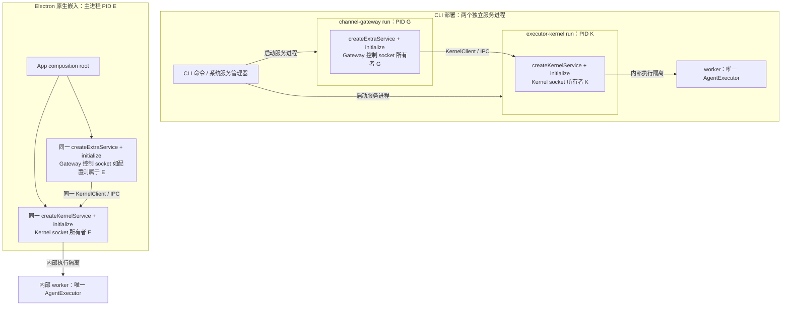

# 设计状态

下列名称和类型是本 worktree 的实现合同，尚未提交或合并 main。当前以 main@70f0247 为协议与行为基线；#73 的 KernelClient.invoke、交互、InvocationRegistry 和低层协议，以及 #72 的 Gateway 排空和终态失败确认原样保留。原生装配保留 #72 的插件单调截止，不恢复独立 runner 或外部服务启动器。本任务仅重做原生服务装配及其清理，旧 worktree 的重复 invoke、beginDrain/drain 和 KernelExecutionClient 方案不再采用。验证事实见 [实施记录](implementation.md)。

普通业务通过 KernelClient 调用 RPC，像使用工具一样提交输入、消费结果并按需控制，不操作调用登记表，也不承担服务托管。CLI/App 装配入口负责原生服务 initialize/close；Extra close 在内部复用 main 的调用登记进行清理，不把内部机制变成业务接入前置步骤。

三个评审项已按[整改方案](remediation.md)实施：分离取消与依赖权限、并发清理，补齐三个内置模块公开入口。实际检查与发行包验证结果见[实施记录](implementation.md)。

## 服务和进程边界



图中两种部署是各自独立的实例示例，不争用同一 endpoint。App 也可只构造 Gateway 或只 attach 已有 Kernel；attach 从不取得服务关闭权限。Kernel 服务本体始终在调用进程中，CLI 与 App 没有不同的 SDK 装配实现。内部 worker 只能执行 Core/Adapter，不能监听服务 socket、构造 Extra 或反向启动 Kernel。

## 公共 API 分工

| 公开入口 | 合同 |
| --- | --- |
| `/executor-kernel` | `createKernelService`、服务类型、`attachKernel`、KernelClient、RunRef、既有低层操作及 worker authoring |
| `/host` | re-export `createKernelService`、`createExtraService`、服务与共同生命周期类型、Home/identity/endpoint 辅助函数；不导出 Kernel/Extra launcher |
| `/extra` | 通用两阶段插件合同、配置和依赖类型；不增加 Gateway 专用导出 |
| `/extras/channel-gateway` | Gateway 模块、GatewayDependencies 与 LoadContexts；不扩展基线业务存储合同 |
| `/extras/channel-wecom` | WeCom 模块、WecomDependencies 与 LoadContexts |
| `/extras/webui` | WebUI 模块；各模块的公开配置 Schema 出口继续保留 |
| `/executor-core` | 既有显式 direct Core 入口；不是本任务的服务构造替代路线 |

Kernel 服务的真实构造实现留在 Kernel 包；公共 facade 仅 re-export。`createExtraService` 将 runner 内装配抽到普通模块；CLI 与 App 都直接调用。`startKernelServer` 已收敛为新服务内部实现，不再维持另一套公开构造/生命周期签名。`startNativeComponent` 不得用于启动 Runtime Kernel/Gateway；其与外部原生 Go 服务的既有合同另行保留，迁移不得把本次删除的 launcher 转移到该入口。

## 实施类型

```ts
type ServicePhase =
  | "created" | "initializing" | "ready"
  | "closing" | "closed" | "failed";

interface ServiceCleanupResult {
  readonly complete: boolean;
  readonly errors: readonly { resource: string; code: string }[];
  readonly pendingResources: readonly string[];
}

interface ServiceLifecycle<S> {
  initialize(options?: { signal?: AbortSignal }): Promise<void>;
  status(): Promise<S>;
  close(): Promise<ServiceCleanupResult>;
  readonly closed: Promise<ServiceCleanupResult>;
}
declare class ServiceInitializationError extends Error {
  readonly cause: unknown;
  readonly cleanup: ServiceCleanupResult;
}

interface KernelServiceOptions {
  endpoint: string;
  workerEntrypoint: string;
  manifest?: string;
  env?: NodeJS.ProcessEnv;
  adapterConfigurations?: Record<string, AdapterProbeOptions>;
  stateDirectory?: string;
  configurations?: (runtimeId?: string) => Record<string, AdapterProbeOptions>;
}
interface KernelServiceStatus {
  phase: ServicePhase;
  endpoint: string;
  pid: number;
  kernel?: KernelStatus;
}
interface KernelService extends ServiceLifecycle<KernelServiceStatus> {
  readonly client: KernelClient;
}
declare function createKernelService(options: KernelServiceOptions): KernelService;

interface ExtraServiceOptions<D extends object> {
  endpoint: string;
  module: ExtraPluginModule<D>;
  config: JsonObject;
  dependencies: Readonly<D>;
  enabled?: boolean;
  controlEndpoint?: string;
  logging?: RuntimeLoggingOptions;
}
interface ExtraServiceStatus {
  phase: ServicePhase;
  pid: number;
  name: string;
  kernel_available: boolean;
  plugin: JsonObject;
}
type ExtraService = ServiceLifecycle<ExtraServiceStatus>;
declare function createExtraService<D extends object>(
  options: ExtraServiceOptions<D>
): ExtraService;
```

引用的 `KernelStatus`、`AdapterProbeOptions`、`ExtraPluginModule`、`JsonObject`、`RuntimeLoggingOptions` 沿现有定义；KernelClient 在现有定义上按 #69 增加共同 invoke。主发行物必须提供全部声明依赖。共同生命周期类型与 ServiceInitializationError 置于无业务依赖的公共模块，由 `/host` 与 `/executor-kernel` re-export 同一份声明；Kernel 不反向依赖 Host SDK。`ServiceCleanupResult` 与进程部署的旧 `CleanupResult.processExited` 分开：关闭原生服务绝不退出 Electron 主进程，主进程存活也不表示服务清理失败。

工厂只建立服务对象，不执行 IO、不加载插件、不 spawn。构造时确定并复制 JSON 配置，函数/句柄按引用注入，初始化时取得资源。Kernel `client` 仅 ready 后可取；它是普通 KernelClient，调用相同 invoke/控制方法，不增加 owned 专用执行 API。服务 close 关闭自身创建的 client；另外 attach 的 client 由各自调用方关闭。

配置来自宿主。CLI 可以读 JSON 并 import descriptor 指定模块，App 可以直接 import 模块并从 SQLite 读取值；最终均形成上述同一种 options。SDK 服务不接收 CLI 配置文件路径代替配置值。`manifest` 仅是内部 worker 的 Adapter 选择来源；SDK 不自动继承 CLI 默认清单。`workerEntrypoint` 是实际执行代码入口，不是外部 Node 路径或顶层服务入口。

Extra 模块由泛型 D 约束自己的 dependencies，不将其收窄为 ChannelDependencies。完整声明的 name 由 `module.name` 提供，CLI 在模块解析时核对 descriptor.name。函数直接在服务进程中调用；不再要求走父子依赖代理、dependencyModule 或独立 runner。保留 `createContextLoader` 的真实在途额度、迟到结果丢弃和同步/异步语义；非 Channel 的依赖不强行套用 loadContexts 业务协议。所有应用 SQLite 均由宿主负责创建、连接、迁移和关闭；SDK/Extra 仅调用宿主注入的业务函数，不接管数据库。工厂返回值也不改变 SQLite 的宿主所有权。Extra close 只停止自己的工作并报告排空结果，宿主据此安排数据库关闭。

同一进程内以规范化 Kernel endpoint 与 module.name 为 Extra 所有权键；初始化时预留，只有完整关闭后释放。失败初始化和 incomplete 仍占该键及现有名称容量，不能通过新建服务对象绕过挂起依赖；不同 Kernel endpoint 的同名业务实例互不冲突。可选 controlEndpoint 另按操作系统端点租约排他，不能覆盖其他进程的服务。

## 相同调用链示例

以下 API 在本 worktree 实现，包外普通 SDK fixture 严格编译并运行，禁止用 `declare` 空壳替代实际构造测试。CLI 直接调用相同公共 API，是本次库内共同实现的主要验证入口，不需要进入外部 Electron 工程。

```ts
// CLI executor-kernel run 与 Electron main 均调用本段相同 SDK API。
import { createKernelService } from "@mininglamp-oss/octo-runtime/executor-kernel";

const kernel = createKernelService({ endpoint, workerEntrypoint, adapterConfigurations });
await kernel.initialize();
const status = await kernel.status();
const adapters = await kernel.client.list();
for await (const frame of kernel.client.invoke(input)) consume(frame);
const cleanup = await kernel.close();
// 宿主根据 cleanup.complete 决定自己的退出结果，SDK 不调用 process.exit。
```

```ts
// CLI channel-gateway run 与 Electron main 均调用本段相同 SDK API。
import { createExtraService } from "@mininglamp-oss/octo-runtime/host";
import * as gateway from "@mininglamp-oss/octo-runtime/extras/channel-gateway";

const extra = createExtraService({
  endpoint, module: gateway, config, dependencies, controlEndpoint
});
await extra.initialize();
const status = await extra.status();
const cleanup = await extra.close();
```

CLI composition root：读取参数/配置，调用工厂与 initialize，发布 ready，接 SIGINT/SIGTERM，await close 后由 CLI 决定 exit code；系统服务 restart 是停止该服务进程后启动新的 run 进程。Electron composition root：在 app 就绪后按所需顺序调用相同工厂与 initialize，在退出/账号切换时 await 对应 close；借用共享 Kernel 的 App 不关闭 Kernel。宿主入口不补一层业务 invoke，也不维护替代 SDK supervisor。

App 同时构造 Kernel 和 Gateway 时先初始化 Kernel，再初始化 Gateway；关闭先 Gateway 再 Kernel。Gateway 不拉起 Kernel，Kernel 暂时不可达不阻止无执行需求的插件初始化，实际 invoke 明确失败；status 单列 kernel_available。连接恢复不能升级为部署恢复。`enabled=false` 不初始化插件；若配置控制 endpoint，仍提供 disabled 状态，延续 CLI 既有可观测合同。

## 执行与所属 Run

按 #69，将 `KernelClient.invoke: InputInvoke` 作为唯一业务入口；保留 submit/get/subscribe/cancel/respond/respondNative。高层 invoke 复用现有身份生成、ACK 原身份查回和原 ref/cursor 续流，不重新提交。普通 socket/client/iterator 关闭只关闭消费，不取消已接纳执行。

Extra 服务建立自己的 attached client，main 的 invoke 自动完成身份登记，覆盖 ACK 未知和接纳竞态。ExtraService.close 内部调用 client.invocations.stopAdmission()/drain({deadline, reason})，并发等待源调用排空和插件清理；普通业务不手动操作该接口。登记是服务内部资源管理，不提供另一个 invoke，不复制传输。低层 submit 的调用所有权继续由明确选择该原语的高级调用方自行管理，保持 main 合同。

`extra-port.ts` 已由 main 删除；ExtraContext.kernel 保留实际 KernelClient 类型，不增加另一业务类型视图或字符串 cancel 重载。取消使用 main 的 cancelInvocation，交互使用 respondInteraction/respondNativeInteraction。其余 log/signal/onDispose/onStatus 与两阶段入口保留。Gateway/WeCom/WebUI 的执行代码原样保留 main 实现。drain 查询原 Run 的源终态，不额外占订阅额度。#66 保持通用依赖泛型，业务类型从业务出口导入，不扩展逐 Bot 控制。

## 初始化、关闭和错误

| 情况 | 强制行为 |
| --- | --- |
| 重复/并发 initialize | 共用首次初始化 Promise；失败对象不重试，先检查清理再新建对象 |
| initialize 期间 close/abort | 同步禁止新资源接纳，取消 readiness/依赖等待；异步返回后再次检查状态并回滚，不能迟到报告 ready |
| 初始化失败 | 抛 `ServiceInitializationError`，保留 cause 与 cleanup；即使超时或清理不全也提供资源事实，不能只抛字符串 |
| close-before-initialize | 无资源则 complete=true；对象不可重新 initialize |
| 正常 close | 同步停止新 invoke 并通知插件停业务准入，立即取消本服务所属 Run；并发等待排空与 dispose，各步骤不重置预算 |
| 独立资源清理失败 | 继续尝试其余资源，聚合稳定错误码和 pendingResources；不能靠 Promise.race 伪装真实操作结束 |
| Extra 的依赖尚未结束 | 取消与依赖权限分开；插件清理完成或到期前允许已有任务收尾调用，之后在进入宿主函数前拒绝；最后等待全部真实 Promise，未结束保留占额，数据库始终由宿主关闭 |
| incomplete | 保留失败实例/endpoint 的所有权记录，禁止冲突替换；不能以 socket 消失或 worker leader 退出代替资源清理证明 |
| 重复/并发 close | 返回同一清理 Promise 和结果；不重复 cancel/dispose，不用第二次空清理把失败改成成功 |
| closed Promise | 仅在 close 形成结果后 resolve；单个 worker 可恢复故障或耗尽通过 KernelStatus 报告，不假定服务已关闭 |
| status | 返回服务阶段与事实；插件业务状态是原 JSON，error 使用脱敏码；closed/failed 状态不得为了查询重新取得资源 |

Kernel close 影响此 Kernel 全部 Run；Extra close 只影响本 Extra。取消 ACK 不是终态，尾流缺失、接纳未知和清理未知均保持可观察。Kernel 共用 5 秒截止，Extra 继承插件 4 秒单调预算及任何更早截止；初始化回滚、dispose 和依赖等待不重置。截止只限制可调度事件循环中的等待，不中断任意同步业务或已开始的宿主函数；SDK 不在超时后 kill 宿主进程。worker/Provider 的平台回收预算沿既有合同单列。服务 close 不删除 Home、应用数据或宿主配置。

## 内部 worker 与本次验证边界

保留内部独立执行 worker，以隔离 Provider/Adapter 的退出、OOM 和同步阻塞；它运行相同 AgentExecutor。Kernel 服务拥有自己的 worker 及其受管执行资源，Gateway 不拥有这些资源。worker 心跳、源终态和有界恢复沿现有规则；不得在 worker 中再创建 Kernel 服务。

本次只评估和修改 octo-runtime 库。复用已有 worker/Supervisor/RPC，通过 CLI 原生加载同一 SDK 验证执行与回收，不以外部 Electron 的打包、fuse 或版本假设作为库内架构阻塞，也不据此增加新的内部运行后端。

CLI 和其他原生宿主使用相同公共 API 与真实实现。库内验收覆盖 CLI 原生服务拓扑、包外 SDK 消费和共同生命周期；真实 Electron 专项留作外部集成证据，不作为本次库内开发前置条件，也不因 CLI 通过而标记为已实测。严禁外部 Node 代启服务、宿主专用服务分支或私有源码补丁的原则保持。
