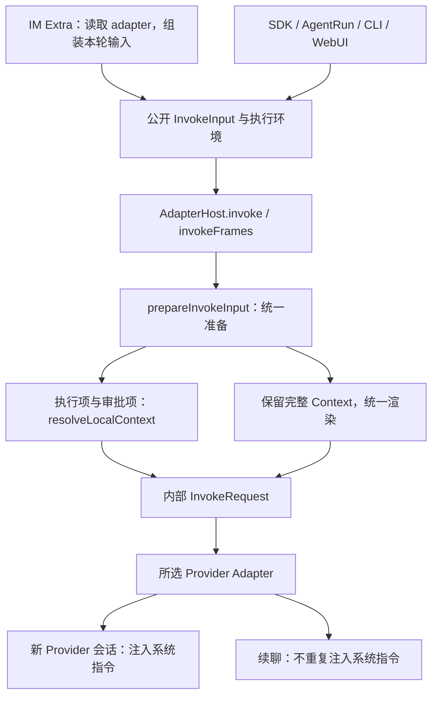

# 目标

状态：2026-10-17 已实施核心前置修复：两个 Channel 直接提交公开 InvokeInput，Host 统一准备；instructions entries 仅 text、单换行、拒绝 source。默认人设与三个 CLI Extra 同步交付。全 Adapter 会话矩阵、HostApp 配置生产者迁移和完整准备失败展示仍按[验收清单](acceptance.md)保留待办，不将本轮核心修复等同整个关联任务完成。证据见[交付记录](../../journal/shared/2026-10-17-extra-initializer-delivery.md)。

排查中的坑、经验和故障时序已沉淀为[独立记录](../../journal/shared/2026-10-16-im-invoke-preparation-lessons.md)，目标调用图同步至[IM Agent 指南](../../guides/im-agent-invocation-boundary.md#执行准备与系统指令调用视图)。

所有执行入口复用 AdapterHost 的执行准备路径。IM Extra 可以读取所选 adapter，并保留自己的业务策略；真正执行时只组装公开 `InvokeInput`，调用注入的 `host.invoke(input, environment)`。`resolveLocalContext()` 属于 AdapterHost 内部的共享准备流程。

`octo.control/instructions.payload.entries` 改为 `{ text: string }[]`。删除 `source`，按原顺序以单个 `"\n"` 拼成系统指令。不兼容旧结构，不提供迁移、回退或双协议路径。

## 现状与问题证据

核对分支为 `feat/open-source-github`，提交基线为 `fed4244`。工作树存在其他任务的未提交改动；本任务不覆盖这些改动，实施前需重读受影响文件。

| 当前路径 | 已核对行为 | 问题与影响 |
| --- | --- | --- |
| Octo / WeCom Extra 的 `execution/dispatcher.ts` | 调用 `resolveLocalContext()`，先生成内部 `InvokeRequest` | Extra 重复承担执行配置解析 |
| Octo `execution/task.ts` 等调用点 | 把内部请求转回 `InvokeInput`，再调用 Host | Host 重新执行同类准备，形成两套边界 |
| Core `prepareInvokeInput()` | 只将执行项和审批项传给执行 resolver，并保留完整 Context | 已有适合复用的准备路径 |
| Core `assertLocalContext()` | 拒绝 `octo.control/instructions` 进入执行专用 resolver | Extra 将完整 Context 传入后，在 Provider 启动前报错 |
| Gateway 本轮准备失败分支 | 发送通用文本，未沿任务失败投影展示错误卡片 | 用户看到在线绿点和失败文本，却看不到可定位的任务错误 |

在本仓已构建的 Gateway dispatcher 上，用含预置系统指令的 Context 调用 `createImInvocation()`，已复现 `LOCAL_CONTEXT_TYPE_UNSUPPORTED: octo.control/instructions`。该检查没有调用 Provider，也没有向 IM 发送消息；它证明准备路径存在缺陷，不代表已复现用户设备的完整现场。

用户反馈 CLI daemon 模式没有出现问题，但本轮未复现该运行现场。不能据此断言 CLI 有独立、正确的执行实现；后续需对齐 SDK 版本、配置和完整输入后验收入口一致性。

源码入口：

- [Octo dispatcher](../../../packages/octo-runtime-extra-channel-gateway/src/execution/dispatcher.ts)、[Octo task](../../../packages/octo-runtime-extra-channel-gateway/src/execution/task.ts)。
- [WeCom dispatcher](../../../packages/octo-runtime-extra-channel-wecom/src/execution/dispatcher.ts)。
- [公开输入准备](../../../packages/octo-runtime-executor-core/src/invoke-input.ts)、[执行 Context 解析](../../../packages/octo-runtime-executor-core/src/context.ts)、[AdapterHost](../../../packages/octo-runtime-adapter-host/src/index.ts)。
- [指令校验](../../../packages/octo-runtime-protocol/src/context.ts)、[指令拼接](../../../packages/octo-runtime-protocol/src/model-context.ts)、[配置分层](../../../packages/octo-runtime-protocol/src/context-configuration.ts)。

## 关键合同

### 1. 执行责任归 AdapterHost



| 主体 | 责任 | 不承担的责任 |
| --- | --- | --- |
| 宿主与业务入口 | 提供本轮 inputs、完整 contexts、会话标识和执行环境；决定配置及会话策略 | 不自行生成内部执行计划 |
| IM Extra | 读取 adapter 选择，执行渠道准入、固定目录策略、业务默认值、可选上下文预算和既有重试策略 | 不调用 `resolveLocalContext()`，不先生成内部 `InvokeRequest` 再转回公开输入 |
| AdapterHost 的共享准备流程 | 校验公开输入，解析执行配置，渲染本轮 Context，构造内部请求，调用 Adapter | 不读取渠道配置或补取业务历史 |
| Provider Adapter | 将统一请求映射为 Provider 原生协议，处理新会话与续聊 | 不按渠道另建执行准备路径 |

实施约束：

1. Octo、WeCom 的 dispatcher 改为返回公开调用所需数据。任务对象、重试快照及会话记录随之调整，保留调用标识、代次、取消信号和 Provider binding 的既有含义。
2. Extra 的 adapter 读取只服务于现有业务判断，例如输入限制、执行环境和重试选择。最终 adapter 和执行参数由 Host 统一解析，不保留 Extra 的第二份执行计划。
3. Extra 在调用前组装本轮完整 Context，合并业务默认值并保持既定覆盖关系。Octo 长任务时限、WeCom 默认值、IM 固定 workdir 等业务差异继续归各入口；统一执行不意味着改成相同业务默认值。
4. Context 超预算时，Extra 可以按既有顺序舍弃自己自动补充的可选材料；该过程使用 Context 校验和预算能力，不再借助执行 resolver。不得丢弃必需项、系统指令或用户显式输入以掩盖错误。
5. 保留 Core 执行 resolver 的类型边界。不得通过放宽 `assertLocalContext()` 接收所有类型来掩盖 Extra 的重复准备问题。
6. 直接 Host、Host RPC、daemon SDK、`agent_run.invoke`、CLI 和 WebUI 最终都进入同一 Host 准备流程；传输层保留自身必要校验，不复制执行解析或指令渲染。
7. 继续使用独立 AdapterHost 执行进程及现有公开接口；本次不新增执行引擎、入口或 CLI 包装层。

### 2. instructions 仅包含文本列表

目标协议示例：

```json
{
  "namespace": "octo.control",
  "name": "instructions",
  "payload": {
    "entries": [
      { "text": "你是一个叫小巴的个人助理。" },
      { "text": "按本轮提供的工具说明完成任务。" }
    ]
  }
}
```

转换结果严格等价于：

```ts
entries.map(entry => entry.text).join("\n")
```

- 条目只允许 `text`，沿用非空字符串校验；不新增 trim、排序、去重、来源标题或自动包装。
- 保留文本中的空白、重复内容和已有换行。空列表或没有 instructions 时，派生系统指令为空字符串。
- 带 `source` 的旧条目直接校验失败；不静默忽略、不自动剥离。删除 `agent_configuration` / `platform_policy` 的字段定义、分支、示例及测试依赖。
- 保留现有 Context 条目数和 UTF-8 预算限制。删除 `source` 不代表取消输入边界。
- 同步修改 JSON Schema、运行时校验、持久配置 Schema 和生成类型；通过生成脚本更新类型，不手改生成结果。
- 配置分层中删除按 `source` 判断的逻辑。保留当前 defaults / mandatory 的职责、强制覆盖与写入授权边界；本次不改变 instructions 仅允许进入 mandatory 配置层的既有规则。
- `source` 原本不是身份凭据；删除字段不得削弱实际权限校验，也不得新增替代它的来源分类字段。
- 保留公开 `InvokeInput.controlInstructions` 的现有显式覆盖语义：提供该值时沿用该值，否则从 Context 列表派生。所有入口使用共享准备逻辑中的同一优先级，不新增渠道专用拼接。

### 3. 本轮传入与 Provider 注入时机分开

业务方在发起调用时提供当轮指令，不要求在 Runtime 或 Extra 启动时固定提示词。Host 不按业务会话缓存、补齐或推测 instructions。

| Provider 会话状态 | 指令行为 |
| --- | --- |
| 新建 Provider 会话 | 将本轮已冻结的系统指令交给 Adapter，按其既有原生映射注入 |
| 延续已有 Provider 会话 | 不将同一份系统指令再次作为本轮 system 或用户正文发送 |
| 既有恢复策略明确退回新 Provider 会话 | 作为新会话处理，使用本次调用显式提供的冻结指令；不从历史缓存找回 |
| 续聊时业务修改系统指令 | 不自动热更新 Provider 会话；业务需要生效时显式新建或重置会话 |

普通 Context 继续按现有合同逐轮处理，不能因为系统指令只在新会话注入而一并省略。系统指令也不能改成每轮附加的普通 Context 来绕开错误。

覆盖当前全部具体 Adapter：Codex、Claude Code、CodeBuddy、Hermes、Kimi Code、MCode、OpenCode、OpenClaw、Qoder CLI、Qoder CLI CN、ZCode GUI、Antigravity，以及复用的 ACP 实现。各 Provider 的原生映射不同，本计划不假定它们都有独立 system 字段；验收必须确认各自映射和新会话/续聊行为。

### 4. 失败展示与连接状态分开

准备失败、Host 拒绝、Provider 执行失败和结果未知必须保留各自阶段，不能都变成一条无法定位的通用文本。

补充排查已隔离复现多类错误被通用文案覆盖、会话读取失败无回复、展示初始化失败及明确 Host 拒绝被误报结果未知；具体输入、证据与平台差异见[同类错误记录](../../journal/shared/2026-10-16-im-invoke-preparation-lessons.md#同类错误的补充排查)。这些属于本节实施范围。

- 在执行准备阶段失败时，明确显示“尚未发起执行”。错误进入现有标准失败事件与展示投影，包含安全的原因、公开错误码和诊断关联信息，不伪造 Provider 已启动。
- Octo 复用现有独立错误卡片和普通文本投递；两路分别处理投递失败，避免一条路径失败后另一条也被跳过。复用已有准入失败投影，不新增一套错误组件。
- WeCom 沿平台现有失败展示和文本能力呈现等价信息，不假定它支持 Octo 卡片格式。
- IM 绿点表达连接在线。单轮准备失败不得修改为连接故障，也不得仅靠绿点表达任务成功。
- 会话存储读取失败需有可观察的安全失败回执。展示初始化失败不得吞掉独立文本回复，不得将已知未执行的错误改报为结果未知；WeCom 任务诊断不得写入连接 error。
- 不将原始错误对象、完整 Context、提示词、Token 或凭据写入用户卡片及诊断。准备失败不触发模型或工具重跑。

## 实施步骤

以下均待实施，按依赖顺序推进：

- [ ] P1：修改 instructions Schema、运行时校验、单换行转换、配置分层及生成类型；删除仓内旧 source 数据与示例，建立正反例。
- [ ] P2：把 Octo / WeCom Extra 改为公开 `InvokeInput` 调用；删除重复 resolver、内部请求往返转换，保留业务默认值、预算及重试合同。
- [ ] P3：核对 Host / RPC / daemon / AgentRun / CLI / WebUI 的入口一致性；覆盖全部 Adapter 的新建、续聊和既有 fresh fallback 分支。
- [ ] P4：准备失败接入既有失败投影，验证错误卡片、文本、公开码和连接状态互不混淆。
- [ ] P5：同步 SDK 指南、Context 规则、渠道规则及消费者；执行[验收清单](acceptance.md)，记录实际通过项和未验限制。

涉及消费者包括 Work App 的原生 SDK 调用、IM 配置构造和 submodule 固定提交，以及仓外使用该协议的调用方。实施时列出实际生产者与消费者并同步升级；不得为未升级方增加旧结构回退。Work App 的 submodule 更新必须指向实际完成验证的 Runtime 提交。

## 范围外

- 本轮不实施代码、不修改运行配置、不重启服务、不提交或推送产品改动。
- 不保留旧 `source` 协议，不新增兼容层或自动数据迁移；实施时更新已知配置生产者与受控样例，不扫描改写用户数据库。
- 不新增 Worker 执行入口、Provider 能力标签框架或额外会话缓存。
- 不改变 IM 固定目录、既有准入、投递重试、会话代次及 reset 的产品含义。
- 不重置 Runtime 身份、Home、profile、授权、配置、SQLite 或历史数据。协议不兼容不构成删库授权。

## 验收

以[验收清单](acceptance.md)为实施交付依据。本轮只核对计划文档和复现已有准备错误，不声称任何功能修复或全 Adapter 联调已经完成。

当前无需新增核心产品决策。实施时需要记录各 Adapter 的实际安装与认证条件、仓外消费者升级情况和未覆盖场景；无法实测的项保持待验，不以类型检查代替真实验证。
