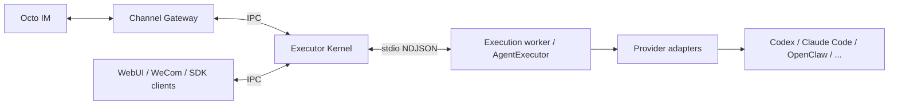

# Octo Runtime

**Run AI agents on your own machine. Connect them to the tools your team uses.**

Octo Runtime brings local Agent execution, messaging integrations and a browser workspace into one npm package. Use the CLI to get running, or embed the SDK in your own application.

[Get Started](#get-started) · [English](https://github.com/Mininglamp-OSS/octo-runtime/blob/main/docs/en/README.md) | [简体中文](https://github.com/Mininglamp-OSS/octo-runtime/blob/main/docs/zh-CN/README.md)

## What Is Octo Runtime?

Octo Runtime runs Agent tasks through Provider adapters, so applications can use a shared execution interface with providers such as Codex, Claude Code and OpenClaw. You choose and authenticate the Provider; Runtime manages execution and exposes results, cancellation and interaction through its SDK.

- **Executor Kernel** runs local Agent tasks and supervises its execution worker.
- **Channel Gateway** connects Octo IM Bots to the Kernel and delivers Agent replies.
- **WeCom** connects WeCom Bots to the same execution service.
- **WebUI** provides a local browser workspace for conversations and projects.

Adapters ship for Codex, Claude Code, CodeBuddy, OpenCode, DeepSeek Harness, OpenClaw, Grok Build, Antigravity, ZCode, Hermes, Kimi Code, MCode, and both Qoder CLIs; see [Packages and layers](https://github.com/Mininglamp-OSS/octo-runtime/blob/main/packages/README.md).

The Kernel and each Extra run as independent services. They can start in either order, and stopping one Extra leaves the others running. Your application owns its business data, credentials and conversation history.

## Core Architecture



The Executor Kernel provides local execution. Channel Gateway, WebUI, WeCom, and SDK clients are independent callers that connect over IPC; their business logic and lifecycle stay outside the Kernel. Channel Gateway, WebUI, and WeCom are bundled here. An external control plane can call the same Kernel IPC without being part of this repository.

## Get Started

You need **Node.js 24.x or 26.x** and an installed, authenticated Provider. This requirement applies to end users running the installed CLI or SDK, not only to the development/build environment. Node.js 22 is unsupported; upgrade to Node.js 24 before installing Runtime. Runtime does not install Provider software or sign in for you.

The supported range is `^24.0.0 || ^26.0.0`. Node.js 25 and future majors are outside this range. CI checks installation, build, types, automated tests, and packed CLI/SDK consumption on both supported majors. New LTS majors are added after the same checks pass; support is reviewed at each LTS transition and before a supported major reaches end of life. Removal is announced in release notes before changing the engine range.

### 1. Install

```bash
npm install -g @mininglamp-oss/octo-runtime
octo-runtime --help
```

### 2. Configure

To use an Octo IM Bot, choose either configuration method below. Replace the API URL, Bot ID, token and absolute workspace path with values for your environment. Both examples use an installed, authenticated Codex Provider; use `claude-code` for Claude Code.

#### Option A: configure one Bot

`configure` adds a new Bot or updates the matching `bot_id`. It preserves omitted fields and other Bots.

```bash
octo-runtime channel-gateway configure \
  --api_url https://im.example.com/api \
  --bot_id '<BOT_ID>' \
  --bf_token '<BOT_TOKEN>' \
  --adapter_type codex \
  --workdir /absolute/workspace \
  --model '<MODEL_ID>' \
  --effort medium
```

`--model` and `--effort` are optional. On first configuration, omit them to use the selected Harness framework's own defaults; updates preserve existing values when these flags are omitted.

#### Option B: save a complete JSON declaration

`extraset` replaces the whole declaration. Include every Bot and setting you want to retain; it does not merge by `bot_id` or preserve omitted fields. This `<<<` example works in Bash and Zsh.

```bash
octo-runtime channel-gateway extraset <<< '{
  "module": "@mininglamp-oss/octo-runtime-extra-channel-gateway",
  "enabled": true,
  "config": {
    "bots": [
      {
        "api_url": "https://im.example.com/api",
        "bot_id": "<BOT_ID>",
        "bf_token": "<BOT_TOKEN>",
        "adapter": {
          "adapter_type": "codex",
          "workdir": "/absolute/workspace",
          "model": "<MODEL_ID>",
          "effort": "medium"
        }
      }
    ]
  }
}'
```

`model` and `effort` are optional: remove either field to use the selected Harness framework's own default. Replace `<MODEL_ID>` with a model supported by that Harness; supported effort values depend on the Harness. You can also use `octo-runtime channel-gateway extraset < channel-gateway.json` with the same complete JSON in a file. `octo-runtime channel-gateway extraget` returns the complete declaration, including credentials.

Both methods save configuration without starting or reloading services. Configuration is saved under your Runtime Home, normally `~/.octo-runtime` (`%LOCALAPPDATA%\OctoRuntime` on Windows). If you omit `workdir`, Gateway defaults to `~/octo-runtime/channels/{bot_id}`. See the [Gateway guide](https://github.com/Mininglamp-OSS/octo-runtime/blob/main/packages/octo-runtime-extra-channel-gateway/README.md) for multiple Bots, permissions and other Provider settings. For a browser workspace or WeCom, use the [Extra configuration guide](https://github.com/Mininglamp-OSS/octo-runtime/blob/main/.octospec/guides/extra-configuration.md).

### 3. Start

```bash
octo-runtime executor-kernel start
octo-runtime channel-gateway start
octo-runtime status
```

Each `start` installs its component's service if needed, enables autostart during that installation and waits for local readiness. Installation and startup progress appears in the terminal. Both services start automatically when you sign in or your user service manager activates, with no required startup order.

Successful `start` and `restart` commands include the component's current status: service state, autostart, IPC, PID, Worker readiness or Extra business status, and the service definition path. `status` shows the same readable status; use `--json` for formatted JSON. Kernel readiness and Bot connectivity are reported separately. You can now message your Bot in Octo IM.

After changing Gateway configuration, run `octo-runtime channel-gateway restart`. Use `stop` to stop a component or `uninstall` to remove its service while keeping your data. Explicit `install --autostart=false` disables autostart; a plain `install` enables it again. See [CLI installation and operations](https://github.com/Mininglamp-OSS/octo-runtime/blob/main/docs/en/getting-started/cli.md) / [CLI 安装与运维](https://github.com/Mininglamp-OSS/octo-runtime/blob/main/docs/zh-CN/getting-started/cli.md) for commands, Home and profiles, Gateway configuration, and logs, and [Troubleshooting](https://github.com/Mininglamp-OSS/octo-runtime/blob/main/docs/en/guides/troubleshooting.md) for failures.

## Embed the SDK

Applications can construct the Kernel and Extras directly in their own process through the Host SDK, then call `KernelClient.invoke` to run tasks. The Kernel supervises an isolated execution worker. SDK applications choose their own configuration, dependencies and service lifecycle.

| Package Entry                                  | Purpose                                                                 |
| ---------------------------------------------- | ----------------------------------------------------------------------- |
| `@mininglamp-oss/octo-runtime/host`            | Native Kernel and Extra construction, lifecycle and component endpoints |
| `@mininglamp-oss/octo-runtime/executor-kernel` | Kernel client, invocation, subscriptions and worker entry               |
| `@mininglamp-oss/octo-runtime/executor-core`   | Explicit execution inside the current process                           |
| `@mininglamp-oss/octo-runtime/extra`           | Extra plugin lifecycle and public types                                 |
| `@mininglamp-oss/octo-runtime/protocol`        | Execution inputs, events and validation                                 |
| `@mininglamp-oss/octo-runtime/extras/*`        | Built-in Extra modules and configuration schemas                        |

Follow [Your First SDK Invocation](https://github.com/Mininglamp-OSS/octo-runtime/blob/main/docs/en/getting-started/sdk.md) and [Extras](https://github.com/Mininglamp-OSS/octo-runtime/blob/main/docs/en/guides/extras.md) for host composition. Desktop applications use the SDK directly. `octo-cli`, the Octo business API tool, is a separate program from `octo-runtime`.

## Documentation

The developer documentation covers architecture, your first SDK call, CLI operations, Kernel IPC, inputs, Context types, MCP, interaction and troubleshooting, in English and Chinese with shared runnable examples and diagrams. The Chinese `SDK_*` guides keep host-specific assembly detail.

| Goal                                                  | Guide                                                                                                                                                                                                       |
| ----------------------------------------------------- | ----------------------------------------------------------------------------------------------------------------------------------------------------------------------------------------------------------- |
| Read the developer documentation                      | [English](https://github.com/Mininglamp-OSS/octo-runtime/blob/main/docs/en/README.md) / [简体中文](https://github.com/Mininglamp-OSS/octo-runtime/blob/main/docs/zh-CN/README.md)                           |
| Install, run, and operate the CLI                     | [English](https://github.com/Mininglamp-OSS/octo-runtime/blob/main/docs/en/getting-started/cli.md) / [简体中文](https://github.com/Mininglamp-OSS/octo-runtime/blob/main/docs/zh-CN/getting-started/cli.md) |
| Choose an integration path (CLI, SDK, public entries) | [INTEGRATION.md (中文)](https://github.com/Mininglamp-OSS/octo-runtime/blob/main/INTEGRATION.md)                                                                                                            |
| Embed Runtime in an application                       | [English](https://github.com/Mininglamp-OSS/octo-runtime/blob/main/docs/en/getting-started/sdk.md) / [简体中文](https://github.com/Mininglamp-OSS/octo-runtime/blob/main/docs/zh-CN/getting-started/sdk.md) |
| Connect Octo IM from an application                   | [SDK Channel Gateway](https://github.com/Mininglamp-OSS/octo-runtime/blob/main/SDK_CHANNEL_GATEWAY_GUIDE.md)                                                                                                |
| Install, package or replace an old release            | [Deployments](https://github.com/Mininglamp-OSS/octo-runtime/blob/main/DEPLOYMENTS.md)                                                                                                                      |
| Understand architecture and ownership                 | [Architecture Rules](https://github.com/Mininglamp-OSS/octo-runtime/blob/main/.octospec/rules/architecture.md)                                                                                              |
| Contribute changes                                    | [Contributing](https://github.com/Mininglamp-OSS/octo-runtime/blob/main/CONTRIBUTING.md)                                                                                                                    |

## Development

Use Node.js 24.x or 26.x and the pnpm version specified in `package.json`. `.nvmrc`, Node.js type definitions, and publishing workflows intentionally stay on Node.js 24, the oldest supported baseline; this does not restrict consumers to 24.

```bash
pnpm install
pnpm build
pnpm typecheck
pnpm lint
pnpm lint:names
pnpm format:check
pnpm test:suites
```

The repository contains the CLI in `apps/cli`, the Kernel and execution engine in `packages/octo-runtime-executor-*`, the Host SDK, Provider adapters and optional Extras. Internal workspace packages are private; distribution uses a single public npm package.

Automated fixture tests do not replace real Provider, IM or native service-manager acceptance. See the [implementation evidence and remaining checks](https://github.com/Mininglamp-OSS/octo-runtime/blob/main/.octospec/tasks/executor-kernel-host-lifecycle/implementation.md).

## License

[Apache License 2.0](https://github.com/Mininglamp-OSS/octo-runtime/blob/main/LICENSE). Copyright 2026 Mininglamp Technology.
