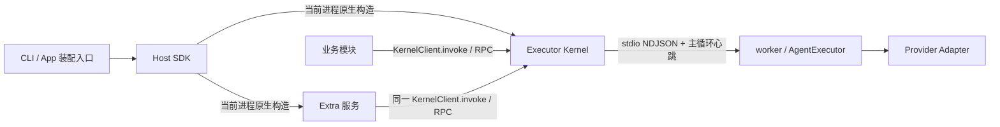

# Octo Runtime

Octo Runtime 是 Provider-neutral 的本地 Agent 执行基础设施。宿主决定业务输入、配置来源和依赖安装；Runtime 校验执行合同并调用 Provider，不保存业务 Run、Agent 或聊天历史。

## Developer Documentation / 开发者文档

[English](https://github.com/Mininglamp-OSS/octo-runtime/blob/main/docs/en/README.md) · [简体中文](https://github.com/Mininglamp-OSS/octo-runtime/blob/main/docs/zh-CN/README.md)：架构、首次 SDK 调用、Kernel IPC、inputs、Context 类型、MCP、交互与故障排查。核心模块配有 Mermaid 图，两种语言共用可运行示例。

## 执行结构



Kernel 监督自己的 worker，保存有界源窗口并提供执行、订阅和控制。Extra 由宿主独立启动；停止或重载一个 Extra 不停止 Kernel 或其他 Extra。没有 Extra 也可执行本地请求。

旧 daemon app、workspace 包、CLI 命令组、bin 和 AdapterHost 过渡别名已删除。执行实现只有 `AgentExecutor`。Run 7、Context v3 和既有身份文件格式不变。

旧 daemon 架构的 `1.0.1` 版本已列为 deprecated，不支持升级或迁移。已有安装须先停止并移除旧服务，执行 `npm uninstall -g @mininglamp-oss/octo-runtime`，再安装新架构版本并重新配置，详见 [重新安装步骤](https://github.com/Mininglamp-OSS/octo-runtime/blob/main/DEPLOYMENTS.md#旧版弃用与重新安装)。

## CLI

要求 Node.js 24.x：

```bash
npm install -g @mininglamp-oss/octo-runtime
octo-runtime executor-kernel install
octo-runtime executor-kernel start
octo-runtime channel-gateway install
octo-runtime channel-gateway start
octo-runtime status
```

两个组件分别提供 `uninstall|install|start|restart|stop|run`。首次 install 默认不自启；`install --autostart=true` 显式启用。start/restart 要求已安装，不会隐式安装、启用或启动另一组件。前台使用 run。

`extraset <name>` 从 stdin 保存完整 `{module, enabled?, config}` 到 `<home>/extras/<name>/config.json`；随后只重启对应 Extra。SDK 宿主自行取得配置值，不必使用该目录。卸载服务保留 Home、身份、配置和凭据。

## 公开 SDK

单一 npm 包提供：

| 子路径 | 用途 |
| --- | --- |
| `/host` | createKernelService、createExtraService、原生生命周期、组件端点 |
| `/executor-kernel` | createKernelService、attachKernel、KernelClient.invoke、RunRef、serveWorker |
| `/executor-core` | 显式进程内 AgentExecutor |
| `/extra` | 插件生命周期、动态函数依赖、协议类型 |
| `/protocol` | 输入、事件、帧与校验工具 |
| `/protocol/schema.json`、`/executor-kernel/ipc-schema.json` | 跨语言合同 |
| `/extras/*/config-schema.json` | 三个内置 Extra 的配置 Schema |
| `/extras/channel-gateway` | 可导入 Gateway 模块及其业务依赖类型 |

CLI 服务进程和原生应用主进程通过相同工厂直接构造服务，socket PID 就是调用进程 PID；内部执行 worker 仍独立隔离。attached client.close 不取消 Run、不停止服务。服务 close 返回实际清理结果；`complete=false` 时不能宣称资源已释放或启动冲突替代实例。SDK 不经外部 Node 或 Runtime CLI 代替构造服务。

业务只需将 KernelClient 作为普通 RPC 工具使用：invoke 输入并消费结果，按需取消或响应交互。服务托管不属于每次调用的接入步骤，普通业务不手动操作调用登记或 drain。

完整接入示例见 [SDK 指南](https://github.com/Mininglamp-OSS/octo-runtime/blob/main/SDK_NATIVE_INTEGRATION_FULL_GUIDE.md)，命令见 [CLI](https://github.com/Mininglamp-OSS/octo-runtime/blob/main/apps/cli/README.md)，发行验证见 [部署说明](https://github.com/Mininglamp-OSS/octo-runtime/blob/main/DEPLOYMENTS.md)。

## 输入和业务边界

本轮输入使用公开 InvokeInput，模型 Context 使用 `octo.context-envelope/v3`。Context 由业务发起方选择、构造和保存；内核不自动扫描、补齐、缓存或去重业务背景。执行权限、审批和 Provider 原生映射按既有合同处理。

宿主保管凭据并决定安装哪些 Provider/插件；Runtime 不在探测、注册或执行时下载依赖。本地 IPC 采用同一 OS 账号互信，POSIX socket 权限 0600；跨账号隔离应使用不同 OS 账号。Extra 仍独立验证远程身份和资源授权。

## 开发与验证

```bash
pnpm install
pnpm run build
pnpm typecheck
pnpm lint
pnpm lint:names
pnpm format:check
pnpm test:suites
node scripts/pack-release.mjs
node scripts/verify-release.mjs dist/release/mininglamp-oss-octo-runtime-0.0.0.tgz
```

自动测试使用 fixture Provider；不能代替实际 Provider、真实 IM 或各平台原生服务验收。当前实施证据和待验收项见 [实施记录](https://github.com/Mininglamp-OSS/octo-runtime/blob/main/.octospec/tasks/executor-kernel-host-lifecycle/implementation.md)。

## 结构

- `apps/cli`：CLI 宿主、Home/profile、原生服务、Provider 配置。
- `packages/octo-runtime-host-sdk`：原生 Extra 装配和宿主依赖生命周期。
- `packages/octo-runtime-executor-kernel`：IPC、worker 监督、源窗口。
- `packages/octo-runtime-executor-core`：唯一 AgentExecutor。
- `packages/octo-runtime-extra-*`：可选业务接入。
- `packages/octo-runtime-adapter-*`：Provider 协议适配。
- `.octospec/rules`：当前架构与工程合同。

架构入口见 [开发者架构说明](https://github.com/Mininglamp-OSS/octo-runtime/blob/main/docs/zh-CN/concepts/architecture.md)。所有内部 workspace 包仍 private，只发布一个 npm 包。

## 许可证

[Apache License 2.0](LICENSE)。Copyright 2026 Mininglamp Technology。
