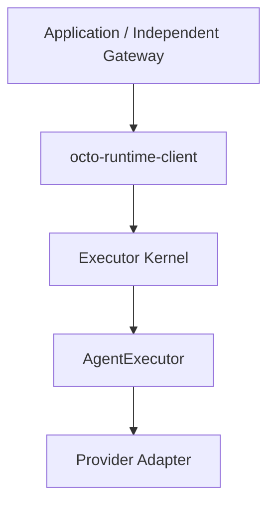

# Architecture

[简体中文](../../zh-CN/concepts/architecture.md)

Runtime accepts application-prepared input and execution configuration, invokes a Provider and returns execution events. Applications own business data, session bindings, authorization and result delivery.

## Module Responsibilities

| Module | Public responsibility |
| --- | --- |
| runtime-client | Connect to an existing Kernel; submit, observe and control invocations. |
| Executor Kernel | Provide local RPC, execution management and bounded output replay. |
| Executor Core | Route to registered Adapters and manage execution, cancellation and budgets. |
| Provider Adapter | Validate supported settings and map native Provider calls, output and interactions. |
| protocol | Define and validate input, AgentEnv, event and IPC data shapes. |
| Host SDK | Provide Home, endpoint and startup-diagnostic helpers. |

## Integration

Standalone applications install `@mininglamp-oss/octo-runtime-client` and connect using `attachKernel({ endpoint })`. CLI or the application itself can start the service.

Native SDK hosts import required Adapters, construct objects and pass them to `createKernelService`. Adapters may use classes, factories, closures or plain objects, with arguments defined by each implementation. See [SDK Integration](../getting-started/sdk.md) for dependencies, initialization and invocation examples.

Services, Engines and connections are managed by their creators or explicitly agreed owners. Borrowing an object does not transfer authority to restart, close or delete its persistent data. `client.close()` releases only that client's connections; use `interrupt` to cancel execution and continue observing the terminal result. Runtime Home and Provider data directories have separate ownership.

## Output Silence and Execution Budgets

Runtime Core owns the public-text silence clock and periodic notices. With normal consumption, continuous silence produces new `model_output_idle` notices at 60/120/180 seconds and subsequent minute boundaries through the existing event stream. Gateway updates the original card from each source notice; it does not time silence, add elapsed seconds, or cancel for local silence. Backpressure or late timers can skip historical boundaries; see [Output and Control](../reference/output-and-control.md).

This clock differs from Watchdog model-idle progress. Notices do not extend or reset first-frame, model-idle, tool, or total-run budgets. The default is enforce; explicit observe remains valid. Terminal results and cleanup take priority. The connected Runtime service must provide periodic behavior; upgrading only the client does not enable it in an older service.

## Inputs and Execution Configuration

[inputs](../reference/input-parts.md) carries text, images, application prompts and business history; [AgentEnv](../reference/agent-env-standard.md) carries execution settings. Core snapshots AgentEnv per invocation, reads Adapter routing and forwards items with their values and order intact.

The public protocol defines seven standard execution items. Each consuming Adapter validates its private items; see the [private-field reference](../reference/agent-env/private-items.md). Execution settings do not automatically become model text.

## Sessions and Application Responsibilities

Callers preserve the complete ProviderSession and explicitly pass it to the next invocation. agentEnv is per-invocation configuration rather than session identity. Applications may authorize new configuration for the same session, subject to Provider resume and permission constraints. When replacing a Provider binding, applications invalidate its interactions and avoid sending an old session handle to another Adapter, account or server. See [Identifiers](identifiers.md) and [Output and Control](../reference/output-and-control.md).

Applications or the independent [Channel Gateway](https://github.com/Mininglamp-OSS/octo-channel-gateway) own model catalogs, device selection, business channels, history selection and delivery. The Runtime Adapter list reports registration and probes, rather than account authentication or model access.
