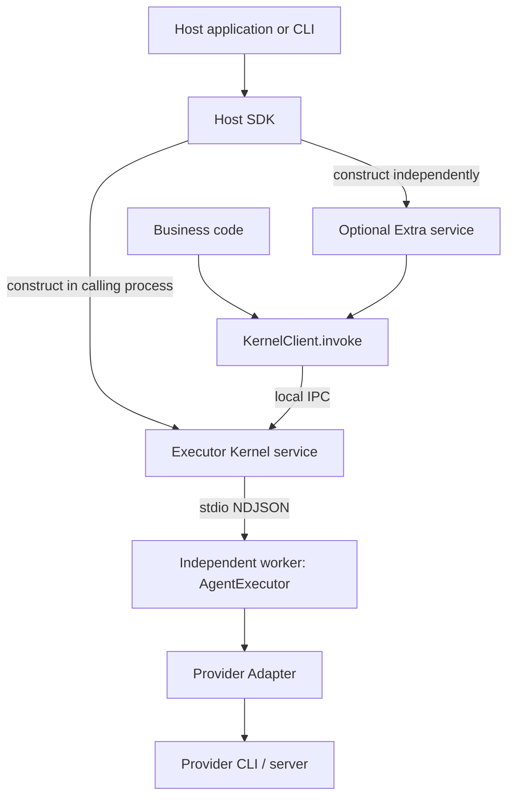
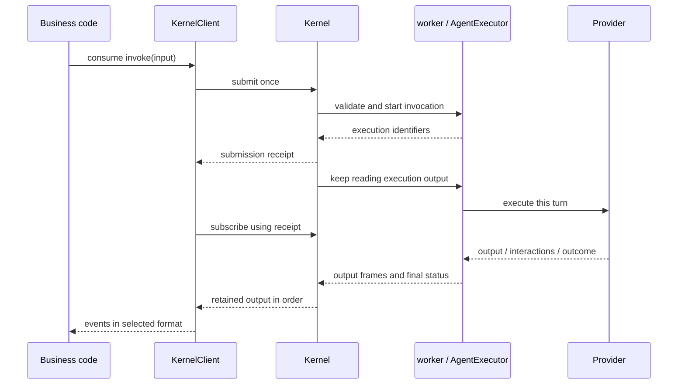
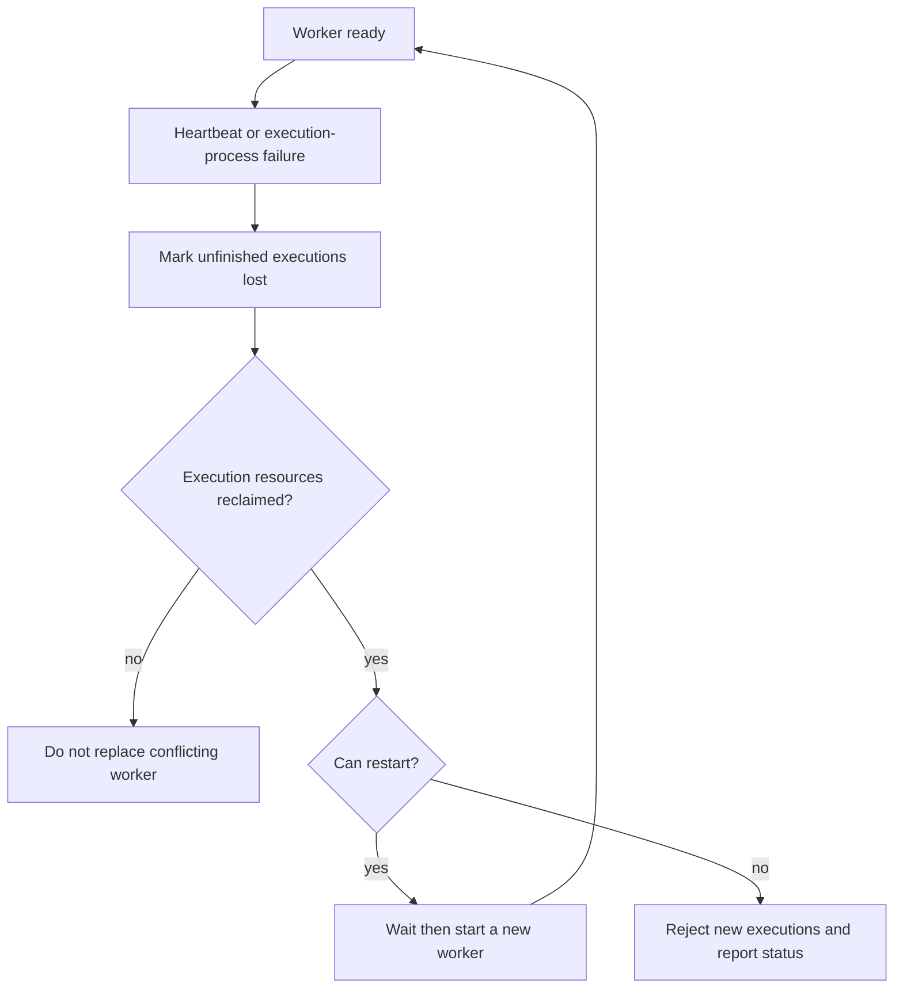

# Architecture

[简体中文](../../zh-CN/concepts/architecture.md) | [Documentation](../README.md)

Octo Runtime gives applications a common interface to Agent execution programs such as Codex and Claude Code. This guide calls those programs **Providers** and the integrating application the **host application**. Each Provider has an **Adapter** that translates inputs, outputs, and control messages.

Applications normally invoke `KernelClient.invoke`. Kernel receives the request, runs it in a separate worker process, and returns output to the client. This guide calls one execution a Run. The application handles output and interactions, Kernel manages worker startup and supervision, and KernelClient handles output subscriptions and reconnection.

The root [architecture document](../../../ARCHITECTURE.md) explains the motivation: IM integrations, desktop applications, and task systems can share execution capabilities instead of each implementing Provider integration.

Kernel currently provides local inter-process communication (IPC). Optional Extras connect business entry points such as IM. Cloud device registration, remote addressing, and cross-device conversation routing in the root document remain design goals, outside the current public Kernel API.

`createKernelService` creates the Kernel service and IPC endpoint in the calling process. AgentExecutor runs in a worker process started by Kernel. A native application can create Kernel in its main process without separately running the Runtime CLI. It can also connect to an existing service with `attachKernel(endpoint)`.

The CLI stores a device instance's identity and configuration in its Home directory. The workdir is the Agent's working directory and has a different purpose. SDK applications choose their own configuration and state locations.

## Responsibilities

Adapter and Extra selection belongs to the integration entry point. SDK hosts use native imports and composition without a manifest; the CLI's unified manifests contain both adapters and extras, with a built-in catalog and a Runtime Home extension. The default distribution keeps the full catalog. See [Adapter and Extra Loading](module-loading.md) for constraints, resolution anchors, and verification scope.

| Component        | Owns                                                                                                   | Does not own                                           |
| ---------------- | ------------------------------------------------------------------------------------------------------ | ------------------------------------------------------ |
| Host application | Install/authenticate Providers, supply configuration, history and databases, start and close services  | Translate Provider protocols                           |
| Host SDK         | Create Kernel and Extra services, supply dependencies, report initialization and cleanup results       | Manage application database schemas or migrations      |
| Executor Kernel  | Expose IPC, supervise workers, retain output for reading after a disconnect                            | Store business history or automatically rerun requests |
| AgentExecutor    | Prepare input, drive an execution, handle interactions, cancellation and final status                  | Retrieve business background or install Providers      |
| Provider Adapter | Convert Runtime settings to Provider configuration, handle native output, clean up execution resources | Decide business permissions or fill in chat history    |
| Extra            | Receive business requests, load Context, invoke Kernel, deliver results to business systems            | Close a shared Kernel or another module's invocations  |

Local SDK invocation can use Kernel alone, without an Extra, cloud login, or IM connection. `octo-runtime` is the CLI for starting and managing Runtime. `octo-cli` is a separate business API tool; install and configure its credentials separately if the Agent needs to call it.

## Invocation Sequence

A submission receipt confirms that the request was received; read the output stream for its result. A submitted execution continues if the client disconnects. On reconnection, the client queries that execution and reads output still retained by Kernel, without invoking again. Worker loss marks unfinished executions as `lost`; a replacement worker handles new requests only.

## KernelClient or Direct Core

| Property                                | KernelClient                                | AgentExecutor                           |
| --------------------------------------- | ------------------------------------------- | --------------------------------------- |
| Execution location                      | Independent worker supervised by Kernel     | Calling process                         |
| Fault isolation                         | Worker isolation; host owns Kernel service  | Shares host failure/blocking/OOM domain |
| Early iterator closure                  | Stops receiving output; execution continues | Requests execution cancellation         |
| Reading after a disconnect              | Original output within the retention window | No Kernel output cache                  |
| Local `streamLimits` environment option | Rejected                                    | Supported                               |
| Shutdown                                | Service `close()`, inspect `complete`       | `shutdown()`, inspect `cleanup`         |

Choose KernelClient for most integrations. Use AgentExecutor directly only when you need execution in the calling process and accept that blocking or crashes can affect the application process. Both offer `invoke(input, environment?)`, but differ in iterator closure, output recovery, and resource cleanup. See [Kernel IPC](../reference/kernel-ipc.md) and the [Core package](../../../packages/octo-runtime-executor-core/README.md).

## Worker Failure and Shutdown

Kernel checks the worker's main-loop heartbeat every second and considers it lost after 5 seconds without a response. Worker startup allows 15 seconds for readiness. Before replacement, Kernel cleans up the old worker's execution resources. Incomplete cleanup blocks creation of a worker that could conflict with those resources.

Replacement backoff is 250, 1000, and 4000 ms, with at most three replacements in 60 seconds. Running stably for 60 seconds resets that count. A new worker does not rerun old requests.

After creating Kernel, await `initialize()` before using `kernel.client`. At shutdown, close the application's Extras, wait for result consumption and delivery, then close the Kernel it created. A client obtained through `attachKernel` closes its connections without closing the service. A cleanup result of `complete=false` means some resources are not confirmed released; inspect the returned errors and pending resources.

## Access Permissions

Local IPC trusts clients under the same operating-system account. POSIX socket permissions are `0600`. Applications accepting remote business requests must authenticate users and check resource permissions. A workdir is only a working directory; it does not restrict the Provider's access to other files or the network.

On Windows, some descendant processes may become untrackable after their parent exits or the application is forcibly terminated. Account for this platform limit when interpreting cleanup results.

Implementation: [service](../../../packages/octo-runtime-executor-kernel/src/service.ts), [server](../../../packages/octo-runtime-executor-kernel/src/server.ts), [Core](../../../packages/octo-runtime-executor-core/src/index.ts), [Extra service](../../../packages/octo-runtime-host-sdk/src/extra-service.ts).
