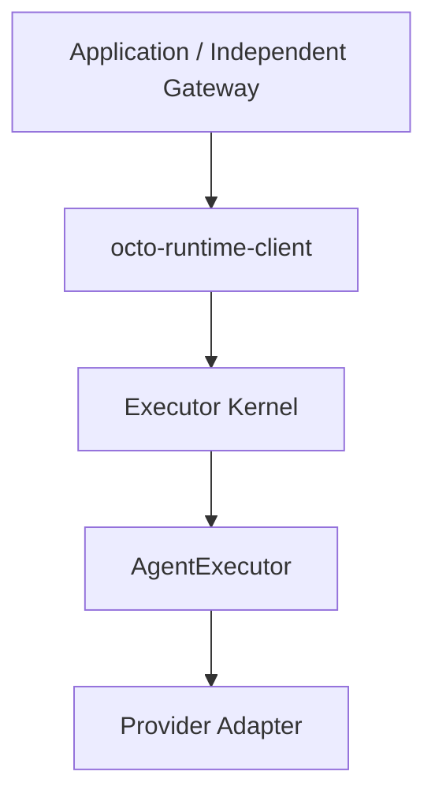

# Architecture

[简体中文](../../zh-CN/concepts/architecture.md)

Runtime provides general execution; applications own business data and lifecycle.

Gateway is an independent repository and owns configuration, authorization, contexts, sessions and delivery. Closing a registration leaves the shared Kernel running.

Execution event envelopes retain their format. Gateway/applications prepare business inputs; agentEnv contains execution configuration only.
