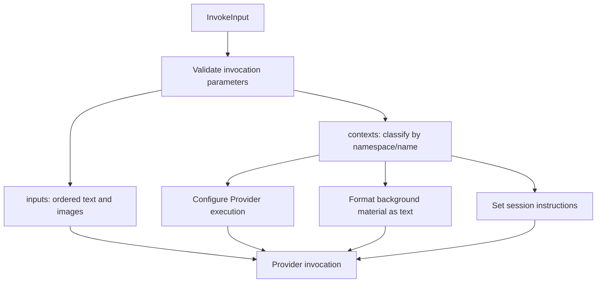

# Inputs and Contexts

[简体中文](../../zh-CN/concepts/inputs-and-contexts.md) | [Documentation](../README.md)

Every invocation requires `inputs` and `contexts`, with different purposes:

- `inputs` is the message for this turn, containing text and optionally images. For example: "Summarize the selected text."
- `contexts` supplies background material and execution settings chosen by your application, such as selected text, a Provider, a working directory, or MCP connections.

In this example, `inputs` states the task, `extra.project/selection` supplies the text to summarize, and `octo.execution/adapter` selects Codex.

```json
{
  "inputs": [{ "type": "text", "text": "Summarize the selected text." }],
  "protocol_mode": "canonical",
  "contexts": {
    "schema": "octo.context-envelope/v3",
    "items": [
      { "namespace": "octo.execution", "name": "adapter", "payload": { "type": "codex" } },
      {
        "namespace": "extra.project",
        "name": "selection",
        "guidance": "Use this as source material.",
        "payload": { "text": "The project ships on Friday." }
      }
    ]
  }
}
```

Context `items` may be empty. Without an explicit Adapter selection, Runtime uses Codex. Other omitted execution settings use their respective defaults.

## What Reaches the Model?

Each Context item has a type identified by `namespace` and `name`. For example, `octo.execution/adapter` means `namespace: "octo.execution"` and `name: "adapter"`. Runtime uses the type to decide how to handle the item: background material becomes model input, while execution settings configure the Provider.



| Input                                                                | Consumer                                     | Model-visible?                                                              |
| -------------------------------------------------------------------- | -------------------------------------------- | --------------------------------------------------------------------------- |
| `inputs` text/image                                                  | Provider                                     | Yes, as this turn's text and images                                         |
| `octo.content/inline`, `octo.content/references`, `extra.<domain>/*` | Runtime formats background text              | Yes, preserving item order, `guidance`, and `payload`                       |
| `octo.execution/*`, `octo.security/approval_policy`                  | Runtime and Adapter                          | Not as background text; used for execution settings and approval policy     |
| `octo.runtime/selection`                                             | Application Runtime routing logic            | No; the local Kernel does not switch devices based on this item             |
| `octo.control/instructions` / `controlInstructions`                  | Provider session configuration               | Yes, passed separately from ordinary background material                    |
| `runMetadata`                                                        | Application logging and business correlation | No                                                                          |
| `InvokeEnvironment`                                                  | Local execution control                      | No; contains cancellation and environment overrides, outside the input JSON |

Environment variables are not automatically added to model input, but tools called by the Agent may read or print them. Keep secrets out of background material and logs.

## What to Supply on Each Turn

Your application selects the background needed for each turn. Runtime processes what you submit; it does not automatically retrieve material from business databases, SOUL files, or the previous invocation's Context.

If an item from the previous turn needs to be sent again, include it again. Runtime does not cache or deduplicate submissions. Within one invocation's `items`, each `namespace` and `name` pair must be unique.

A resource reference supplies an address and retrieval instructions. The Agent needs a tool to read the content; Runtime does not download it in advance. To let the model see an image directly, put its data in `inputs`.

Session instructions take effect differently from ordinary background material. `octo.control/instructions` is applied when a Provider session is created, rather than sent again as a user message on continuation. Changing instructions generally requires your application to create or reset the Provider session. Only use instruction sources authorized by your application.

See [InvokeInput](../reference/invoke-input.md), [Context Catalog](../reference/contexts.md), and [Context and Sessions](../guides/context-and-sessions.md).
