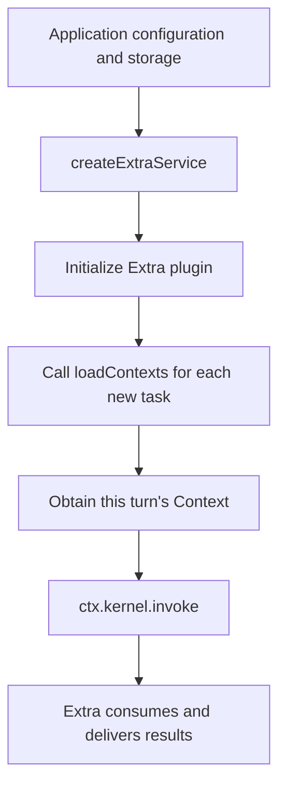
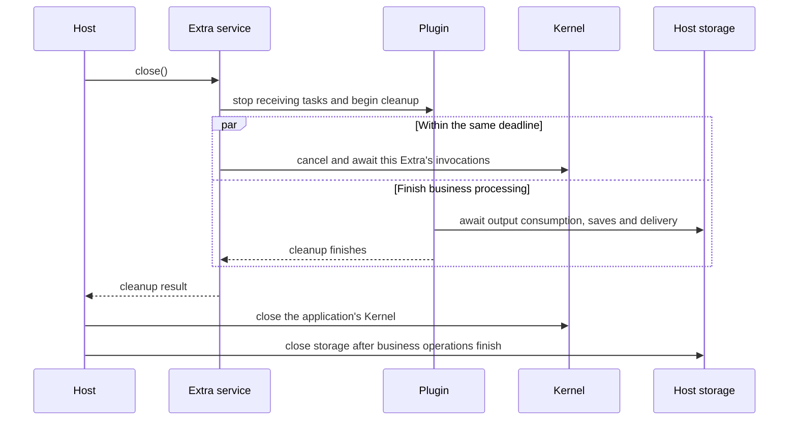

# Integrate Extras

[简体中文](../../zh-CN/guides/extras.md) | [Documentation](../README.md)

An Extra connects a business system to Kernel. For example, an IM Extra receives chat messages, prepares invocation parameters, calls Kernel, and sends Agent replies back to chat. Direct SDK calls to Kernel do not need an Extra.

Import `createExtraService` from `@mininglamp-oss/octo-runtime/host` and supply:

- `endpoint`: the existing Kernel address. Extra connects to it without starting Kernel.
- `module`: the Extra module, such as Channel Gateway, WeCom, or WebUI.
- `config`: the JSON configuration required by that module.
- `dependencies`: application functions, such as loading Context or creating session storage.

Call `initialize()` to start, `status()` to inspect, and `close()` on exit. Built-in modules use the main package's `/extras/channel-gateway`, `/extras/channel-wecom`, and `/extras/webui` import paths. Each module's `/config-schema.json` subpath provides its configuration schema.

## Load Business Data Each Turn

Channel Gateway can load background through `GatewayDependencies.loadContexts(config, {signal})`. The function returns `readonly ContextItem[]`, synchronously or asynchronously. Gateway calls it for every accepted task, so the next turn can read updated application data without restarting Extra.

Gateway merges the result with static Context. A dynamic item replaces the entire static item with the same `namespace` and `name`, including its `payload`; fields are not merged individually. This is Channel Gateway behavior and does not run automatically for direct Kernel calls.

By default, Gateway waits up to 5 seconds for loading and allows at most 8 unfinished loading operations, configurable up to 32. Results are limited to 32 items and 64 KiB when serialized. A timeout stops waiting but does not stop the underlying operation; it occupies a concurrency slot until it finishes. Wrapping synchronous database work in an `async` function does not prevent event-loop blocking.

## Store Sessions

Use `GatewayDependencies.createSessionStore(botConfig)` to supply independent session storage for each Bot. Without this function, Gateway uses memory storage with a capacity limit.

Your application chooses the storage implementation. Runtime does not depend on SQLite or manage application database schemas and migrations. Wait for Extra's output consumption and storage operations before closing the database. See the existing Chinese [Gateway integration guide](../../../SDK_CHANNEL_GATEWAY_GUIDE.md) for detailed business configuration and storage implementations.

## Develop an Extra

The plugin entry point has the form `extra(context, jsonConfig)(dependencies)`. Put configuration values in `jsonConfig` and application functions in `dependencies`. The plugin and those functions run in the same process.

Use `ctx.kernel.invoke` to call the shared Kernel, `ctx.onDispose` to register cleanup, `ctx.onStatus` to report business status, and `ctx.log` for diagnostics. Applications manage the plugin through these public APIs without accessing its internals or adding another execution forwarding interface.

## Close an Extra

`close()` stops new invocations, notifies the plugin to clean up, and cancels and awaits this Extra's submitted invocations. These operations share a default 4-second shutdown deadline, or an earlier deadline inherited from the caller.

During cleanup, the plugin can still call application dependency functions to finish saving and delivering results. New dependency calls are rejected after plugin cleanup finishes or the deadline expires. Functions already running cannot be forcibly stopped; the service continues tracking unfinished operations.

Inspect `complete`, `errors`, and `pendingResources` in the result. `complete=false` means some work or resources remain unresolved, so do not treat shutdown as complete. The database remains application-managed; the SDK does not close it automatically.

Closing one Extra does not close the shared Kernel or stop other Extras' invocations. In status results, `phase` is the Extra service's lifecycle stage, `kernel_available` reports whether Kernel can currently execute, and `plugin` contains the plugin's business status. Check the corresponding status and connection results to confirm whether a Bot or Provider is online.

Sources: [Extra API](../../../packages/octo-runtime-host-sdk/src/extras.ts), [service](../../../packages/octo-runtime-host-sdk/src/extra-service.ts), [Gateway entry](../../../packages/octo-runtime-extra-channel-gateway/src/extra.ts).
