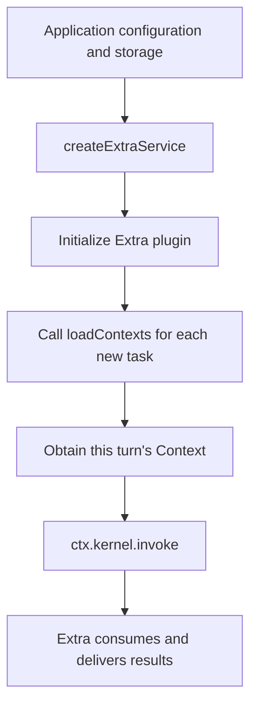
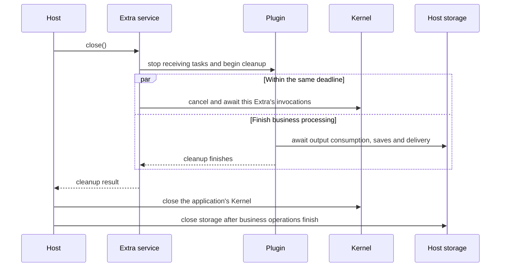

# Integrate Extras

For CLI setup, use `<extra> configure` or `<extra> extraset` for a complete JSON declaration. See [Extra-owned commands](extra-commands.md). `extraset`/`extraget` are advanced interfaces for manually written full JSON declarations.

[简体中文](../../zh-CN/guides/extras.md) | [Documentation](../README.md)

An Extra connects a business system to Kernel. For example, an IM Extra receives chat messages, prepares invocation parameters, calls Kernel, and sends Agent replies back to chat. Direct SDK calls to Kernel do not need an Extra.

Import `createExtraService` from `@mininglamp-oss/octo-runtime/host` and supply:

- `endpoint`: the existing Kernel address. Extra connects to it without starting Kernel.
- `module`: the Extra module, such as Channel Gateway, WeCom, or WebUI.
- `config`: the JSON configuration required by that module.
- `dependencies`: application functions, such as loading Context or creating session storage.

Call `initialize()` to start, `status()` to inspect, and `close()` on exit. Built-in modules use the main package's `/extras/channel-gateway`, `/extras/channel-wecom`, and `/extras/webui` import paths. Each module's `/config-schema.json` subpath provides its configuration schema.

## Load Business Data Each Turn

Channel Gateway can load background through `GatewayDependencies.loadContexts(config, {signal})`. The function returns `readonly ContextItem[]`, synchronously or asynchronously. Gateway calls it for every accepted task, so the next turn can read updated application data without restarting Extra.

Gateway merges the result with static Context. A dynamic item replaces the entire static item with the same `namespace` and `name`, including its `payload`; fields are not merged individually. This is Channel Gateway behavior and does not run automatically for direct Kernel calls.

The entire `extra.im` namespace belongs to the corresponding Octo Gateway or WeCom Channel Extra. When building Context, the channel ignores all `extra.im` items from static application configuration and `loadContexts`, including items it does not generate on this turn. Application material must use another namespace. Reserved items produce only a warning with their count; they do not interrupt AgentRun. Any external updates to channel rules must be read and assembled within the channel under its business contract; this change adds no external rule-source API. Global `octo.control/instructions` retains the composition rules below. Frozen retries preserve the complete channel-generated snapshot. See the authoritative [Channel rules](../../../.octospec/rules/channel-integration.md).

After resolving the application's Context, Octo Gateway appends its default English mention instructions on stable-rule refresh turns to the effective `octo.control/instructions.payload.entries`: `entries = [...hostEffectiveEntries, ...gatewayDefaultEntries]`. Instructions configured through CLI `extraset` belong to the application and come first. Each list retains its order and duplicate entries; the result contains one instructions item, without modifying application input or accumulating prior results. A same-generation card retry reuses the entire frozen Context and artifact policy without appending defaults again or reloading application data or history. This does not change static/dynamic replacement, public Context merging, or other Extras.

By default, Gateway waits up to 5 seconds for loading and allows at most 8 unfinished loading operations, configurable up to 32. Results are limited to 32 items and 64 KiB when serialized. A timeout stops waiting but does not stop the underlying operation; it occupies a concurrency slot until it finishes. Wrapping synchronous database work in an `async` function does not prevent event-loop blocking.

Gateway's default instructions also count toward the final invocation's Context limits. Supplying the maximum amount of application Context does not reserve capacity for Gateway additions. Gateway may omit automatic supplementary material under budget pressure, but fails rather than silently dropping default instructions or explicit application items.

## Octo Mentions and Bot Handoffs

When the current user explicitly requests a human notification or a handoff to a Bot in the current group, the model confirms the target's real UID and writes `@[uid:displayName]` in the successful final reply. Gateway validates current membership and an explicit human flag (`robot=0/false`) or Bot flag (`robot=1/true`), then sends readable text and native `mention.uids/entities` on the original reply connection. Plain `@name` does not notify. Unknown targets fall back to plain text; code, quoted examples, progress, thinking, and failed replies are not converted. This does not enable broadcasts, duplicate CLI sends, or unsolicited Bot calls.

When `allowed_sender_ids` is omitted, Gateway relies on the platform's DM admission/access policy and adds no sender restriction in groups or topics. Owners, other users, and other Bots can trigger a run, subject to Space, group enablement/scope, and native mention checks. An explicit list admits only listed senders, without implicitly adding the owner; `[]` rejects everyone and `null` is invalid. Gateway does not maintain a separate friend list or enforce an additional friends-only policy. Card controls must still match the original task initiator, Space, card message, and channel address.

Gateway rejects its own messages before command handling, Context preparation, or AgentRun dispatch, including self mentions and AI broadcasts, even if its own UID is in `allowed_sender_ids`. This applies to direct messages, groups, and topics.

The Bot setting `stable_context_refresh_interval_turns` is a positive safe integer, default `30`. Stable `extra.im/mention-instructions`, `artifact-delivery`, and `history-instructions` enter ordinary model Context on turns 1, N, 2N, etc. Fresh Provider sessions also receive the full rules, so periodic refresh works for resumed Codex, Claude Code, and OpenClaw sessions. Reset/new restarts counting. Commands, preparation failures, tool steps, automatic retries, and same-generation card retries do not advance the counter. A failed refresh remains pending. Custom session stores must preserve the optional `stableContext` binding state. Group/topic rules are checked each new turn and included when changed or due for refresh.

Each real inbound message separately supplies compact `extra.im/message-trigger` JSON with one short English guidance sentence. `conversation` identifies the direct chat, group, or topic, including group/topic names and IDs; `sender` identifies the actor by UID, name, and `human`/`bot`/`unknown` type; `recipient` identifies this Bot; `sentAt` is the original message time in the system time zone with an explicit offset; `mentions` contains actual @ targets and broadcast flags. Names and identity types come from read-only APIs authenticated as this Bot, within a shared five-second enrichment budget. Unavailable names/times are `null`; unknown types remain `unknown`, without guesses from message text or UID suffixes. The actor is supplied independently of the refresh schedule and mention targets. History and gap facts retain their loading conditions; their fixed reading rules now belong to the stable item. Artifact delivery always uses its effective policy even when an ordinary turn omits the explanation. Guidance uses real newlines. The full mention block retains `[OCTO_CHANNEL_MENTION_RULES_V1]` boundaries and asks the model to preserve it during summarization; model retention is not guaranteed. Periodic refresh accepts possible forgetting between refreshes, without compaction monitoring, exemptions, or an old-session upgrade compatibility path. See [Context and Sessions](context-and-sessions.md).

## Store Sessions

History message `sentAt` is the original message time in ISO 8601 with the system time-zone offset, for example `2026-10-29T13:36:53.000+08:00`. Missing or invalid times are null, including in quotes and forwards; processing time is never substituted. Shortening a body preserves its timestamp, which counts toward the existing serialized-history budget.

In `message-trigger`, `conversation.id` is the original channel ID and `conversation.type` is `dm`, `group`, or `group_topic`. A topic retains its full channel ID here; `conversation.group.id` and `conversation.topic.id` identify its parent group and topic separately.

Gateway caches resolved user/Bot names and identity types in memory for ten minutes, partitioned by API, Bot, and Space, with up to 2,000 entries per Bot. Reads do not extend expiry. Failed or missing lookups are not cached. Names can lag changes until expiry; this cache never authorizes membership or outgoing mentions. Optional enrichment failures do not stop AgentRun and do not trigger retries or alternative lookup APIs. User cancellation still cancels preparation.

Automatic history uses `messages: [{uid, username, sentAt, content}]`, ordered oldest first, with separate records even for consecutive messages from the same sender. Every body has a type, including `content: {type: "text", text: "..."}`. Replies retain the quote separately from the response; forwards retain nested messages; rich text retains ordered blocks. Image, file, and document references use `read: false`; preparing history does not fetch their bytes. The complete serialized array is capped at 20 records and 8,000 Unicode code points; shortened or omitted bodies are explicit, and nesting is bounded. Automatic model input has no separate `history-gap`: incomplete, unavailable, or omitted history adds one short English `note` to `history` beside `messages`. A failure may use an empty message array; normal history has no note. Retrieval cursors and handoff evidence stay inside Gateway.

The array budget includes identity fields, timestamps, JSON structure, and escaping. Primary history and fresh-fallback supplements share the same 20-message/8,000-code-point window. First-turn and uncertain-continuity history retain own Bot messages; verified continuation may omit only specific outputs already covered by assistant history. See [Gateway history selection and recovery](context-and-sessions.md).

For final deliverables, Gateway attempts local Markdown paths on its actual filesystem for all Providers, including preset OpenClaw Agents. No additional configuration or default workspace restriction is required. Explicit `artifact_delivery.allowed_roots` still restrict access, with an empty list denying all files. Missing or unreadable paths report actual file failures; Agent source does not imply remote storage.

Use `GatewayDependencies.createSessionStore(botConfig)` to supply independent session storage for each Bot. Without this function, Gateway uses memory storage with a capacity limit.

Your application chooses the storage implementation. Runtime does not depend on SQLite or manage application database schemas and migrations. Wait for Extra's output consumption and storage operations before closing the database. See the existing Chinese [Gateway integration guide](../../../SDK_CHANNEL_GATEWAY_GUIDE.md) for detailed business configuration and storage implementations.

## Develop an Extra

The plugin entry point has the form `extra(context, jsonConfig)(dependencies)`. Put configuration values in `jsonConfig` and application functions in `dependencies`. The plugin and those functions run in the same process.

Use `ctx.kernel.invoke` to call the shared Kernel, `ctx.onDispose` to register cleanup, `ctx.onStatus` to report business status, and `ctx.log` for diagnostics. Applications manage the plugin through these public APIs without accessing its internals or adding another execution forwarding interface.

## Close an Extra

`close()` stops new invocations, notifies the plugin to clean up, and cancels and awaits this Extra's submitted invocations. These operations share a default 4-second shutdown deadline, or an earlier deadline inherited from the caller.

During cleanup, the plugin can still call application dependency functions to finish saving and delivering results. New dependency calls are rejected after plugin cleanup finishes or the deadline expires. Functions already running cannot be forcibly stopped; the service continues tracking unfinished operations.

Inspect `complete`, `errors`, and `pendingResources` in the result. `complete=false` means some work or resources remain unresolved, so do not treat shutdown as complete. The database remains application-managed; the SDK does not close it automatically.

Closing one Extra does not close the shared Kernel or stop other Extras' invocations. In status results, `phase` is the Extra service's lifecycle stage, `kernel_available` reports whether Kernel can currently execute, and `plugin` contains the plugin's business status. Check the corresponding status and connection results to confirm whether a Bot or Provider is online.

Sources: [Extra API](../../../packages/octo-runtime-host-sdk/src/extras.ts), [service](../../../packages/octo-runtime-host-sdk/src/extra-service.ts), [Gateway entry](../../../packages/octo-runtime-extra-channel-gateway/src/extra.ts), [instruction composition](../../../packages/octo-runtime-extra-channel-gateway/src/execution/dispatcher.ts), [mention rules and conversion](../../../packages/octo-runtime-extra-channel-gateway/src/transport/mentions.ts), [message admission](../../../packages/octo-runtime-extra-channel-gateway/src/transport/normalize.ts).
