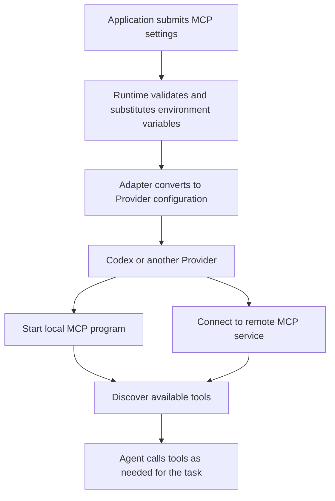

# Use MCP

[简体中文](../../zh-CN/guides/mcp.md) | [Documentation](../README.md)

MCP lets an Agent use tools to access external systems, such as project documents, databases, or business APIs. This guide shows how to configure MCP servers for a Runtime invocation.

Add a Context item to `InvokeInput.contexts.items` with `namespace: "octo.execution"` and `name: "mcp"`. Put the connection settings in `payload.mcpServers`. This guide refers to that Context type as `octo.execution/mcp`.

Prepare your MCP server, then choose its connection type:

- **Remote service**: use `streamable_http` with the service URL and any authentication headers.
- **Local program**: use `stdio` with the installed executable's path and arguments.

Both examples below use Codex. For another Provider, check the support table on this page first.

## Connect to a Remote Service

This example connects to a service that uses Bearer Token authentication. Replace `url` with your service address and set `BUSINESS_TOKEN` in the environment of the process that starts Runtime. Runtime replaces `${BUSINESS_TOKEN}` with that variable's value to build the request header. Do not put the token in `inputs`.

```json
{
  "protocol_mode": "canonical",
  "inputs": [{ "type": "text", "text": "Use the project tools to summarize the current task." }],
  "contexts": {
    "schema": "octo.context-envelope/v3",
    "items": [
      { "namespace": "octo.execution", "name": "adapter", "payload": { "type": "codex" } },
      {
        "namespace": "octo.execution",
        "name": "mcp",
        "payload": {
          "mcpServers": {
            "project-api": {
              "type": "streamable_http",
              "url": "https://example.com/mcp",
              "headers": { "Authorization": "Bearer ${BUSINESS_TOKEN}" }
            }
          }
        }
      }
    ]
  }
}
```

Pass this object as `input` to `client.invoke(input)` and consume the returned event stream. See the [SDK quickstart](../getting-started/sdk.md) and [invokeOnce example](../../examples/invoke.mts) for the complete invocation code.

Configuring MCP makes the service's tools available to the Agent. The Agent does not necessarily use them on every turn. Inspect the Provider's tool calls and results to confirm that a particular tool ran.

## Start a Local Program

Install the MCP server on the machine running Runtime, then replace `command` below with the executable's actual path. Each entry in `args` is one argument; do not combine them into a shell command.

```json
{
  "protocol_mode": "canonical",
  "inputs": [{ "type": "text", "text": "List the available project documents." }],
  "contexts": {
    "schema": "octo.context-envelope/v3",
    "items": [
      { "namespace": "octo.execution", "name": "adapter", "payload": { "type": "codex" } },
      {
        "namespace": "octo.execution",
        "name": "mcp",
        "payload": {
          "mcpServers": {
            "project-local": {
              "type": "stdio",
              "command": "/absolute/path/to/project-mcp",
              "args": ["--project", "example"],
              "env": { "PROJECT_ID": "example-project" }
            }
          }
        }
      }
    ]
  }
}
```

Supply the MCP configuration on every invocation that needs it, including when continuing an existing session. Changing the configuration after an invocation starts does not affect that invocation.

`mcpServers: {}` supplies no servers in this item. It does not disable servers configured in the Provider or clear caller defaults.

## How Configuration Takes Effect

Runtime validates the configuration and substitutes environment variables. The Adapter then converts it to the selected Provider's configuration format. For example, the Codex Adapter passes the settings to Codex. The Provider starts the local program or connects to the remote service. Runtime does not download or install MCP servers.



## Configuration Fields

`payload.mcpServers` maps service names to connection settings, with at most 32 entries. Names must match `^[A-Za-z0-9][A-Za-z0-9._-]{0,127}$`, for example `project-api`.

Use the fields for the selected `type` in the table below. Unknown fields fail validation. A `stdio` entry cannot contain HTTP fields such as `url`, and a `streamable_http` entry cannot contain local program fields such as `command`. HTTP header names must be unique, ignoring case.

| Transport         | Required                   | Optional                                                                                          |
| ----------------- | -------------------------- | ------------------------------------------------------------------------------------------------- |
| `stdio`           | `type`, nonempty `command` | `args` (≤128 strings), `env` (string map), `cwd`, `required`, `startupTimeoutMs`, `toolTimeoutMs` |
| `streamable_http` | `type`, HTTP(S) `url`      | `headers` (string map), `required`, `startupTimeoutMs`, `toolTimeoutMs`                           |

Providers support different optional fields. Supplying a field that the selected Provider cannot support fails with `MCP_OPTION_UNSUPPORTED`; see the support table below. `required` belongs to an individual server entry, at the same level as `command` or `url`. See the [Context reference](../reference/contexts.md) for field bounds and validation rules.

## Use Environment Variables

`${NAME}` in connection settings refers to a variable in the invocation's execution environment. In addition to authentication headers, substitution is supported in `command`, each `args` entry, `cwd`, `env` values, and `url`. Service names, field names, header names, and `env` keys are not substituted.

Runtime merges environment variables in this order, with later values overriding earlier ones: the inherited process environment, `octo.execution/envs`, invocation `executionEnvOverrides`, and Adapter environment settings. Values in `octo.execution/envs` are not themselves expanded as templates. See [InvokeInput and Execution Environment](../reference/invoke-input.md) for passing `executionEnvOverrides`.

Substitution runs once. Runtime does not execute shell expressions or expand variables inside the substituted value. Use `$${NAME}` to keep the literal text `${NAME}`. An unset variable fails with `MCP_ENV_MISSING`. A variable set to an empty string substitutes an empty string; Runtime then validates the resulting connection settings.

A local MCP program's own `env` settings can further override its child process environment. A remote service receives the configured request headers and URL, not the local environment variables.

Set environment variables before invoking. Running `export` in another terminal does not update an existing Runtime or Provider process. Runtime does not write substituted values back to Context or user configuration files. If you put a secret directly in Context, a Context snapshot may still retain it.

## Provider Support

| Adapter                                                | Supported connections                                          | Optional fields and limits                                                                   |
| ------------------------------------------------------ | -------------------------------------------------------------- | -------------------------------------------------------------------------------------------- |
| Codex                                                  | stdio, Streamable HTTP                                         | Supports `cwd`, `required`, `startupTimeoutMs`, and `toolTimeoutMs`.                         |
| Claude Code                                            | stdio, Streamable HTTP                                         | Does not support those four optional fields. Substituted values cannot contain literal `${`. |
| ACP, Hermes, Kimi Code, MCode, Qoder CLI, Qoder CLI CN | stdio; Streamable HTTP when the Provider declares HTTP support | Does not support those four optional fields.                                                 |
| OpenCode                                               | stdio, Streamable HTTP                                         | Supports `toolTimeoutMs`; does not support `cwd`, `required`, or `startupTimeoutMs`.         |
| CodeBuddy, OpenClaw, ZCode GUI, Antigravity            | No per-invocation MCP configuration                            | Nonempty MCP configuration fails with `MCP_UNSUPPORTED`.                                     |

Choose service names distinct from the Provider's existing MCP configuration. Codex rejects duplicates with `MCP_SERVER_NAME_CONFLICT`, even if the existing service is disabled or uses a different transport. It does not overwrite that service. Claude Code and OpenCode handle duplicate names according to their own configuration loading rules.

Configuring MCP does not change tool approval policy. Your application must still handle approval requests for tools that require them. The server also checks business permissions for the supplied credentials, such as whether a token can read a particular project.

## Troubleshoot Connections

Start with the reported error code:

| Error code                 | What to check                                                                                       |
| -------------------------- | --------------------------------------------------------------------------------------------------- |
| `MCP_ENV_MISSING`          | Set the variable referenced by the template in this invocation's execution environment.             |
| `MCP_UNSUPPORTED`          | The Adapter does not support per-invocation MCP configuration; choose one that does.                |
| `MCP_OPTION_UNSUPPORTED`   | Remove optional fields that the Provider support table lists as unsupported.                        |
| `MCP_SERVER_NAME_CONFLICT` | Rename the service to avoid an existing Codex configuration entry.                                  |
| `MCP_LITERAL_UNSUPPORTED`  | A final value passed to Claude Code contains literal `${`; check escaping and substitution results. |

If configuration validation passes but tools remain unavailable, check the Provider's connection logs: can the local program start, is the remote address reachable, does authentication succeed, and does the server return a tool list? Do not log tokens or substituted authentication headers.

See [Maintenance and Validation](../maintenance.md) for the validation scope of these examples and tests.

Sources: [Adapter MCP helper](../../../packages/octo-runtime-adapter-sdk/src/mcp.ts), [Codex](../../../packages/octo-runtime-adapter-codex/src/mcp.ts), [Claude Code](../../../packages/octo-runtime-adapter-claude-code/src/index.ts), [ACP](../../../packages/octo-runtime-adapter-acp/src/index.ts), [OpenCode](../../../packages/octo-runtime-adapter-opencode/src/index.ts).
