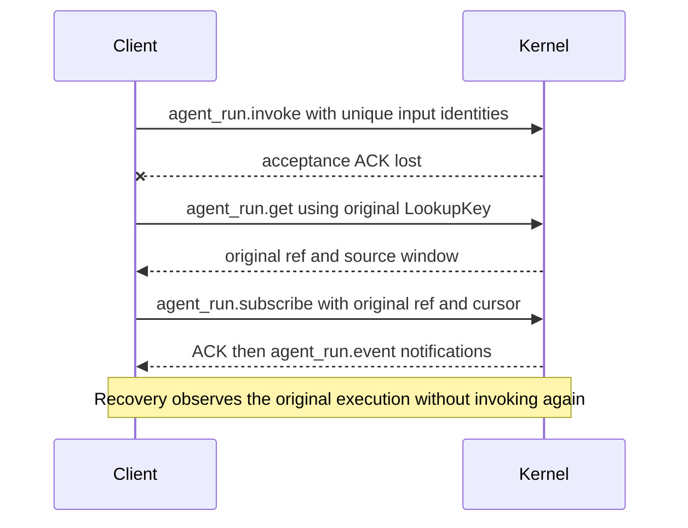

# Kernel IPC and SDK

[简体中文](../../zh-CN/reference/kernel-ipc.md) | [Documentation](../README.md)

Kernel IPC is the protocol between an application and a local Kernel service. TypeScript applications normally use `KernelClient.invoke`, letting the SDK handle submission, subscription, and reconnection. Other languages can implement a client using the JSON-RPC protocol below.

Start with the [SDK quickstart](../getting-started/sdk.md) for a first integration. This reference covers public imports, client methods, and the underlying protocol separately.

## Public Package Surface

| Import subpath                                                                | Purpose                                                                                        |
| ----------------------------------------------------------------------------- | ---------------------------------------------------------------------------------------------- |
| `/host`                                                                       | Create Kernel/Extra services, manage initialization and shutdown, generate component endpoints |
| `/executor-kernel`                                                            | `attachKernel`, KernelClient types, KernelError, `serveWorker`, Kernel service factory         |
| `/executor-core`                                                              | Use AgentExecutor directly in the calling process                                              |
| `/protocol`                                                                   | InvokeInput, output/context types and public validators                                        |
| `/protocol/schema.json`                                                       | Shared protocol schema                                                                         |
| `/executor-kernel/ipc-schema.json`                                            | IPC v1 schema                                                                                  |
| `/executor-kernel/ipc-fixtures.json`                                          | Test samples of valid and invalid IPC messages                                                 |
| `/extra`, `/extras/channel-gateway`, `/extras/channel-wecom`, `/extras/webui` | Generic plugin API and built-in business modules                                               |

All paths are under `@mininglamp-oss/octo-runtime`. For example, import the client from `@mininglamp-oss/octo-runtime/executor-kernel`. Internal workspace packages are private; applications use the public paths above.

## Create a Service

`createKernelService(options)` requires the listening address `endpoint` and absolute worker entry path `workerEntrypoint`. Optional settings are Adapter module `manifest`, `adapterConfigurations`, `configurations(runtimeId?)`, `env`, and `stateDirectory`. The manifest selects Adapter modules for the worker; it does not store business Agent data.

1. Create the service and await `initialize({signal?})`.
2. After initialization, invoke through `kernel.client` or inspect the service with `status()`.
3. Call `close()` on exit. You can also await the `closed` Promise for the cleanup result.

Initialization failure throws `ServiceInitializationError` with the original `cause` and `cleanup` result. Repeated initialization or closure on the same object shares the original operation. Create a new object to start another service lifecycle.

## KernelClient Methods

| Method                                             | Purpose and result                                                                                                             |
| -------------------------------------------------- | ------------------------------------------------------------------------------------------------------------------------------ |
| `invoke(input, environment?)`                      | Async output stream that submits when read, manages execution identifiers, and reconnects within limits. Use for normal calls. |
| `cancelInvocation(invocationId, reason?)`          | Cancel an invocation started through invoke on this client; returns `{accepted}`.                                              |
| `respondInteraction(invocationId, response)`       | Reply to that invocation's canonical interaction.                                                                              |
| `respondNativeInteraction(invocationId, response)` | Reply to that invocation's Provider-native interaction.                                                                        |
| `status()` / `list()`                              | Query Kernel/worker state and registered Adapter metadata respectively. Check Provider installation and login separately.      |
| `close()`                                          | Close client connections without cancelling submitted executions or closing the Kernel service.                                |

Use these lower-level methods only when managing submission and subscription yourself:

| Method                                                    | Purpose and result                                                                                           |
| --------------------------------------------------------- | ------------------------------------------------------------------------------------------------------------ |
| `submit(input, environment?)`                             | Submit one execution and return `{ref}`. The caller then subscribes to output and handles recovery.          |
| `get(key, expectedInstance?)`                             | Query the original execution's ref, retained output range, and final state.                                  |
| `subscribe(ref, afterSeq = 0, signal?)`                   | Read HostFrames after a sequence number. The signal only stops the subscription.                             |
| `cancel(ref, reason?)`                                    | Cancel by complete ref. The result says whether the request was accepted; read output for the final outcome. |
| `respond(ref, response)` / `respondNative(ref, response)` | Reply to an interaction by complete ref.                                                                     |

## Manage Unfinished Client Invocations

`client.invocations` tracks up to 128 calls started through `invoke`, including calls with unknown outcomes. Lower-level `submit` is not added automatically.

- `snapshot()` returns invocation metadata.
- `stopAdmission()` rejects new invoke calls.
- `drain({deadline, reason})` cancels and awaits tracked calls, returning `complete` and `unresolved`. Its deadline is an absolute millisecond timestamp calculated with `Date.now()`.

Applications that create Kernel normally use the service's `close()`. An application connected to an external Kernel can explicitly use this registry to cancel and await its own invocations on exit.

## IPC Message Format

IPC protocol version is 1. It is numbered independently from Run schema version 7, Context `octo.context-envelope/v3`, and internal Adapter transport version 2.

Use a Unix domain socket on macOS/Linux or a Named Pipe on Windows. Each connection sends one UTF-8 JSON-RPC 2.0 request ending with LF. Its `id` must be a nonempty string. Numeric IDs, batch requests, and top-level or params fields undefined by the schema are rejected.

Ordinary requests end the connection after their response. A subscription receives its response followed by `agent_run.event` notifications on the same connection. One JSON message may arrive across several socket reads. Limit buffering and parse only after receiving a complete LF-delimited line.

| Wire method                | Params                                                 | Successful result                                                            |
| -------------------------- | ------------------------------------------------------ | ---------------------------------------------------------------------------- |
| `status`                   | `{}`                                                   | KernelStatus including `kernel_instance_id`, `execution_ready`, worker state |
| `adapter.list`             | `{}`                                                   | Registered Adapter metadata array                                            |
| `agent_run.invoke`         | `{input, executionEnvOverrides?, kernel_instance_id?}` | `{kernel_instance_id, receipt}`; receipt is the accepted execution identity  |
| `agent_run.get`            | `{key, kernel_instance_id?}`                           | `{ref, oldest_seq, latest_seq, terminal?}`                                   |
| `agent_run.subscribe`      | `{ref, after_seq}`                                     | Snapshot ACK, then ordered event notifications                               |
| `agent_run.cancel`         | `{ref, reason?}`                                       | `{accepted}`                                                                 |
| `agent_run.respond`        | `{ref, response}`                                      | Interaction acceptance result                                                |
| `agent_run.native.respond` | `{ref, response}`                                      | Native response acceptance result                                            |

Queries and controls use two identifier objects:

- `LookupKey`: `run_id`, `invocation_id`, `agent_session_id`, `session_generation`, and `protocol_mode`, to find a submitted execution.
- `RunRef`: those fields plus `kernel_instance_id`, `stream_id`, and `protocol`, to subscribe to or control a specific execution.

Save the complete submission receipt. It contains the actual session generation and protocol; do not reconstruct it from a business session ID alone.

## Minimal Non-TypeScript Exchange

Open a connection, send this JSON plus LF, read the matching response, and close:

```json
{ "jsonrpc": "2.0", "id": "status-1", "method": "status", "params": {} }
```

After checking readiness, submit once on a new connection (optionally include the observed instance in params):

```json
{
  "jsonrpc": "2.0",
  "id": "invoke-1",
  "method": "agent_run.invoke",
  "params": {
    "input": {
      "runId": "example-run",
      "invocationId": "example-invocation",
      "sessionId": "example-session",
      "sessionGeneration": 0,
      "protocol_mode": "canonical",
      "inputs": [{ "type": "text", "text": "Say hello." }],
      "contexts": { "schema": "octo.context-envelope/v3", "items": [] }
    }
  }
}
```

The execution and invocation IDs above are examples; generate unique values for each new execution. After receiving the response:

1. Merge `result.kernel_instance_id` with `result.receipt` to obtain `ref`.
2. Open a new connection and send `agent_run.subscribe` with the complete `ref` and `after_seq: 0` in params.
3. Read `agent_run.event` notifications. Their params are `{kernel_instance_id, run_id, stream_id, seq, event}`, where `event` is a complete HostFrame.
4. Validate execution identifiers and consecutive `seq` values, then save the last successfully read sequence number for reconnection.

Even in canonical mode, IPC subscriptions return HostFrames. Only the higher-level TypeScript `invoke` API extracts CanonicalEvent objects from them.

See the IPC schema for complete request and response structures. Errors contain the JSON-RPC numeric `error.code` and a stable string `error.data.code`, such as `RUN_NOT_AVAILABLE`. Handle the latter instead of matching message text that may change. This repository does not currently provide official Go/Python clients; use these steps when implementing your own.

## Reconnection and Limits



If no receipt arrives after submission, query with the original `LookupKey` rather than invoking again, which may execute the task twice. The TypeScript client makes at most 3 recovery attempts within 10 seconds, reading the original ref after the last consecutive sequence number.

Recovery fails on Kernel instance changes, execution identifier mismatches, invalid sequence numbers, missing output, or expiry. A lost cancellation or interaction response returns `OPERATION_OUTCOME_UNKNOWN`: the operation may already have taken effect, so resending it automatically may duplicate the operation.

Default output-cache and connection limits are:

| Item                                         | Default limit           |
| -------------------------------------------- | ----------------------- |
| Output cache per execution                   | 4096 frames, 32 MiB     |
| Output cache overall                         | 128 executions, 128 MiB |
| Retention after execution ends               | 120 seconds             |
| Subscriptions per execution                  | 16                      |
| Frames per batch / size per frame            | 32 frames / 20 MiB      |
| Concurrent Kernel / client connections       | 64 / 32                 |
| Wait for the write buffer to become writable | At most 5 seconds       |

Byte limits count serialized data, rather than total process memory. Trusted Adapter execution settings can adjust output-cache policy within allowed bounds. Ordinary Context cannot change it.

Kernel or worker restart does not restore old output or rerun old executions. Applications decide how to proceed when a result is `lost` or unknown. See [Output and Control](output-and-control.md).

Sources: [IPC schema](../../../packages/octo-runtime-protocol/schema/kernel-ipc.schema.json), [fixtures](../../../packages/octo-runtime-protocol/schema/kernel-ipc-fixtures.json), [client types](../../../packages/octo-runtime-executor-kernel/src/types.ts), [client](../../../packages/octo-runtime-executor-kernel/src/client.ts), [server](../../../packages/octo-runtime-executor-kernel/src/server.ts).
