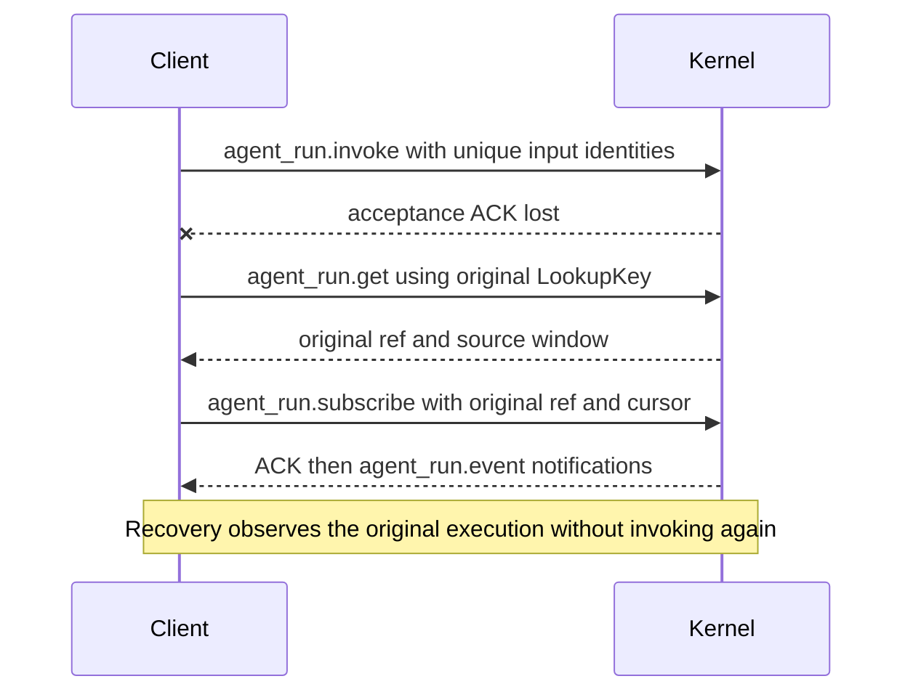

# Kernel IPC

[简体中文](../../zh-CN/reference/kernel-ipc.md) | [Documentation](../README.md)

Local Kernel JSON-RPC protocol. TypeScript applications normally use [KernelClient](kernel-client.md); clients in other languages can implement this protocol.

## Schemas and Validation

The standalone client provides two Draft-07 schemas at `/protocol/schema.json` and `/protocol/ipc-schema.json`, plus conformance samples at `/protocol/ipc-fixtures.json`. Samples are not protocol definitions.

Standard validators enforce standard keywords; `x-octo-*` semantics require explicit implementation. Runtime also checks byte/depth budgets, Unicode scalar strings, uniqueness, cross-field consistency and execution state. Structural validation alone does not establish full conformance.

## IPC Message Format

IPC protocol version is 2. It is numbered independently from Run schema version 7, Context `octo.context-envelope/v3`, and internal Adapter transport version 2.

The IPC Schema `$id` is `urn:mininglamp-oss:octo-runtime:kernel-ipc:v2`.

Use a Unix domain socket on macOS/Linux or a Named Pipe on Windows. Each connection sends one UTF-8 JSON-RPC 2.0 request ending with LF. Its `id` must be a nonempty string. Numeric IDs, batch requests, and top-level or params fields undefined by the schema are rejected.

Ordinary requests end the connection after their response. A subscription receives its response followed by `agent_run.event` notifications on the same connection. One JSON message may arrive across several socket reads. Limit buffering and parse only after receiving a complete LF-delimited line.

| Wire method                | Params                                                 | Successful result                                                                                                   |
| -------------------------- | ------------------------------------------------------ | ------------------------------------------------------------------------------------------------------------------- |
| `status`                   | `{}`                                                   | KernelStatus including `kernel_instance_id`, `execution_ready`, host `pid`                                          |
| `adapter.list`             | `{}`                                                   | Registered Adapter metadata array including `available`, `unavailableReason`, `providerPath`, and `providerVersion` |
| `agent_run.invoke`         | `{input, executionEnvOverrides?, kernel_instance_id?}` | `{kernel_instance_id, receipt}`; receipt is the accepted execution identity                                         |
| `agent_run.get`            | `{key, kernel_instance_id?}`                           | `{ref, oldest_seq, latest_seq, terminal?}`                                                                          |
| `agent_run.subscribe`      | `{ref, after_seq}`                                     | Snapshot ACK, then ordered event notifications                                                                      |
| `agent_run.cancel`         | `{ref, reason?}`                                       | `{accepted}`                                                                                                        |
| `agent_run.respond`        | `{ref, response}`                                      | Interaction acceptance result                                                                                       |
| `agent_run.native.respond` | `{ref, response}`                                      | Native response acceptance result                                                                                   |

Queries and controls use two identifier objects:

- `LookupKey`: `run_id`, `invocation_id`, `agent_session_id`, `session_generation`, and `protocol_mode`, to find a submitted execution.
- `RunRef`: those fields plus `kernel_instance_id`, `stream_id`, and `protocol`, to subscribe to or control a specific execution.

Save the complete submission receipt. It contains the actual session generation and protocol; do not reconstruct it from a business session ID alone.

## Minimal Non-TypeScript Exchange

Open a connection, send this JSON plus LF, read the matching response, and close:

```json
{ "jsonrpc": "2.0", "id": "status-1", "method": "status", "params": {} }
```

After checking readiness, submit once on a new connection (optionally include the observed instance in params):

```json
{
  "jsonrpc": "2.0",
  "id": "invoke-1",
  "method": "agent_run.invoke",
  "params": {
    "input": {
      "runId": "example-run",
      "invocationId": "example-invocation",
      "sessionId": "example-session",
      "sessionGeneration": 0,
      "protocol_mode": "canonical",
      "inputs": [
        {
          "type": "text",
          "text": "Say hello."
        }
      ],
      "agentEnv": {
        "schema": "octo.context-envelope/v3",
        "items": [
          {
            "namespace": "octo.execution",
            "name": "workspace",
            "payload": {
              "path": "/absolute/prepared/project"
            }
          }
        ]
      }
    }
  }
}
```

The execution and invocation IDs above are examples; generate unique values for each new execution. After receiving the response:

1. Merge `result.kernel_instance_id` with `result.receipt` to obtain `ref`.
2. Open a new connection and send `agent_run.subscribe` with the complete `ref` and `after_seq: 0` in params.
3. Read `agent_run.event` notifications. Their params are `{kernel_instance_id, run_id, stream_id, seq, event}`, where `event` is a complete HostFrame.
4. Validate execution identifiers and consecutive `seq` values, then save the last successfully read sequence number for reconnection.

Even in canonical mode, IPC subscriptions return HostFrames. Only the higher-level TypeScript `invoke` API extracts CanonicalEvent objects from them.

See the IPC schema for complete request and response structures. Errors contain the JSON-RPC numeric `error.code` and a stable string `error.data.code`, such as `RUN_NOT_AVAILABLE`. Handle the latter instead of matching message text that may change. This repository does not currently provide official Go/Python clients; use these steps when implementing your own.

## Reconnection and Limits



If no receipt arrives after submission, query with the original `LookupKey` rather than invoking again, which may execute the task twice. The TypeScript client makes at most 3 recovery attempts within 10 seconds, reading the original ref after the last consecutive sequence number.

Recovery fails on Kernel instance changes, execution identifier mismatches, invalid sequence numbers, missing output, or expiry. A lost cancellation or interaction response returns `OPERATION_OUTCOME_UNKNOWN`: the operation may already have taken effect, so resending it automatically may duplicate the operation.

Default output-cache and connection limits are:

| Item                                         | Default limit                            |
| -------------------------------------------- | ---------------------------------------- |
| Output cache per execution                   | 4096 frames, 32 MiB                      |
| Output cache overall                         | 128 executions, 128 MiB                  |
| Retention after execution ends               | 120 seconds                              |
| Concurrent subscriptions across the Kernel   | 16, shared by all executions and clients |
| Frames per batch / size per frame            | 32 frames / 20 MiB                       |
| Concurrent Kernel / client connections       | 64 / 32                                  |
| Wait for the write buffer to become writable | At most 5 seconds                        |

The subscription budget is separate from the Kernel and per-client connection limits. Ending a subscription releases its slot; it does not cancel the execution.

Byte limits count serialized data, rather than total process memory. Trusted Adapter execution settings can adjust output-cache policy within allowed bounds. Ordinary Context cannot change it.

Kernel host restart does not restore old output or rerun old executions. Applications decide how to proceed when a result is `lost` or unknown. See [Output and Control](output-and-control.md).

Sources: [IPC schema](../../../packages/octo-runtime-protocol/schema/kernel-ipc.schema.json), [conformance fixtures](../../../packages/octo-runtime-protocol/test/fixtures/kernel-ipc-fixtures.json), [client types](../../../packages/octo-runtime-client/src/types.ts), [client](../../../packages/octo-runtime-client/src/client.ts), [server](../../../packages/octo-runtime-executor-kernel/src/server.ts).
