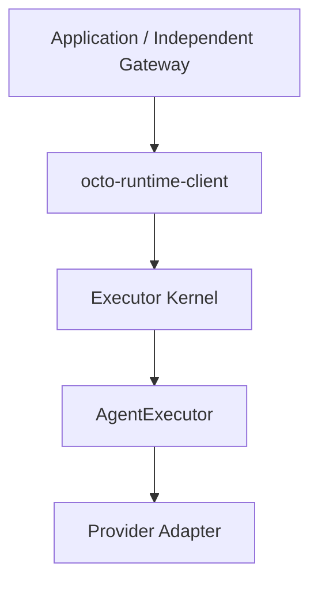

# 架构

[English](../../en/concepts/architecture.md)

Runtime 接收应用准备的输入与执行配置，调用 Provider，并返回执行事件。应用负责业务数据、会话绑定、授权和结果投递。

## 模块职责

| 模块 | 公开职责 |
| --- | --- |
| runtime-client | 连接已有 Kernel，提交、观察和控制调用。 |
| Executor Kernel | 提供本地 RPC、执行管理和有界输出续流。 |
| Executor Core | 路由到已注册 Adapter，管理执行、取消和预算。 |
| Provider Adapter | 校验其支持的配置，映射 Provider 原生调用、输出和交互。 |
| protocol | 定义输入、AgentEnv、事件和 IPC 数据形状及校验。 |
| Host SDK | 提供 Home、endpoint 和启动诊断辅助 API。 |

## 接入方式

独立应用安装 `@mininglamp-oss/octo-runtime-client`，通过 `attachKernel({ endpoint })` 连接服务。服务可以由 CLI 或应用自身启动。

原生 SDK 宿主 import 所需 Adapter，构造对象后传给 `createKernelService`。Adapter 可以通过类、工厂、闭包或直接对象构造，参数由具体实现决定。所需依赖、初始化和调用示例见 [SDK 接入](../getting-started/sdk.md)。

服务、Engine 和连接由创建者或明确约定的所有者维护。借用对象不转移重启、关闭或持久数据删除权限。`client.close()` 仅释放该客户端连接；取消执行使用 `interrupt`，并继续观察终态。Runtime Home 与 Provider 自有数据目录分别管理。

## 输出静默与执行预算

模型公开文本的静默时钟与周期通知归 Runtime Core。正常消费时，持续静默到 60/120/180 秒等节点产生新 `model_output_idle` notice，经现有事件流传递；Gateway 只按每条源通知刷新原卡片，不计时、补算或本地静默取消。背压/迟到允许跳过历史节点，详见[输出与控制](../reference/output-and-control.md)。

该时钟不同于 Watchdog 模型空闲进度时钟。通知不延长或重置首帧、模型空闲、工具与总预算；默认 enforce，显式 observe 仍为合法配置。终态与清理优先；周期能力须由实际连接的 Runtime 服务提供，仅升级 client 不代表服务已支持。

## 输入与执行配置

[inputs](../reference/input-parts.md) 承载文本、图片、应用提示词和业务历史；[AgentEnv](../reference/agent-env-standard.md) 承载执行配置。Core 为每次调用复制 AgentEnv 快照，读取 Adapter 路由，并保留条目原值和顺序交给 Adapter。

七个标准执行项由公共协议定义；Adapter 专属项由消费它的 Adapter 校验，详见[私有字段参考](../reference/agent-env/private-items.md)。执行配置不会自动拼入模型正文。

## 会话与业务边界

调用方完整保存 ProviderSession，再显式传给下一轮。agentEnv 是逐轮配置，不是会话身份；同一会话可由应用授权选择新的配置，仍受 Provider 恢复与权限限制。Provider 绑定替换时，应用须使旧交互失效，避免将旧会话句柄投向另一个 Adapter、账号或服务端。见[标识](identifiers.md)和[输出与控制](../reference/output-and-control.md)。

模型目录、设备选择、业务渠道、历史选择和结果投递由应用或独立 [Channel Gateway](https://github.com/Mininglamp-OSS/octo-channel-gateway) 管理。Runtime 的 Adapter 列表表示注册和探测信息，不证明账号登录或模型权限。
