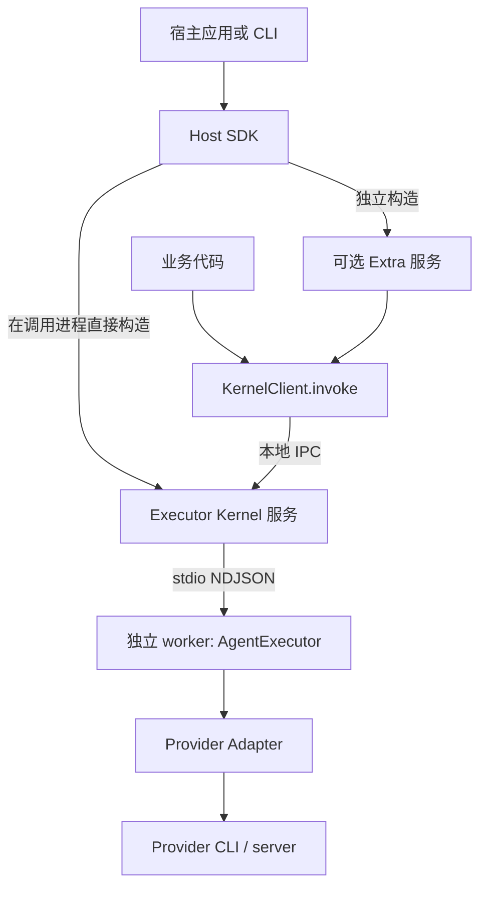
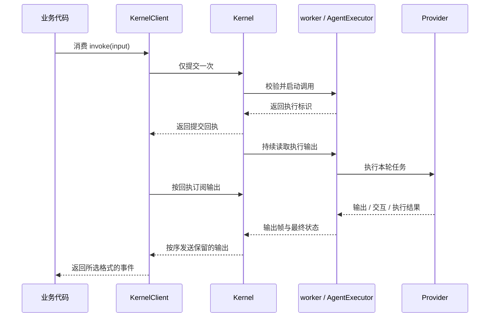
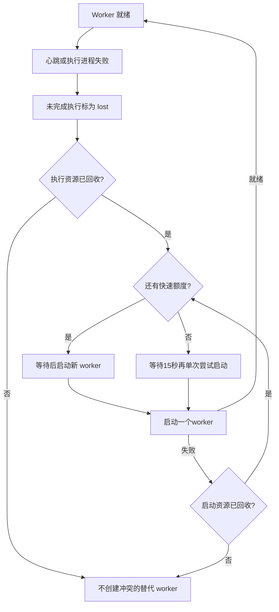

# 核心架构

[English](../../en/concepts/architecture.md) | [文档目录](../README.md)

Octo Runtime 让应用通过统一接口调用 Codex、Claude Code 等 Agent 执行程序。本文将这些程序称为 **Provider**，将接入 Runtime 的应用称为**宿主应用**。每个 Provider 对应一个 **Adapter**，负责转换输入、输出和控制消息。

应用通常通过 `KernelClient.invoke` 发起调用。Kernel 接收请求，在独立的 worker 进程中执行，并把输出返回给客户端。本文将一次执行称为 Run。应用处理输出和交互请求，Kernel 管理 worker 的启动与监督，KernelClient 处理输出订阅和断线重连。

根目录[架构文档](../../../ARCHITECTURE.md)介绍了这一设计的背景：IM、桌面应用和任务系统共用一套执行能力，无需各自实现 Provider 接入。

当前 Kernel 提供本地进程间通信（IPC）。IM 等业务入口通过可选的 Extra 接入。根文档中描述的云端设备注册、远程寻址和跨设备会话路由仍是目标设计，当前公开 Kernel 接口没有实现这些能力。

`createKernelService` 在调用它的进程中创建 Kernel 服务和 IPC endpoint；AgentExecutor 在 Kernel 启动的 worker 进程中运行。原生应用可以直接在主进程中创建 Kernel，无需另外运行 Runtime CLI。也可以通过 `attachKernel({ endpoint })` 连接已经存在的服务。

CLI 用 Home 目录保存设备实例的身份和配置，用 workdir 指定 Agent 工作目录，两者用途不同。使用 SDK 的应用自行决定配置和状态存放位置。

## 职责划分

Adapter 与 Extra 由接入入口选择。SDK 宿主原生 import 和组装，不依赖 manifest；CLI 使用同时包含 adapters、extras 的统一清单，读取内置目录和 Runtime Home 扩展。默认发行继续保留全量集合。完整约束、解析锚点和验证范围见 [Adapter 与 Extra 载入](module-loading.md)。

| 组件             | 负责                                                                  | 不负责                           |
| ---------------- | --------------------------------------------------------------------- | -------------------------------- |
| 宿主应用         | 安装和认证 Provider，提供配置、业务历史和数据库，管理服务的启动与关闭 | 转换 Provider 协议               |
| Host SDK         | 创建 Kernel 和 Extra 服务，传入依赖，报告初始化和清理结果             | 管理应用数据库的表结构和迁移     |
| Executor Kernel  | 提供 IPC 接口，监督 worker，暂存输出以支持断线后补读                  | 保存业务历史或自动重跑请求       |
| AgentExecutor    | 准备输入，驱动一次执行，处理交互、取消和最终状态                      | 查询业务背景或安装 Provider      |
| Provider Adapter | 将 Runtime 参数转换为 Provider 配置，处理原生输出并清理执行资源       | 决定业务权限或补齐聊天历史       |
| Extra            | 接收业务请求，加载 Context，调用 Kernel，向业务系统投递结果           | 关闭共享 Kernel 或其他模块的调用 |

本地 SDK 调用可以只使用 Kernel，不需要 Extra、云端登录或 IM 连接。`octo-runtime` 是启动和管理 Runtime 的 CLI；`octo-cli` 则是独立的业务 API 工具。如果 Agent 需要调用 `octo-cli`，应用需要另外安装并配置凭据。

Provider harness 的登录、授权及凭据准备归使用者、宿主与 harness。Runtime 传递普通执行环境并完成必要的协议握手，包括使用 harness 广告的受支持方式进行 ACP 认证；不检查 Provider 专属认证环境变量或凭据文件，不因某个变量缺失而推断未登录，也不代办登录和凭据刷新。harness 自行解析认证来源并判断认证是否成功，Runtime 如实返回失败。框架自身安全及 Extra 显式业务凭据合同仍按各自规则执行。

## Channel Context 与历史

Channel Gateway 负责 IM Context 的稳定规则、当前消息事实和历史查询。Host SDK、Kernel、Core、renderer 与 Provider Adapter 消费已提交输入，不自行选择或去重业务历史；OpenClaw、Codex、Claude Code 共用该责任边界。

稳定 mention、产物格式和历史理解指引在第 1 轮及每 N 轮携带（`stable_context_refresh_interval_turns`，默认 30）；reset/new 重置计数，新 Provider 会话获得完整规则。独立 `message-trigger` 描述每条真实入站消息。群/子区规则按范围及版本更新，清空时明确 `NO RULES`。周期刷新不保证轮间始终记住规则，也不监听模型压缩。

自动历史选取同频道当前触发前最近最多 **20 条消息**，从旧到新呈现。**完整序列化 `messages` 数组最多 8000 Unicode 码点**，包括身份、时间、JSON 结构及转义，属于整个数组的总预算。冷启动和缺口准备共用本轮一次有界读取，主历史与 fresh fallback 恢复补充共用同一窗口和预算。

首轮、reset、补位或连续性未知的历史保留自身 Bot 消息。确认正常续接时，Gateway 才可依据完成状态、归属、投递位置和内容指纹，省略已由同一 Provider 会话 assistant 覆盖的具体成功输出；本次 fresh fallback 从冻结窗口补回。不按 UID、正文或 URL 全面去重，不删除引用/转发内部消息，不过滤显式宿主 Context。

接入说明见[会话准备](../guides/context-and-sessions.md)，权威合同见 [Octospec 架构约束](../../../.octospec/rules/architecture.md)。

## 调用时序

提交回执表示请求已经被接收，执行结果还要从输出流中读取。客户端断线后，已提交的执行仍会继续。重连时客户端查询原执行，并补读 Kernel 尚未清除的输出，不会重新发起调用。若 worker 失联，未完成的执行会标记为 `lost`；替代 worker 只处理新请求。

## KernelClient 与直接 Core

| 属性                         | KernelClient                          | AgentExecutor                     |
| ---------------------------- | ------------------------------------- | --------------------------------- |
| 执行位置                     | Kernel 监督的独立 worker              | 调用进程                          |
| 故障隔离                     | worker 隔离；宿主管理 Kernel 服务     | 共享宿主故障、阻塞和 OOM 影响     |
| 提前关闭迭代器               | 停止接收输出，执行继续                | 请求取消执行                      |
| 断线后补读                   | 可读取保留期内的原执行输出            | 不提供 Kernel 输出缓存            |
| 本地环境 `streamLimits` 选项 | 拒绝                                  | 支持                              |
| 关闭                         | 调用服务的 `close()`，检查 `complete` | 调用 `shutdown()`，检查 `cleanup` |

通常选择 KernelClient。只有应用需要进程内执行，并能接受执行阻塞或崩溃影响应用进程时，才直接使用 AgentExecutor。两者都提供 `invoke(input, environment?)`，但关闭迭代器、恢复输出和清理资源的行为不同。详见 [Kernel IPC](../reference/kernel-ipc.md) 和 [Core 包](../../../packages/octo-runtime-executor-core/README.md)。

## Worker 故障与服务关闭

Kernel 每秒检查一次 worker 主循环心跳，连续 5 秒未响应时判定失联。worker 启动后最多等待 15 秒就绪。启动替代 worker 前先清理旧 worker 的执行资源；清理未完成时，不创建可能与旧资源冲突的 worker。

快速替换按 250、1000、4000 毫秒间隔退避，60 秒活跃观测时间最多快速尝试三次。额度耗尽后保持 `recovering`，每次等待 15 秒再单次尝试启动；启动和清理完成后才开始下一次等待。短暂就绪不会退出低频策略，连续健康观测 60 秒才恢复快速额度。清理或所有权未确认时保持 `exhausted`，阻止替换并保留关闭失败。关闭服务会取消等待。恢复期间 Kernel 进程、实例和本地监听保持不变，不依赖网络连通性；新 worker 不会重跑旧请求。

创建 Kernel 后，先等待 `initialize()` 完成，再使用 `kernel.client`。应用退出时，先关闭由应用创建的 Extra，等待结果消费和投递结束，再关闭自己创建的 Kernel。通过 `attachKernel` 获得的客户端只需关闭连接，不会关闭服务。清理结果中 `complete=false` 表示还有资源未确认释放，应检查返回的错误和待清理资源。

## 访问权限

本地 IPC 假定同一操作系统账号下的客户端可信，POSIX socket 权限为 `0600`。如果应用接收远程业务请求，需要自行认证用户并检查资源权限。workdir 只是工作目录，不会限制 Provider 对其他文件或网络的访问。

Windows 上父进程退出或应用被强制终止后，部分后代进程可能无法继续跟踪和回收。判断清理结果时需要考虑这一平台限制。

实现：[service](../../../packages/octo-runtime-executor-kernel/src/service.ts)、[server](../../../packages/octo-runtime-executor-kernel/src/server.ts)、[Core](../../../packages/octo-runtime-executor-core/src/index.ts)、[Extra service](../../../packages/octo-runtime-host-sdk/src/extra-service.ts)。
