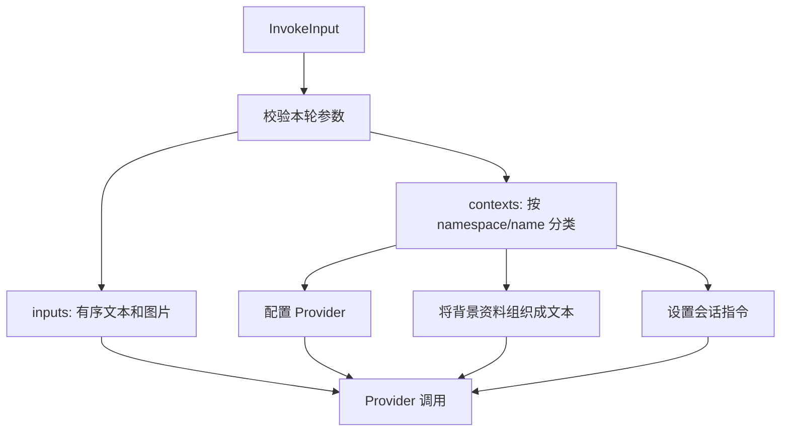

# Inputs 与 Contexts

[English](../../en/concepts/inputs-and-contexts.md) | [文档目录](../README.md)

每次调用都要提供 `inputs` 和 `contexts`，两者用途不同：

- `inputs` 是本轮发给 Agent 的消息，可以包含文本和图片。例如：“总结选中的这段文字”。
- `contexts` 是应用为本轮提供的背景资料和执行配置。例如：选中的文字、使用哪个 Provider、工作目录和 MCP 连接信息。

下面的调用要求 Agent 总结一段文字。`inputs` 提出任务，`extra.project/selection` 提供待总结的材料，`octo.execution/adapter` 指定使用 Codex。

```json
{
  "inputs": [{ "type": "text", "text": "Summarize the selected text." }],
  "protocol_mode": "canonical",
  "contexts": {
    "schema": "octo.context-envelope/v3",
    "items": [
      { "namespace": "octo.execution", "name": "adapter", "payload": { "type": "codex" } },
      {
        "namespace": "extra.project",
        "name": "selection",
        "guidance": "Use this as source material.",
        "payload": { "text": "The project ships on Friday." }
      }
    ]
  }
}
```

Context 的 `items` 可以为空。没有指定 Adapter 时，Runtime 默认使用 Codex；其他未提供的执行设置也使用各自的默认值。

## 哪些内容会发给模型

Context item 通过 `namespace` 和 `name` 标识类型。例如，`octo.execution/adapter` 表示 `namespace: "octo.execution"`、`name: "adapter"`。Runtime 根据类型决定如何处理该项：背景资料会组织成模型输入，执行配置则用于设置 Provider。



| 输入                                                                 | 消费方                     | 模型是否可见                                    |
| -------------------------------------------------------------------- | -------------------------- | ----------------------------------------------- |
| `inputs` 的 text/image                                               | Provider                   | 是，作为本轮消息的文本和图片                    |
| `octo.content/inline`、`octo.content/references`、`extra.<domain>/*` | Runtime 将其组织成背景文本 | 是，保留 item 顺序、`guidance` 和 `payload`     |
| `octo.execution/*`、`octo.security/approval_policy`                  | Runtime 和 Adapter         | 不作为背景文本发送；用于设置执行参数和审批策略  |
| `octo.runtime/selection`                                             | 应用的 Runtime 路由逻辑    | 否；本地 Kernel 不会根据该项切换设备            |
| `octo.control/instructions` / `controlInstructions`                  | Provider 的会话指令配置    | 是，但与普通背景资料分开传入                    |
| `runMetadata`                                                        | 应用的日志和业务关联逻辑   | 否                                              |
| `InvokeEnvironment`                                                  | 本地执行控制               | 否；包含取消信号和环境变量覆盖，不属于输入 JSON |

环境变量不会被自动拼进模型输入，但 Agent 调用的工具仍可能读取或打印它们。不要把密钥放进背景资料或日志。

## 每轮需要提供什么

应用负责选择本轮需要的背景资料。Runtime 按本次提交的内容处理，不会从业务数据库、SOUL 文件或上一轮 Context 中自动补充材料。

上一轮提交过的 Context，如果这一轮仍需发送，就再次提交。Runtime 不会自动缓存或去重；同一调用的 `items` 内则不允许出现重复的 `namespace` 和 `name` 组合。

资源引用只提供地址和获取方式。Agent 需要通过工具读取正文，Runtime 不会提前下载。如果要让模型直接看图片，请把图片数据放进 `inputs`。

会话指令与普通背景资料的生效时机不同：`octo.control/instructions` 在新建 Provider 会话时设置，续聊时不会被当成用户消息再次发送。需要更换指令时，应用通常需要新建或重置 Provider 会话，且只能使用经过应用授权的指令来源。

详见 [InvokeInput](../reference/invoke-input.md)、[Context 目录](../reference/contexts.md)和 [Context 与会话](../guides/context-and-sessions.md)。
