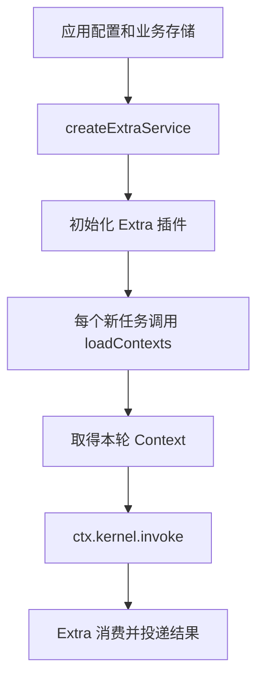
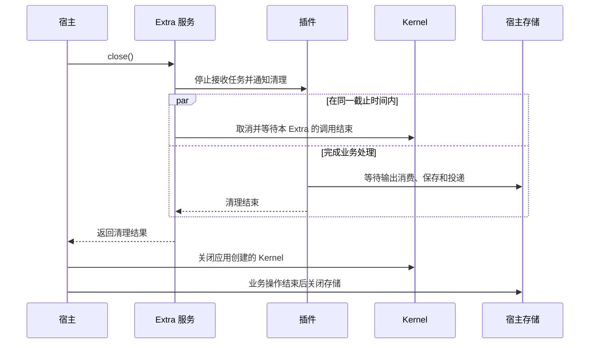

# 接入 Extra

[English](../../en/guides/extras.md) | [文档目录](../README.md)

Extra 用于把业务系统接到 Kernel。例如，IM Extra 接收聊天消息、准备调用参数、调用 Kernel，再把 Agent 回复发回聊天。直接使用 SDK 调用 Kernel 时，不需要 Extra。

从 `@mininglamp-oss/octo-runtime/host` 导入 `createExtraService`，传入以下参数：

- `endpoint`：已有 Kernel 的地址。Extra 连接这个服务，不会替应用启动 Kernel。
- `module`：Extra 模块，例如 Channel Gateway、企业微信或 WebUI。
- `config`：该模块需要的 JSON 配置。
- `dependencies`：应用提供给模块的函数，例如读取 Context 或创建会话存储。

然后调用服务的 `initialize()` 启动，使用 `status()` 查看状态，退出时调用 `close()`。内置模块的导入路径为 `/extras/channel-gateway`、`/extras/channel-wecom` 和 `/extras/webui`，均位于主包下；各模块的 `/config-schema.json` 子路径提供配置 Schema。

## 每轮加载业务数据

Channel Gateway 支持通过 `GatewayDependencies.loadContexts(config, {signal})` 加载背景资料。该函数可同步或异步返回 `readonly ContextItem[]`。Gateway 每接收一个可执行任务就调用一次，因此应用数据变化后，下一轮可以读取最新内容，无需重启 Extra。

加载结果会与静态 Context 合并。同一 `namespace` 和 `name` 的动态项替换整个静态项，包括其 `payload`；不会逐字段合并。这是 Channel Gateway 的行为，直接调用 Kernel 时不会自动执行这一步。

取得宿主本轮有效 Context 后，Octo Gateway 再将默认英文 mention 指令追加到 `octo.control/instructions.payload.entries`：`entries = [...hostEffectiveEntries, ...gatewayDefaultEntries]`。通过 CLI `extraset` 配置的指令属于宿主，在前保留。两个列表各自保序、保留重复项，最终只有一个 instructions item。Gateway 每轮重新组合，不修改宿主输入、不累计上一轮结果。这一步不改变宿主静态/动态替换、公共 Context 合并或其他 Extra 的行为。

Gateway 默认等待加载完成最多 5 秒，同时最多允许 8 个尚未结束的加载操作，可配置到 32 个。返回值最多 32 项，序列化后最多 64 KiB。等待超时不代表底层操作已停止；该操作实际结束前仍占用并发名额。访问数据库时也要注意：仅将同步操作包进 `async` 函数，并不能避免阻塞事件循环。

Gateway 默认指令也计入最终调用的 Context 预算。宿主返回达到上限的材料，并不代表已为 Gateway 追加项预留容量。预算不足时，Gateway 可以省略自动辅助材料；无法满足预算则报错，不静默丢弃默认指令或显式宿主项。

## Octo 点名与 Bot 交接

当前用户明确要求通知真人或向当前群的 Bot 交接任务时，模型确认目标的真实 UID，在成功 final 普通正文中输出 `@[uid:displayName]`。Gateway 核验当前成员及明确的真人标记（`robot=0/false`）或 Bot 标记（`robot=1/true`），沿原回复连接发送可读正文及原生 `mention.uids/entities`。普通 `@名字` 不产生通知。无法确认的目标退为纯文本；代码、引用示例、进度、thinking 和失败回复不转换。该能力不开放广播、CLI 重复发送或自行发起 Bot 调用。

接收 Bot 仍须按真实发送者授权、Space、群范围和原生 mention 规则准入。Gateway 在命令处理、Context 准备和 AgentRun 调度前拒绝自身消息，包括自己 @ 自己和 AI 广播，即使自己的 UID 在 `allowed_sender_ids` 中也不能绕过。私聊、群和话题一致；授权其他 Bot 不代表允许当前 Bot 触发自己。

完整英文规则使用 `[OCTO_CHANNEL_MENTION_RULES_V1]` 边界，在新 Provider 会话中通过既有会话指令通道传入。每轮还提供普通 `extra.im/mention-instructions` 英文短提醒，覆盖升级前创建的续聊会话；该自动辅助材料仍受上述预算降级规则约束。短提醒不会更新已有会话的系统指令或重置会话。完整规则要求模型在摘要或 compaction 时原样保留，以模型行为为准，Runtime 不新增压缩豁免或拦截机制。会话边界见[背景资料与会话](context-and-sessions.md)。

## 保存会话

通过 `GatewayDependencies.createSessionStore(botConfig)` 为每个 Bot 提供独立的会话存储。不提供该函数时，Gateway 使用有容量限制的内存存储。

应用可以自行选择存储实现；Runtime 不依赖 SQLite，也不负责应用数据库的表结构和迁移。关闭数据库前，要先等待 Extra 的输出消费和存储操作结束。详细的业务配置与存储实现见现有中文 [Gateway 接入指南](../../../SDK_CHANNEL_GATEWAY_GUIDE.md)。

## 开发自己的 Extra

插件入口的形式为 `extra(context, jsonConfig)(dependencies)`。配置值放在 `jsonConfig`，应用函数放在 `dependencies`。插件与这些函数运行在同一进程中。

插件通过 `ctx.kernel.invoke` 调用共享 Kernel，通过 `ctx.onDispose` 注册清理函数，通过 `ctx.onStatus` 提供业务状态，通过 `ctx.log` 记录诊断信息。应用通过这些公开接口管理插件，不需要访问插件内部对象或另外建立执行转发接口。

## 关闭 Extra

调用 `close()` 后，Extra 停止新调用，通知插件清理，并取消、等待本 Extra 已提交的调用。这些工作共用默认 4 秒的关闭期限；如果上层指定的截止时间更早，就使用更早的时间。

清理期间，插件仍可调用应用依赖函数完成保存和投递。插件清理结束或期限到达后，不再允许发起新的依赖调用。已经开始的函数不能被强制停止，服务会继续记录尚未结束的操作。

检查 `close()` 返回的 `complete`、`errors` 和 `pendingResources`。`complete=false` 表示还有未完成或未确认释放的资源，不能直接按“全部已关闭”处理。数据库仍由应用管理，SDK 不会自动关闭它。

关闭一个 Extra 不会关闭共享 Kernel，也不会停止其他 Extra 的调用。查看状态时，`phase` 表示 Extra 服务的生命周期阶段，`kernel_available` 表示 Kernel 当前是否可执行，`plugin` 则是插件报告的业务状态。确认 Bot 或 Provider 是否在线，需要查看对应状态和连接结果。

来源：[Extra API](../../../packages/octo-runtime-host-sdk/src/extras.ts)、[service](../../../packages/octo-runtime-host-sdk/src/extra-service.ts)、[Gateway 入口](../../../packages/octo-runtime-extra-channel-gateway/src/extra.ts)、[指令组合](../../../packages/octo-runtime-extra-channel-gateway/src/execution/dispatcher.ts)、[mention 规则与转换](../../../packages/octo-runtime-extra-channel-gateway/src/transport/mentions.ts)、[消息准入](../../../packages/octo-runtime-extra-channel-gateway/src/transport/normalize.ts)。
