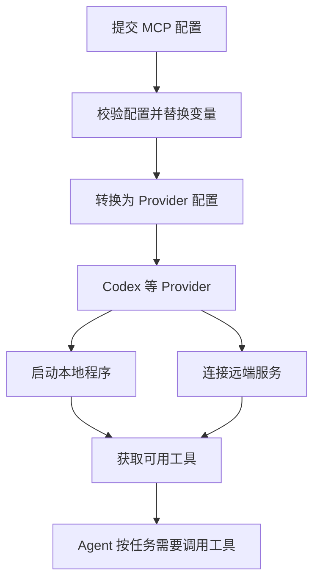

# 使用 MCP

[English](../../en/guides/mcp.md) | [文档目录](../README.md)

MCP 让 Agent 通过工具访问外部系统，例如查询项目资料、读取数据库或调用业务 API。本页说明如何在一次 Runtime 调用中配置 MCP server。

在 `InvokeInput.contexts.items` 中添加一项 Context：`namespace` 为 `octo.execution`，`name` 为 `mcp`，连接信息写入 `payload.mcpServers`。本文将这类 Context 简称为 `octo.execution/mcp`。

先准备好 MCP server，再按连接方式选择配置：

- **远端服务**：使用 `streamable_http`，填写服务 URL 和所需的认证 header。
- **本地程序**：使用 `stdio`，填写已安装程序的路径和启动参数。

下面两个示例都使用 Codex。使用其他 Provider 时，先查看本页的 Provider 支持表。

## 连接远端服务

以下示例连接一个使用 Bearer Token 认证的服务。将 `url` 替换为实际地址，并在启动 Runtime 的进程环境中设置 `BUSINESS_TOKEN`。Runtime 会把 `${BUSINESS_TOKEN}` 替换为该环境变量的值，生成请求 header。不要把 Token 写进 `inputs`。

```json
{
  "protocol_mode": "canonical",
  "inputs": [{ "type": "text", "text": "Use the project tools to summarize the current task." }],
  "contexts": {
    "schema": "octo.context-envelope/v3",
    "items": [
      { "namespace": "octo.execution", "name": "adapter", "payload": { "type": "codex" } },
      {
        "namespace": "octo.execution",
        "name": "mcp",
        "payload": {
          "mcpServers": {
            "project-api": {
              "type": "streamable_http",
              "url": "https://example.com/mcp",
              "headers": { "Authorization": "Bearer ${BUSINESS_TOKEN}" }
            }
          }
        }
      }
    ]
  }
}
```

将上述对象作为 `input` 传给 `client.invoke(input)`，并消费返回的事件流。完整调用方式见 [SDK 快速开始](../getting-started/sdk.md) 和 [invokeOnce 示例](../../examples/invoke.mts)。

配置 MCP 后，Agent 可以使用服务提供的工具，但不一定会在每轮调用中使用。要确认某个工具是否执行，请查看 Provider 返回的工具调用和结果。

## 启动本地程序

先在运行 Runtime 的机器上安装 MCP server，再将下面的 `command` 替换为程序的实际路径。`args` 中每一项是一个启动参数，无需拼成 shell 命令。

```json
{
  "protocol_mode": "canonical",
  "inputs": [{ "type": "text", "text": "List the available project documents." }],
  "contexts": {
    "schema": "octo.context-envelope/v3",
    "items": [
      { "namespace": "octo.execution", "name": "adapter", "payload": { "type": "codex" } },
      {
        "namespace": "octo.execution",
        "name": "mcp",
        "payload": {
          "mcpServers": {
            "project-local": {
              "type": "stdio",
              "command": "/absolute/path/to/project-mcp",
              "args": ["--project", "example"],
              "env": { "PROJECT_ID": "example-project" }
            }
          }
        }
      }
    ]
  }
}
```

每次调用都需要提供本轮使用的 MCP 配置，包括继续已有会话时。调用开始后，修改配置不会影响已经执行的这一轮。

`mcpServers: {}` 只表示本项没有提供服务，不会关闭 Provider 自己配置的 MCP server，也不会清除调用方设置的默认服务。

## 配置如何生效

Runtime 先校验配置并替换环境变量，然后由 Adapter 转换成所选 Provider 的配置格式。例如，Codex Adapter 会将配置传给 Codex。最终由 Codex 等 Provider 启动本地程序或连接远端服务。Runtime 本身不会下载或安装 MCP server。



## 配置字段

`payload.mcpServers` 是以服务名称为 key、连接配置为 value 的对象，最多包含 32 个服务。服务名称须匹配 `^[A-Za-z0-9][A-Za-z0-9._-]{0,127}$`，例如 `project-api`。

每个服务根据 `type` 选择下表中的字段。未知字段会导致校验失败；`stdio` 不能填写 `url` 等 HTTP 字段，`streamable_http` 也不能填写 `command` 等本地程序字段。HTTP header 名称不能重复，大小写不同也算重复。

| Transport         | 必填                   | 可选                                                                                                 |
| ----------------- | ---------------------- | ---------------------------------------------------------------------------------------------------- |
| `stdio`           | `type`、非空 `command` | `args`（≤128 个字符串）、`env`（字符串 map）、`cwd`、`required`、`startupTimeoutMs`、`toolTimeoutMs` |
| `streamable_http` | `type`、HTTP(S) `url`  | `headers`（字符串 map）、`required`、`startupTimeoutMs`、`toolTimeoutMs`                             |

各 Provider 对可选字段的支持不同。填写了当前 Provider 不支持的字段时，调用会返回 `MCP_OPTION_UNSUPPORTED`，具体支持情况见下表。`required` 属于单个服务的配置，应写在 `command` 或 `url` 的同一层。字段范围和校验规则见 [Context 参考](../reference/contexts.md)。

## 使用环境变量

连接配置中的 `${NAME}` 引用本轮执行环境中的变量。除了前面的认证 header，`command`、`args` 的每个元素、`cwd`、`env` 的值和 `url` 都支持这种写法。服务名称、字段名称、header 名称和 `env` 的 key 不支持替换。

Runtime 按以下顺序合并环境变量，后面的同名变量覆盖前面的值：进程继承的环境、`octo.execution/envs`、调用时传入的 `executionEnvOverrides`、Adapter 设置的环境。`octo.execution/envs` 中的值本身不会做模板替换。关于 `executionEnvOverrides` 的传入方式，见 [InvokeInput 与执行环境](../reference/invoke-input.md)。

模板只替换一次，不会执行 shell 表达式或继续解析替换结果中的变量。使用 `$${NAME}` 可以保留字面量 `${NAME}`。变量不存在时返回 `MCP_ENV_MISSING`；变量已设置为空字符串时，替换结果也为空，Runtime 随后会校验结果是否符合连接配置要求。

本地 MCP 程序还可以通过自身配置的 `env` 覆盖子进程环境。远端服务只能收到请求中配置的 header 和 URL，不会自动收到本地环境变量。

请在调用前准备好环境变量。在另一个终端中执行 `export`，不会更新已经启动的 Runtime 或 Provider 进程。Runtime 不会把替换结果写回 Context 或用户配置文件；如果直接把密钥填进 Context，Context 快照仍可能保存该密钥。

## Provider 支持情况

| Adapter                                                | 支持的连接方式                                           | 可选字段与限制                                                       |
| ------------------------------------------------------ | -------------------------------------------------------- | -------------------------------------------------------------------- |
| Codex                                                  | stdio、Streamable HTTP                                   | 支持 `cwd`、`required`、`startupTimeoutMs`、`toolTimeoutMs`。        |
| Claude Code                                            | stdio、Streamable HTTP                                   | 不支持上述四个可选字段；替换后的值不能包含字面量 `${`。              |
| ACP、Hermes、Kimi Code、MCode、Qoder CLI、Qoder CLI CN | stdio；Provider 声明支持 HTTP 时也可使用 Streamable HTTP | 不支持上述四个可选字段。                                             |
| OpenCode                                               | stdio、Streamable HTTP                                   | 支持 `toolTimeoutMs`，不支持 `cwd`、`required`、`startupTimeoutMs`。 |
| CodeBuddy、OpenClaw、ZCode GUI、Antigravity            | 不支持通过本轮调用配置 MCP                               | 提供非空 MCP 配置时返回 `MCP_UNSUPPORTED`。                          |

服务名称应与 Provider 已有的 MCP 配置区分开。Codex 遇到同名服务会返回 `MCP_SERVER_NAME_CONFLICT`，即使已有服务被禁用，或两者使用不同的连接方式，也不会覆盖。Claude Code 和 OpenCode 按各自的配置加载规则处理同名服务。

配置 MCP 不会改变工具调用的审批策略。如果工具需要审批，应用仍需处理审批请求。服务端也会按当前凭据检查业务权限，例如 Token 是否允许读取指定项目。

## 排查连接问题

先根据错误码检查配置：

| 错误码                     | 检查方式                                                          |
| -------------------------- | ----------------------------------------------------------------- |
| `MCP_ENV_MISSING`          | 检查模板引用的环境变量是否已在本轮执行环境中设置。                |
| `MCP_UNSUPPORTED`          | 当前 Adapter 不支持本轮 MCP 配置，改用支持 MCP 的 Adapter。       |
| `MCP_OPTION_UNSUPPORTED`   | 按 Provider 支持表删除不支持的可选字段。                          |
| `MCP_SERVER_NAME_CONFLICT` | 修改服务名称，避开 Codex 已有配置。                               |
| `MCP_LITERAL_UNSUPPORTED`  | Claude Code 收到的最终值包含字面量 `${`，检查转义和变量替换结果。 |

配置检查通过后仍无法使用工具时，查看 Provider 的连接日志：本地程序是否能启动、远端地址是否可达、认证是否通过、服务是否返回工具列表。不要在日志中输出 Token 或替换后的认证 header。

文档示例和测试的验证范围见 [维护与验证](../maintenance.md)。

来源：[Adapter MCP helper](../../../packages/octo-runtime-adapter-sdk/src/mcp.ts)、[Codex](../../../packages/octo-runtime-adapter-codex/src/mcp.ts)、[Claude Code](../../../packages/octo-runtime-adapter-claude-code/src/index.ts)、[ACP](../../../packages/octo-runtime-adapter-acp/src/index.ts)、[OpenCode](../../../packages/octo-runtime-adapter-opencode/src/index.ts)。
