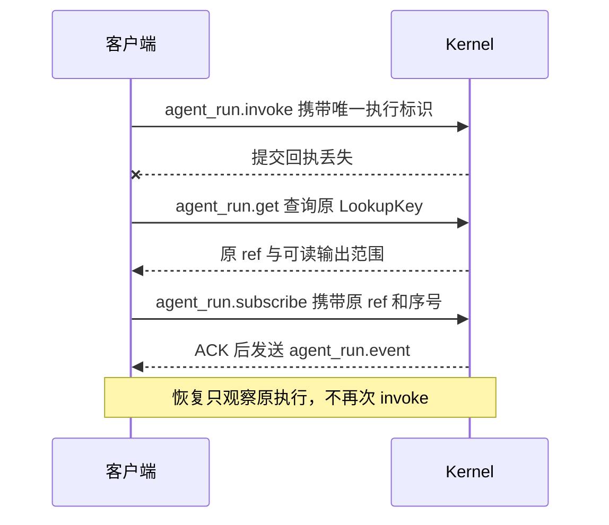

# Kernel IPC 与 SDK

[English](../../en/reference/kernel-ipc.md) | [文档目录](../README.md)

Kernel IPC 是应用与本地 Kernel 服务之间的通信协议。TypeScript 应用通常使用 `KernelClient.invoke`，由 SDK 完成提交、订阅和重连。其他语言可以按本页的 JSON-RPC 协议实现客户端。

首次接入可先阅读 [SDK 快速开始](../getting-started/sdk.md)。本页分别介绍公开导入路径、客户端方法和底层协议。

## 公开包入口

| 导入子路径                                                                    | 用途                                                                           |
| ----------------------------------------------------------------------------- | ------------------------------------------------------------------------------ |
| `/host`                                                                       | 创建 Kernel 和 Extra 服务，管理初始化和关闭，生成组件 endpoint                 |
| `/executor-kernel`                                                            | `attachKernel`、KernelClient 类型、KernelError、`serveWorker`、Kernel 服务工厂 |
| `/executor-core`                                                              | 在调用进程中直接使用 AgentExecutor                                             |
| `/protocol`                                                                   | InvokeInput、输出/Context 类型与公开校验器                                     |
| `/protocol/schema.json`                                                       | 共享协议 Schema                                                                |
| `/executor-kernel/ipc-schema.json`                                            | IPC v1 Schema                                                                  |
| `/executor-kernel/ipc-fixtures.json`                                          | IPC 合法与非法消息的测试样本                                                   |
| `/extra`、`/extras/channel-gateway`、`/extras/channel-wecom`、`/extras/webui` | 通用插件 API 和内置业务模块                                                    |

上述路径都位于 `@mininglamp-oss/octo-runtime` 下。例如，导入客户端使用 `@mininglamp-oss/octo-runtime/executor-kernel`。仓库内部的 workspace 包是私有包，应用使用上表中的公开路径。

## 创建服务

`createKernelService(options)` 必须提供监听地址 `endpoint` 和 worker 入口文件绝对路径 `workerEntrypoint`。SDK 可选参数包括 `adapterConfigurations`、`configurations(runtimeId?)`、`env` 和 `stateDirectory`。SDK 宿主在自己的 worker 代码中 import 并注册所选 Adapter，不使用 manifest，也不代启另一个顶层服务。CLI 内部 runner 接受互斥的 `manifest` 文件或已解析 `adapterModules` 快照；这是 CLI 的装配机制，不是 SDK 的接入条件。见[模块载入](../concepts/module-loading.md)。

1. 创建服务对象后，等待 `initialize({signal?})` 完成。
2. 初始化成功后，使用 `kernel.client` 发起调用，或通过 `status()` 查看服务状态。
3. 退出时调用 `close()`；也可以等待 `closed` Promise 获取清理结果。

初始化失败会抛出 `ServiceInitializationError`，其中保留原始原因 `cause` 和清理结果 `cleanup`。对同一对象重复初始化或关闭，会复用原操作；需要重新启动一段服务生命周期时，应创建新对象。

## KernelClient 方法

| 方法                                               | 用途与返回值                                                                                 |
| -------------------------------------------------- | -------------------------------------------------------------------------------------------- |
| `invoke(input, environment?)`                      | 返回异步输出流，读取时提交请求，并自动处理执行标识和有限重连。普通调用使用此方法。           |
| `cancelInvocation(invocationId, reason?)`          | 取消同一客户端通过 invoke 发起的调用，返回 `{accepted}`。                                    |
| `respondInteraction(invocationId, response)`       | 回复该调用的 canonical 交互请求。                                                            |
| `respondNativeInteraction(invocationId, response)` | 回复该调用的 Provider 原生交互请求。                                                         |
| `status()` / `list()`                              | 分别查询 Kernel 和 worker 状态、已注册 Adapter 元数据。Provider 是否安装和登录还需另外检查。 |
| `close()`                                          | 关闭客户端连接，不取消已提交的执行，也不关闭 Kernel 服务。                                   |

只有需要自行管理提交和订阅时，才使用下面的底层方法：

| 方法                                                      | 用途与返回值                                                  |
| --------------------------------------------------------- | ------------------------------------------------------------- |
| `submit(input, environment?)`                             | 提交一次执行并返回 `{ref}`；随后由调用方订阅输出和处理恢复。  |
| `get(key, expectedInstance?)`                             | 查询原执行的 ref、仍可读取的输出范围和最终状态。              |
| `subscribe(ref, afterSeq = 0, signal?)`                   | 从指定序号之后读取 HostFrame；signal 只停止订阅。             |
| `cancel(ref, reason?)`                                    | 按完整 ref 取消执行；返回是否接受请求，最终结果仍从输出读取。 |
| `respond(ref, response)` / `respondNative(ref, response)` | 按完整 ref 回复交互请求。                                     |

## 管理客户端尚未结束的调用

`client.invocations` 最多跟踪 128 个通过 `invoke` 发起的调用，包括结果未知的调用。底层 `submit` 不会自动加入此表。

- `snapshot()` 返回调用元数据。
- `stopAdmission()` 停止接受新的 invoke。
- `drain({deadline, reason})` 取消并等待已登记调用，返回 `complete` 和 `unresolved`。`deadline` 是按 `Date.now()` 计算的绝对毫秒时间戳。

应用自己创建 Kernel 服务时，通常调用服务的 `close()` 即可。连接外部 Kernel 的应用，如果需要退出时取消并等待自己提交的调用，可以显式使用此表。

## IPC 消息格式

IPC 协议版本为 1。它与 Run schema 版本 7、Context 版本 `octo.context-envelope/v3`、内部 Adapter 传输版本 2 分别独立编号。

macOS/Linux 使用 Unix domain socket，Windows 使用 Named Pipe。每条连接只发送一个 UTF-8 编码的 JSON-RPC 2.0 请求，以换行符 LF 结束。请求 `id` 必须是非空字符串；数字 ID、批量请求、Schema 未定义的顶层或 params 字段都会被拒绝。

普通请求收到响应后结束连接。订阅请求收到响应后，在同一连接继续接收 `agent_run.event` 通知。读 socket 时，一条 JSON 可能分多次收到；应限制缓存大小，收到完整 LF 分隔行后再解析。

| Wire 方法                  | Params                                                 | 成功结果                                                                |
| -------------------------- | ------------------------------------------------------ | ----------------------------------------------------------------------- |
| `status`                   | `{}`                                                   | KernelStatus，包含 `kernel_instance_id`、`execution_ready`、worker 状态 |
| `adapter.list`             | `{}`                                                   | 已注册 Adapter 元数据数组                                               |
| `agent_run.invoke`         | `{input, executionEnvOverrides?, kernel_instance_id?}` | `{kernel_instance_id, receipt}`，receipt 包含执行标识                   |
| `agent_run.get`            | `{key, kernel_instance_id?}`                           | `{ref, oldest_seq, latest_seq, terminal?}`                              |
| `agent_run.subscribe`      | `{ref, after_seq}`                                     | 快照 ACK，随后发送有序事件通知                                          |
| `agent_run.cancel`         | `{ref, reason?}`                                       | `{accepted}`                                                            |
| `agent_run.respond`        | `{ref, response}`                                      | 是否接受交互回复                                                        |
| `agent_run.native.respond` | `{ref, response}`                                      | 是否接受原生交互回复                                                    |

查询和控制使用两种标识对象：

- `LookupKey`：`run_id`、`invocation_id`、`agent_session_id`、`session_generation`、`protocol_mode`，用于找回已提交的执行。
- `RunRef`：在上述字段上增加 `kernel_instance_id`、`stream_id`、`protocol`，用于订阅和控制确定的一次执行。

保存完整提交回执。它包含实际使用的会话代次和协议，不能只用业务 session ID 重新拼接。

## 非 TypeScript 的最小交互

建立连接，发送以下 JSON 和 LF，读取相同 id 的响应后关闭：

```json
{ "jsonrpc": "2.0", "id": "status-1", "method": "status", "params": {} }
```

检查就绪后，在新连接只提交一次（可在 params 中增加查到的 instance）：

```json
{
  "jsonrpc": "2.0",
  "id": "invoke-1",
  "method": "agent_run.invoke",
  "params": {
    "input": {
      "runId": "example-run",
      "invocationId": "example-invocation",
      "sessionId": "example-session",
      "sessionGeneration": 0,
      "protocol_mode": "canonical",
      "inputs": [{ "type": "text", "text": "Say hello." }],
      "contexts": { "schema": "octo.context-envelope/v3", "items": [] }
    }
  }
}
```

示例中的执行和调用 ID 仅供展示，实际每次新执行应生成唯一值。收到响应后：

1. 将 `result.kernel_instance_id` 与 `result.receipt` 合并为 `ref`。
2. 建立新连接，发送 `agent_run.subscribe`，params 包含完整 `ref` 和 `after_seq: 0`。
3. 读取 `agent_run.event` 通知。其 params 为 `{kernel_instance_id, run_id, stream_id, seq, event}`，其中 `event` 是完整 HostFrame。
4. 检查执行标识和连续的 `seq`，保存最后成功读取的序号，供重连使用。

即使选择 canonical，IPC 订阅返回的仍是 HostFrame。只有 TypeScript 的高层 `invoke` API 才会从帧中取出 CanonicalEvent。

请求和响应的完整结构见 IPC Schema。错误包含 JSON-RPC 数值 `error.code`，以及稳定的字符串 `error.data.code`，例如 `RUN_NOT_AVAILABLE`。应用应按后者处理错误，不依赖可能变化的 message 文本。本仓库目前未提供官方 Go/Python 客户端，上述步骤供自行实现时参考。

## 重连与限额



提交后没有收到回执时，使用原 `LookupKey` 查询；不要直接再次 invoke，否则可能重复执行。TypeScript 客户端会在 10 秒内最多尝试恢复 3 次，并从原 ref 的最后连续序号之后继续读取。

Kernel 实例变化、执行标识不匹配、序号非法、输出缺失或过期时，恢复会报错。取消或交互回复的响应丢失时，返回 `OPERATION_OUTCOME_UNKNOWN`：操作可能已经生效，自动重发可能产生重复操作。

默认输出缓存和连接限制如下：

| 项目                        | 默认限制                 |
| --------------------------- | ------------------------ |
| 单次执行输出缓存            | 4096 帧、32 MiB          |
| 全部执行输出缓存            | 128 次执行、128 MiB      |
| 执行结束后保留时间          | 120 秒                   |
| 整个 Kernel 的并发订阅数    | 16，所有执行和客户端共享 |
| 每批读取帧数 / 单帧大小     | 32 帧 / 20 MiB           |
| Kernel / 单客户端并发连接数 | 64 / 32                  |
| 写入等待缓冲区可写的时间    | 最多 5 秒                |

订阅预算独立于 Kernel 和单客户端连接数限制。结束订阅会释放额度，不会取消执行。

字节限制按序列化数据计算，不代表进程实际内存占用上限。可信的 Adapter 执行设置可以在允许范围内调整输出缓存策略，普通 Context 不能修改它。

Kernel 或 worker 重启后，不会恢复旧输出或重跑旧执行。结果为 `lost` 或未知时，应由应用决定后续处理。详见[输出与控制](output-and-control.md)。

来源：[IPC schema](../../../packages/octo-runtime-protocol/schema/kernel-ipc.schema.json)、[fixture](../../../packages/octo-runtime-protocol/schema/kernel-ipc-fixtures.json)、[client 类型](../../../packages/octo-runtime-executor-kernel/src/types.ts)、[client](../../../packages/octo-runtime-executor-kernel/src/client.ts)、[server](../../../packages/octo-runtime-executor-kernel/src/server.ts)。
