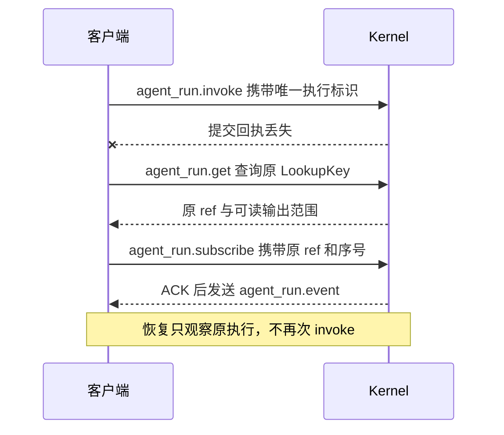

# Kernel IPC

[English](../../en/reference/kernel-ipc.md) | [文档目录](../README.md)

本地 Kernel 的 JSON-RPC 协议。TypeScript 应用通常使用 [KernelClient](kernel-client.md)；其他语言可按本页实现客户端。

## Schema 与校验

独立 client 提供 `/protocol/schema.json`、`/protocol/ipc-schema.json` 两个 Draft-07 Schema，以及 `/protocol/ipc-fixtures.json` 一致性样本。样本不属于协议定义。

标准校验器执行标准关键字，`x-octo-*` 附加语义须显式实现。运行时还校验字节/深度预算、Unicode 标量字符串、唯一性、跨字段一致性与执行状态；只通过结构校验不足以证明完整符合协议。

## IPC 消息格式

IPC 协议版本为 2。它与 Run schema 版本 7、Context 版本 `octo.context-envelope/v3`、内部 Adapter 传输版本 2 分别独立编号。

IPC Schema 的 `$id` 为 `urn:mininglamp-oss:octo-runtime:kernel-ipc:v2`。

macOS/Linux 使用 Unix domain socket，Windows 使用 Named Pipe。每条连接只发送一个 UTF-8 编码的 JSON-RPC 2.0 请求，以换行符 LF 结束。请求 `id` 必须是非空字符串；数字 ID、批量请求、Schema 未定义的顶层或 params 字段都会被拒绝。

普通请求收到响应后结束连接。订阅请求收到响应后，在同一连接继续接收 `agent_run.event` 通知。读 socket 时，一条 JSON 可能分多次收到；应限制缓存大小，收到完整 LF 分隔行后再解析。

| Wire 方法                  | Params                                                 | 成功结果                                                                                              |
| -------------------------- | ------------------------------------------------------ | ----------------------------------------------------------------------------------------------------- |
| `status`                   | `{}`                                                   | KernelStatus，包含 `kernel_instance_id`、`execution_ready`、宿主 `pid`                                |
| `adapter.list`             | `{}`                                                   | 已注册 Adapter 元数据数组，包含 `available`、`unavailableReason`、`providerPath` 和 `providerVersion` |
| `agent_run.invoke`         | `{input, executionEnvOverrides?, kernel_instance_id?}` | `{kernel_instance_id, receipt}`，receipt 包含执行标识                                                 |
| `agent_run.get`            | `{key, kernel_instance_id?}`                           | `{ref, oldest_seq, latest_seq, terminal?}`                                                            |
| `agent_run.subscribe`      | `{ref, after_seq}`                                     | 快照 ACK，随后发送有序事件通知                                                                        |
| `agent_run.cancel`         | `{ref, reason?}`                                       | `{accepted}`                                                                                          |
| `agent_run.respond`        | `{ref, response}`                                      | 是否接受交互回复                                                                                      |
| `agent_run.native.respond` | `{ref, response}`                                      | 是否接受原生交互回复                                                                                  |

查询和控制使用两种标识对象：

- `LookupKey`：`run_id`、`invocation_id`、`agent_session_id`、`session_generation`、`protocol_mode`，用于找回已提交的执行。
- `RunRef`：在上述字段上增加 `kernel_instance_id`、`stream_id`、`protocol`，用于订阅和控制确定的一次执行。

保存完整提交回执。它包含实际使用的会话代次和协议，不能只用业务 session ID 重新拼接。

## 非 TypeScript 的最小交互

建立连接，发送以下 JSON 和 LF，读取相同 id 的响应后关闭：

```json
{ "jsonrpc": "2.0", "id": "status-1", "method": "status", "params": {} }
```

检查就绪后，在新连接只提交一次（可在 params 中增加查到的 instance）：

```json
{
  "jsonrpc": "2.0",
  "id": "invoke-1",
  "method": "agent_run.invoke",
  "params": {
    "input": {
      "runId": "example-run",
      "invocationId": "example-invocation",
      "sessionId": "example-session",
      "sessionGeneration": 0,
      "protocol_mode": "canonical",
      "inputs": [
        {
          "type": "text",
          "text": "Say hello."
        }
      ],
      "agentEnv": {
        "schema": "octo.context-envelope/v3",
        "items": [
          {
            "namespace": "octo.execution",
            "name": "workspace",
            "payload": {
              "path": "/absolute/prepared/project"
            }
          }
        ]
      }
    }
  }
}
```

示例中的执行和调用 ID 仅供展示，实际每次新执行应生成唯一值。收到响应后：

1. 将 `result.kernel_instance_id` 与 `result.receipt` 合并为 `ref`。
2. 建立新连接，发送 `agent_run.subscribe`，params 包含完整 `ref` 和 `after_seq: 0`。
3. 读取 `agent_run.event` 通知。其 params 为 `{kernel_instance_id, run_id, stream_id, seq, event}`，其中 `event` 是完整 HostFrame。
4. 检查执行标识和连续的 `seq`，保存最后成功读取的序号，供重连使用。

即使选择 canonical，IPC 订阅返回的仍是 HostFrame。只有 TypeScript 的高层 `invoke` API 才会从帧中取出 CanonicalEvent。

请求和响应的完整结构见 IPC Schema。错误包含 JSON-RPC 数值 `error.code`，以及稳定的字符串 `error.data.code`，例如 `RUN_NOT_AVAILABLE`。应用应按后者处理错误，不依赖可能变化的 message 文本。本仓库目前未提供官方 Go/Python 客户端，上述步骤供自行实现时参考。

## 重连与限额



提交后没有收到回执时，使用原 `LookupKey` 查询；不要直接再次 invoke，否则可能重复执行。TypeScript 客户端会在 10 秒内最多尝试恢复 3 次，并从原 ref 的最后连续序号之后继续读取。

Kernel 实例变化、执行标识不匹配、序号非法、输出缺失或过期时，恢复会报错。取消或交互回复的响应丢失时，返回 `OPERATION_OUTCOME_UNKNOWN`：操作可能已经生效，自动重发可能产生重复操作。

默认输出缓存和连接限制如下：

| 项目                        | 默认限制                 |
| --------------------------- | ------------------------ |
| 单次执行输出缓存            | 4096 帧、32 MiB          |
| 全部执行输出缓存            | 128 次执行、128 MiB      |
| 执行结束后保留时间          | 120 秒                   |
| 整个 Kernel 的并发订阅数    | 16，所有执行和客户端共享 |
| 每批读取帧数 / 单帧大小     | 32 帧 / 20 MiB           |
| Kernel / 单客户端并发连接数 | 64 / 32                  |
| 写入等待缓冲区可写的时间    | 最多 5 秒                |

订阅预算独立于 Kernel 和单客户端连接数限制。结束订阅会释放额度，不会取消执行。

字节限制按序列化数据计算，不代表进程实际内存占用上限。可信的 Adapter 执行设置可以在允许范围内调整输出缓存策略，普通 Context 不能修改它。

Kernel 宿主重启后，不会恢复旧输出或重跑旧执行。结果为 `lost` 或未知时，应由应用决定后续处理。详见[输出与控制](output-and-control.md)。

来源：[IPC schema](../../../packages/octo-runtime-protocol/schema/kernel-ipc.schema.json)、[一致性样本](../../../packages/octo-runtime-protocol/test/fixtures/kernel-ipc-fixtures.json)、[client 类型](../../../packages/octo-runtime-client/src/types.ts)、[client](../../../packages/octo-runtime-client/src/client.ts)、[server](../../../packages/octo-runtime-executor-kernel/src/server.ts)。
