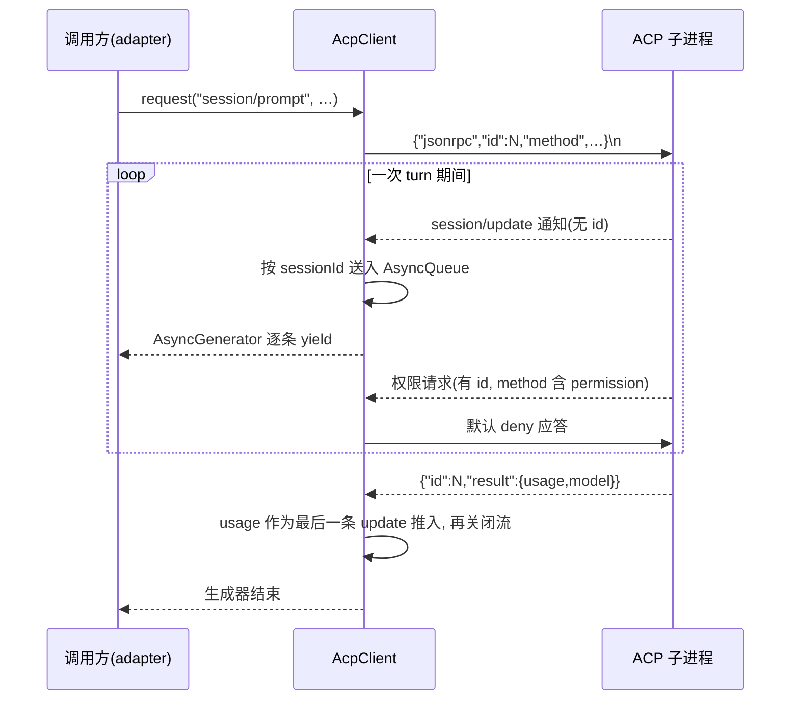

# @mininglamp-oss/octo-runtime-acp-client

> 全局 Context 约束：本轮模型上下文由业务方选择，selection 等业务项可不发送，可传空或显式重复。必要执行配置独立校验且不注入 LLM。底层只转发并渲染本轮数据，不按 sessionId 缓存、补齐、合并、去重或省略；reset／新 Provider 会话／resume 失败后由业务方重新提供必要背景。见 [分类矩阵](../../.octospec/rules/context-input.md) 与 [IPD-SE](../../.octospec/rules/context-input.md)。Host 仅按白名单 pattern 保序拼接，不做业务检查或编译。

一个面向 ACP（Agent Client Protocol）本地 Agent CLI 的传输层客户端：负责启动子进程、发起请求、按序递交对方推送的通知流，并对反向的权限请求给出应答。

## 定位与职责

部分 Agent CLI（如 CodeBuddy）并非“单次执行、打印结果后退出”，而是通过 ACP 持续对话：JSON-RPC 2.0 报文逐行传输，经由子进程的 stdin/stdout 双向通信。

直接面向该子进程编写代码存在若干难点：

- 每个发出的请求携带一个数字 `id`，对方的响应亦携带 `id`，需自行完成“响应与请求”的配对；
- 在等待响应的同时，对方还会持续推送无 `id` 的 `session/update` 通知（模型输出、工具调用），需单独接收；
- ACP 的权限请求是反向的——由 provider 主动询问“是否批准某项操作”，调用方必须回复一条应答，否则 provider 将阻塞等待；
- 子进程可能中途崩溃，此时所有待处理的请求与进行中的流都需被明确置为失败，而非无限期挂起。

本包将上述传输层处理全部收敛，对外仅暴露一组简洁的方法：`initialize / newSession / loadSession / prompt / cancel / close`。它不生成 Octo Runtime 的 canonical event——该职责属于适配器，本包仅实现纯粹的 ACP 传输层。

## 工作原理

子进程的 stdout 上混合着三类消息，客户端需在同一条流中分别处理：**带 id 的响应**（配对到对应请求）、**`session/update` 通知**（送入对应 session 的流）、**反向权限请求**（客户端必须回复一条应答）。



关键机制如下：

1. **请求与响应经数字 id 配对**。`request()` 自增一个 `id` 并登记一个 pending 项，收到同 `id` 的 `result`/`error` 时 resolve/reject 对应项。每个请求配有一个不阻止 Node 退出（`unref`）的超时兜底。
2. **通知走独立队列**。`session/update` 无 `id`，按 `sessionId` 路由至一个单消费者 `AsyncQueue`，`prompt()` 将其包装为 `AsyncGenerator` 供调用方 `for await` 消费。
3. **`prompt` 将响应与流合并为一条**。`session/prompt` 的最终响应（含 `usage`/`model`）作为最后一条合成 update 推入队列后关闭流；若响应为 reject，则队列以该错误关闭。无论何种结果，`finally` 中都会摘除该 session 的队列。
4. **权限反向请求默认拒绝**。对于 provider 发来的权限请求，默认 handler 优先选择带 reject/deny 的选项（无则选择最后一个，再无则返回 `cancelled`），确保无人值守的 run 不会阻塞于权限提示。
5. **进程终止时统一置为失败**。子进程退出且仍有未完成的请求或流时，以捕获到的 stderr 尾部（最多 8KB）作为错误，reject 所有 pending 请求并关闭所有 update 队列。无效 JSON 同理处理。

## 使用

`spawnAcpClient` 启动子进程并包装为客户端，随后按 ACP 顺序调用即可：

```ts
import { spawnAcpClient } from "@mininglamp-oss/octo-runtime-acp-client";

const client = spawnAcpClient({
  command: "codebuddy",
  args: ["--acp"],
  cwd: process.cwd()
  // 可选：signal（abort 时自动 close），permissionHandler（覆盖默认 deny）
});

try {
  await client.initialize(); // ACP 握手，必须最先调用
  const session = await client.newSession({ cwd: process.cwd() });
  for await (const update of client.prompt(session.id, "Inspect this repository")) {
    console.log(update); // 逐条消费 session/update
  }
} finally {
  await client.close(); // SIGTERM，1 秒未退出则 SIGKILL
}
```

恢复已有会话使用 `client.loadSession(sessionId, { cwd })`（超时放宽至 10 分钟，因部分 provider 会在 load 时回放历史）；中途打断使用 `client.cancel(sessionId)`（一条无 id 的 fire-and-forget 通知）。

`client.prompt(sessionId, input)` 和 `acpPromptParams(sessionId, input)` 同时接受字符串及有序 text/image 块数组。图片块使用 `{ type: "image", mimeType, data }`，其中 `data` 为 base64，不含 data URL 前缀。调用方必须在握手结果中确认 `agentCapabilities.promptCapabilities.image === true` 才能发送图片；通用 ACP Adapter 执行此检查。传输层只负责编码，不替代资源授权与内容完整性校验。

## 约束与注意事项

- **并非完整的 ACP SDK**。仅覆盖 `initialize` 与 `session` 相关方法，未暴露文件系统、terminal、MCP server 等 capability 协商扩展。握手时通告的 `clientCapabilities` 为空。
- **默认拒绝权限是安全默认，而非“provider 未弹出提示即等同自动放行”**。如需放开，应显式传入 `permissionHandler`。
- **不产出 canonical event**。session/update 的语义翻译（区分思考、最终回复与工具调用）在 CodeBuddy 适配器中完成。
- **非 Windows 环境下子进程被 detach 为独立进程组**，使 `close()` 能整棵进程树一并回收；`signal` 触发 abort 时自动执行 `close()`。
- **`prompt` 的超时上限为 8 小时**，用以覆盖长时间自主运行的 turn，不应误认为其会快速超时返回。

## 相关文档

- CodeBuddy 完整接入教程：[CodeBuddy Adapter](../octo-runtime-adapter-codebuddy/README.md)
- 事件契约与三层事件模型：[Protocol](../octo-runtime-protocol/README.md)
- Adapter 编写指南：[Adapter Authoring](../../.octospec/guides/adapter-authoring.md)

## 模块责任边界

- 负责：实现 ACP 传输、请求关联与协议交互。
- 不负责：业务 Context 决策、IM/Worker 接入。
- 协作边界：见 [根架构与包边界](../../README.md#执行结构)。隔离入口共用 Kernel IPC 和 worker，显式 direct 模式使用同一 AgentExecutor；模块按职责提供协议、执行或宿主能力。
