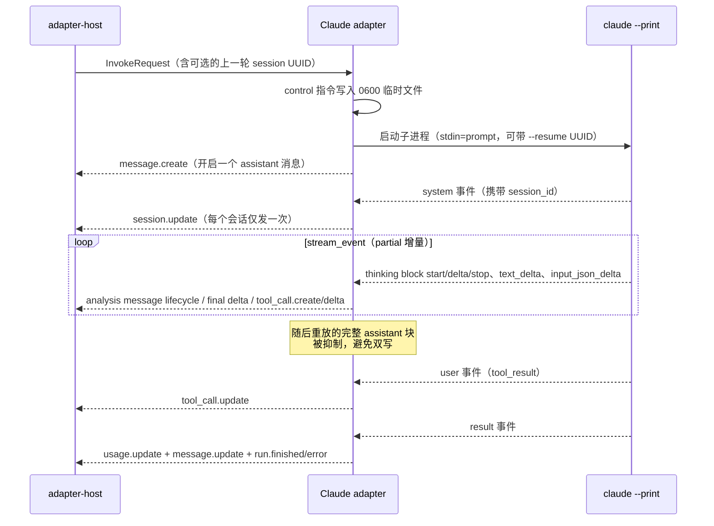

# @mininglamp-oss/octo-runtime-adapter-claude-code

> 全局 Context 约束：本轮模型上下文由业务方选择，selection 等业务项可不发送，可传空或显式重复。必要执行配置独立校验且不注入 LLM。底层只转发并渲染本轮数据，不按 sessionId 缓存、补齐、合并、去重或省略；reset／新 Provider 会话／resume 失败后由业务方重新提供必要背景。见 [分类矩阵](../../.octospec/rules/context-input.md) 与 [IPD-SE](../../.octospec/rules/context-input.md)。Host 仅按白名单 pattern 保序拼接，不做业务检查或编译。

Octo Runtime 的 Claude Code 适配器：将本地 Claude Code CLI 接入统一的适配器契约，负责启动 `claude --print` 子进程、读取其流式输出、续跑上一轮会话，并将 Claude 的原生事件翻译为保序、去重、终态唯一的 `CanonicalEvent` 流。

## 定位与职责

直接对接 Claude Code CLI 存在若干需要处理的差异：Claude 的 `stream-json` 输出中，同一段文字先以 delta 增量流出，随后又将完整的 assistant 块重放一次，若原样接收会导致文本与工具调用双写；工具参数的增量（`input_json_delta`）不携带工具 ID，仅带一个 block 序号，需要自行维护「序号 → 工具 ID」的映射，否则并发的子任务会相互串扰；此外还需处理上一轮会话的续跑，以及非交互模式下的权限提示应答。

本适配器将上述差异收敛在自身边界内。它为每次调用启动一个 `claude --print` 子进程，用户 prompt 经 stdin 传入，Claude 的 stream-json 经 stdout 输出，适配器将原生事件翻译为 Octo Runtime 统一的 message / tool / usage / run 事件。上层得到保序、去重、仅含单一终态的干净事件流。

适配器不实现 Claude 模型 API，也不负责 workspace trust、容器隔离或业务任务状态。

## 工作原理

每次调用对应一个 `claude --print` 子进程。必须启用 `--include-partial-messages` 才能获得 thinking / text / 工具参数的增量；普通 stream-json 只提供整块 assistant，无法满足本地 Chat 的实时流式需求。



其核心机制体现为以下几点：

1. **会话续跑依赖 session UUID**。首次调用从 Claude 的 `system` 事件获取 session UUID，通过 `session.update` 上报，Core 原样保存（不解析格式）；下一轮自动附加 `--resume <uuid>` 续接会话。Claude CLI 原生支持 fork，但当前 host / core 无 fork 流程，因此适配器不声明 `session.fork`。
2. **仅发增量、抑制重放**。partial 模式下一段内容先以 delta 流出，随后 Claude 会将完整块再发一次，适配器只发送前者。`result` 中的完整 text 也不会覆盖已流出的交错文本，否则 UI 中工具调用之前的进度会被抹除。
3. **每次调用独立的归一化状态**。工具参数增量仅带 block 序号而不带工具 ID，normalizer 需按「序号 → 工具 ID」逐调用维护映射。因此 normalizer 不可实现为 adapter 单例——一个 adapter 可能同时执行多个调用，共享状态会导致串扰。
4. **显式请求的 thinking 是公开 reasoning**。Agent 配置开启 thinking 后，Claude 的 `thinking_delta` 归入 analysis channel 并标记 `exposure=public_reasoning`，进入面向用户的思考区域；provenance 保留其 Claude 原生事件来源。
5. **原生消息边界就是模型轮次**。每组 `message_start` / `message_stop` 映射为一对 `model_step.started` / `model_step.finished`，同一组 thinking、文本与工具事件共享 provider message ID 作为 `stepId`。卡片端据此沿用 OpenCode 的“第 N 轮”展示；`tool_use` 与 `end_turn` 分别显示为“分析并调用工具”和“整理回答”。每轮已经通过 final channel 公开输出的文本会以有界 `publicText` 随结束事件上报，仅在没有真实 reasoning 时作为卡片说明，绝不冒充 thinking。
6. **默认绕过权限**。无人值守下默认 `bypassPermissions` 并附加 `--dangerously-skip-permissions`。该机制解决的是 daemon 无法应答权限提示的问题，不提供任何隔离（见下文）。

## 使用

前置条件：Node.js 24.x、pnpm，以及 PATH 上一个已登录的 Claude Code CLI（使用同一 OS 用户认证）。

```bash
claude --version
claude auth status
```

启动 daemon 并探测 adapter：

```bash
pnpm daemon

pnpm cli adapter probe claude-code
```

Agent Worker 在 Agent revision 中保存该 execution profile，并把所有业务入口统一下发
为 AgentRun。adapter 只处理 `InvokeRequest`；provider session 由 Worker 的
AgentSession 保存并在后续调用中作为 opaque resume UUID 下发。

实际拼装出的命令大致如下：

```text
claude --print --input-format text --output-format stream-json --verbose \
  --include-partial-messages --append-system-prompt-file <临时文件> \
  [--resume <session-uuid>] [--model <model>] \
  [--settings '{"alwaysThinkingEnabled":true|false}'] [--effort <level>] \
  --permission-mode <mode> [--dangerously-skip-permissions] -
```

## 配置

| 字段                           | 作用                                                                                                                    | 默认                         |
| ------------------------------ | ----------------------------------------------------------------------------------------------------------------------- | ---------------------------- |
| `workdir`                      | Claude 的 cwd 与代码目标（不是安全边界）                                                                                | 必填                         |
| `model`                        | `--model`，别名 / 全名取决于 CLI                                                                                        | 由 CLI 决定                  |
| `thinking`                     | 显式配置 Claude thinking；`true`/非 `disabled` 字符串写入 `alwaysThinkingEnabled:true`，`false`/`disabled` 写入 `false` | 未配置时由 CLI settings 决定 |
| `effort`                       | 可选推理强度，映射为 `--effort low/medium/high/xhigh/max`                                                               | `medium`                     |
| `permissionMode`               | 支持 `acceptEdits/auto/bypassPermissions/default/dontAsk/plan`                                                          | `bypassPermissions`          |
| `dangerouslyBypassPermissions` | 为 `true` 时强制 `bypassPermissions`，优先级高于 `permissionMode`                                                       | `false`                      |

control 指令经 `0600` 临时文件（`--append-system-prompt-file`）传入，用户 prompt 经 stdin 传入，两者互不混淆；临时文件在调用的 `finally` 阶段清理。适配器不传 `--disallowedTools`，保留 Claude 完整工具目录。

## 模型配置与环境变量

Agent Revision 使用 `execution_profile.agent_config.model`，adapter 在每次启动 `claude --print` 时映射为 `--model <value>`，新会话与 `--resume` 会话都生效。值可以是 CLI 支持的别名（如 `sonnet`）或完整模型名；未设置时交由 Claude Code settings 决定。

Claude Code 的默认模型环境变量是 `ANTHROPIC_MODEL`，网关地址常用 `ANTHROPIC_BASE_URL`。本 adapter 不主动写这些变量，只继承 daemon 的进程环境；显式的 `agent_config.model` 通过 `--model` 传入，优先于 settings 和 `ANTHROPIC_MODEL`。参考 [Claude Code CLI reference](https://code.claude.com/docs/en/cli-reference)。

## 约束与注意事项

- **workdir 不是沙箱，默认 bypass 更不是**。默认绕过权限意味着可执行 shell、修改 workdir、访问该 OS 用户可触及的一切资源。生产环境必须使用容器 / VM / 独立用户实现真正隔离，否则不得运行不可信任务。若需保守执行，可显式选择 `dontAsk`，但缺少 Claude allow rules 的工具会被直接拒绝。
- **`--print` 会跳过 workspace trust 对话框**。因此只能指向已审查、信任的 workdir——Octo Runtime 不会代为判断目录是否可信。
- **凭证只能保留在进程环境中**，不得写入 Agent prompt、Octo Runtime state 或 workdir。
- **thinking 不一定有正文**。部分 provider / model 会产生 thinking token，但只给出空 `thinking_delta` 与签名。适配器按原生 thinking block 的 start/stop 保留一个无正文的 reasoning item，不伪造思考文本；若摘要非空则逐 delta 追加。该 item 与是否显式配置 `effort` 无关。
- **`probe` 仅检查可执行文件**，不验证认证、provider 网络、额度或模型名。
- **取消仅保证直接 CLI 进程终止**（AbortSignal 加 host 收尾唯一 `run.stopped`），生产环境应补充进程组回收。
- 尚未暴露 fork、MCP config、allowed tools、budget、structured output 等 Claude 参数。

## 相关文档

- 事件契约与三层事件模型：[Protocol](../octo-runtime-protocol/README.md)
- 适配器的调用生命周期与终态兜底：[Adapter Host](../octo-runtime-executor-kernel/README.md)
- provider adapter 概览与编写指南：[docs/05](../../.octospec/guides/providers.md)、[docs/08](../../.octospec/guides/adapter-authoring.md)
- 源码：[`src/index.ts`](src/index.ts)

## 模块责任边界

- 负责：将 claude-code 原生执行协议映射为 InvokeRequest / CanonicalEvent，由 adapter-host 调用。
- 不负责：Worker/IM WS、聊天历史、Event/AgentRun 登记。
- 协作边界：见 [根架构与包边界](../../README.md#执行结构)。隔离入口共用 Kernel IPC 和 worker，显式 direct 模式使用同一 AgentExecutor；模块按职责提供协议、执行或宿主能力。
