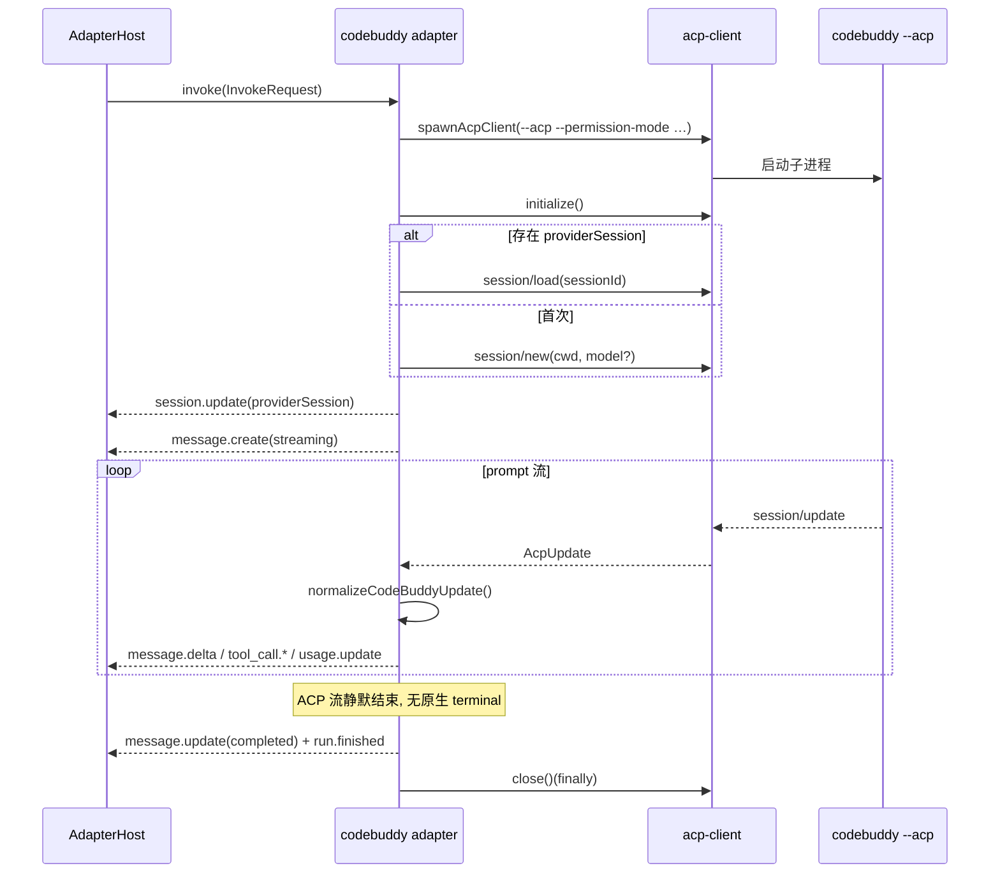

# @mininglamp-oss/octo-runtime-adapter-codebuddy

> 全局 Context 约束：本轮模型上下文由业务方选择，selection 等业务项可不发送，可传空或显式重复。必要执行配置独立校验且不注入 LLM。底层只转发并渲染本轮数据，不按 sessionId 缓存、补齐、合并、去重或省略；reset／新 Provider 会话／resume 失败后由业务方重新提供必要背景。见 [分类矩阵](../../.octospec/rules/context-input.md) 与 [IPD-SE](../../.octospec/rules/context-input.md)。Host 仅按白名单 pattern 保序拼接，不做业务检查或编译。

Octo Runtime 的 CodeBuddy 适配器：将本地 CodeBuddy CLI 接入统一的 Runtime 调用模型，通过 ACP（Agent Client Protocol）与其对话，并将 CodeBuddy 的原生输出翻译为 Runtime 的 canonical event。

Adapter type：`codebuddy`

## 定位与职责

CodeBuddy 并非“单次执行后退出”的 CLI，而是通过 ACP 持续对话，使用一套自有的事件词汇：`agent_message_chunk`、`agent_thought_chunk`、`tool_call`、`session/update` 等，上层无法直接识别。此外，ACP 流存在一个语义空缺：一次 prompt 完成后，provider 不会发出明确的“结束”信号，只是停止推送，若上层持续等待将无法判定何时收尾。

本适配器承担两项职责：其一，将 CodeBuddy 的 ACP 事件翻译为 Runtime 认识的 canonical event（思考归入 `analysis` 频道，最终回复归入 `final` 频道，工具调用遵循标准生命周期）；其二，为“静默结束”的 ACP 流补全明确的收尾事件——`message.update` 与 `run.finished`。

底层的 ACP 传输（连接建立、请求配对、通知接收、权限拦截）不在此实现，而是委托给 `@mininglamp-oss/octo-runtime-acp-client`。本适配器仅负责事件翻译与生命周期收尾。

## 工作原理

每次 invocation 都新起一个 `codebuddy --acp` 子进程，握手后依据是否存在 providerSession 决定恢复旧会话或新建会话，两条路径最终汇入同一条 `session/prompt` 流。



翻译规则（`normalizeCodeBuddyUpdate`）如下：

1. `agent_message_chunk` 映射为 `final` 频道的 `message.delta`；
2. `agent_thought_chunk` 是 CodeBuddy 经 ACP 主动输出的展示级思考流，映射为 `analysis` 频道的 `message.delta`，并标注 `exposure: "public_reasoning"` 与 CodeBuddy provenance，使其能够进入公开进度卡片；
3. `tool_call` 与 `tool_call_update` 映射为标准的 `tool_call.create` 与 `tool_call.update`；
4. prompt 结束时的 `usage` 映射为 `usage.update`；
5. 无法识别的 update 类型直接忽略（返回空数组）。

## 使用

首先启动 daemon：

```bash
cd /absolute/path/to/octo-runtime
pnpm daemon
```

在另一终端中探测可用性：

```bash
pnpm cli adapter probe codebuddy
```

Agent Worker 在 Agent revision 中保存该 execution profile。业务服务提交 AgentRun，
Runtime 将 Worker 的 AgentSession/provider session 原样交给 CodeBuddy ACP adapter；
adapter 不创建 Chat、Task 或 Trigger。

## 配置

| Agent revision 配置      | `agentConfig` 字段 | 作用                                                           |
| ------------------------ | ------------------ | -------------------------------------------------------------- |
| `--workdir DIR`          | `workdir`          | 作为 ACP cwd，也是代码目标目录；本身不限制对其他宿主路径的读取 |
| `--model MODEL`          | `model`            | 仅在 `session/new` 新建会话时传入                              |
| `--permission-mode MODE` | `permissionMode`   | 传给 `codebuddy --permission-mode`，默认 `acceptEdits`         |

恢复会话经由 `session/load`，不会重设 model——原会话自行保留模型上下文。

## 模型配置与环境变量

Agent Revision 使用 `execution_profile.agent_config.model`。新建 provider session 时，adapter 把该值放入 ACP `session/new.model`；例如 `"model": "glm-5.3"`。恢复已有 session 时 CodeBuddy 当前协议路径没有再次选模，因此 Revision 改模后需要 `/reset` 或新建 Runtime session 才能保证生效。

本机验证的 CodeBuddy CLI 支持 `--model <model>`，但 adapter 使用 ACP，不走该 CLI 参数。当前没有确认到 CodeBuddy 的专用默认模型环境变量；adapter 也不会猜测或设置一个环境变量。未配置时使用 CodeBuddy 自身设置中的默认模型，实际可用模型名由当前登录账号和 CodeBuddy 版本决定。

## 约束与注意事项

- **prompt 拼接为单条 ACP text**：用户 prompt 与 daemon 的 `appendInstructions` 以两个换行拼接后作为单条 text content 发出，并非独立的 system role。若需更强的 prompt 隔离，应扩展 ACP 初始化，而非将控制协议隐藏于 workdir。
- **取消通过关闭进程实现**，而非可重连的远端 cancel。host abort 时 acp-client 直接关闭子进程；尽管 client 实现了 `session/cancel`，当前适配器采用进程关闭方式。
- **每次 invocation 均为新子进程**，无常驻 daemon。会话记录由 CodeBuddy provider session 持久化，经 `session/load` 恢复；适配器不声明 fork、reattach 或 message append 能力。
- **权限反向请求默认拒绝**（由 acp-client 承担）。不应将“provider 未弹出提示”误解为“自动批准”。
- **`probe` 仅检查 `codebuddy` 可执行文件是否存在**，不验证登录状态、模型可用性或额度——CodeBuddy CLI 目前不具备与其他 provider 一致的 `auth status` 契约。

## 相关文档

- 底层 ACP 传输客户端：[ACP Client](../octo-runtime-acp-client/README.md)
- 事件修整与终态兜底：[Adapter Host](../octo-runtime-executor-kernel/README.md)
- Provider adapter 总览：[Provider Adapters](../../.octospec/guides/providers.md)
- Adapter 编写指南：[Adapter Authoring](../../.octospec/guides/adapter-authoring.md)

## 模块责任边界

- 负责：将 codebuddy 原生执行协议映射为 InvokeRequest / CanonicalEvent，由 adapter-host 调用。
- 不负责：Worker/IM WS、聊天历史、Event/AgentRun 登记。
- 协作边界：见 [根架构与包边界](../../README.md#执行结构)。隔离入口共用 Kernel IPC 和 worker，显式 direct 模式使用同一 AgentExecutor；模块按职责提供协议、执行或宿主能力。
