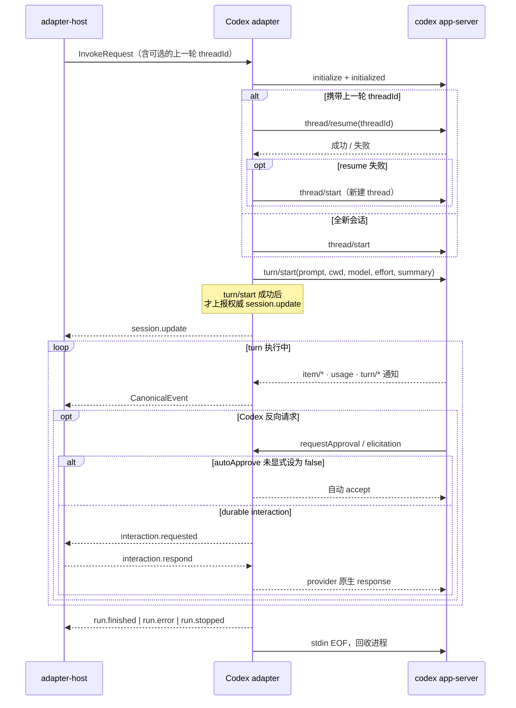

# @mininglamp-oss/octo-runtime-adapter-codex

> 全局 Context 约束：本轮模型上下文由业务方选择，selection 等业务项可不发送，可传空或显式重复。必要执行配置独立校验且不注入 LLM。底层只转发并渲染本轮数据，不按 sessionId 缓存、补齐、合并、去重或省略；reset／新 Provider 会话／resume 失败后由业务方重新提供必要背景。见 [分类矩阵](../../.octospec/rules/context-input.md) 与 [IPD-SE](../../.octospec/rules/context-input.md)。Host 仅按白名单 pattern 保序拼接，不做业务检查或编译。

Octo Runtime 的 Codex 适配器：将本地 Codex CLI 接入统一的适配器契约，负责启动 `codex app-server` 子进程、驱动会话握手、续跑上一轮会话，并将 Codex 的原生双向协议翻译为格式统一、终态唯一的 `CanonicalEvent` 流。

## 定位与职责

Codex 采用自有的会话（thread）概念与一套双向 JSON-RPC 协议，与其他 provider 差异显著；在一轮执行过程中，它会反向发起命令执行与补丁应用的审批请求，调用方必须应答，否则执行将持续阻塞。此外，上一轮会话的续跑、会话文件缺失的恢复、以及异常退出的收尾，都需要专门处理。

本适配器将上述差异收敛在自身边界内。它对每次调用启动一个 `codex app-server` 子进程，主动完成 `initialize → thread → turn` 握手，并将 Codex 的原生事件翻译为 Octo Runtime 的统一 `CanonicalEvent`。默认模式保持无人值守兼容，自动应答受支持的审批与 elicitation；当 `agentConfig.autoApprove` 显式设为 `false` 时，适配器发布 `interaction.requested`，等待 Worker 的 durable response，再恢复同一个 provider JSON-RPC 请求。上层始终得到格式统一、仅含单一终态的事件流，领域核心无需针对 Codex 编写任何分支逻辑。

适配器仅负责协议翻译和当前 invocation 内的原生请求恢复，不涉及排队、Trigger、Chat/Task 持久化，也不承担跨节点调度或人工权限决策；这些权威状态都在 Agent Worker。

`input.image` 表示适配器能够编码图片输入。`modelInputParts` 中的有序 text/image 分别映射为 `turn/start.input` 的 text 和 image data URL，不传本地客户端路径。会话恢复失败时使用 `freshFallbackModelInputParts`。所选模型是否支持图片由上游能力检查和实际 Provider 请求确认，适配器声明不代表所有模型均支持图片。诊断输入只保存图片 MIME、字节大小和 SHA-256，不保存图片内容。

组件测试位于 `test/adapter-multimodal.test.js`。启用 `OCTO_CODEX_MULTIMODAL_LIVE=1` 后，测试使用本机 Codex 登录状态发送三张自制 PNG，并验证识图结果及原生输入摘要；可用 `OCTO_CODEX_MULTIMODAL_MODEL` 指定测试模型。该测试会调用真实模型。

## 观察连接与真实执行停止

一次 Adapter 调用可以通过宿主提供的代理连接实际 Provider；本地代理进程退出不保证后台 turn 停止。取消可以先收敛本地事件，但 `turn/interrupt` ACK 和本地合成 `run.cancelled` 也不是实际停止证明。

Adapter 在关闭读端前最多观察 250ms 的真实尾流，仅匹配当前 thread/turn 且含终态 status 的 `turn/completed` 通过 `AdapterInvocationContext.reportExecutionStopped(outcome)` 确认执行停止。Core 分别报告本地清理与真实停止；未收到匹配终态则保持 unknown，不由代理退出推断。这个证据用于诊断和状态解释，不授权重放请求或新建执行。

产品如需重新连接仍运行中的任务，应在宿主专属观察适配中恢复原流，不发送“继续”输入。Generic Adapter 不调用产品私有订阅接口，也不改变已有普通续聊的行为。

## 工作原理

与单向读取 stdout 的 `codex exec --json` 不同，本适配器使用 `codex app-server` 的双向 JSON-RPC 2.0：Octo Runtime 既主动发起请求，也应答 Codex 反向发来的请求。一次调用对应一个子进程，执行完成后即回收。



其核心机制体现为以下几点：

1. **会话续跑与自动降级**。`providerSession.sessionId` 即 Codex 的 thread ID，Core 仅将其作为不透明字符串保存。携带该 ID 时优先 `thread/resume` 续接上一轮会话；若 resume 报错，或 resume 成功但在 `turn/start` 时才发现 thread 已丢失，适配器会自动新建 thread 重试一次，并在 session 中记录低基数的降级原因（`resume_rejected` / `rollout_path_missing` / `turn_start_thread_not_found`），不会将整轮直接判定为失败。
2. **权威 session 延迟上报**。仅当 `turn/start` 真正成功、本轮确实可执行时，才向 Core 上报 `session.update`，以避免 Core 保存下一个「thread 存在但无法执行」的无效 ID。
3. **终态唯一**。`turn/completed` 映射为 `run.finished` / `run.error` / `run.stopped`；进程异常退出或被取消时，适配器均兜底为单一干净终态，此后到达的 provider 事件一律丢弃。
4. **审批与 durable interaction**。线程使用 `approvalPolicy: untrusted`，让未信任的命令、文件修改与动态 MCP 工具进入 Codex 的反向审批协议。为兼容既有无人值守运行，`autoApprove` 未配置或为 `true` 时继续自动应答受支持的命令、文件、权限和 MCP elicitation；显式设为 `false` 时，命令/文件/权限审批、MCP elicitation 和 `request_user_input` 会投影为 `interaction.requested`，并通过 `interaction.response` capability 将 Worker 的 durable response 精确路由回原 invocation。provider `_meta` 与 verification challenge 不进入展示投影；未知反向请求仍回应 JSON-RPC `-32601`。不能使用 `approvalPolicy: never`：新版 Codex 会在发出反向请求前直接拒绝需要审批的 MCP 工具。自动 accept 不构成安全边界（见下文）。
5. **完整 CODEX_HOME**。app-server 直接复用真实 HOME，避免残缺 shadow HOME 触发 `state_5.sqlite` backfill 与并发锁等待。本轮私有控制指令只通过原生 `thread/start` / `thread/resume.developerInstructions` 传入，不修改用户的 `config.toml`。

## 桌面 GUI / computer use 能力

`computer_use`（看屏幕 / 点击 / 输入）这类桌面 GUI 能力**不属于 codex 二进制本身**，也不是云端调用。它由本机安装的 **ChatGPT.app 作为 provisioner** 写入共享的 `~/.codex`（`CODEX_HOME`），任何读取该 HOME 的 codex 二进制（npm CLI 或 ChatGPT 内置版）都会继承这一能力。已实测：npm CLI 与内置版的 `features list` / `plugin list` 完全一致，自起的 `codex exec` 进程也能驱动 computer use，无需桌面应用编排。

provisioning 的具体形态：

- `[mcp_servers.node_repl]`：`cua_repl`，command 指向 `/Applications/ChatGPT.app/.../cua_node/bin/node_repl`（**绝对路径**）。
- `[mcp_servers.computer-use]`：command 是 `./Codex Computer Use.app/.../SkyComputerUseClient mcp`（**相对路径**，按 `CODEX_HOME` 解析），该 helper.app 持有 macOS TCC（屏幕录制 / 辅助功能）授权。
- `openai-bundled` marketplace 里的 computer-use / browser 等插件。

因此启用条件是一条依赖链：

1. **本机安装并运行过 ChatGPT.app**，让它把上述 MCP server / 插件写进 `~/.codex`，并在系统「隐私与安全性」里授予 helper 屏幕录制 / 辅助功能权限（TCC 绑定到 helper.app bundle，一台设备授权一次即可复用）。
2. **能力已 provisioning / 开启**（config 中相应条目存在）。
3. **adapter 侧放行**——本适配器已默认满足：`buildCodexCommand` 复用真实 `CODEX_HOME`、`app-server.ts` 使用 `approvalPolicy: "untrusted"`，且不禁用任何 MCP server；默认自动接受受支持的反向审批，`autoApprove: false` 则交给 Worker durable interaction。`mcpToolCall` 事件已被 normalizer 统一映射为 `mcp__<server>__<tool>`。所以默认无需额外运行时开关，cua / computer-use 的工具调用会像普通 MCP 工具一样透传给上层。

宿主应用负责决定 computer use 的安装、配置与入口。Adapter 创建和模块导入时不读取 `config.toml` 判断支持范围，也不生成 `tool.computer_use` 标签；执行时沿用原生 Codex 配置并转发真实结果。

关键约束：

- **必须使用真实 `CODEX_HOME`**。`[mcp_servers.computer-use].command` 是按 `CODEX_HOME` 解析的相对路径；临时 HOME 会使该相对路径失效。Adapter 不创建 shadow HOME，不安装或覆盖用户配置的插件。
- **能力传递性依赖 ChatGPT.app 存在**。`node_repl` 指向 `/Applications/ChatGPT.app/...`；卸载 ChatGPT.app 后即使保留 config 也会失效。
- **`probe` 只查 codex 可执行文件**，probe 通过不代表 computer use 调用成功。宿主应用管理配置与系统授权，实际工具启动、调用失败按 Provider 返回的结果处理。

## 使用

Task 专家运行使用服务端冻结的 `approvalMode: full_access` 时，只有 Worker 物化的
`octo_task` HTTP server 且 Runtime 已校验并读取同一任务材料，才会为已注册的七个
Task 工具设置 Codex `tools.<tool>.approval_mode = "approve"`。校验依据为冻结的
Task resource 与 `runMetadata.taskMaterials` 中匹配的任务、材料引用、版本、处理权
epoch 和摘要；默认工具策略仍为 `prompt`。`ask`、`assisted`、未知工具及一般 MCP
elicitation 继续走 durable interaction。用户正文和控制指令不会被解析为审批策略
或 MCP 地址；每次调用仍由 Task 服务端校验运行 grant 和任务操作权限。

配置字段参见 [Codex 配置参考](https://learn.chatgpt.com/docs/config-file/config-reference)。

前置条件：Node.js 24.x 或 26.x（LTS）、pnpm，以及 PATH 上一个已登录的 Codex CLI。

```bash
codex --version
codex login status
```

在仓库根目录启动 daemon 并探测 adapter：

```bash
pnpm daemon

pnpm cli adapter probe codex
```

Agent Worker 在 Agent revision 中保存该 execution profile。所有 IM、Loop、
AutoPilot 或 Webhook 输入都由 Worker 统一下发为 AgentRun；adapter 只接收
`InvokeRequest`，并把 Worker 提供的 provider session 映射为 Codex resume thread。

Agent revision 的 `execution_profile.agent_config` 提供 `workdir`、`model`、
`sandbox` 和 approval 配置。

## 配置

以下字段通过 `agent create` 或 `agentConfig` 传入：

| 字段                                        | 作用                                                                                   | 默认                                      |
| ------------------------------------------- | -------------------------------------------------------------------------------------- | ----------------------------------------- |
| `workdir`                                   | Codex 进程 / thread / turn 的 cwd                                                      | 必填                                      |
| `model`                                     | 传给 thread 与 turn                                                                    | 由 Codex 配置决定                         |
| `thinking`                                  | 映射为 turn 的 `effort`；`disabled` 兼容映射为 `low`                                   | 由 Codex 配置决定                         |
| `sandbox`                                   | `read-only` / `workspace-write` / `danger-full-access`                                 | `workspace-write`                         |
| `autoApprove`                               | 显式为 `false` 时启用 Worker durable interaction；未配置或为 `true` 时兼容既有自动应答 | 自动应答                                  |
| `dangerouslyBypassPermissions`              | 为 `true` 时强制 sandbox 为 `danger-full-access`，优先级高于 `sandbox`                 | `false`                                   |
| `providerOptions.reasoningSummary`          | reasoning summary 采集偏好 `auto/concise/detailed/none`                                | `auto`（`thinking:disabled` 时为 `none`） |
| `providerOptions.appServerRequestTimeoutMs` | 单个 RPC 的超时                                                                        | `30000`                                   |
| `providerOptions.finalizationTimeoutMs`     | 原生 `final_answer` 完成且无未完成 item/交互后，等待轮次结束的上限；新活动取消计时     | `15000`                                   |

最终答复完成后超过收尾期限，适配器请求 `turn/interrupt`，再等待最多 2 秒；没有终态则结束本次子进程。已有答复保留，异常以 `CODEX_FINALIZATION_TIMEOUT` 上报，不伪造成功、不重新提交问题。中断期间若收到正常 `completed`，仍按成功结束。原生中断或超时均需验证后续 `thread/resume`；该策略仅用于 Codex。

`summary` 默认显式传入 `auto`：仅设置 `effort` 并不保证 app-server 回吐 reasoning summary，不显式请求可能只得到空的 analysis。该字段仅控制 provider 是否采集，不代表内容一定对用户可见。

## 模型配置与环境变量

Agent Revision 统一使用 `execution_profile.agent_config.model`。本 adapter 会把该值同时传给 app-server 的 `thread/start.model` 和每一轮的 `turn/start.model`，所以新会话与续跑会话都会按当前 Revision 重新选模。例如：

```json
{
  "default_adapter": "codex",
  "agent_config": { "model": "tencent/glm-5.3" }
}
```

`tencent/glm-5.3` 必须是当前 Runtime 的 Codex 配置能够解析的模型名；adapter 不创建 provider，也不改写 provider catalog。未设置 `model` 时使用 Codex 自身默认值。

Codex 没有专用的“默认模型环境变量”。默认模型来自 `$CODEX_HOME/config.toml` 的 `model`，`CODEX_HOME` 只负责选择配置/认证目录；自定义 provider 的密钥环境变量名称由 `model_providers.<id>.env_key` 配置决定。Adapter 设置的 app-server `model` 优先于配置文件默认值。参考 [Codex configuration reference](https://developers.openai.com/codex/config-reference)。

## 约束与注意事项

- **workdir 不是沙箱**。真正的文件与网络边界由 Codex 自身 sandbox 叠加外部隔离（容器 / VM / 独立用户）决定。`danger-full-access` 仅应在已具备外部隔离的执行节点上使用。
- **审批自动 accept 不是权限系统**。`accept` 只是无人值守下的协议兼容，实际可执行的操作取决于 sandbox、OS 用户、网络策略与可用凭证的交集。当前未将审批转发至任何人工决策链。
- **同一 thread 不支持被两个调用并发 resume**。适配器与 host 均未按 thread 串行化，也无跨进程文件锁；并发 resume 属不支持场景，调用方需在 Core / 调度层保证同一 session 同时仅有一个 active run。
- **RPC 超时不是整轮超时**。若 app-server 保持连接、`turn/start` 已响应却始终不发终态，适配器自身不会结束，整轮预算需由上层 Host / Core 控制。
- **`probe` 仅检查可执行文件**，不验证 app-server API 版本、认证、网络、模型额度或 workdir 权限。
- **进程按直接 PID 回收**（stdin EOF → SIGTERM → SIGKILL 阶梯），不做 POSIX 进程组级 kill。宿主崩溃需依赖外部 supervisor。
- **prompt 当前仅支持 text**，图片等多模态输入尚未接入。

## 相关文档

- 事件契约与三层事件模型：[Protocol](../octo-runtime-protocol/README.md)
- 适配器的调用生命周期与终态兜底：[Adapter Host](../octo-runtime-executor-kernel/README.md)
- provider adapter 概览与编写指南：[docs/05](../../.octospec/guides/providers.md)、[docs/08](../../.octospec/guides/adapter-authoring.md)
- 源码：[`src/index.ts`](src/index.ts)（本地配置装配）、[`src/app-server.ts`](src/app-server.ts)（协议状态机 + JSON-RPC client + 事件映射）

## 模块责任边界

- 负责：将 codex 原生执行协议映射为 InvokeRequest / CanonicalEvent，由 adapter-host 调用。
- 不负责：Worker/IM WS、聊天历史、Event/AgentRun 登记。
- 协作边界：见 [根架构与包边界](../../README.md#执行结构)。隔离入口共用 Kernel IPC 和 worker，显式 direct 模式使用同一 AgentExecutor；模块按职责提供协议、执行或宿主能力。
