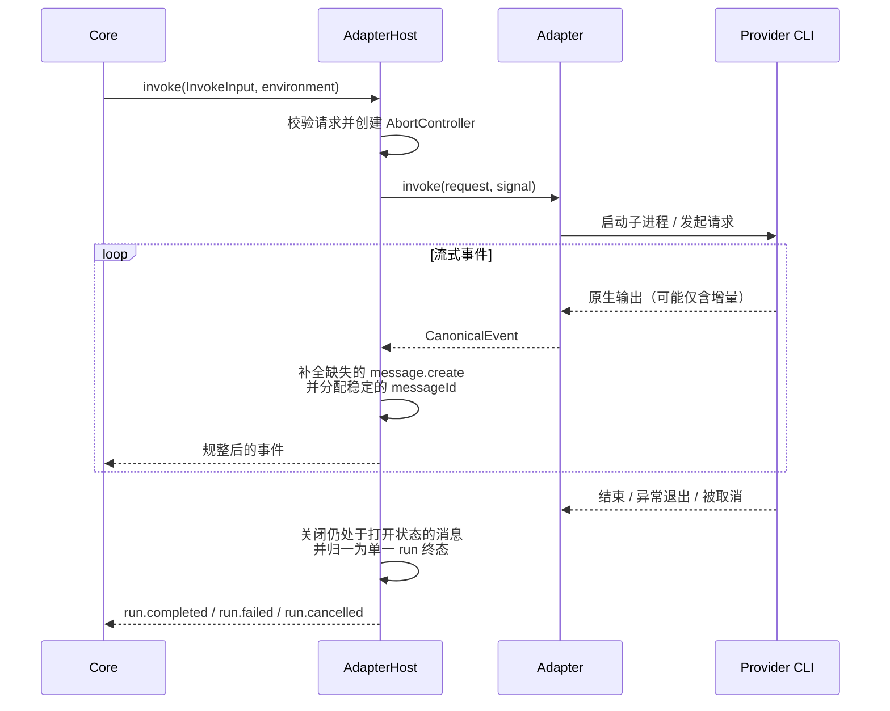

# @mininglamp-oss/octo-runtime-adapter-host

> #46 migration: execution now lives exclusively in
> `@mininglamp-oss/octo-runtime-executor-core` as `AgentExecutor`. This package
> retains the transitional worker, NDJSON RPC, launcher and bounded source
> window. Its `AdapterHost` export aliases that same class. Explicit direct
> consumers use `@mininglamp-oss/octo-runtime/executor-core`; see
> [Core API and failure domain](../octo-runtime-executor-core/README.md).
> The new ExecutorKernel package and supervision are tracked by #47.

> 全局 Context 约束：本轮模型上下文由业务方选择，selection 等业务项可不发送，可传空或显式重复。必要执行配置独立校验且不注入 LLM。底层只转发并渲染本轮数据，不按 sessionId 缓存、补齐、合并、去重或省略；reset／新 Provider 会话／resume 失败后由业务方重新提供必要背景。见 [分类矩阵](../../.octospec/rules/context-input.md) 与 [IPD-SE](../../.octospec/rules/context-input.md)。Host 仅按白名单 pattern 保序拼接，不做业务检查或编译。

Octo Runtime 的适配器宿主（Adapter Host）：统一管理各 provider 适配器的注册与调用，并在调用边界上保证消息生命周期完整、事件合法、且每次运行只产生一个终态事件。

## 定位与职责

不同的 Agent provider（Codex、Claude Code、CodeBuddy、OpenCode 等）在事件格式、生命周期语义和取消方式上存在显著差异：部分只输出增量文本而不标记消息的开始与结束；部分在异常退出时不产生任何收尾事件；取消机制也各不相同。若由领域核心（`octo-runtime-core`）直接对接这些差异，核心逻辑会被大量 provider 分支污染，且每接入一个新 provider 都需改动核心。

适配器宿主将这些差异收敛在单一边界上，提供模式声明、接纳、调用、取消与对应模式的交互响应。默认 native 交付真实原生载荷及独立 Host 控制帧；显式 canonical 提供统一事件视图。两个模式共用执行与资源清理，并以唯一 Host 控制终态收尾。

宿主本身不涉及排队、调度、持久化或业务建模，这些职责属于 daemon 与 core。

## 工作原理

调用方传入统一的 `InvokeInput` 并显式选择 canonical。只有 Host 解析执行配置并生成内部 Adapter 请求。以下流程说明 canonical 消费；native 保留 Provider 消息，不执行 Canonical 转换。



规整过程遵循三条约束：

1. **消息生命周期完整**：即使适配器仅发送 `message.delta`，宿主也会补全起始的 `message.create` 与结束的 `message.update`，并确保同一条消息始终使用同一 `messageId`，使上层无需自行推断消息归属。
2. **终态唯一**：正常结束为 `run.completed`，错误为 `run.failed`，取消为 `run.cancelled`；缺失 Provider 终态报告失败。完整帧流另外携带唯一 Host 控制终态，连接结束本身不能作为成功依据。
3. **取消经由 AbortSignal**：`cancel(invocationId)` 触发对应调用的 `AbortController`，由适配器负责将其传导至子进程或协议层；上层无需了解 provider 的进程模型。

适配器宿主作为 daemon 启动的独立子进程运行：宿主进程内的 `AdapterHostRpcServer` 依据 manifest 加载适配器并对外提供服务，daemon 通过 `spawnAdapterHost` 建立 `AdapterHostRpcClient`，两者以 stdio 上的 NDJSON JSON-RPC 2.0 通信。这条子进程边界是宿主的运行方式，Core 面向的始终是同一组 `invoke/list/cancel` 契约。

## 使用

### 独立进程入口

CLI daemon 与 SDK 都通过 package exports 解析 `@mininglamp-oss/octo-runtime-adapter-host/runner`，用 Node 启动独立子进程。`apps/` 只保留 CLI 与 daemon，不再另建 Host app。runner 读取 manifest、动态加载并校验 Adapter、启动 stdio RPC server；库提供注册、调用生命周期、RPC 和子进程管理。

```text
CLI → UDS / Pipe → daemon → stdio NDJSON JSON-RPC → package runner → Provider Adapter
```

一个 daemon 共享一个 Host 子进程，Host 按 manifest 加载多个 Adapter 模块；不是每个 Adapter 或每次调用启动一个常驻 Host。Provider CLI 进程由各 Adapter 管理。daemon 继续保留 Host 就绪握手、取消、异常收口与重启监督；Host 重启不重放中断调用。

独立进程用于隔离 Adapter 加载或崩溃对 daemon 的影响，不是安全沙箱。多个 Adapter 仍共享 Host 进程和宿主用户权限。目录收敛不改变该进程边界，也不修改已有 Home、身份、profile 或配置。宿主指定的入口覆盖继续有效。

在源码仓库可用 `pnpm host` 单独运行 runner；正常使用只需启动 daemon。新增 Adapter 时在本包声明生产依赖并更新 manifest。

### 自定义宿主

CLI 的适配器由专属清单 `apps/cli/src/default_adapters.json` 声明；SDK 产品在自己的独立 Host 入口直接 import 并调用 `serveAdapterHost([adapter])`。正常运行时由 daemon 拉起 Host 子进程并与之通信。直接驱动 JSON 入口时使用 `spawnAdapterHost`；驱动代码入口时省略 `manifest`，将 `entrypoint` 指向自己的编译后 JS：

```ts
import { spawnAdapterHost } from "@mininglamp-oss/octo-runtime-adapter-host";
import type { InvokeInput } from "@mininglamp-oss/octo-runtime-protocol";
import { fileURLToPath } from "node:url";

const host = await spawnAdapterHost({
  entrypoint: fileURLToPath(import.meta.resolve("@mininglamp-oss/octo-runtime-adapter-host/runner")),
  manifest: "apps/cli/dist/default_adapters.json"
});

const input: InvokeInput = {
  invocationId: "invoke-1",
  sessionId: "session-1",
  sessionGeneration: 0,
  runId: "run-1",
  inputs: [{ type: "text", text: "Inspect this repository" }],
  workdir: process.cwd(),
  controlInstructions: "",
  contexts: { schema: "octo.context-envelope/v3", items: [] },
  protocol_mode: "canonical",
  approvalMode: "full_access",
  agentSource: "provisioned",
  agentConfig: {}
};

for await (const event of host.client.invoke({ ...input, protocol_mode: "canonical" }, { signal: AbortSignal.timeout(120000) })) {
  console.log(event.type, event.payload);
}

await host.close();
```

省略 `protocol_mode` 时，`invoke` 返回 native `HostFrame`，不运行 canonical 转换器。
`invokeFrames` 在两种模式下都返回带身份与连续序号的完整帧；显式 canonical 的 `invoke`
是 `canonicalEvents` 类型化视图。两者使用相同 input/environment；只有 Host 解析执行配置，RPC 只传输。模式与实际执行支持在 ACK 前校验，私有接纳逻辑不启动 Provider。signal 不序列化，由客户端映射为取消 RPC。
当前执行的原生反向请求通过 `respondNative(invocationId, { requestId, payload })` 回复，
`payload` 为完整 Provider 响应。终态、过期、重复响应和扩大授权范围的响应均拒绝。
本地 native 支持 Codex app-server 和 Claude stream-json；其他 Adapter 声明 canonical-only。

`spawnAdapterHost` 以首次 `list` 成功作为就绪握手：manifest 错误或可执行文件缺失会在此阶段即时暴露，而非延迟到首次调用。

### Provider 输出容量

Host 默认接纳最大 16 MiB 的 Provider 原始消息和 20 MiB 的完整 HostFrame；Adapter/RPC
单 invocation 队列为 32 MiB / 4096 项，单 Run 重放窗口为 32 MiB / 4096 帧，全局重放窗口为
128 MiB。所有边界保持有界，容量错误不会自动重试。

CLI manifest 可在受信的 Adapter 执行配置中覆盖这些值；每项硬上限是默认值的 2 倍，无效配置会使 Host 配置加载失败：

```json
{
  "execution": {
    "stream_limits": {
      "raw_message_max_bytes": 16777216,
      "host_frame_max_bytes": 20971520,
      "adapter_queue_max_bytes": 33554432,
      "rpc_queue_max_bytes": 33554432,
      "replay_run_max_bytes": 33554432,
      "replay_global_max_bytes": 134217728
    }
  }
}
```

未列出的字段使用中央默认值。覆盖只影响后续 invocation；配置不能来自 Context、聊天正文或
`agent_config.providerOptions`。

## 约束与注意事项

模型阶段的 canonical 事件静默时限默认是 **300 秒**（`modelIdleTimeoutMs: 300_000`）。
调用方可通过 `InvokeRequest.runtimeLimits.modelIdleTimeoutMs` 显式覆盖。
显式值优先，未覆盖字段使用各自默认值；字段和执行行为见
[watchdog.ts](../octo-runtime-executor-core/src/watchdog.ts)。

- **独立进程并非安全沙箱**：同一宿主内的多个适配器仍共享同一 Node.js 进程与宿主账号。强隔离需依赖容器、独立系统用户或“一适配器一进程”。
- **同类型适配器不可重复注册**：`register` 对重复的 `metadata.type` 直接抛错。
- **`probe` 仅做能力探测**：未实现 `probe` 的适配器返回“未校验但可用”，不代表 provider 实际可运行。

## 相关文档

- 事件契约与三层事件模型：[Protocol](../octo-runtime-protocol/README.md)
- 跨进程 RPC 时序与多节点设想：[Transport And Multi-node](../../.octospec/rules/local-execution.md)
- 整体架构：[Architecture](../../.octospec/rules/architecture.md)

## 模块责任边界

- 负责：独立 worker 与 AdapterHostRpc 传输，委托 AgentExecutor 执行 invoke、cancel、probe 和交互响应。
- 不负责：Worker 注册、IM 消息、群聊和业务调度。
- 协作边界：见 [根架构与包边界](../../README.md#模块责任边界)。所有执行来源共用 adapter-host IPC；模块按职责提供协议、执行或宿主能力。
