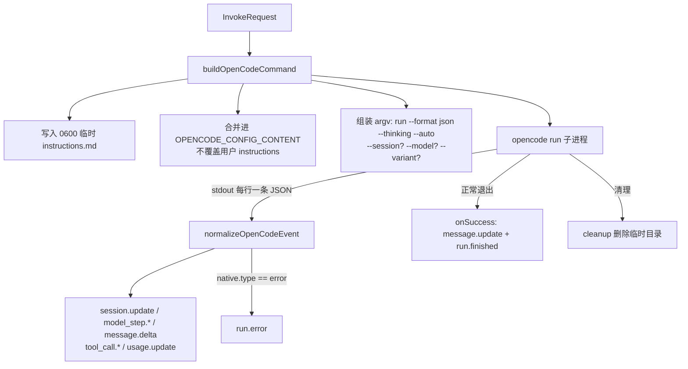

# @mininglamp-oss/octo-runtime-adapter-opencode

> 全局 Context 约束：本轮模型上下文由业务方选择，selection 等业务项可不发送，可传空或显式重复。必要执行配置独立校验且不注入 LLM。底层只转发并渲染本轮数据，不按 sessionId 缓存、补齐、合并、去重或省略；reset／新 Provider 会话／resume 失败后由业务方重新提供必要背景。见 [分类矩阵](../../.octospec/rules/context-input.md) 与 [IPD-SE](../../.octospec/rules/context-input.md)。Host 仅按白名单 pattern 保序拼接，不做业务检查或编译。

Octo Runtime 的 OpenCode 适配器：将本地 OpenCode CLI 接入统一的 Runtime 调用模型，组装并执行单次 `opencode run --format json --thinking --auto`，并将其逐行输出的 JSON 事件翻译为 Runtime 的 canonical event。

Adapter type：`opencode`

## 定位与职责

OpenCode 是“单次执行后退出”的 CLI：将 prompt 作为命令行参数传入，以 `--format json` 模式在 stdout 上逐行输出 JSON 事件（模型输出、工具调用、token 用量等），执行完毕即退出。

将其接入 Runtime 需解决以下具体问题：

- 如何注入 Runtime 的上下文，同时不破坏用户既有的 OpenCode 配置；
- 其 JSON 事件采用 OpenCode 自有格式（`step_start`、`text` part、`tool` part 的 `state.status` 等），上层无法识别；
- 执行完毕即干净退出，不发出“结束”事件，需由适配器补全收尾；
- 作为无人值守的本地 coding runtime，工具调用必须自动批准，不能等待交互式授权。

本适配器处理上述全部问题：以临时文件注入上下文、翻译 JSON 事件、在成功退出时合成收尾事件，并无条件附加 `--auto`。它不管理 OpenCode 的 provider 账号，也不会将 OpenCode 自身的 agent 概念自动映射为 Runtime Agent。

需与 OpenClaw 区分：OpenCode 与 OpenClaw 是两个不同的适配器、两个不同的可执行文件、两套不同的 session 格式。

## 工作原理

`buildOpenCodeCommand` 先组装 argv 与环境变量，JSON CLI 助手启动子进程，`normalizeOpenCodeEvent` 将每行 JSON 翻译为 canonical event，进程正常退出时 `onSuccess` 补全收尾。



翻译规则（`normalizeOpenCodeEvent`）如下：

1. `step_start` 映射为 `model_step.started`，并同时通过 `session.update` 记录 OpenCode session ID；
2. `text` part 映射为 final `message.delta`；
3. `reasoning` part 映射为 `analysis/public_reasoning` 的 `message.delta`，进入消息卡片的思考区域；
4. `tool` part 的 `state.status === "running"` 映射为 `tool_call.create`；`completed` 与 `error` 映射为 `tool_call.update`；
5. `step_finish` 映射为 `model_step.finished` 与 `usage.update`（含 finish reason、provider 时间戳、tokens 与 cost）；
6. `error` 事件映射为 `run.error`（内联发出，这是唯一由 normalizer 直接产出的终态）；
7. 进程正常退出但 provider 未给出终态时，`onSuccess` 合成 `message.update` 与 `run.finished`。

## 使用

首先启动 daemon：

```bash
cd /absolute/path/to/octo-runtime
pnpm daemon
```

在另一终端中探测可用性：

```bash
pnpm cli adapter probe opencode
```

Agent Worker 在 Agent revision 中保存该 execution profile。业务服务提交统一
AgentRun；adapter 从 Worker AgentSession 的 opaque provider session 读取 OpenCode
session ID 并通过 `--session` 恢复。

## 配置

| Agent revision 配置      | `agentConfig` 字段 | 拼入命令行                                                   |
| ------------------------ | ------------------ | ------------------------------------------------------------ |
| `--workdir DIR`          | `workdir`          | 子进程 cwd；本身不构成文件访问隔离                           |
| `--model provider/model` | `model`            | `--model provider/model`                                     |
| `--thinking LEVEL`       | `thinking`         | `--variant LEVEL`；具体可用值由 OpenCode provider/model 决定 |
| `--auto-approve`         | `autoApprove`      | 兼容保留；adapter 已强制传入 `--auto`                        |

实际命令形态：首次 turn 为 `opencode run --format json --thinking --auto [--model …] [--variant …] <prompt>`；后续 turn 会附加 `--session <provider-session-id>` 以恢复会话。Adapter 无条件传入 `--thinking`，确保 reasoning block 写入 JSON stdout；无条件传入 `--auto`，避免无人值守调用停在权限确认；可选的 `--variant` 只控制 provider-specific reasoning 档位。

## 模型配置与环境变量

Agent Revision 使用 `execution_profile.agent_config.model`，adapter 每轮映射为 `--model provider/model`，包括 `--session` 恢复路径。值必须使用 OpenCode 的完整 `provider_id/model_id` 形式；未设置时使用 OpenCode 配置中的 `model`。

OpenCode 没有固定的专用默认模型环境变量。`OPENCODE_CONFIG` 可指定配置文件，`OPENCODE_CONFIG_CONTENT` 可直接注入 JSON 配置；用户也可以在配置中用 `{env:NAME}` 引用任意自定义变量。Adapter 本身已使用 `OPENCODE_CONFIG_CONTENT` 合并 instructions，并用显式 `--model` 选择 Revision 模型。参考 [OpenCode configuration](https://dev.opencode.ai/docs/config/)。

## 约束与注意事项

- **`--auto` 具有危险性且由此 adapter 强制开启**：provider 会自动批准未被显式拒绝的权限（可直接修改文件）。因此只能把该 adapter 部署在受控 workdir 与具备外部隔离的节点上。
- **用户 prompt 出现在 argv 中**：同机的进程检查工具可能读取到它，不适合承载 secret。若需更强的隐私保障，应改用 OpenCode server/API 或引入 stdin carrier，而非假定 argv 已被隐藏。
- **上下文经临时文件注入**：`appendInstructions` 写入一个 `0600` 临时 Markdown，追加到 `OPENCODE_CONFIG_CONTENT` 中已有的 `instructions` 列表末尾，合并结果注入子进程环境，不覆盖用户原有配置。`OPENCODE_CONFIG_CONTENT` 必须为合法 JSON，非法值将在 spawn 前失败。
- **每次 invocation 均为一次性子进程**，无常驻 daemon。生产模式下 session ID 由 Worker 的 AgentSession 保存，下一次 AgentRun 自动经 `--session` 恢复。
- **reasoning 是显式展示内容**：Adapter 无条件传入 `--thinking`，因此将 OpenCode 主动输出的 reasoning block 归入 analysis channel 并标记 `exposure=public_reasoning`，使其进入消息卡片的思考区域；其他 provider 的 `private_reasoning` 仍保持不可见。
- **卡片按模型轮次组织**：同一 OpenCode `messageID` 下的 reasoning、tool 与 text 共享 `stepId`。Worker 可据 `model_step.started/finished` 将它们归入同一轮；最终 `text` 仍是独立正文，不会被重复标成“总结”。
- **未暴露 OpenCode 的 `--fork` 与 `--agent` 等原生能力**。公共 CLI 的 `--provider-agent` 目前仅被 OpenClaw 适配器消费，不能用于配置 OpenCode agent。
- **`probe` 仅检查可执行文件是否存在**，不验证 provider 凭证、模型或网络。取消由 host 保证最终仅发出一个 `run.stopped`；当前通用 subprocess runtime 尚不具备完整的进程组回收保证。

## 相关文档

- 事件修整与终态兜底：[Adapter Host](../octo-runtime-executor-kernel/README.md)
- Provider adapter 总览：[Provider Adapters](../../.octospec/guides/providers.md)
- Prompt 与 workdir 约定：[Prompt And Workdir](../../.octospec/rules/context-input.md)
- Adapter 编写指南：[Adapter Authoring](../../.octospec/guides/adapter-authoring.md)

## 模块责任边界

- 负责：将 opencode 原生执行协议映射为 InvokeRequest / CanonicalEvent，由 adapter-host 调用。
- 不负责：Worker/IM WS、聊天历史、Event/AgentRun 登记。
- 协作边界：见 [根架构与包边界](../../README.md#执行结构)。隔离入口共用 Kernel IPC 和 worker，显式 direct 模式使用同一 AgentExecutor；模块按职责提供协议、执行或宿主能力。
