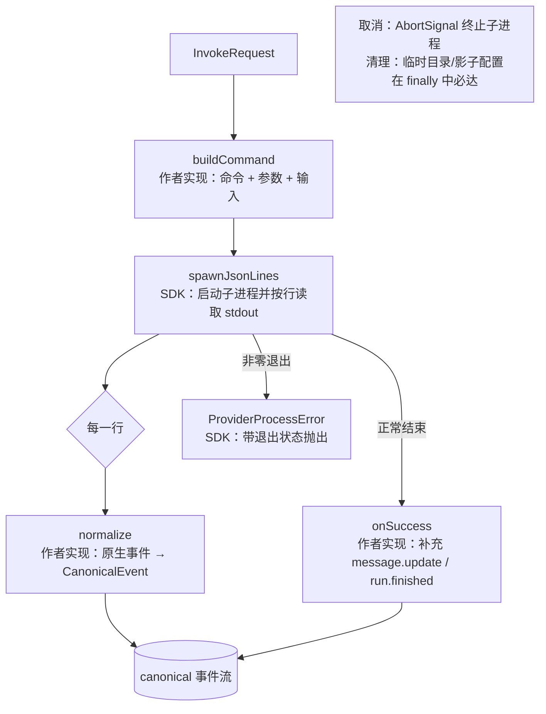

# @mininglamp-oss/octo-runtime-adapter-sdk

> 全局 Context 约束：本轮模型上下文由业务方选择，selection 等业务项可不发送，可传空或显式重复。必要执行配置独立校验且不注入 LLM。底层只转发并渲染本轮数据，不按 sessionId 缓存、补齐、合并、去重或省略；reset／新 Provider 会话／resume 失败后由业务方重新提供必要背景。见 [分类矩阵](../../.octospec/rules/context-input.md) 与 [IPD-SE](../../.octospec/rules/context-input.md)。Host 仅按白名单 pattern 保序拼接，不做业务检查或编译。

Octo Runtime 的适配器开发 SDK。多数 provider CLI 的形态一致——接收一段输入、按行输出 JSON——本包将这类适配器的通用流程（启动子进程、按行读取、解析、取消、清理）沉淀为若干工具函数，使适配器作者只需实现 provider 特有的部分。

## 定位与职责

若每个 provider 适配器都从零实现，将反复出现相同的样板代码：启动子进程、按行读取 stdout、将 `AbortSignal` 接入进程终止、确保临时文件在成功/失败/取消后均被清理、在退出码非零时报错等。

本 SDK 将这些通用逻辑封装为工具函数。接入一个“JSON 流式 CLI”型 provider 时，适配器作者真正需要实现的仅有三处 provider 特有逻辑：如何构造命令、如何将原生事件翻译为 `CanonicalEvent`、以及结束时补充何种终态。

双模式 Driver 在同一条执行链中读取 `AdapterInvocationContext.protocolMode`。
native 输出 `DriverFrame` 原始对象及独立控制事实，canonical 才创建每次执行独享的 Normalizer。
`DriverQueue` 和 `NativeInteractionBridge` 提供有界缓冲、当前 pending 请求关联、写入确认和过期清理。
`defineAdapter` 默认声明 canonical-only；提供原生出口的 Driver 必须明确声明 `protocolSupport`。
Host 注册阶段校验该声明，不从 Provider 名称或 payload 推断模式。

## 工作原理

`createJsonCliAdapter` 固定通用流程，并将 provider 差异保留为若干回调：



若干约定：

1. **适配器只处理 provider 差异**：命令、权限、会话编解码与原生事件映射均留在适配器内，通用运行时不予涉及。
2. **一行一个原生事件**：运行时仅负责按行读取，如何解析、忽略哪些噪声由 `normalize` 决定。
3. **prompt 载体显式**：用户 prompt、控制指令、环境变量与临时配置由适配器分别映射（以 `providerInputText(request)` 取应发送给模型的文本）。
4. **取消经由 AbortSignal，清理经由 `finally`**：成功、失败、取消三种路径均会执行清理。

## 使用

一个最小适配器：

```ts
import {
  createJsonCliAdapter,
  probeCommand,
  providerInputText,
  type CanonicalEvent
} from "@mininglamp-oss/octo-runtime-adapter-sdk";

interface NativeEvent {
  type?: string;
  text?: string;
}

export const exampleAdapter = createJsonCliAdapter<NativeEvent>({
  metadata: { type: "example", agentSources: ["provisioned"] },
  probe: () => probeCommand("example-cli"),
  buildCommand: (request) => ({
    command: "example-cli",
    args: ["--json"],
    cwd: request.workdir,
    input: providerInputText(request)
  }),
  normalize: (native): CanonicalEvent[] =>
    native.type === "text" ? [{ type: "message.delta", payload: { text: native.text ?? "" } }] : [],
  onSuccess: () => [
    { type: "message.update", payload: { status: "completed" } },
    { type: "run.finished", payload: {} }
  ]
});
```

## 约束与注意事项

- 仅适用于“一次调用对应一个 CLI 子进程、且以 JSON/JSONL 流式输出”的 provider。
- 若 provider 使用双向 JSON-RPC、WebSocket 或常驻 daemon（如 Codex app-server、CodeBuddy 的 ACP），则不应使用 `createJsonCliAdapter`，而应直接实现 `Adapter` 接口，可参考 codex / codebuddy 适配器。

## 相关文档

- 注册、测试与文档要求：[Adapter 开发指南](../../.octospec/guides/adapter-authoring.md)

## 模块责任边界

- 负责：提供适配器共用的进程、流解析和事件辅助工具。
- 不负责：Daemon 生命周期、IM/Worker 接入。
- 协作边界：见 [根架构与包边界](../../README.md#执行结构)。隔离入口共用 Kernel IPC 和 worker，显式 direct 模式使用同一 AgentExecutor；模块按职责提供协议、执行或宿主能力。
